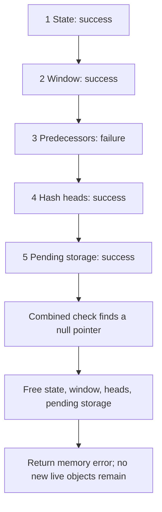

[State operations](/sample/state-operations.html) began with a live stream that could continue, reset or copy its task. Where does that live stream obtain storage? Who owns its byte window, search index and decoding tables, and who frees them on failure? Those questions determine whether the algorithm can safely start and end.

Init receives the caller's `z_stream`, parameters, version information and allocator fields. It returns a status and may attach newly allocated private state. It does not process message bytes. Under the selected default allocator, a successful compressor owns five allocations; a newly initialized ordinary decoder owns one. Input and output remain caller objects.

First connect each allocation to the algorithmic work it supports. Then follow two failures: a compressor's third request fails while later requests succeed, and a decoder writes output before failing to allocate a retained window. Each permitted successful or failed outcome needs an exact account of resources and output.

This chapter uses the default allocator and includes allocation failure. The complete lifetime composition is unfinished. Custom callbacks, other layouts and platform limits have explicit scope in the [configuration reference](/reference/docs/spec/input-configurations.html) and [safety requirements](/reference/docs/spec/safety.html).

## Working storage acquired by compressor Init {#compressor}

To find repeated message bytes, the compressor needs a history window and a searchable index of earlier positions. To emit compressed bytes, it also needs pending output and temporary symbols. These jobs explain the five allocations, before their sizes matter.

Successful [deflateInit2_](/reference/functions/deflateInit2_.html) owns five allocations: a state record, window, predecessor array `prev`, hash-head array `head`, and pending storage. Tree arrays, heap/depth arrays and their descriptors belong to the state record. The caller's `z_stream`, input/output and optional gzip metadata remain borrowed objects, not extra allocations to release with End.

For the default window and memory settings, the four buffers below each occupy 65536 bytes, although their elements and jobs differ. To compare other accepted settings, first distinguish the two controls. `w_bits` is the base-two exponent of the history-window scale; 15 means `2^15 = 32768` bytes. `memLevel` is a memory-budget setting that controls the hash index and temporary symbol storage, not the effort chosen by compression level. Write `W = 1 << w_bits` for that history scale in bytes and `B = 1 << (memLevel + 6)` for the symbol-capacity parameter in records. Here `1 << k` means `2^k`. The physical byte array needs `2W` bytes for history and unprocessed input together. The selected packed-symbol layout has:

| Allocation | Extent | Default dimensions |
| --- | --- | --- |
| State | One `deflate_state` record | Contains control fields and embedded trees |
| Window | `2W` bytes | 65536 bytes at window bits 15 |
| `prev` | `W` positions, two bytes each | 65536 bytes |
| `head` | `1 << (memLevel + 7)` positions | 32768 positions, 65536 bytes at memory level 8 |
| Pending | `4B` bytes | 65536 bytes with `B = 16384` |

Symbols begin at `pending_buf + B`; they are not a sixth allocation. Each record occupies three bytes. The [shared-storage chapter](/sample/storage.html) explains when consumed records make room for output. `memLevel` changes hash and symbol capacity; the compression level instead changes strategy/search settings. The zlib window request 8 is normalized to 9. Actual parameter acceptance, normalization and refusals belong to the full [initialization contract](/reference/functions/deflateInit2_.html).

For example, a fresh window may contain arbitrary bytes, but the compressor has not yet accepted them as message input. A search cannot justify a match merely because its index fits inside that allocation. `head` identifies candidate history chains and `prev` links older positions; only the chains established by real insertion may be followed.

Allocation acquires capacity, not meaningful content everywhere. The state record is explicitly zeroed. `lm_init` clears hash heads and establishes counters; it does not initialize every predecessor slot. `high_water` tracks established window bytes. Later searches need their own written-position argument rather than treating an allocated array as entirely initialized.

## When the third allocation fails {#failure}

After compatible version/structure checks, compressor initialization validates parameters before allocation. If the state allocation succeeds, it then attempts all four buffers **before testing their combined result**. An early buffer failure does not stop later requests.

To include out-of-memory behavior, the proof model specifies an outcome for each allocation attempt. This sequence is called an allocation oracle; it does not assume that one failed request makes every later request fail. Take this concrete sequence:

| Attempt | Object | Outcome |
| --- | --- | --- |
| 1 | State | Success |
| 2 | Window | Success |
| 3 | `prev` | Failure |
| 4 | `head` | Success |
| 5 | Pending | Success |

The arrows below follow the actual attempt order. A failure at request 3 still leads to two more requests; release happens only after the combined check.



The next excerpt names the size parameter `lit_bufsize`, which is `B` above, and requests `LIT_BUFS = 4` bytes per unit in this layout. Thus `ZALLOC` requests `4B` bytes for `pending_buf`; `pending_buf_size` records that byte capacity. `Z_NULL` is the C null-pointer marker. A null result identifies a request that did not obtain storage.

Read this as a complete schedule, not “stop at the first failure.” The C makes the [window, predecessor and head requests](https://github.com/madler/zlib/blob/757f0527154291bcf6bfbd6396ecde6bedd2db95/deflate.c#L457-L459) before reaching the later pending request. Only [after that request](https://github.com/madler/zlib/blob/757f0527154291bcf6bfbd6396ecde6bedd2db95/deflate.c#L504-L512) does it test all four pointers. This selected excerpt is verbatim:

```c
s->pending_buf = (uchf *) ZALLOC(strm, s->lit_bufsize, LIT_BUFS);
s->pending_buf_size = (ulg)s->lit_bufsize * 4;

if (s->window == Z_NULL || s->prev == Z_NULL || s->head == Z_NULL ||
    s->pending_buf == Z_NULL) {
    s->status = FINISH_STATE;
    strm->msg = ERR_MSG(Z_MEM_ERROR);
    deflateEnd (strm);
    return Z_MEM_ERROR;
}
```

In the table, `prev` is NULL but `head` and pending are live allocations. The combined test enters cleanup. `FINISH_STATE` allows cleanup without having initialized the successful compressor's full search state.

The failure branch must release pending, head, window and state, skipping the NULL predecessor pointer. It cannot clean up only the allocations preceding attempt 3. The source sets a cleanup-compatible status, records the memory message, calls [deflateEnd](/reference/functions/deflateEnd.html), and returns `Z_MEM_ERROR` with no new live owned block and a NULL stream state.

If attempt 1 itself fails, there are no buffer attempts and the old `state` field is retained. Preparing default callbacks and clearing `msg` can already have changed the stream. Even complete cleanup does not restore the allocation-attempt counter or fresh-identity counter. “No new live allocation” and “the whole heap is unchanged” are different conclusions.

The following smaller, two-resource model isolates the lifetime pattern. It is not the exact five-request schedule above; select the second failure, then compare successful initialization followed by End.

<div class="zl-demo-mount"><zlib-demo kind="ownership"><p>A teaching initializer acquires state and then window. A failed second allocation releases state; successful initialization retains both until End. The real compressor attempts four buffers before checking them.</p></zlib-demo></div>

The ledger pattern also applies to [deflateCopy](/reference/functions/deflateCopy.html), but copying has its own path. It must release every newly acquired destination allocation on failure and preserve the source. It cannot call cleanup on the source merely because the destination attempt failed.

## Delayed decoder-history allocation {#decoder}

A decoder can often use bytes it has just written into the caller's output buffer as match history during the same call. A private window is needed when suitable history must survive beyond that output buffer, so allocating it at every Init would sometimes be wasted work.

[inflateInit2_](/reference/functions/inflateInit2_.html) initially allocates only an `inflate_state`. Its code-length/work/decoding arrays are embedded in that record. The window pointer starts NULL. Static fixed decoding tables are shared read-only objects, not per-stream owned allocations.

The decoder delays the history-window allocation until an operation needs to retain or install history. [inflateSetDictionary](/reference/functions/inflateSetDictionary.html) can require it; normal decoding can allocate while committing recent output for continuation. A one-call `Z_FINISH` completion can avoid a window entirely. Avoiding an unnecessary allocation and history copy is the practical benefit of this lazy design.

Take a call that has written `ABAB` and must retain it to resume later. If creating the history window fails at that point, those four caller bytes do not disappear. The application has both an error status and a modified output destination.

This moves failure into a surprising place. `inflate` can already have consumed input and written caller output when window allocation fails. Its I/O pointers and available counts can reflect those effects, while normal final totals/checksum accounting is skipped. `Z_MEM_ERROR` therefore does not mean unchanged output. The live decoder remains endable; see the complete [inflate contract](/reference/functions/inflate.html).

For the following condition, `out` is a saved output-space count, not an output pointer. Subtracting the remaining `strm->avail_out` gives the bytes written since that baseline. `state->wsize` is the active history-window size in bytes; zero means it is not active yet. The mode constants `CHECK`, `BAD` and `MEM` mark trailer processing, malformed data and memory failure. Their ordered values let the condition decide when to retain output for a later call.

The order is visible in the [actual return path](https://github.com/madler/zlib/blob/757f0527154291bcf6bfbd6396ecde6bedd2db95/inflate.c#L1140-L1155). These selected lines come before the normal totals/checksum update:

```c
RESTORE();
if (state->wsize || (out != strm->avail_out && state->mode < BAD &&
        (state->mode < CHECK || flush != Z_FINISH)))
    if (updatewindow(strm, strm->next_out, out - strm->avail_out)) {
        state->mode = MEM;
        return Z_MEM_ERROR;
    }
```

`RESTORE()` has published the current buffer pointers/counts. `updatewindow` may then fail and return before the following `total_in`, `total_out` and check-value updates. For the `ABAB` scenario, neither “all fields rolled back” nor “all accounting was finalized” describes the error result. The exact path and its ownership still need proof.

Decoder initialization has a different error order from the compressor. It attempts state allocation before validating the window argument. An invalid window request can therefore produce `Z_MEM_ERROR` if allocation fails first. If allocation succeeds but the request is invalid, the new state is freed and `state` becomes NULL before `Z_STREAM_ERROR`. Version/structure rejection happens earlier still. These distinctions matter to callers and to the exact failure proof.

## Reuse for another task, or release with End {#release}

Suppose a service handles thousands of independent messages. End followed by Init would repeatedly release and reacquire buffers. Reset can instead retain their capacity while discarding the previous task's logical contents. Physical reuse saves allocation work; it does not make old bytes valid input to the next message.

[inflateReset](/reference/functions/inflateReset.html) can keep a compatible physical window while clearing its logical history. An incompatible window is freed; reset itself does not allocate its replacement. [deflateReset](/reference/functions/deflateReset.html) keeps its five allocations for another compression task. Reuse avoids repeated allocation work without implying that prior dictionary contents remain valid history.

[inflateEnd](/reference/functions/inflateEnd.html) frees the optional window and state, clears the state pointer, and returns `Z_OK` for a valid live decoder even if decoding was abandoned. [deflateEnd](/reference/functions/deflateEnd.html) frees all five allocations; `Z_DATA_ERROR` for busy unfinished compression is reported after release, not instead of release. A second End fails the stream check rather than freeing again.

For the compressor, [the actual End tail](https://github.com/madler/zlib/blob/757f0527154291bcf6bfbd6396ecde6bedd2db95/deflate.c#L1317-L1328) frees the buffers and state before choosing between `Z_DATA_ERROR` and `Z_OK`. Thus a busy task abandoned with `Z_DATA_ERROR` has still released its storage; retrying End does not complete compression. The caller's original buffers and already delivered bytes remain caller objects.

[inflateBackInit_](/reference/functions/inflateBackInit_.html) is a useful ownership contrast: its history window is supplied by the caller. [inflateBackEnd](/reference/functions/inflateBackEnd.html) releases the callback decoder's state, not that caller window. The [ownership proof chapter](/sample/ownership-proof.html) turns these actual object transitions into establishment, frame and exact live-block obligations.

## Preservation after failure {#proof-obligations}

The ownership promise has three parts. After successful Init, every new live object belongs to the stream until a specified transition releases it. After failed Init or Copy, no newly acquired live object is stranded and no unrelated old object is removed. After End, the removed set is exactly the stream's former owned set, including an optional window if one was acquired later. The output/frame promise is separate: a mid-decode allocation error may preserve newly written caller bytes. These are execution-proof obligations over all permitted allocation outcomes, not conclusions established by the teaching model or one allocation trace. See [current evidence](/reference/docs/progress.html) for acceptance scope.

The algorithm's windows, indexes and pending bytes now have concrete owners. The next chapter joins the five allocation requests, independent copies and End into [one ownership argument](/sample/ownership-proof.html): object identities determine which storage is released, and write regions determine which caller bytes may change.
