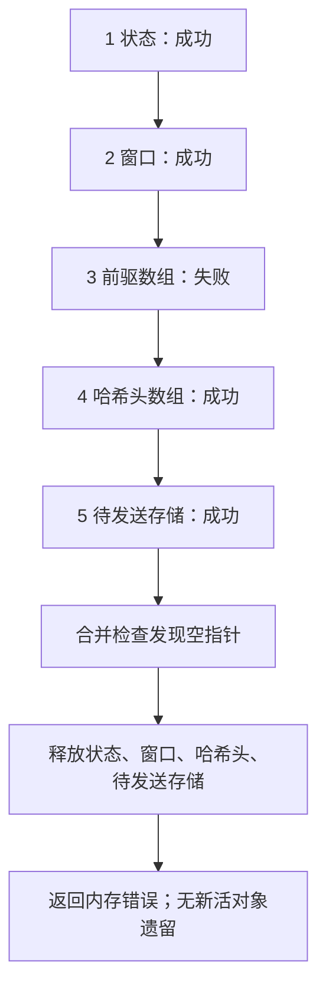

[状态操作](/sample/state-operations.html)从一个活流出发：继续、重置或复制当前任务。但活流本身从哪里获得存储？字节窗口、搜索索引和解码表各由谁拥有，失败时又由谁释放？这些问题决定了算法能否安全开始和结束。

初始化接收调用者的 `z_stream`、参数、版本信息和分配器字段，返回状态码，并可能把新分配的私有状态挂到流上。它不处理消息字节。在选定的默认分配器下，成功压缩器拥有五项分配；刚初始化的普通解码器拥有一项。调用者的输入和输出仍归调用者。

先把每项分配接回它支持的算法工作，再跟踪两个失败：压缩器第三次分配失败，后面的请求却仍成功；解码器已经写出输出，随后才因保留窗口分配失败。每次允许的成功或失败结果，都需要精确的资源和输出说明。

本章使用默认分配器并包含分配失败。完整生命周期组合尚未完成。自定义回调、其他布局和平台限制的具体范围见[配置参考](/reference/docs/spec/input-configurations.html)与[安全要求](/reference/docs/spec/safety.html)。

## 压缩器初始化获得的工作存储 {#compressor}

压缩器要找出重复的消息字节，需要历史窗口和能搜索旧位置的索引。要发射压缩字节，还需要待发送输出和临时符号。先理解这些用途，再看五项分配的尺寸。

成功的 [deflateInit2_](/reference/functions/deflateInit2_.html)拥有五项分配：状态记录、窗口、前驱数组 `prev`、哈希头数组 `head` 和待发送字节存储。树数组、堆/深度数组及其描述符属于状态记录。调用者的 `z_stream`、输入／输出和可选 gzip 元数据仍是借用对象，不是结束操作要额外释放的分配。

默认窗口和内存设置下，下表的四个缓冲区各占 65536 字节，但元素和用途不同。比较其他可接受设置之前，先区分两个控制量。`w_bits` 是历史窗口尺度以二为底的指数；15 表示 `2^15 = 32768` 字节。`memLevel` 是控制哈希索引和临时符号存储的内存预算设置，不是决定搜索力度的压缩级别。用 `W = 1 << w_bits` 表示以字节计量的历史尺度，用 `B = 1 << (memLevel + 6)` 表示以记录计量的符号容量参数。这里 `1 << k` 表示 `2^k`。实际字节数组需要 `2W` 字节，同时容纳历史与未处理输入。选定的打包符号布局如下：

| 分配 | 范围 | 默认尺寸 |
| --- | --- | --- |
| 状态 | 一个 `deflate_state` 记录 | 包含控制字段和内嵌树 |
| 窗口 | `2W` 字节 | 窗口位数 15 时为 65536 字节 |
| `prev` | `W` 个位置，每个两字节 | 65536 字节 |
| `head` | `1 << (memLevel + 7)` 个位置 | 内存级别 8 时为 32768 个位置、65536 字节 |
| 待发送存储 | `4B` 字节 | `B = 16384` 时为 65536 字节 |

符号从 `pending_buf + B` 开始，并非第六项分配。每个记录占三字节。[共享存储章节](/sample/storage.html)解释何时消费记录会为输出释放空间。`memLevel` 改变哈希和符号容量；压缩级别则改变策略/搜索设置。Zlib 窗口请求 8 会归一化为 9。实际参数接受、归一化和拒绝由完整[初始化契约](/reference/functions/deflateInit2_.html)规定。

例如，新窗口可以含任意字节，但压缩器还没有把它们接受为消息输入。索引位于已分配范围内，不足以证明找到了一项合法匹配。`head` 指出候选历史链，`prev` 连接较早位置；只有真实插入建立的链才允许被遍历。

分配获得容量，不使所有内容自动有意义。状态记录会显式清零。`lm_init` 清空哈希头并建立计数器，但不初始化每个前驱槽。`high_water` 跟踪已经建立的窗口字节。后续搜索仍需已写位置论证，不能把已分配数组当成全部初始化。

## 第三次分配失败之后 {#failure}

版本/结构检查兼容后，压缩器初始化先验证参数，再分配。状态分配成功后，它先尝试全部四个缓冲区，**然后才检查合并结果**。较早的缓冲区失败不会停止后面的请求。

为了涵盖内存不足，证明模型为每次分配尝试指定成功或失败的结果。这份序列称为分配预言机，并不假定某次失败之后所有请求都会失败。考虑这组具体结果：

| 尝试 | 对象 | 结果 |
| --- | --- | --- |
| 1 | 状态 | 成功 |
| 2 | 窗口 | 成功 |
| 3 | `prev` | 失败 |
| 4 | `head` | 成功 |
| 5 | 待发送存储 | 成功 |

下面把这次尝试画成实际执行顺序。第 3 项失败之后，箭头仍会经过后两次申请；释放发生在最后的合并检查之后。



下面节选中的尺寸参数 `lit_bufsize` 就是上面的 `B`；本布局的 `LIT_BUFS = 4` 表示每单位申请四字节。因此，`ZALLOC` 为 `pending_buf` 请求 `4B` 字节，`pending_buf_size` 记录这份字节容量。`Z_NULL` 是 C 的空指针标记，表示相应请求没有获得存储。

把这张表读作完整的请求顺序，而不是“第一次失败就停止”。C 先请求[窗口、前驱和哈希头](https://github.com/madler/zlib/blob/757f0527154291bcf6bfbd6396ecde6bedd2db95/deflate.c#L457-L459)，再到后面的待发送字节请求。只有[完成待发送字节请求之后](https://github.com/madler/zlib/blob/757f0527154291bcf6bfbd6396ecde6bedd2db95/deflate.c#L504-L512)，才一起检查四个指针。以下是逐字节选：

```c
s->pending_buf = (uchf *) ZALLOC(strm, s->lit_bufsize, LIT_BUFS);
s->pending_buf_size = (ulg)s->lit_bufsize * 4;

if (s->window == Z_NULL || s->prev == Z_NULL || s->head == Z_NULL ||
    s->pending_buf == Z_NULL) {
    s->status = FINISH_STATE;
    strm->msg = ERR_MSG(Z_MEM_ERROR);
    deflateEnd (strm);
    return Z_MEM_ERROR;
}
```

在表中的情形，`prev` 为 NULL，但 `head` 和待发送字节仍是活分配。合并检查进入清理。`FINISH_STATE` 让代码不必先建立成功压缩器的完整搜索状态，就能执行清理。

失败分支必须释放待发送存储、哈希头、窗口和状态，跳过 NULL 前驱指针。不能只清理第 3 次尝试之前的分配。源码设置适合清理的状态、记录内存错误消息，调用 [deflateEnd](/reference/functions/deflateEnd.html)，然后返回 `Z_MEM_ERROR`；没有新拥有的活块，流状态指针为 NULL。

如果第 1 次尝试就失败，不会再尝试缓冲区，原 `state` 字段保留。准备默认回调和清除 `msg` 此前可能已经改变流。即使完全清理，也不会恢复分配尝试计数或新对象身份计数。“没有新活分配”与“整个堆不变”是不同结论。

下面更小的双资源模型单独展示生命周期模式。它不是上面精确的五次请求顺序；选择第二次失败，再与成功初始化后结束操作比较。

<div class="zl-demo-mount"><zlib-demo kind="ownership"><p>教学初始化器先获得状态，再获得窗口。第二次分配失败时释放状态；成功初始化后保留两者直到结束操作。真实压缩器先尝试四个缓冲区，再合并检查。</p></zlib-demo></div>

这份账本模式也适用于 [deflateCopy](/reference/functions/deflateCopy.html)，但复制有自己的路径。失败时必须释放目标新获得的每项分配，并保持源不变。不能因为目标尝试失败，就清理源。

## 解码器历史的延迟分配 {#decoder}

解码器往往能在同一次调用里，直接用刚写入调用者输出缓冲区的字节作为匹配历史。只有需要让相应历史活过这份输出缓冲区时，才需要私有窗口。因此每次初始化都分配窗口，有时会做无用功。

[inflateInit2_](/reference/functions/inflateInit2_.html)起初只分配一个 `inflate_state`。码长、工作和解码数组内嵌于该记录。窗口指针从 NULL 开始。静态固定解码表是共享只读对象，不是每个流独立拥有的分配。

解码器把历史窗口分配延迟到需要保留或安装历史的操作。[inflateSetDictionary](/reference/functions/inflateSetDictionary.html)可能需要它；普通解码为后续执行提交近期输出时也可能分配。单次 `Z_FINISH` 完成可能完全不需要窗口。避免不必要分配和历史复制，就是这种延迟设计的实际收益。

考虑一次已经写出 `ABAB`、又必须保留历史以便稍后继续的调用。如果此时创建历史窗口失败，这四个调用者字节不会消失。应用同时得到错误状态和已被修改的输出目标。

它也把失败移到了意外的位置。窗口分配失败前，`inflate` 可能已经消费输入、写入调用者输出。输入／输出指针和可用计数可能反映这些效果，而正常的最终总计数/校验更新被跳过。因此，`Z_MEM_ERROR` 不表示输出不变。活解码器仍然可以结束操作；参见完整 [inflate 契约](/reference/functions/inflate.html)。

读下面条件时，`out` 是保存的输出空间数量，不是输出指针；减去剩余的 `strm->avail_out`，得到基线之后写出的字节数。`state->wsize` 是以字节计量的当前历史窗口大小，零表示尚未启用。模式常量 `CHECK`、`BAD`、`MEM` 分别表示尾部处理、畸形数据和内存失败；它们按顺序编号，条件据此决定是否为下一次调用保留输出。

[实际返回路径](https://github.com/madler/zlib/blob/757f0527154291bcf6bfbd6396ecde6bedd2db95/inflate.c#L1140-L1155)直接展示了顺序。以下节选位于正常总计数和校验值更新之前：

```c
RESTORE();
if (state->wsize || (out != strm->avail_out && state->mode < BAD &&
        (state->mode < CHECK || flush != Z_FINISH)))
    if (updatewindow(strm, strm->next_out, out - strm->avail_out)) {
        state->mode = MEM;
        return Z_MEM_ERROR;
    }
```

`RESTORE()` 已经发布当前缓冲区指针和计数。随后 `updatewindow` 可能失败，在后面的 `total_in`、`total_out` 和校验值更新之前返回。因此在 `ABAB` 的情形，“全部字段已回滚”与“全部计数已结算”都不能描述错误结果。具体路径及其所有权仍需证明。

解码器初始化的错误顺序不同于压缩器。它先尝试状态分配，再验证窗口参数。因此，如果分配先失败，无效窗口请求也可能得到 `Z_MEM_ERROR`。如果分配成功而请求无效，则释放新状态、将 `state` 置 NULL，再返回 `Z_STREAM_ERROR`。版本/结构拒绝更早发生。这些区别对调用者和精确失败证明都重要。

## 为下一项任务复用，或用结束操作释放 {#release}

假设一个服务需要处理数千条独立消息。每次结束操作后再初始化，就要反复释放和重新获得缓冲区。重置可以保留容量，丢弃上一项任务的逻辑内容。物理复用节省分配工作，却不使旧字节成为下一条消息的合法输入。

[inflateReset](/reference/functions/inflateReset.html)可以保留兼容的物理窗口，同时清空其逻辑历史。不兼容窗口会被释放；重置自身不分配替代品。[deflateReset](/reference/functions/deflateReset.html)为下一项压缩任务保留五项分配。复用省去重复分配工作，但不代表旧字典内容仍可作为有效历史。

[inflateEnd](/reference/functions/inflateEnd.html)释放可选窗口和状态，清空状态指针；对有效活解码器，即使解码被放弃也返回 `Z_OK`。[deflateEnd](/reference/functions/deflateEnd.html)释放全部五项分配；繁忙且未完成压缩的 `Z_DATA_ERROR` 在释放之后报告，而非代替释放。第二次结束操作会因流检查失败而拒绝，不会再次释放。

压缩器的[实际结束操作尾部](https://github.com/madler/zlib/blob/757f0527154291bcf6bfbd6396ecde6bedd2db95/deflate.c#L1317-L1328)先释放缓冲区和状态，再选择 `Z_DATA_ERROR` 或 `Z_OK`。因此，放弃繁忙任务得到 `Z_DATA_ERROR` 时，存储已经释放；重试结束操作不能完成压缩。调用者原有缓冲区和已交付字节仍属于调用者。

[inflateBackInit_](/reference/functions/inflateBackInit_.html)提供了有用的所有权对照：其历史窗口由调用者提供。[inflateBackEnd](/reference/functions/inflateBackEnd.html)释放回调解码器的状态，不释放调用者窗口。[所有权证明章节](/sample/ownership-proof.html)把这些实际对象转换为建立、框架条件和精确活块义务。

## 失败后的保持义务 {#proof-obligations}

所有权承诺分三部分。初始化成功后，每个新活对象都归流拥有，直到规定的转换释放它。初始化或复制失败后，不能遗留新获得的活对象，也不能移除无关旧对象。结束操作后，被移除的集合必须恰好等于流原来拥有的集合，包括后来才获得的可选窗口。输出和框架条件是另一项承诺：解码中途分配失败，可以保留新写入的调用者字节。这些都是覆盖允许分配结果的执行证明义务，不能由教学模型或一条分配轨迹建立。[当前证据](/reference/docs/progress.html)记录接受范围。

因此，算法章节里的窗口、索引和待发送字节现在都有了具体归属。下一章把五次分配、独立副本和结束操作接成[同一份所有权论证](/sample/ownership-proof.html)：对象身份说明释放的是哪一份存储，写入范围说明调用者的哪些字节允许改变。
