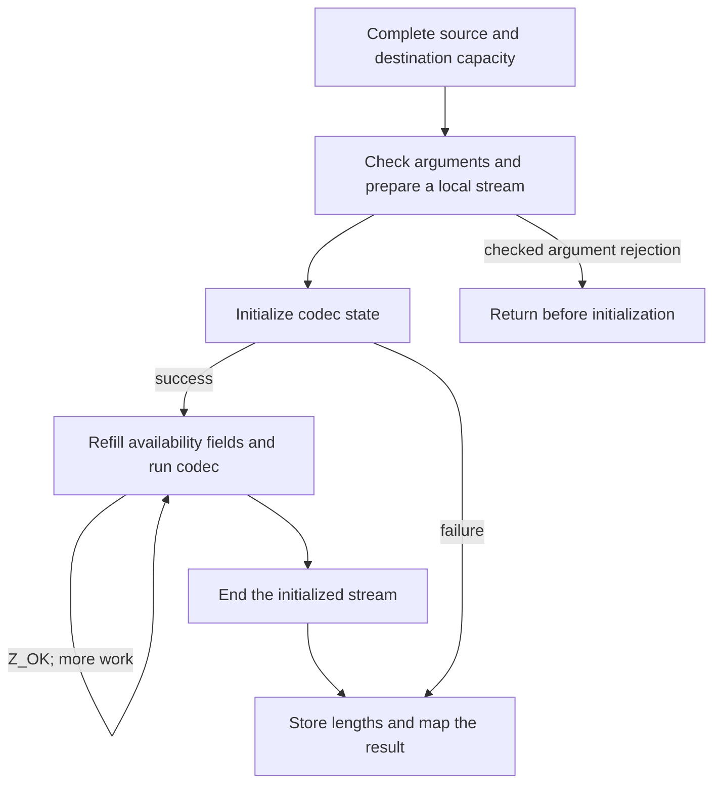

Suppose a record already contains all eight bytes `ABABABAB`. You want to store a complete compressed value in another memory buffer, then recover it without keeping a stream object between calls. Choose `compress2_z` and `uncompress2_z` for that task. The former receives all source bytes and a writable destination; the latter receives a complete **zlib-wrapped** value and a destination whose capacity the application already knows. Neither call returns a live codec to resume later.

## Compress a record, then find its boundary {#example}

This complete application example targets the pinned headers and library. It is teaching code, not a zlib source excerpt. Its input is eight bytes, without a string terminator. Compression capacity is 21; the actual encoding length is returned in `packed_len`. Three extra bytes model the next field in an enclosing record. Successful decoding must produce eight original bytes and stop before `END`.

```c
#include <string.h>
#include <zlib.h>

int main(void) {
    const unsigned char source[] = {'A','B','A','B','A','B','A','B'};
    unsigned char packed[24], restored[8];
    z_size_t packed_len = compressBound_z(sizeof source); /* 21 */
    int ret = compress2_z(packed, &packed_len, source, sizeof source,
                          Z_DEFAULT_COMPRESSION);
    if (ret != Z_OK) return 1;

    /* An enclosing record has three bytes after the zlib stream. */
    memcpy(packed + packed_len, "END", 3);
    z_size_t used = packed_len + 3, made = sizeof restored;
    ret = uncompress2_z(restored, &made, packed, &used);
    if (ret != Z_OK) return 1;
    return !(made == sizeof source && used == packed_len &&
             memcmp(restored, source, sizeof source) == 0 &&
             memcmp(packed + used, "END", 3) == 0);
}
```

The arrays have different roles: `source` is the original record, `packed` holds its compressed encoding and trailing field, and `restored` receives the decoded record. The length variables are measured in bytes and change meaning across a call: `packed_len` enters compression as capacity and returns as compressed size; `used` enters decompression as available input and returns as consumed size; `made` enters as output capacity and returns as produced size.

There is no `End` call in this program because each utility ends its own temporary stream. Returning on an error leaves the automatic caller arrays to their ordinary C lifetime. It does not leave a library stream for the application to repair. The example deliberately keeps both length cells separate from input, output and one another.

The rest of this chapter follows those calls into their implementation: why the capacity is 21, how the consumed boundary is calculated, and which failures can leave output. For an input that arrives gradually or an unknown decoded size, use the [stream route](/sample/interfaces.html) instead. [Callbacks](/sample/callbacks.html) and [gzip handles](/sample/gzip.html) solve different I/O tasks.

## A temporary stream {#temporary-stream}

`compress2_z` accepts source bytes, a destination, a length cell and a compression level. On entry, `*destLen` is the writable capacity. On return, it normally reports the number of bytes produced. A `Z_OK` result means that a complete **zlib-wrapped** stream was written. `compress_z` selects the default level; the plain `compress` and `compress2` names adapt the corresponding `uLong` arguments.



The local `z_stream` is automatic C storage. The codec's internal state is separately allocated and released before the utility returns. An unsuccessful compression call does not return a partially usable compressor that can later be resumed. To control continuation yourself, use the stream API.

There can still be an internal loop. The full buffer lengths use a wide type, while `avail_in` and `avail_out` use `uInt`, a 32-bit unsigned integer in the selected build, to count the current piece in bytes. The utility loads representable pieces into those availability fields and keeps the wider remaining lengths separately. Large input therefore does not require one availability value to contain its entire size. The loop preserves pointer movement and consumed/produced counts across its pieces. These source correspondences are **to confirm** through the [buffer implementation argument](/reference/docs/proof/buffers.html).

In the example, eight input bytes fit in one `uInt` piece. Once that piece has been offered, the wider `sourceLen` remainder is zero, so this actual [compress.c:60–65](https://github.com/madler/zlib/blob/757f0527154291bcf6bfbd6396ecde6bedd2db95/compress.c#L60-L65) excerpt selects `Z_FINISH`:

```c
        err = deflate(&stream, sourceLen ? Z_NO_FLUSH : Z_FINISH);
    } while (err == Z_OK);

    *destLen = (z_size_t)(stream.next_out - dest);
    deflateEnd(&stream);
    return err == Z_STREAM_END ? Z_OK : err;
```

The pointer difference becomes `packed_len`; `deflateEnd` releases internal state; the last line turns codec completion into utility success. The loop and cleanup explain why a single application call can require several codec calls without exposing continuation to the application.

## Capacity and integer widths {#capacity}

How much destination space should the application reserve? Let `n` be the number of original input bytes. `compressBound_z(n)` adds conservative room for encoding overhead to that count. In the expression below, `floor` means rounding down, and `SIZE_MAX` is the largest number representable by the size type `z_size_t`. Every term is a byte count. For the default buffer compressor, the numeric result is

```text
min(SIZE_MAX, n + floor(n/4096) + floor(n/16384) + floor(n/33554432) + 13)
```

For our eight-byte record all three floor terms are zero, so the result is `8 + 13 = 21`. The 24-byte array reserves those 21 bytes plus room for `END`. Allocate real writable storage, check that allocation, then place its capacity in the length cell before compression. The returned compressed size can be much smaller than the bound. A bound is a capacity promise under its stated compression configuration, not a prediction of the encoder's exact choice of matches or block type.

The saturation at `SIZE_MAX` matters. The formula must not wrap to a small number at the largest input values. A saturated number also does not mean that an addressable buffer of that size exists. The numeric formula, the existence of caller storage, and the theorem that actual compressed output fits that storage are three separate questions. The [bound contract](/reference/functions/compressBound_z.html) states the selected scope.

`_z` forms use `z_size_t`; the plain forms use `uLong` for these lengths. Both are 64 bits in the selected LP64 build, but that coincidence is not an API-wide rule for every platform. A caller must use the declared length type and avoid a narrowing conversion before the library sees the value. Queries about an initialized compressor's nondefault wrapper or settings belong to [deflateBound_z](/reference/functions/deflateBound_z.html), with its own conditions.

## Consumption and partial results {#results}

`uncompress2_z` uses two length cells. Initially they contain input availability and output capacity; after an initialized decode they report input consumed and output produced. It decodes the first zlib stream. If a compressed stream is followed by unrelated bytes, success leaves those trailing bytes unused, and the consumed count identifies their boundary. `uncompress_z` receives source length by value, so that boundary is not returned to the caller.

The utility tracks space not yet offered to its internal stream separately from space still unused in the current piece. Before the next excerpt, `len` counts input bytes not yet offered and `left` counts destination bytes not yet offered. Adding `stream.avail_in` and `stream.avail_out` includes the unused current pieces. Subtracting those totals from the original length cells yields actual consumption and production.

Here is the boundary calculation in [uncompr.c:72–75](https://github.com/madler/zlib/blob/757f0527154291bcf6bfbd6396ecde6bedd2db95/uncompr.c#L72-L75), copied verbatim:

```c
    len += stream.avail_in;
    left += stream.avail_out;
    *sourceLen -= len;
    *destLen -= left;
```

`len` combines input not yet offered with the current chunk's unread suffix. In our record that suffix is `END`, so subtracting the three unused bytes changes `used` from `packed_len + 3` to `packed_len`. Likewise, subtracting unused destination space leaves `made == 8`. The code counts real pointer progress; it does not search for the text `END`.

The decoder does not infer the required output allocation from the compressed length. A short compressed input can expand substantially. If the application cannot establish an adequate destination, streaming gives it a controlled way to receive successive output chunks.

The utility's result mapping is also more specific than “the underlying decoder returned an error.” A complete stream maps `Z_STREAM_END` to utility success `Z_OK`. A dictionary request maps to `Z_DATA_ERROR`, since this interface does not provide a dictionary-supply step. Input exhaustion that prevents completion is a data error; output-capacity exhaustion can be `Z_BUF_ERROR`. Malformed, truncated, raw and gzip input remain cases the zlib-only convenience decoder must handle through its error contract.

Change the example to a destination smaller than eight bytes and the same accounting becomes important on failure: already written bytes are not rolled back. In particular, a decoder allocation failure can follow partial output. After successful initialization, the counted utility records actual consumption and production even on that later failure. Early argument rejection and initialization failure instead retain the incoming length cells as specified. The [complete uncompress2_z entry](/reference/functions/uncompress2_z.html) gives the check order and zero-capacity cases.

Compression has a different length-write order. `compress2_z` checks some arguments before clearing its destination length, then initializes the stream. A bad level and an allocation failure can therefore leave length zero, while an earlier argument rejection preserves it. The plain `compress2` wrapper reads the length cell before calling the checked `_z` form. A nullable argument admitted by one entry cannot silently be carried over to another. Read [compress2_z](/reference/functions/compress2_z.html) and [compress2](/reference/functions/compress2.html) separately.

Across these outcomes, the intended lifetime is simple: a successful initialization creates an end obligation, and the utility performs that cleanup before returning. It preserves the caller's input and unrelated storage; caller buffers and scalar cells remain caller-owned. Length cells must satisfy the documented separation conditions, including separation from one another when both occur.

## Library queries and interface families {#queries}

The utility family also contains small inspection functions. `zlibVersion` returns a borrowed immutable version string. `zError` returns borrowed immutable text for a result code; callers neither modify nor free either result. Unknown error values map to empty text under the selected contract. `zlibCompileFlags` reports type sizes and compile-time choices. Its size fields help explain why a length conversion that works on one ABI is not automatically portable.

These queries do not create a compression lifetime. They belong beside the buffer utilities in the [public index](/reference/api.html?group=utility), while the other families remain separately accessible: compression streams, decompression streams, callback decoding, checksums and gzip files. This organization groups functions by the state and protocol the application must manage, rather than forcing all entries into one call diagram.

Continue with [callback decoding](/sample/callbacks.html) to see a different owner for the I/O loop. After the interface mechanisms are clear, [the interface proof chapter](/sample/interfaces-proof.html) explains how temporary streams, callback events and file-world effects change the statement that must be established.
