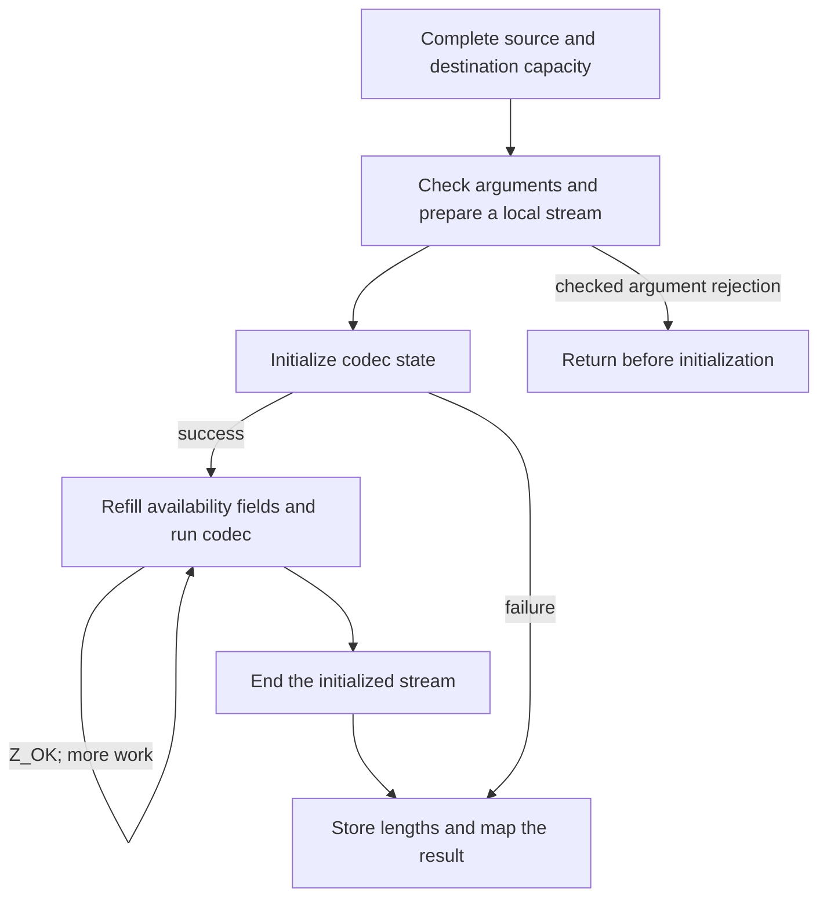

The stream API makes buffer replacement and completion visible to the application. The buffer utilities move that loop inside the library. They are useful when the whole input is available and a destination of known capacity can be supplied at once. Their convenience comes from managing an ordinary temporary stream, not from using a different compression format.

This chapter connects the [stream-call route](/sample/interfaces.html) to `compress`, `uncompress` and the library queries. It also places them among the other public interfaces: streaming offers explicit continuation, [callbacks](/sample/callbacks.html) let decoding request buffers, and [gzip handles](/sample/gzip.html) add file I/O and buffering.

## A temporary stream {#temporary-stream}

`compress2_z` accepts source bytes, a destination, a length cell and a compression level. On entry, `*destLen` is the writable capacity. On return, it normally reports the number of bytes produced. A `Z_OK` result means that a complete **zlib-wrapped** stream was written. `compress_z` selects the default level; the plain `compress` and `compress2` names adapt the corresponding `uLong` arguments.



The local `z_stream` is automatic C storage. The codec's internal state is separately allocated and released before the utility returns. An unsuccessful compression call does not return a partially usable compressor that can later be resumed. To control continuation yourself, use the stream API.

There can still be an internal loop. The full buffer lengths use a wide type, while `avail_in` and `avail_out` are limited to `uInt`. The utility loads representable pieces into those availability fields and keeps the wider remaining lengths separately. Large input therefore does not require one availability value to contain its entire size. The loop preserves pointer movement and consumed/produced counts across its pieces. These source correspondences are **to confirm** through the [buffer implementation argument](/reference/docs/proof/buffers.html).

## Capacity and integer widths {#capacity}

For the default buffer compressor, `compressBound_z(n)` gives the numeric expression

```text
min(SIZE_MAX, n + floor(n/4096) + floor(n/16384) + floor(n/33554432) + 13)
```

For eight input bytes this is 21 bytes. Allocate real writable storage, check that allocation, then place its capacity in the length cell before compression. The returned compressed size can be much smaller than the bound. A bound is a capacity promise under its stated compression configuration, not a prediction of the encoder's exact choice of matches or block type.

The saturation at `SIZE_MAX` matters. The formula must not wrap to a small number at the largest input values. A saturated number also does not mean that an addressable buffer of that size exists. The numeric formula, the existence of caller storage, and the theorem that actual compressed output fits that storage are three separate questions. The [bound contract](/reference/functions/compressBound_z.html) states the selected scope.

`_z` forms use `z_size_t`; the plain forms use `uLong` for these lengths. Both are 64 bits in the selected LP64 build, but that coincidence is not an API-wide rule for every platform. A caller must use the declared length type and avoid a narrowing conversion before the library sees the value. Queries about an initialized compressor's nondefault wrapper or settings belong to [deflateBound_z](/reference/functions/deflateBound_z.html), with its own conditions.

## Consumption and partial results {#results}

`uncompress2_z` uses two length cells. Initially they contain input availability and output capacity; after an initialized decode they report input consumed and output produced. It decodes the first zlib stream. If a compressed stream is followed by unrelated bytes, success leaves those trailing bytes unused, and the consumed count identifies their boundary. `uncompress_z` receives source length by value, so that boundary is not returned to the caller.

The decoder does not infer the required output allocation from the compressed length. A short compressed input can expand substantially. If the application cannot establish an adequate destination, streaming gives it a controlled way to receive successive output chunks.

The utility's result mapping is also more specific than “the underlying decoder returned an error.” A complete stream maps `Z_STREAM_END` to utility success `Z_OK`. A dictionary request maps to `Z_DATA_ERROR`, since this interface does not provide a dictionary-supply step. Input exhaustion that prevents completion is a data error; output-capacity exhaustion can be `Z_BUF_ERROR`. Malformed, truncated, raw and gzip input remain cases the zlib-only convenience decoder must handle through its error contract.

Already written bytes are not rolled back. In particular, a decoder allocation failure can follow partial output. After successful initialization, the counted utility records actual consumption and production even on that later failure. Early argument rejection and initialization failure instead retain the incoming length cells as specified. The [complete uncompress2_z entry](/reference/functions/uncompress2_z.html) gives the check order and zero-capacity cases.

Compression has a different length-write order. `compress2_z` checks some arguments before clearing its destination length, then initializes the stream. A bad level and an allocation failure can therefore leave length zero, while an earlier argument rejection preserves it. The plain `compress2` wrapper reads the length cell before calling the checked `_z` form. A nullable argument admitted by one entry cannot silently be carried over to another. Read [compress2_z](/reference/functions/compress2_z.html) and [compress2](/reference/functions/compress2.html) separately.

Across these outcomes, the intended lifetime is simple: a successful initialization creates an end obligation, and the utility performs that cleanup before returning. It preserves the caller's input and unrelated storage; caller buffers and scalar cells remain caller-owned. Length cells must satisfy the documented separation conditions, including separation from one another when both occur.

## Library queries and interface families {#queries}

The utility family also contains small inspection functions. `zlibVersion` returns a borrowed immutable version string. `zError` returns borrowed immutable text for a result code; callers neither modify nor free either result. Unknown error values map to empty text under the selected contract. `zlibCompileFlags` reports type sizes and compile-time choices. Its size fields help explain why a length conversion that works on one ABI is not automatically portable.

These queries do not create a compression lifetime. They belong beside the buffer utilities in the [public index](/reference/api.html?group=utility), while the other families remain separately accessible: compression streams, decompression streams, callback decoding, checksums and gzip files. This organization groups functions by the state and protocol the application must manage, rather than forcing all entries into one call diagram.

Continue with [callback decoding](/sample/callbacks.html) to see a different owner for the I/O loop. After the interface mechanisms are clear, [the interface proof chapter](/sample/interfaces-proof.html) explains how temporary streams, callback events and file-world effects change the statement that must be established.
