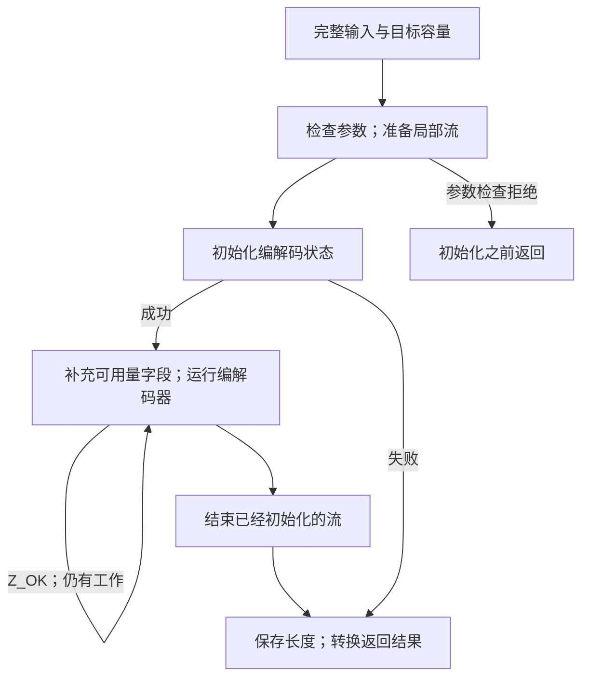

流式 API 把更换缓冲区与完成过程交给应用程序控制。整块缓冲区工具则把这段循环放进库里：调用时已经具备全部输入，并能一次提供容量明确的目标区，就可以使用它们。这种便利来自库替你管理一个临时流，压缩格式仍然是同一个格式。

本章把[流式调用路线](/sample/interfaces.html)连接到 `compress`、`uncompress` 和库信息查询。也可以借此区分其他入口：流接口显式保留继续工作的状态，[回调解码](/sample/callbacks.html)让解码器主动请求缓冲区，[gzip 句柄](/sample/gzip.html)则进一步管理文件 I/O 和缓冲。

## 临时流 {#temporary-stream}

`compress2_z` 接收源字节、目标区、长度单元和压缩级别。进入时，`*destLen` 是可写容量；返回时，它通常记录已经产生的字节数。`Z_OK` 表示写出了一个完整的 **zlib 封装流**。`compress_z` 选择默认级别，普通名称 `compress` 和 `compress2` 则适配相应的 `uLong` 参数。



局部 `z_stream` 是 C 的自动存储。编解码器的内部状态另外分配，并在工具函数返回前释放。压缩失败时，调用者不会收到一个可以继续使用的半成品压缩器。如果需要自己控制继续执行，应选择流接口。

工具内部仍然可能有循环。整块缓冲区长度使用较宽的类型，`avail_in` 和 `avail_out` 却受 `uInt` 限制。工具把可以表示的片段填入可用量字段，另行保存较宽的剩余长度。因此，较大的输入不要求单个可用量字段容纳全部大小。循环需要在这些片段之间保持指针移动及消费、产生的准确计数。这些源码对应关系仍需[缓冲区实现论证](/reference/docs/proof/buffers.html)确认（**to confirm**）。

## 容量与整数位宽 {#capacity}

默认缓冲区压缩器使用的 `compressBound_z(n)` 数值为：

```text
min(SIZE_MAX, n + floor(n/4096) + floor(n/16384) + floor(n/33554432) + 13)
```

八个输入字节对应 21 字节的上界。调用者需要分配真实的可写存储，检查分配结果，再把容量填入长度单元。最终压缩长度可以显著小于上界。上界是在规定压缩配置下给出的容量保证，不是对编码器具体采用哪些匹配、哪一种块的预测。

在 `SIZE_MAX` 处饱和很重要：最大的输入值不应该让公式回绕成很小的结果。饱和后的数值也不意味着相应大小的缓冲区一定可以寻址。数值公式、调用者存储的存在，以及实际压缩结果放得下的结论，是三个需要分别回答的问题。[上界契约](/reference/functions/compressBound_z.html)说明了当前范围。

这些长度在 `_z` 形式中使用 `z_size_t`，在普通形式中使用 `uLong`。二者在选定的 LP64 构建中都是 64 位，但不能把这种巧合推广到所有平台。调用者要使用声明的长度类型，并避免在库看到数值之前就发生缩窄转换。已初始化压缩器采用其他封装或配置时，应查看 [deflateBound_z](/reference/functions/deflateBound_z.html)及其自己的条件。

## 消费量与部分结果 {#results}

`uncompress2_z` 使用两个长度单元：进入时分别表示可用输入和输出容量，初始化后的解码返回时则记录输入消费量和输出产生量。它解码第一个 zlib 流。若压缩流后面还有无关字节，成功解码会留下这些尾随输入，消费量可以指出它们的起点。`uncompress_z` 的源长度按值传入，因此不把这个边界返回给调用者。

解码器不会根据压缩长度自动推算目标区的分配大小。很短的压缩输入也可能展开出很多数据。如果应用程序无法事先建立足够的目标容量，流接口可以让它有控制地接收连续输出块。

工具的结果转换也比“底层解码器报错了”更具体。完成时的 `Z_STREAM_END` 被转换为工具函数的成功码 `Z_OK`。字典请求被转换为 `Z_DATA_ERROR`，因为这一接口没有补充字典的步骤。输入耗尽而未能完成属于数据错误；输出容量耗尽则可能是 `Z_BUF_ERROR`。畸形、截断、raw 和 gzip 输入仍然属于这个只接收 zlib 流的便利解码器需要通过错误契约处理的情形。

已经写出的字节不会回滚。尤其是，解码器的分配失败可能发生在部分输出之后。成功初始化后，计数版本即使遇到这种较晚的失败，也会保存实际消费量和产生量。较早的参数拒绝或初始化失败则按规定保留传入的长度单元。[uncompress2_z 完整条目](/reference/functions/uncompress2_z.html)给出了检查顺序和零容量情形。

压缩工具写回长度的顺序不同。`compress2_z` 先检查一部分参数，再清零目标长度，然后初始化流。因此，错误级别和分配失败可能留下零长度，更早的参数拒绝则保留原值。普通 `compress2` 包装器在进入带检查的 `_z` 形式前，已经读取长度单元。一个入口允许为空的参数，不能直接推定在另一个入口也允许为空。应分别查看 [compress2_z](/reference/functions/compress2_z.html) 和 [compress2](/reference/functions/compress2.html)。

这些结果背后的生命周期规则很简单：成功初始化会产生一次结束义务，工具函数在返回前完成这项清理。调用者输入和无关存储保持不变，缓冲区及标量单元仍归调用者所有。长度单元要满足文档规定的分离条件；同时存在两个单元时，它们之间也需要分离。

## 库信息与接口类别 {#queries}

工具类别还包括几个小型查询。`zlibVersion` 返回借用的只读版本字符串，`zError` 返回结果码对应的借用只读文本；调用者不能修改或释放这些结果。选定契约把未知错误值映射为空文本。`zlibCompileFlags` 则报告类型大小及编译选项，其大小字段可以解释：一种长度转换为什么在某个 ABI 上可行，却不能自动视为可移植。

这些查询不创建压缩生命周期。它们与缓冲区工具一起列在[公开索引](/reference/api.html?group=utility)中。其余类别分别是压缩流、解压流、回调解码、校验和与 gzip 文件。这样的分类依据是应用程序需要管理的状态和协议，不必把全部入口挤进一张调用图。

接下来阅读[回调解码](/sample/callbacks.html)，看看 I/O 循环由另一方控制时有什么变化。接口机制清楚之后，[接口证明一章](/sample/interfaces-proof.html)会解释临时流、回调事件和文件世界的影响怎样改变需要建立的命题。
