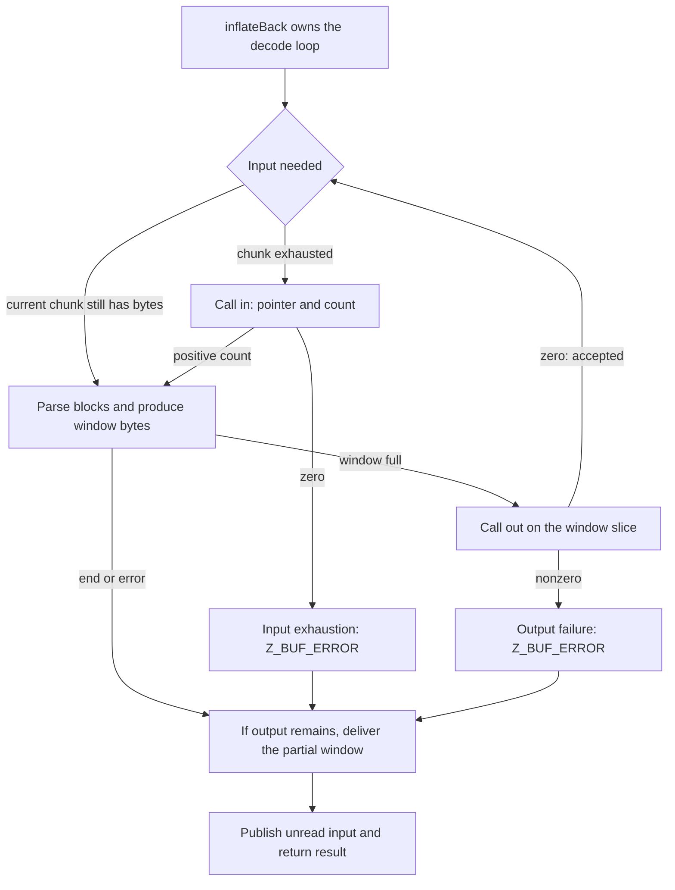

Suppose your container already supplies raw DEFLATE chunks, and your output destination accepts a callback. You want the decoder to ask for the next chunk instead of writing an application loop around `inflate`. Choose `inflateBack`: its input callback supplies a pointer and count, and its output callback receives decoded window slices. A successful call delivers the decoded bytes and returns `Z_STREAM_END`.

This changes who controls the same byte-recovery task. In the [direct stream interface](/sample/interfaces.html), the application decides when to supply another buffer and call again. Here `inflateBack` makes those requests while decoding. It uses its own loop in `infback.c`, not repeated calls to ordinary `inflate`. Its block parsing and [distance-copy rules](/sample/decode-copy.html) still have to recover the same original bytes.

This choice requires **raw DEFLATE**. `inflateBack` does not parse zlib or gzip wrappers, check their trailers or supply a preset dictionary. If an enclosing format needs them, the application manages them. The [complete callback contracts](/reference/docs/spec/api/inflate-back.html) define the protocol.

## Decode eight bytes through two callbacks {#example}

This complete teaching program supplies `73 74 82 40 00` as chunks of 2, 1 and 2 bytes. Those five encoded bytes mean `ABABABAB`. It uses a caller-owned 32768-byte window and copies accepted output into its own eight-byte result. The callbacks are application code; none of this block is copied from zlib.

```c
#include <string.h>
#include <zlib.h>

static unsigned char raw[] = {0x73, 0x74, 0x82, 0x40, 0x00};
struct input { unsigned part, offset; };
struct output { unsigned char bytes[8]; unsigned count; };

static unsigned feed(void *desc, z_const unsigned char **next) {
    static const unsigned sizes[] = {2, 1, 2};
    struct input *in = desc;
    if (in->part == 3) return 0;
    unsigned n = sizes[in->part++];
    *next = raw + in->offset;
    in->offset += n;
    return n;
}

static int collect(void *desc, unsigned char *bytes, unsigned n) {
    struct output *out = desc;
    if (n > sizeof out->bytes - out->count) return 1;
    memcpy(out->bytes + out->count, bytes, n);
    out->count += n;
    return 0;
}

int main(void) {
    unsigned char window[32768];
    z_stream stream = {0};
    struct input in = {0};
    struct output out = {{0}, 0};
    if (inflateBackInit(&stream, 15, window) != Z_OK) return 1;
    stream.next_in = Z_NULL;
    stream.avail_in = 0;
    int ret = inflateBack(&stream, feed, &in, collect, &out);
    int ended = inflateBackEnd(&stream);
    return !(ret == Z_STREAM_END && ended == Z_OK && out.count == 8 &&
             memcmp(out.bytes, "ABABABAB", 8) == 0);
}
```

The input descriptor keeps `part`, the next chunk number, and `offset`, the byte offset into `raw`. `sizes` gives chunk lengths in bytes. In `feed`, `next` is an output parameter: assigning `*next` tells the decoder where those bytes are. The output descriptor keeps its preserved `bytes` and their valid `count`; `collect` checks remaining room before copying. Each callback receives its descriptor through `desc`, so it can recover its own counters without using the decoder state.

`feed` changes only its descriptor counters; the active `raw` bytes stay unchanged. `collect` copies the window before returning, so the application does not retain a pointer that decoding may reuse. Even when `inflateBack` fails, the program calls `inflateBackEnd` after successful init. That ends library state; the automatic window and descriptors remain caller storage.

Now follow the same run from storage, to callback events, to the final return. The [ordinary chunked-inflate example](../static/examples/inflate-chunks.c) decodes the same raw bytes with the application in control of the loop.

## The caller's window {#window}

`inflateBackInit` receives a writable window and its base-two size exponent. An exponent `b` requires `2^b` writable bytes, so the example passes 15 for its 32768-byte array. For general streams, that full-size window supplies the history needed by the largest permitted distances. The accepted exponent range is 8 through 15, but a smaller window can reject valid streams that refer farther back than it can retain. This is an algorithmic resource choice, not just a smaller output batch.

The example allocates one `window`, rather than separate output and history arrays, because that window serves two jobs. It stores bytes used as match history, and it is the region presented to the output callback. A separate caller output buffer is unnecessary. The library allocates its decoder state, but does not allocate, clear or later free this window. The caller keeps the attached window alive until `inflateBackEnd` has released the decoder state.

This arrangement can avoid an extra copy from a private history window into an application staging buffer. It also creates a lifetime rule. When the output callback sees a window slice, it can read or copy those bytes, or write them to its own destination. It cannot modify the window. Keeping only a pointer for later use is insufficient if the decoder subsequently reuses that region. Persistent output requires the callback to preserve it elsewhere before returning.

## Input and output events {#events}

Input and output callbacks do not alternate one-for-one. The decoder may request several input chunks, or fill its window from available input and deliver output before requesting another chunk. Decode progress and remaining window space determine the next event.

The input callback returns a count and sets the input pointer. A positive count supplies that many readable bytes. Zero reports that no input is available when the decoder needs more; the pointer result is then ignored. The active input chunk must remain readable and unchanged until the next input callback or the decode call's return, including across intervening output callbacks.

The output callback receives a pointer into the window and a length. Zero means success; nonzero means failure. Both callbacks must return safely and preserve the stream, decoder state and window contents. Their own descriptor objects remain the application's responsibility. The public protocol can allow changes and allocation in those own objects, subject to the stated frame and lifetime conditions.



In the input macro below, `have` is the number of unread bytes in the current chunk and `next` points to the next one. `in` names the supplied input callback, and `in_desc` is its application-owned context pointer. `ret` holds the result being prepared; `inf_leave` is the shared exit that publishes unread input and any final output.

The input edge is real C, not an abstract scheduling rule. These are the inner lines of [`PULL`, infback.c:101–108](https://github.com/madler/zlib/blob/757f0527154291bcf6bfbd6396ecde6bedd2db95/infback.c#L99-L109); macro continuation backslashes are omitted for reading:

```c
        if (have == 0) {
            have = in(in_desc, &next);
            if (have == 0) {
                next = Z_NULL;
                ret = Z_BUF_ERROR;
                goto inf_leave;
            }
        }
```

In our run `in` is `feed`. It first sets `next` to `raw` and returns 2. Once those bytes are consumed, another invocation supplies the next slice. Zero chooses an error return instead of waiting inside the library. The retained bit accumulator lets a field cross these input boundaries.

This is an event loop inside one call, rather than a `Z_OK` continuation loop in the application. `inflateBack` never returns `Z_OK`. A successful complete decode returns `Z_STREAM_END` after output callbacks have accepted its bytes. Input exhaustion or an output refusal returns `Z_BUF_ERROR`; detected malformed DEFLATE returns `Z_DATA_ERROR`.

## A five-byte input trace {#trace}

The raw fixed-block example used in [bit output](/sample/bits.html) has bytes `73 74 82 40 00`. It represents two literals, A and B, followed by a length-6, distance-2 match, then the end-of-block symbol. Its decoded bytes are `ABABABAB`.

The program starts with `next_in == NULL`, requesting input through `feed`. Its three chunks produce this event trace:

| Event | Supplied or observed data | Lifetime condition |
| --- | --- | --- |
| First input request | `73 74` | Keep this chunk unchanged while active |
| Second input request | `82` | The exhausted first chunk can now be reused |
| Third input request | `40 00` | Keep it valid until return or another input request |
| Final output callback | Eight bytes `ABABABAB` | Read them without modifying the window |
| Decode return | `Z_STREAM_END` if output succeeded | The attached state and window still exist |

With the general 32768-byte window, eight decoded bytes do not fill it. They reach `out` as the final partial window. Input boundaries can divide an encoding field or symbol; the decoder's held bits and current mode bridge those boundaries. The example is a chosen valid encoding, not a claim about the bytes that a particular zlib compression call selects.

For output, `left` counts unused bytes in the caller window, while `state->wsize` is that window's byte capacity. Their difference is the number of decoded bytes ready to deliver. The `out` callback receives those bytes, and `out_desc` points to its own application context.

The eight-byte delivery comes from the shared exit in [infback.c:562–566](https://github.com/madler/zlib/blob/757f0527154291bcf6bfbd6396ecde6bedd2db95/infback.c#L560-L569), copied verbatim:

```c
    if (left < state->wsize) {
        if (out(out_desc, state->window, state->wsize - left) &&
            ret == Z_STREAM_END)
            ret = Z_BUF_ERROR;
    }
```

Here `left == 32760`, so the callback length is `32768 - 32760 = 8`. The same exit also serves error paths. That shared placement explains why a failure may deliver a partial window; delivery is not restricted to the successful example.

On return, `next_in` and `avail_in` describe the unread suffix of the last input chunk. A container parser can use that boundary to recover trailing data. The normal output fields and total counters are not this interface's observation channel: `next_out`, `avail_out`, totals, `adler` and `data_type` are not updated to summarize callback delivery. Observe output events themselves.

## Failure and continuation boundaries {#failures}

Callback delivery is not a transaction. Full windows may already have reached the application when a later malformed field or missing input stops decoding. A final nonempty partial window can also be presented on an error path. If the final output callback refuses an otherwise successful completion, the result becomes `Z_BUF_ERROR`; it does not replace another selected error. A failure is therefore not a promise of empty output, nor an unconditional exactly-once retry protocol for arbitrary callback side effects.

For `Z_BUF_ERROR`, NULL `next_in` identifies input exhaustion and non-NULL identifies output failure under the contract. That diagnostic distinction helps an application interpret the result, but it does not turn the call into an ordinary resumable `inflate` session. Another `inflateBack` call resets decoding for a new independent raw stream. The current state can also be ended after an error. `inflateBackEnd` releases only the internal state and clears `state`; the caller then remains responsible for its window and callback-owned resources.

Our `feed` has only five bytes to supply, so it has a finite reserve. A general callback needs one more condition before we can claim termination. Every individual callback may return, yet the input callback could keep supplying an unending sequence of nonfinal blocks. A terminating theorem therefore needs a finite-input bound or another explicit progress condition. Callback return, input validity and eventual completion are distinct premises. The complete callback-decoding proof is unfinished. The [callback implementation argument](/reference/docs/proof/callbacks.html) identifies the input, delivery, and termination results to compose, along with narrower callback disciplines used by local proofs.

Our five encoded bytes have now become one accepted eight-byte output event. The library state still needs `inflateBackEnd`; the caller keeps its window, descriptors and collected output. [The callback proof](/sample/interfaces-proof.html#callbacks) connects the exact event sequence to preservation of those objects and the finite input budget. If the enclosing task should instead open a file, check gzip trailers and retain file position, [gzip handles](/sample/gzip.html) provide that different [interface choice](/verification/interfaces.html#choices).
