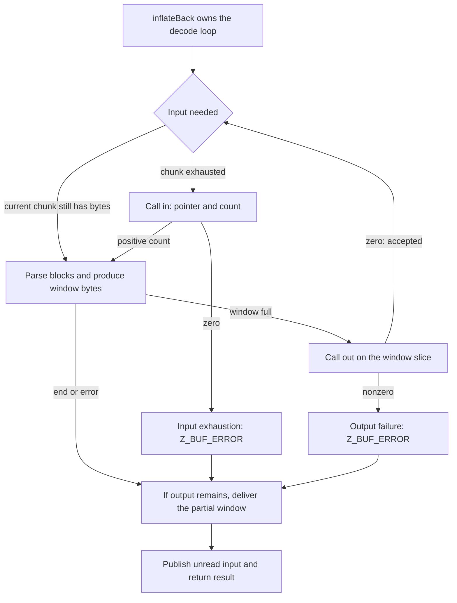

With ordinary `inflate`, the application repeatedly lends input and output buffers. `inflateBack` reverses that arrangement: one decode call asks the application for input when needed and sends output through another callback. The decoding mechanisms are still DEFLATE blocks, tables and matches. The change is who controls the I/O loop and who owns its working storage.

Use this interface for raw DEFLATE. It does not parse a zlib or gzip wrapper, verify their trailers or supply a preset dictionary. If those are part of the enclosing format, the application manages them separately. The [complete callback contracts](/reference/docs/spec/api/inflate-back.html) define the exact protocol.

## The caller's window {#window}

`inflateBackInit` receives a writable window and its size exponent. For general streams, a 15-bit window supplies 32768 bytes. The accepted exponent range is 8 through 15, but a smaller window can reject valid streams that refer farther back than it can retain. This is an algorithmic resource choice, not just a smaller output batch.

The window serves two jobs. It stores bytes used as match history, and it is the region presented to the output callback. A separate caller output buffer is unnecessary. The library allocates its decoder state, but does not allocate, clear or later free this window. The caller keeps the attached window alive until `inflateBackEnd` has released the decoder state.

This arrangement can avoid an extra copy from a private history window into an application staging buffer. It also creates a lifetime rule. When the output callback sees a window slice, it can read or copy those bytes, or write them to its own destination. It cannot modify the window. Keeping only a pointer for later use is insufficient if the decoder subsequently reuses that region. Persistent output requires the callback to preserve it elsewhere before returning.

## Input and output events {#events}

The input callback returns a count and sets the input pointer. A positive count supplies that many readable bytes. Zero reports that no input is available when the decoder needs more; the pointer result is then ignored. The active input chunk must remain readable and unchanged until the next input callback or the decode call's return, including across intervening output callbacks.

The output callback receives a pointer into the window and a length. Zero means success; nonzero means failure. Both callbacks must return safely and preserve the stream, decoder state and window contents. Their own descriptor objects remain the application's responsibility. The public protocol can allow changes and allocation in those own objects, subject to the stated frame and lifetime conditions.

This is an event loop inside one call, rather than a `Z_OK` continuation loop in the application. `inflateBack` never returns `Z_OK`. A successful complete decode returns `Z_STREAM_END` after output callbacks have accepted its bytes. Input exhaustion or an output refusal returns `Z_BUF_ERROR`; detected malformed DEFLATE returns `Z_DATA_ERROR`.

## A five-byte input trace {#trace}

The raw fixed-block example used in [bit output](/sample/bits.html) has bytes `73 74 82 40 00`. It represents two literals, A and B, followed by a length-6, distance-2 match, then the end-of-block symbol. Its decoded bytes are `ABABABAB`.

Start with `next_in == NULL`, which requests input through the callback. Arrange the input callback to expose this five-byte stream in three chunks:

| Event | Supplied or observed data | Lifetime condition |
| --- | --- | --- |
| First input request | `73 74` | Keep this chunk unchanged while active |
| Second input request | `82` | The exhausted first chunk can now be reused |
| Third input request | `40 00` | Keep it valid until return or another input request |
| Final output callback | Eight bytes `ABABABAB` | Read them without modifying the window |
| Decode return | `Z_STREAM_END` if output succeeded | The attached state and window still exist |

With the general 32768-byte window, eight decoded bytes do not fill it. They reach `out` as the final partial window. Input boundaries can divide an encoding field or symbol; the decoder's held bits and current mode bridge those boundaries. The example is a chosen valid encoding, not a claim about the bytes that a particular zlib compression call selects.

On return, `next_in` and `avail_in` describe the unread suffix of the last input chunk. A container parser can use that boundary to recover trailing data. The normal output fields and total counters are not this interface's observation channel: `next_out`, `avail_out`, totals, `adler` and `data_type` are not updated to summarize callback delivery. Observe output events themselves.

## Failure and continuation boundaries {#failures}

Callback delivery is not a transaction. Full windows may already have reached the application when a later malformed field or missing input stops decoding. A final nonempty partial window can also be presented on an error path. If the final output callback refuses an otherwise successful completion, the result becomes `Z_BUF_ERROR`; it does not replace another selected error. A failure is therefore not a promise of empty output, nor an unconditional exactly-once retry protocol for arbitrary callback side effects.

For `Z_BUF_ERROR`, NULL `next_in` identifies input exhaustion and non-NULL identifies output failure under the contract. That diagnostic distinction helps an application interpret the result, but it does not turn the call into an ordinary resumable `inflate` session. Another `inflateBack` call resets decoding for a new independent raw stream. The current state can also be ended after an error. `inflateBackEnd` releases only the internal state and clears `state`; the caller then remains responsible for its window and callback-owned resources.

There is one more boundary before making a termination claim. Every individual callback may return, yet the input callback could keep supplying an unending sequence of nonfinal blocks. A terminating theorem therefore needs a finite-input bound or another explicit progress condition. Callback return, input validity and eventual completion are distinct premises. The [callback implementation argument](/reference/docs/proof/callbacks.html) marks the source reasoning still **to confirm** and identifies narrower callback disciplines used by local proofs.

After these mechanics, [interface proofs](/sample/interfaces-proof.html) explains why callback assumptions are valid descriptions of caller code, while specifications of zlib's own helpers still require proofs about those helpers. For file-level buffering and another kind of external effect, continue with [gzip handles](/sample/gzip.html).
