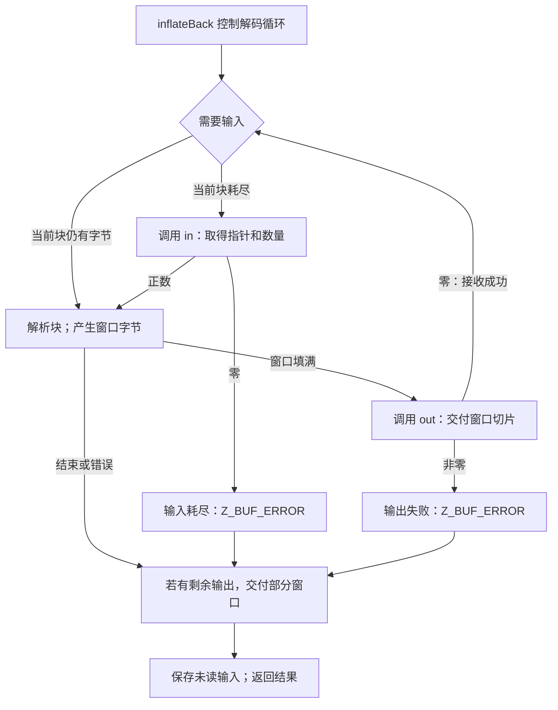

假设外层容器已经能提供 raw DEFLATE 片段，输出目标也能通过回调接收数据。你希望解码器主动请求下一片段，不想在应用程序中围绕 `inflate` 写循环。这时可以选择 `inflateBack`：输入回调提供指针和数量，输出回调接收窗口中的解码切片。成功调用会交付解码结果，并返回 `Z_STREAM_END`。

这个选择要求输入是 **raw DEFLATE**。`inflateBack` 不解析 zlib 或 gzip 封装，不检查相应尾部，也不提供预设字典。外层格式需要这些工作时，由应用程序另外处理。[完整回调契约](/reference/docs/spec/api/inflate-back.html)规定了协议。

## 通过两个回调还原八字节 {#example}

下面这个完整教学程序按 2、1、2 字节提供 `73 74 82 40 00`。这五个编码字节表示 `ABABABAB`。程序使用调用者的 32768 字节窗口，把收到的输出复制到自己的八字节结果区。回调属于应用程序代码，这段代码并非 zlib 源码节选。

```c
#include <string.h>
#include <zlib.h>

static unsigned char raw[] = {0x73, 0x74, 0x82, 0x40, 0x00};
struct input { unsigned part, offset; };
struct output { unsigned char bytes[8]; unsigned count; };

static unsigned feed(void *desc, z_const unsigned char **next) {
    static const unsigned sizes[] = {2, 1, 2};
    struct input *in = desc;
    if (in->part == 3) return 0;
    unsigned n = sizes[in->part++];
    *next = raw + in->offset;
    in->offset += n;
    return n;
}

static int collect(void *desc, unsigned char *bytes, unsigned n) {
    struct output *out = desc;
    if (n > sizeof out->bytes - out->count) return 1;
    memcpy(out->bytes + out->count, bytes, n);
    out->count += n;
    return 0;
}

int main(void) {
    unsigned char window[32768];
    z_stream stream = {0};
    struct input in = {0};
    struct output out = {{0}, 0};
    if (inflateBackInit(&stream, 15, window) != Z_OK) return 1;
    stream.next_in = Z_NULL;
    stream.avail_in = 0;
    int ret = inflateBack(&stream, feed, &in, collect, &out);
    int ended = inflateBackEnd(&stream);
    return !(ret == Z_STREAM_END && ended == Z_OK && out.count == 8 &&
             memcmp(out.bytes, "ABABABAB", 8) == 0);
}
```

输入描述符的 `part` 是下一块的编号，`offset` 是在 `raw` 中的字节偏移，`sizes` 记录每块的字节数。`feed` 的 `next` 是输出参数：给 `*next` 赋值，才把字节地址交给解码器。输出描述符保存已接收的 `bytes` 和有效字节数 `count`，`collect` 先检查剩余容量再复制。每个回调通过 `desc` 找回自己的描述符，不需要借用解码器内部字段保存这些计数。

`feed` 只改自己的描述符计数器，活动的 `raw` 字节始终不变。`collect` 在返回前复制窗口，应用程序便不会保留一个随后可能被解码器重用的指针。只要初始化成功，即使 `inflateBack` 失败，程序也会调用 `inflateBackEnd`。这一步结束库内状态；自动窗口和描述符仍是调用者存储。

接下来沿同一次执行，依次看存储、回调事件和最终返回。[普通分块 inflate 例子](../static/examples/inflate-chunks.c)用应用程序控制循环的方式解码同一组 raw 字节。

## 调用者的窗口 {#window}

`inflateBackInit` 接收可写窗口及其以二为底的大小指数。指数 `b` 要求 `2^b` 个可写字节，因此例子为 32768 字节数组传入 15。处理一般流时，这个完整尺寸为最大允许距离提供足够历史。接口接受 8 到 15 的指数，但较小窗口可能拒绝回引用距离超出保留能力的有效流。因此，窗口大小是一项算法资源选择，不只是输出批次大小。

例子只创建一个 `window`，没有再分配独立的输出数组与历史数组，因为同一个窗口承担两项工作：保存匹配需要的历史字节，也是输出回调收到的数据所在区域。调用者不必另外提供输出缓冲区。库分配解码状态，但不分配、不清空，也不会在结束时释放这个窗口。调用者必须让它一直存活，直到 `inflateBackEnd` 释放了解码状态。

这种安排可以省去从私有历史窗口复制到应用程序暂存缓冲区的一次中转，也带来生命周期要求。输出回调收到窗口切片后，可以读取、复制，或者把它写入自己的目标，却不能改写窗口。若解码器随后重用该区域，只保存指针以备以后读取就不够了。需要持久输出时，回调必须在返回前把内容保存到其他地方。

## 输入与输出事件 {#events}

输入回调返回数量，并设置输入指针。正数表示提供了相应数量的可读字节；零表示解码器需要更多输入时已经没有数据，此时指针结果被忽略。活动输入块要一直保持可读且内容不变，直到下一次输入回调或解码调用返回；中间发生输出回调也不能破坏它。

输出回调接收窗口内的指针和长度，返回零表示成功，非零表示失败。两个回调都必须安全返回，并保持流、解码器状态和窗口内容。回调自己的描述符对象由应用程序负责；在规定的框架与生命周期条件下，公开协议可以允许它们修改或分配自己的对象。



下面输入宏的 `have` 是当前块还没读取的字节数，`next` 指向下一个字节；`in` 是传入的输入回调，`in_desc` 是应用提供给它的上下文指针。`ret` 保存准备返回的结果，`inf_leave` 是发布未读输入及最后输出的共用出口。

请求输入的边就是真实的 C 操作。下面是 [`PULL` 的内部语句，infback.c:101–108](https://github.com/madler/zlib/blob/757f0527154291bcf6bfbd6396ecde6bedd2db95/infback.c#L99-L109)；为方便阅读，省略了宏的续行反斜线：

```c
        if (have == 0) {
            have = in(in_desc, &next);
            if (have == 0) {
                next = Z_NULL;
                ret = Z_BUF_ERROR;
                goto inf_leave;
            }
        }
```

本例的 `in` 就是 `feed`。第一次把 `next` 设为 `raw` 并返回 2；这两个字节消费完后，下一次调用提供下一切片。返回零会选择错误出口，库不会在内部等待。保留的位累积器让一个字段可以跨越输入边界。

这是一轮调用内部的事件循环，应用程序不通过反复接收 `Z_OK` 来继续它。`inflateBack` 不返回 `Z_OK`。完整解码并且输出回调接收成功后，返回 `Z_STREAM_END`；输入耗尽或输出拒绝返回 `Z_BUF_ERROR`；检测到畸形 DEFLATE 则返回 `Z_DATA_ERROR`。

## 五字节输入的执行轨迹 {#trace}

[位输出一章](/sample/bits.html)中的 raw 固定块例子是 `73 74 82 40 00`。它表示字面量 A、B，随后是长度 6、距离 2 的匹配，最后是块结束符号，解出的字节为 `ABABABAB`。

程序从 `next_in == NULL` 开始，通过 `feed` 请求输入。三个片段产生下面的事件轨迹：

| 事件 | 提供或观察到的数据 | 生命周期条件 |
| --- | --- | --- |
| 第一次请求输入 | `73 74` | 活动期间保持内容不变 |
| 第二次请求输入 | `82` | 已经耗尽的第一块现在可以重用 |
| 第三次请求输入 | `40 00` | 保持有效，直到返回或下一次输入请求 |
| 最后的输出回调 | 八字节 `ABABABAB` | 读取，不修改窗口 |
| 解码返回 | 输出成功时为 `Z_STREAM_END` | 附加的状态和窗口仍然存在 |

使用一般的 32768 字节窗口时，八个输出字节填不满窗口，所以通过最终部分窗口交给 `out`。输入边界可以落在某个编码字段或符号中间，解码器保留的位和当前模式负责跨过边界。这个例子是一种选定的有效编码，不表示某次实际 zlib 压缩必然选择这些字节。

对于输出，`left` 是调用者窗口里尚未使用的字节数，`state->wsize` 是窗口的字节容量，二者之差就是待交付的解码字节数。`out` 是接收这些字节的回调，`out_desc` 指向应用为它准备的上下文。

八字节交付来自 [infback.c:562–566](https://github.com/madler/zlib/blob/757f0527154291bcf6bfbd6396ecde6bedd2db95/infback.c#L560-L569) 的共享出口，以下逐字节选：

```c
    if (left < state->wsize) {
        if (out(out_desc, state->window, state->wsize - left) &&
            ret == Z_STREAM_END)
            ret = Z_BUF_ERROR;
    }
```

此时 `left == 32760`，所以回调长度为 `32768 - 32760 = 8`。错误路径也使用这个出口。正因为交付语句位于共享出口，失败时也可能交付部分窗口；它并非只在成功例子中执行。

返回时，`next_in` 和 `avail_in` 描述最后一个输入块中尚未读取的后缀。容器解析器可以利用这个边界找回尾随数据。普通输出字段和总计数不是这一接口的观察渠道：`next_out`、`avail_out`、总计数、`adler` 和 `data_type` 不会被更新成回调交付的汇总。输出需要观察回调事件本身。

## 失败与继续执行的边界 {#failures}

回调交付不是事务。某个后续畸形字段或缺失输入停止解码时，前面的完整窗口可能已经到达应用程序。错误路径也可能交付最后一个非空部分窗口。如果最后的输出回调拒绝了原本成功的完成，结果改为 `Z_BUF_ERROR`；它不会替换另一个已经选定的错误。因此，失败不保证输出为空，也不为任意回调副作用提供无条件的“重试且恰好交付一次”协议。

依照契约，`Z_BUF_ERROR` 时，NULL `next_in` 表示输入耗尽，非 NULL 表示输出失败。这种诊断区别有助于解释结果，却不能把它变成普通的可继续 `inflate` 会话。下一次 `inflateBack` 调用会为一个新的独立 raw 流重置解码。出错后也可以结束状态；`inflateBackEnd` 只释放内部状态并清空 `state`，窗口和回调自有资源仍由调用者负责。

本例 `feed` 总共只能提供五字节，储备是有限的。一般回调还需要另一条条件：每次回调都返回，输入回调却仍可能不断提供没有最终块的输入。终止定理因此需要有限输入界或其他显式进展条件。回调返回、输入有效和最终完成，是三个不同前提。[回调实现论证](/reference/docs/proof/callbacks.html)标明仍需确认的源码推理（**to confirm**），也指出局部证明采用的较窄回调约束。

理解这些机制之后，[接口证明](/sample/interfaces-proof.html)会解释：为什么回调假设可以描述调用者代码，而 zlib 自身辅助函数的规格仍然需要关于这些函数的证明。若要继续了解文件级缓冲和另一类外部效果，可以阅读 [gzip 句柄](/sample/gzip.html)。
