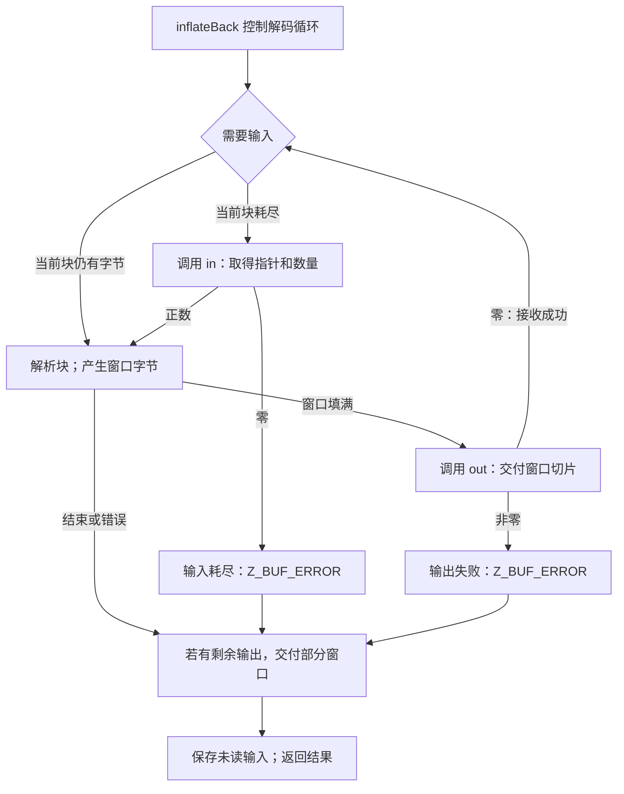

普通 `inflate` 由应用程序反复提供输入和输出缓冲区。`inflateBack` 调换了这一安排：一次解码调用在需要时向应用程序请求输入，并通过另一个回调交付输出。解码仍然处理 DEFLATE 块、表和匹配；改变的是 I/O 循环由谁控制，以及工作存储归谁所有。

这一接口用于 raw DEFLATE。它不解析 zlib 或 gzip 封装，不验证对应尾部，也不提供预设字典。外层格式需要这些内容时，由应用程序另外处理。[完整回调契约](/reference/docs/spec/api/inflate-back.html)规定了精确协议。

## 调用者的窗口 {#window}

`inflateBackInit` 接收可写窗口及其大小指数。处理一般流时，15 位窗口提供 32768 字节。接口接受 8 到 15 的指数，但较小窗口可能拒绝回引用距离超出保留能力的有效流。因此，窗口大小是一项算法资源选择，不只是输出批次大小。

同一个窗口承担两项工作：保存匹配需要的历史字节，也是输出回调收到的数据所在区域。调用者不必另外提供输出缓冲区。库分配解码状态，但不分配、不清空，也不会在结束时释放这个窗口。调用者必须让它一直存活，直到 `inflateBackEnd` 释放了解码状态。

这种安排可以省去从私有历史窗口复制到应用程序暂存缓冲区的一次中转，也带来生命周期要求。输出回调收到窗口切片后，可以读取、复制，或者把它写入自己的目标，却不能改写窗口。若解码器随后重用该区域，只保存指针以备以后读取就不够了。需要持久输出时，回调必须在返回前把内容保存到其他地方。

## 输入与输出事件 {#events}

输入回调返回数量，并设置输入指针。正数表示提供了相应数量的可读字节；零表示解码器需要更多输入时已经没有数据，此时指针结果被忽略。活动输入块要一直保持可读且内容不变，直到下一次输入回调或解码调用返回；中间发生输出回调也不能破坏它。

输出回调接收窗口内的指针和长度，返回零表示成功，非零表示失败。两个回调都必须安全返回，并保持流、解码器状态和窗口内容。回调自己的描述符对象由应用程序负责；在规定的框架与生命周期条件下，公开协议可以允许它们修改或分配自己的对象。

这是一轮调用内部的事件循环，应用程序不通过反复接收 `Z_OK` 来继续它。`inflateBack` 不返回 `Z_OK`。完整解码并且输出回调接收成功后，返回 `Z_STREAM_END`；输入耗尽或输出拒绝返回 `Z_BUF_ERROR`；检测到畸形 DEFLATE 则返回 `Z_DATA_ERROR`。

## 五字节输入的执行轨迹 {#trace}

[位输出一章](/sample/bits.html)中的 raw 固定块例子是 `73 74 82 40 00`。它表示字面量 A、B，随后是长度 6、距离 2 的匹配，最后是块结束符号，解出的字节为 `ABABABAB`。

开始时令 `next_in == NULL`，要求通过回调取得输入。让输入回调把这五个字节分成三块提供：

| 事件 | 提供或观察到的数据 | 生命周期条件 |
| --- | --- | --- |
| 第一次请求输入 | `73 74` | 活动期间保持内容不变 |
| 第二次请求输入 | `82` | 已经耗尽的第一块现在可以重用 |
| 第三次请求输入 | `40 00` | 保持有效，直到返回或下一次输入请求 |
| 最后的输出回调 | 八字节 `ABABABAB` | 读取，不修改窗口 |
| 解码返回 | 输出成功时为 `Z_STREAM_END` | 附加的状态和窗口仍然存在 |

使用一般的 32768 字节窗口时，八个输出字节填不满窗口，所以通过最终部分窗口交给 `out`。输入边界可以落在某个编码字段或符号中间，解码器保留的位和当前模式负责跨过边界。这个例子是一种选定的有效编码，不表示某次实际 zlib 压缩必然选择这些字节。

返回时，`next_in` 和 `avail_in` 描述最后一个输入块中尚未读取的后缀。容器解析器可以利用这个边界找回尾随数据。普通输出字段和总计数不是这一接口的观察渠道：`next_out`、`avail_out`、总计数、`adler` 和 `data_type` 不会被更新成回调交付的汇总。输出需要观察回调事件本身。

## 失败与继续执行的边界 {#failures}

回调交付不是事务。某个后续畸形字段或缺失输入停止解码时，前面的完整窗口可能已经到达应用程序。错误路径也可能交付最后一个非空部分窗口。如果最后的输出回调拒绝了原本成功的完成，结果改为 `Z_BUF_ERROR`；它不会替换另一个已经选定的错误。因此，失败不保证输出为空，也不为任意回调副作用提供无条件的“重试且恰好交付一次”协议。

依照契约，`Z_BUF_ERROR` 时，NULL `next_in` 表示输入耗尽，非 NULL 表示输出失败。这种诊断区别有助于解释结果，却不能把它变成普通的可继续 `inflate` 会话。下一次 `inflateBack` 调用会为一个新的独立 raw 流重置解码。出错后也可以结束状态；`inflateBackEnd` 只释放内部状态并清空 `state`，窗口和回调自有资源仍由调用者负责。

建立终止结论前还需要另一个边界：每次回调都返回，输入回调却仍可能不断提供没有最终块的输入。终止定理因此需要有限输入界或其他显式进展条件。回调返回、输入有效和最终完成，是三个不同前提。[回调实现论证](/reference/docs/proof/callbacks.html)标明仍需确认的源码推理（**to confirm**），也指出局部证明采用的较窄回调约束。

理解这些机制之后，[接口证明](/sample/interfaces-proof.html)会解释：为什么回调假设可以描述调用者代码，而 zlib 自身辅助函数的规格仍然需要关于这些函数的证明。若要继续了解文件级缓冲和另一类外部效果，可以阅读 [gzip 句柄](/sample/gzip.html)。
