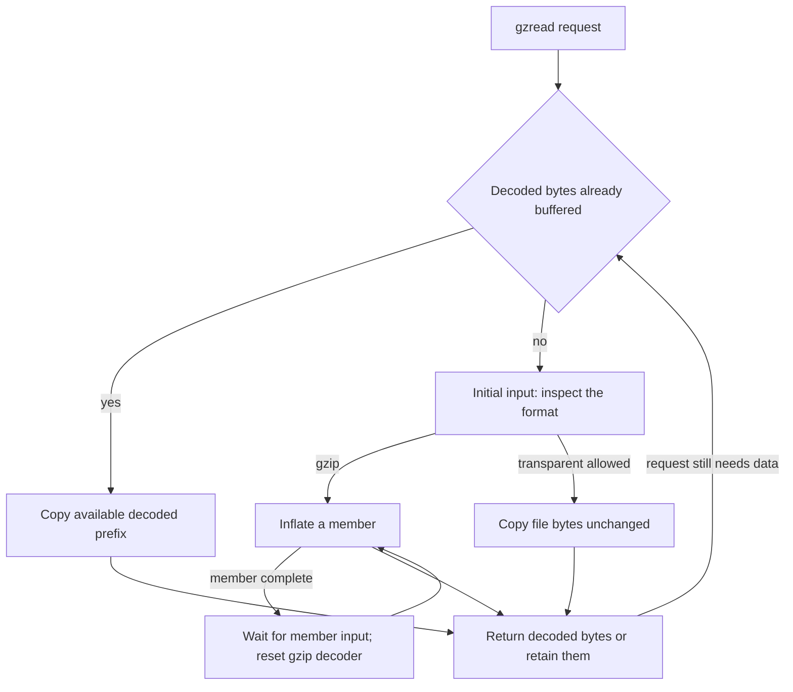
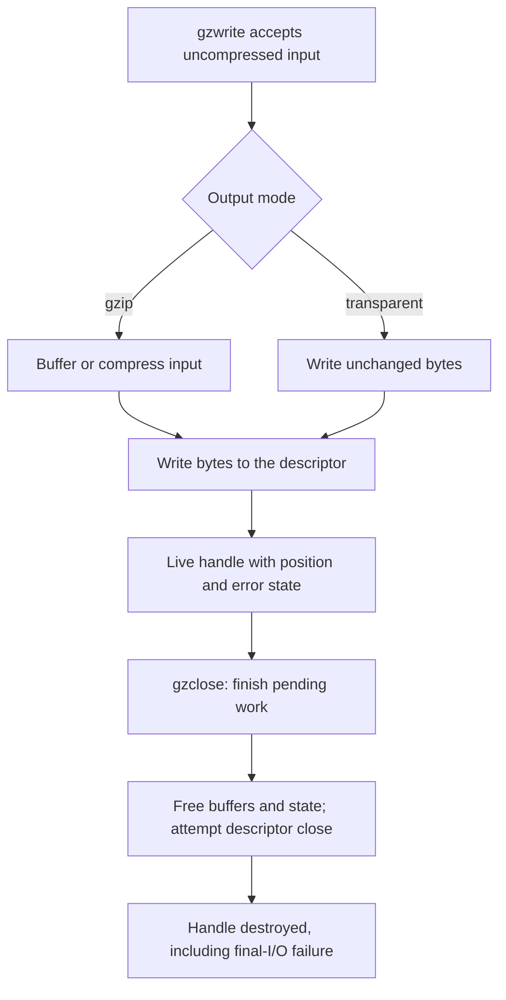

A `gzFile` adds a file protocol around the codec. It manages a descriptor, buffering, format detection, logical position and error state. The application reads or writes uncompressed bytes, while the handle decides when to fetch compressed input, run a codec, retain decoded output or issue a system write.

That extra layer explains behavior that cannot be inferred from `inflate` or `deflate` alone: a read can return transparent input, a seek can defer work, and a successful write can fail later during close. Follow those mechanisms before reading [their proof obligations](/sample/interfaces-proof.html).

## Opening and lazy storage {#opening}

`gzopen` opens a path and creates handle state. `gzdopen` instead wraps an existing descriptor without duplicating it. A successful `gzdopen` transfers responsibility for closing that descriptor to the handle; pass a duplicate if another user must retain the original. Failure leaves descriptor ownership with the caller. The application must not independently move or close the descriptor while the handle owns it.

Opening does no payload I/O. Buffer and codec allocation are deferred until first use or format inspection. The default requested buffer size is 8192 bytes. `gzbuffer` can change that request before buffers exist; its success does not guarantee that later allocation succeeds. It is already too late after an operation such as `gzdirect` has triggered allocation. “Query” is not necessarily synonymous with “no I/O.”

In the selected implementation, a reader uses an input buffer and a double-sized output buffer. A compressed writer uses a double-sized input buffer and an output buffer. Transparent writing does not need that codec output allocation. These source arrangements remain **to confirm** by the [gzip implementation argument](/reference/docs/proof/gzip.html), including every failure and ownership transition.

## Detection and read paths {#reading}

An ordinary reader can accept gzip or return uncompressed input transparently. Detection looks for a plausible four-byte gzip header, not just the first two magic bytes. Empty input is transparent; a forced-gzip mode has a different requirement. Short or temporarily unavailable input needs its own handling before the choice is settled.

The actual reader has three useful data paths: consume existing decoded bytes, copy transparent data directly into the caller's buffer, or inflate directly into a sufficiently large caller buffer. Direct paths avoid an extra copy through internal output storage. They also change which pointers can refer to caller memory, making lifetime reasoning more demanding.

Gzip members are concatenated in the logical output. If one member yields `ABC` and the next `DEFG`, the application reads `ABCDEFG`. A completed member returns to `LOOK`, but the subsequent-member branch is different from initial format detection: it waits for input when necessary, then resets the gzip decoder to attempt another member. It does not rerun the original four-byte classifier to choose transparent input. Ordinary reading has additional rules for trailing non-member bytes; it does not promise to pass arbitrary trailing junk through after gzip decoding. The [gzread contract](/reference/functions/gzread.html) and [format rules](/reference/docs/spec/api/gz-file.html) give the exact conditions.

`gzeof` records an attempted read beyond available data. It is not simply “the last byte was returned.” A zero result needs interpretation with `gzerror`: a complete end and truncated compressed data are different outcomes. Buffered bytes can remain deliverable before an existing error is reported. For item reads, `gzfread` returns complete item counts, while a final partial item can still have been consumed and written into the destination.

## Logical position and seeking {#position}

`gztell` reports the uncompressed logical position. `gzoffset` reports the compressed-file offset after accounting for buffered compressed input. Those numbers generally differ. Reading three decoded bytes can cause the handle to fetch many compressed bytes and even inspect later structures; neither buffer size nor compression ratio gives a fixed conversion between the positions.

Consider the two-member output `ABCDEFG`. After consuming `ABC`, logical position is 3. Requesting `gzseek(file, 5, SEEK_SET)` moves toward the location before `F`. A gzip reader may record a forward skip and perform its decompression during later I/O. The initial success of the seek therefore does not guarantee that the source actually contains enough valid data to fulfill that skip.

A backward compressed seek has another cost. Seeking from there to position 1 can require rewinding to the remembered file start and decoding forward again. There is no general compressed-byte offset for the second uncompressed byte that the library can calculate without decoding. A transparent reader can instead use a direct descriptor seek when permitted. Writing permits forward seeks by supplying zero bytes during later output, flush or close, and refuses backward seeks.

The ordinary origins are `SEEK_SET` and `SEEK_CUR`; `SEEK_END` is not supported. Position arithmetic must remain representable. Pushback can even create a negative logical position at the start. The [gzseek64 contract](/reference/functions/gzseek64.html) retains its source caveats rather than silently excluding that edge case. A successful seek request can leave deferred work, so a zero-length read or write is not a promise to execute it.

## Accepted writes and final cleanup {#writing}

Small writes can be copied into the handle's input buffer; larger ones can be compressed from caller storage directly. Transparent mode writes the bytes without gzip encoding. `gzwrite` normally reports accepted uncompressed bytes, not bytes safely delivered to a file. The handle can still contain input awaiting compression or compressed output awaiting a system write.

For a hard failure, a write can consume a prefix despite returning failure; zero is not always a safe offset from which to resend the whole request. A would-block stall can instead return a short accepted count, with its own retry protocol. Item writes likewise report complete items even when a partial item has been accepted. Read the specific [gzwrite](/reference/functions/gzwrite.html) or [gzfwrite](/reference/functions/gzfwrite.html) contract before deriving a retry loop.

Check errors while the handle is live. `gzerror` returns text whose lifetime can end when a later operation replaces or clears the message. Writer close attempts pending zero fill and `Z_FINISH`, then releases storage and attempts descriptor close even if output failed. Reader close does not decode all remaining input to validate it. A close error does not keep a valid handle alive: do not retry close or ask `gzerror` through the destroyed handle.

The public [gzip index](/reference/api.html?group=gz-file) groups open/configuration, data I/O, position, status and close operations. The [external-I/O model](/reference/docs/design/external-io.html) separately describes which file behaviors the current formal world represents. Understanding the file API is necessary before judging the coverage of a theorem over that world; neither a codec result nor a regular-file model result automatically covers every OS behavior.
