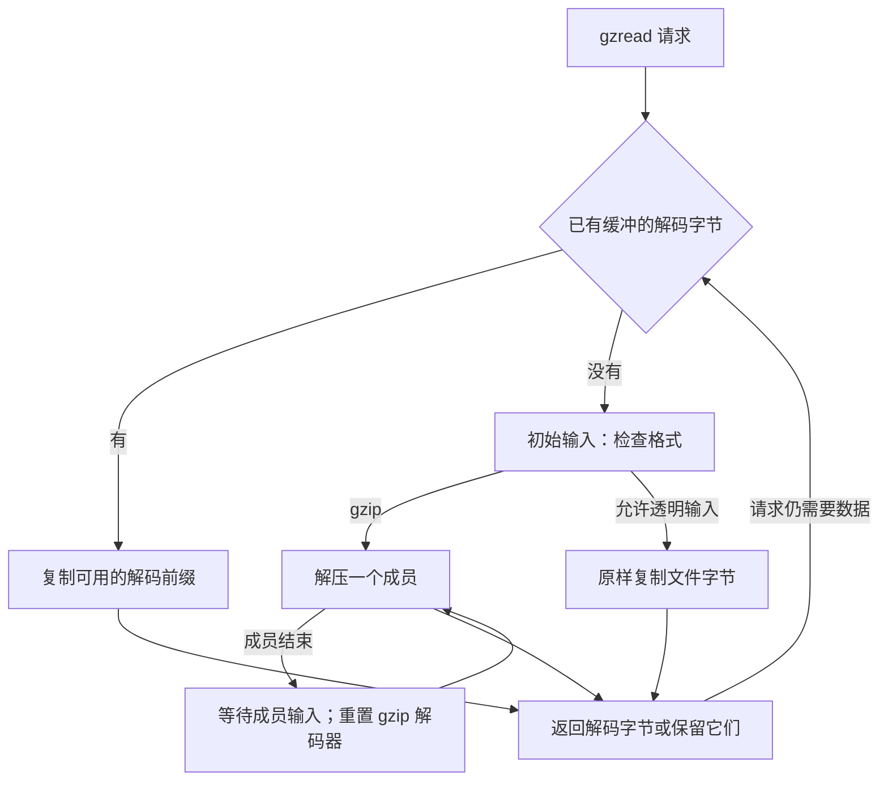
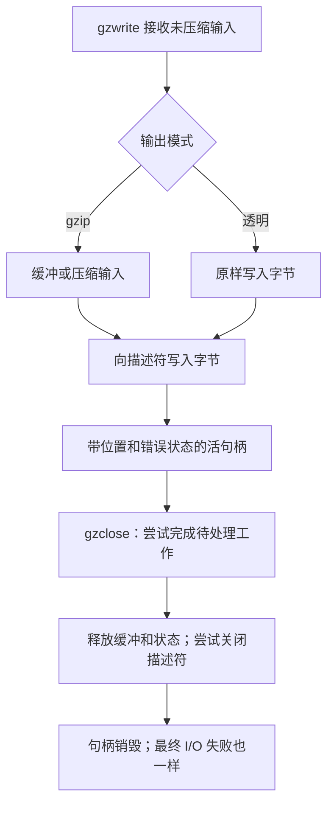

`gzFile` 在编解码器外面再加一层文件协议，管理描述符、缓冲、格式检测、逻辑位置和错误状态。应用程序读写未压缩字节，句柄则决定何时获取压缩输入、运行编解码器、保留解码输出，或者发起系统写入。

这一层解释了单看 `inflate`、`deflate` 推不出的行为：读取可以返回透明输入，seek 可以推迟工作，成功写入之后仍可能在 close 时报错。先理解这些机制，再阅读[相应的证明义务](/sample/interfaces-proof.html)。

## 打开与延迟分配 {#opening}

`gzopen` 打开路径并创建句柄状态。`gzdopen` 则包装已有描述符，不复制它。成功的 `gzdopen` 把关闭描述符的责任转交给句柄；如果另一位使用者还需要原描述符，应传入它的副本。失败时，描述符仍归调用者负责。句柄拥有描述符期间，应用程序不能另外移动或关闭它。

打开不会执行载荷 I/O。缓冲区与编解码器的分配推迟到第一次使用或格式检查。默认请求的缓冲大小是 8192 字节。缓冲区尚不存在时，`gzbuffer` 可以改变这个请求，但成功不保证后续分配一定成功。若 `gzdirect` 等操作已经触发分配，再设置就太迟了。“查询”并不总意味着“不会执行 I/O”。

选定实现中的 reader 使用输入缓冲区和两倍大小的输出缓冲区；压缩 writer 使用两倍大小的输入缓冲区和一个输出缓冲区。透明写入不需要编解码器的输出分配。这些源码安排仍需 [gzip 实现论证](/reference/docs/proof/gzip.html)确认（**to confirm**），包括每一条失败路径和所有权转移。

## 检测与读取路径 {#reading}

普通 reader 可以接收 gzip，也可以透明地返回未压缩输入。检测要求看起来合理的四字节 gzip 头，不只检查前两个魔数字节。空输入属于透明输入；强制 gzip 模式有不同要求。输入太短或暂时无法取得时，还要先处理相应状态，才能确定走哪一条路径。

实际 reader 有三条值得区分的数据路径：消费已有解码缓冲；把透明输入直接复制到调用者缓冲区；或者直接解压到足够大的调用者缓冲区。直接路径省去经过内部输出存储的一次复制，却也改变了哪些指针可以指向调用者内存，使生命周期推理更复杂。

gzip 成员会在逻辑输出中拼接。若第一个成员产生 `ABC`，第二个产生 `DEFG`，应用程序读到的是 `ABCDEFG`。成员结束后会返回 `LOOK`，但后续成员分支与初始格式检测不同：必要时先等待输入，再重置 gzip 解码器，尝试下一个成员。它不会重新运行最初的四字节分类，把输入改判为透明数据。gzip 解码之后的非成员尾随字节另有规则，并不保证把任意垃圾原样继续返回。精确条件见 [gzread 契约](/reference/functions/gzread.html)和[格式规则](/reference/docs/spec/api/gz-file.html)。

`gzeof` 记录的是一次超出可用数据的读取尝试，不能直接解释成“最后一个字节已经返回”。零返回值需要结合 `gzerror` 理解：完整结束和压缩数据截断不是同一种结果。已有错误被报告之前，缓冲字节仍可能继续交付。按项读取时，`gzfread` 返回完整项数，而最后一个不完整项仍可能已经被消费并写进目标区。

## 逻辑位置与定位 {#position}

`gztell` 报告未压缩的逻辑位置，`gzoffset` 报告扣除压缩输入缓冲影响后的文件偏移。这两个数通常不同。读取三个解码字节，可能已经让句柄获取了很多压缩字节，甚至检查后续结构；缓冲大小和压缩率都不能提供固定的位置换算。

继续考虑两个成员产生的 `ABCDEFG`。消费 `ABC` 后，逻辑位置是 3。请求 `gzseek(file, 5, SEEK_SET)`，要到达 `F` 前面的位置。gzip reader 可以先记录向前跳过的数量，等后续 I/O 再进行相应解压。因此，seek 当下成功，不保证源里确实有足够且有效的数据来完成这项跳过。

压缩输入的向后定位还有另一种成本。从这里返回位置 1，可能需要先回到记住的文件起点，再重新向前解码。库通常无法在不解码的情况下，算出第二个未压缩字节对应的压缩文件偏移。透明 reader 在允许时可以直接定位描述符。writer 则通过后续输出、flush 或 close 补充零字节来完成向前定位，不允许向后定位。

普通起点为 `SEEK_SET` 和 `SEEK_CUR`，不支持 `SEEK_END`。位置算术必须可以表示。起始处的 pushback 甚至能产生负逻辑位置。[gzseek64 契约](/reference/functions/gzseek64.html)保留相应源码疑点，没有悄悄排除这种边界。成功的 seek 请求可以留下推迟的工作，因此零长度读写也不保证执行这项工作。

## 写入接收与最终清理 {#writing}

小写入可以复制到句柄的输入缓冲区，较大的写入可以直接从调用者存储进行压缩。透明模式原样写入，不进行 gzip 编码。`gzwrite` 通常报告已经接收的未压缩字节，不代表相应内容已经安全交付给文件：句柄里仍可能保留等待压缩的输入，或者等待系统写入的压缩输出。

硬失败可能在返回失败之前已经消费一段前缀，因此零并不总是让调用者可以从头安全重发整个请求的位置。would-block 停顿则可能返回较短的接收量，并有自己的重试协议。按项写入同样只报告完整项，即使一个部分项已经被接收。建立重试循环前，应查看具体的 [gzwrite](/reference/functions/gzwrite.html) 或 [gzfwrite](/reference/functions/gzfwrite.html) 契约。

要在句柄仍存活时检查错误。`gzerror` 返回的文本可能在后续操作替换或清理错误消息时失效。writer close 尝试补齐待处理零字节并执行 `Z_FINISH`，然后即使输出失败，也会释放存储并尝试关闭描述符。reader close 不会解码剩余全部输入来验证它。关闭报错并不让有效句柄继续存活：不要再次 close，也不要通过已销毁的句柄查询 `gzerror`。

[公开 gzip 索引](/reference/api.html?group=gz-file)按打开与配置、数据 I/O、位置、状态和关闭组织入口。[外部 I/O 模型](/reference/docs/design/external-io.html)则另行说明当前形式化世界能表示哪些文件行为。先理解文件 API，才能判断一个关于该世界的定理究竟覆盖什么；编解码器结果和普通文件模型结果，都不能自动覆盖所有操作系统行为。
