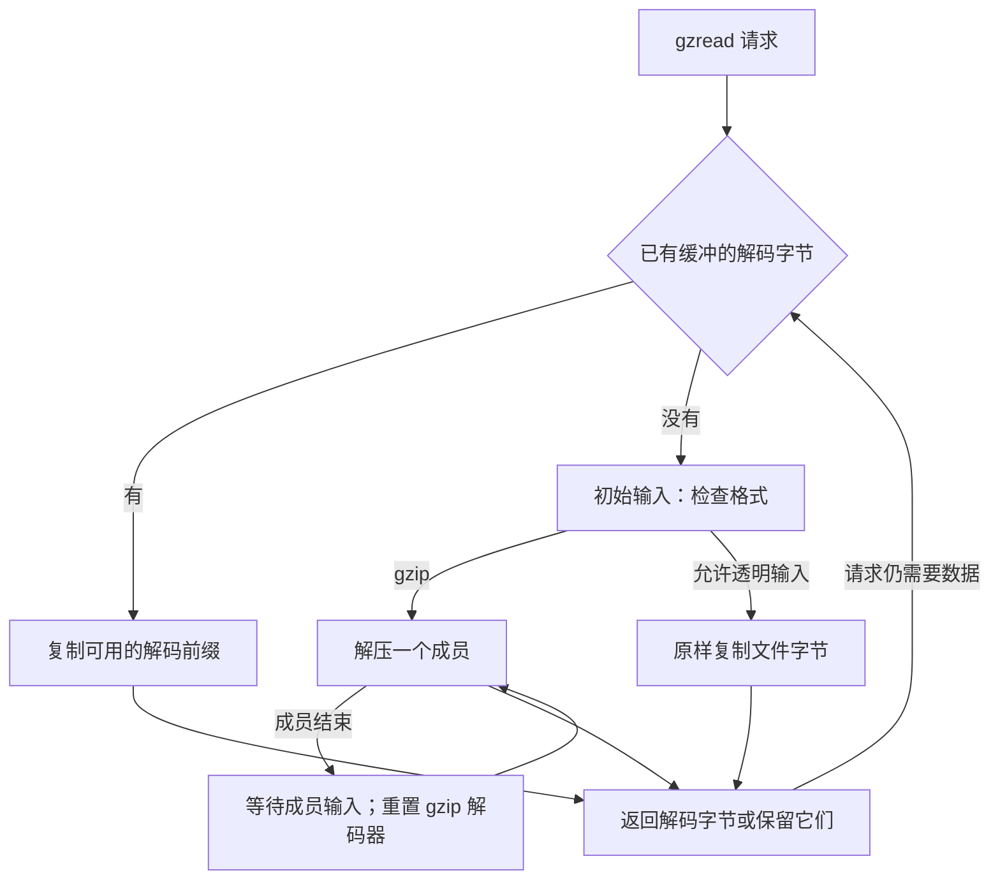
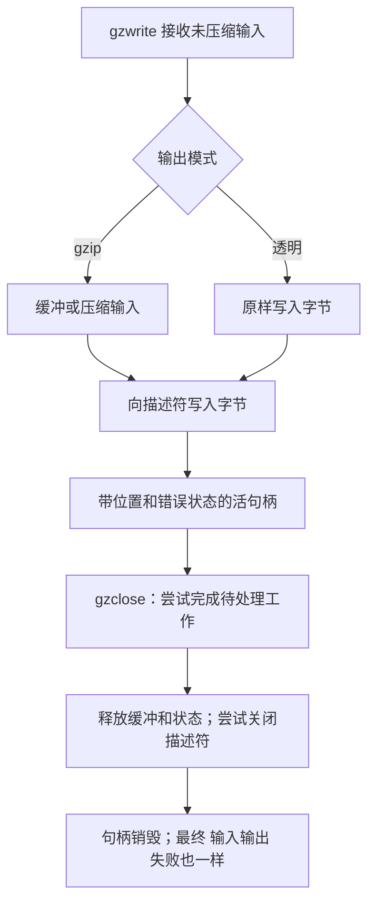

你手里有一个文件，希望应用程序读到的是普通字节。它可能经过 gzip 压缩，可能包含多个连续 gzip 成员，也可能是未压缩文件。这时可选择 `gzFile` 读取接口，让 zlib 管理文件读取、格式检测、缓冲和解码。输入是路径或描述符，`gzread` 的输出则是调用者存储中的未压缩字节。写文件要另开写模式句柄，接收未压缩输入并形成 gzip 文件。

## 读取一个双成员文件 {#example}

设文件内容为 `gzip("ABC")` 后面紧接 `gzip("DEFG")`，中间没有分隔符。每个 `gzip(...)` 都表示带有头尾的完整 gzip 成员。逻辑输出是七字节 `ABCDEFG`。下面的完整教学程序对指定的阻塞文件每次请求三个字节，并把返回字节写到标准输出。它在关闭前检查活句柄的错误，最后也检查关闭结果。

```c
#include <stdio.h>
#include <zlib.h>

int main(int argc, char **argv) {
    if (argc != 2) return 1;
    gzFile file = gzopen(argv[1], "rb");
    if (file == NULL) return 1;
    int ok = gzbuffer(file, 16) == 0;
    unsigned char bytes[3];
    while (ok) {
        int n = gzread(file, bytes, sizeof bytes);
        if (n > 0) {
            if (fwrite(bytes, 1, (size_t)n, stdout) != (size_t)n)
                ok = 0;
            continue;
        }
        int code;
        const char *message = gzerror(file, &code);
        if (n < 0 || (code != Z_OK && code != Z_STREAM_END)) {
            fprintf(stderr, "%s\n", message);
            ok = 0;
        }
        break;
    }
    int closed = gzclose(file); /* file is no longer usable */
    return !(ok && closed == Z_OK);
}
```

普通成功执行依次返回 `ABC`、`DEF`、`G`、零。第二次请求跨越成员边界，应用程序无需重置。如果输入改成内容为 `ABCDEFG` 的普通文件，透明路径也会交付相同应用字节。这是两种不同的输入情形，不能据此认为 gzip 成员后的任意字节都会变成透明输出。

因此，`gzFile` 管理的不只是编解码器，还有描述符所有权、未读压缩输入、已解码输出、逻辑位置和错误状态。下面从打开到关闭，追踪这些责任。[相应证明](/sample/interfaces-proof.html)需要同时描述文件世界与内存。

## 打开与延迟分配 {#opening}

`gzopen` 打开路径并创建句柄状态。`gzdopen` 则包装已有描述符，不复制它。成功的 `gzdopen` 把关闭描述符的责任转交给句柄；如果另一位使用者还需要原描述符，应传入它的副本。失败时，描述符仍归调用者负责。句柄拥有描述符期间，应用程序不能另外移动或关闭它。

打开不会执行载荷 输入输出。缓冲区与编解码器的分配推迟到第一次使用或格式检查。默认请求的缓冲大小是 8192 字节。缓冲区尚不存在时，`gzbuffer` 可以改变这个请求，但成功不保证后续分配一定成功。若 `gzdirect` 等操作已经触发分配，再设置就太迟了。“查询”并不总意味着“不会执行 输入输出”。

选定实现中的读取句柄使用输入缓冲区和两倍大小的输出缓冲区；压缩写入句柄使用两倍大小的输入缓冲区和一个输出缓冲区。透明写入不需要编解码器的输出分配。完整 gzip 接口证明未完成；这些分配与读写路径还需要逐一建立失败清理和所有权转移的结论，详见 [gzip 实现论证](/reference/docs/proof/gzip.html)。

## 检测与读取路径 {#reading}

普通读取句柄可以接收 gzip，也可以透明地返回未压缩输入。检测要求看起来合理的四字节 gzip 头，不只检查前两个魔数字节。空输入属于透明输入；强制 gzip 模式有不同要求。输入太短或暂时无法取得时，还要先处理相应状态，才能确定走哪一条路径。



这里的 `strm` 是句柄内部的解码流，`next_in` 指向第一个未读压缩字节，`avail_in` 是从那里起可读的字节数；数量大于三，才可以读取四个索引。句柄的 `how` 字段选择读取路线：`LOOK` 表示检查下一个成员，`COPY` 表示透明复制，`GZIP` 表示解码；`direct` 标志记录透明模式，`junk` 用于跟踪尾随垃圾的处理路径。

第一个成员通过下面这段真实的 [gzread.c:158–166](https://github.com/madler/zlib/blob/757f0527154291bcf6bfbd6396ecde6bedd2db95/gzread.c#L158-L166) 分类代码进入 gzip 路径：

```c
    if (strm->avail_in > 3 &&
            strm->next_in[0] == 31 && strm->next_in[1] == 139 &&
            strm->next_in[2] == 8 && strm->next_in[3] < 32) {
        inflateReset(strm);
        state->how = GZIP;
        state->junk = 0;
        state->direct = 0;
        return 0;
    }
```

检查的依次是魔数 `1f 8b`、DEFLATE 方法 `08`，以及没有保留高位的标志字节。这只负责选择 gzip 路径，不负责验证完整头尾。普通 `ABCDEFG` 不符合分类条件，会进入 `COPY`。本例第二个成员则走更早的 [124–139 行](https://github.com/madler/zlib/blob/757f0527154291bcf6bfbd6396ecde6bedd2db95/gzread.c#L124-L139)：必要时等待输入，然后重置 `inflate`，直接选择 `GZIP`。阅读流程图时，要保留这两条路径的区别。

实际读取句柄有三条值得区分的数据路径：消费已有解码缓冲；把透明输入直接复制到调用者缓冲区；或者直接解压到足够大的调用者缓冲区。直接路径省去经过内部输出存储的一次复制，却也改变了哪些指针可以指向调用者内存，使生命周期推理更复杂。

gzip 成员会在逻辑输出中拼接。若第一个成员产生 `ABC`，第二个产生 `DEFG`，应用程序读到的是 `ABCDEFG`。成员结束后会返回 `LOOK`，但后续成员分支与初始格式检测不同：必要时先等待输入，再重置 gzip 解码器，尝试下一个成员。它不会重新运行最初的四字节分类，把输入改判为透明数据。gzip 解码之后的非成员尾随字节另有规则，并不保证把任意垃圾原样继续返回。精确条件见 [gzread 契约](/reference/functions/gzread.html)和[格式规则](/reference/docs/spec/api/gz-file.html)。

`gzeof` 记录的是一次超出可用数据的读取尝试，不能直接解释成“最后一个字节已经返回”。零返回值需要结合 `gzerror` 理解：完整结束和压缩数据截断不是同一种结果。已有错误被报告之前，缓冲字节仍可能继续交付。按项读取时，`gzfread` 返回完整项数，而最后一个不完整项仍可能已经被消费并写进目标区。

## 逻辑位置与定位 {#position}

`gztell` 报告未压缩的逻辑位置，`gzoffset` 报告扣除压缩输入缓冲影响后的文件偏移。这两个数通常不同。读取三个解码字节，可能已经让句柄获取了很多压缩字节，甚至检查后续结构；缓冲大小和压缩率都不能提供固定的位置换算。

回到程序中两个成员产生的 `ABCDEFG`。消费 `ABC` 后，逻辑位置是 3。请求 `gzseek(file, 5, SEEK_SET)`，要到达 `F` 前面的位置。gzip 读取句柄可以先记录向前跳过的数量，等后续 输入输出 再进行相应解压。因此，定位请求当下成功，不保证源里确实有足够且有效的数据来完成这项跳过。

在这段代码中，`pos` 是请求到达的未压缩绝对位置，`offset` 则是在使用已有输出缓冲之后，还需要跳过的未压缩字节数。把它存入 `state->skip`，是在登记后续读取要完成的工作，不是在记录一个压缩文件偏移。

真实 seek 实现先消费可用的已缓冲输出，再把剩余工作记录下来。下面两句来自 [`gzlib.c:426–438`](https://github.com/madler/zlib/blob/757f0527154291bcf6bfbd6396ecde6bedd2db95/gzlib.c#L426-L438)：

```c
    state->skip = offset;
    return pos;
```

从逻辑位置 3 请求位置 5 时，已经缓冲的 `DE` 可以直接跳过；尚未缓冲的部分才记入 `skip`。两种路线都指向 `F` 之前。返回 `pos` 报告请求的逻辑位置，剩余工作却可能还没执行。

压缩输入的向后定位还有另一种成本。从这里返回位置 1，可能需要先回到记住的文件起点，再重新向前解码。库通常无法在不解码的情况下，算出第二个未压缩字节对应的压缩文件偏移。透明读取句柄在允许时可以直接定位描述符。写入句柄则通过后续输出、刷新请求或关闭操作补充零字节来完成向前定位，不允许向后定位。

支持的定位基准有两种：`SEEK_SET` 从逻辑位置零计算请求，`SEEK_CUR` 从当前逻辑位置计算；`SEEK_END` 要从解码后的末尾计算，这一模式不受支持。位置算术必须可以表示。起始处退回一个已读字节，甚至能产生负逻辑位置。[gzseek64 契约](/reference/functions/gzseek64.html)保留相应源码疑点，没有悄悄排除这种边界。成功的定位请求可以留下推迟的工作，因此零长度读写也不保证执行这项工作。

## 写入接收与最终清理 {#writing}

小写入可以复制到句柄的输入缓冲区，较大的写入可以直接从调用者存储进行压缩。透明模式原样写入，不进行 gzip 编码。`gzwrite` 通常报告已经接收的未压缩字节，不代表相应内容已经安全交付给文件：句柄里仍可能保留等待压缩的输入，或者等待系统写入的压缩输出。



硬失败可能在返回失败之前已经消费一段前缀，因此返回零不总意味着可以从头安全重发整个请求。非阻塞写入暂时无法继续时，调用则可能报告较短的接收量；应用需要遵循相应的重试协议。按项写入同样只报告完整项，即使一个部分项已经被接收。建立重试循环前，应查看具体的 [gzwrite](/reference/functions/gzwrite.html) 或 [gzfwrite](/reference/functions/gzfwrite.html) 契约。

程序把 `gzerror` 放在 `gzclose` 前面，原因是必须在句柄仍存活时检查错误。`gzerror` 返回的文本可能在后续操作替换或清理错误消息时失效。写入句柄的关闭操作尝试补齐待处理零字节并执行 `Z_FINISH`，然后即使输出失败，也会释放存储并尝试关闭描述符。读取句柄的关闭操作不会解码剩余全部输入来验证它。关闭报错并不让有效句柄继续存活：不要再次关闭操作，也不要通过已销毁的句柄查询 `gzerror`。

写入句柄还要承担本例只读程序没有的最终完成义务。[真实的写入句柄关闭主体，gzwrite.c:715–734](https://github.com/madler/zlib/blob/757f0527154291bcf6bfbd6396ecde6bedd2db95/gzwrite.c#L715-L734)记录补零或完成失败后，仍然继续释放缓冲、关闭描述符并释放句柄。这个顺序解释了：即使 `gzwrite` 看起来成功，也必须检查关闭操作，而且不能通过同一句柄重试关闭操作。

[公开 gzip 索引](/reference/api.html?group=gz-file)按打开与配置、数据 输入输出、位置、状态和关闭组织入口。[外部 输入输出 模型](/reference/docs/design/external-io.html)则另行说明当前形式化世界能表示哪些文件行为。先理解文件 API，才能判断一个关于该世界的定理究竟覆盖什么；编解码器结果和普通文件模型结果，都不能自动覆盖所有操作系统行为。
