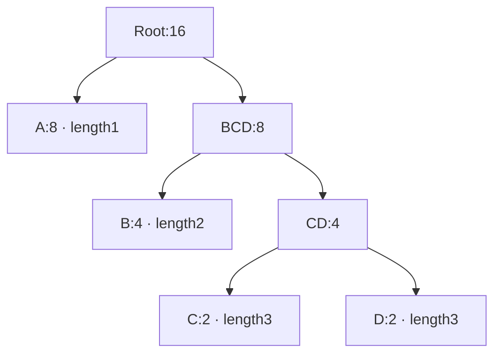

Huffman construction turns symbol counts into a merge tree. Frequent symbols sit nearer the root and usually receive shorter words. We will calculate a four-symbol tree and connect each merge to the zlib array operations. [The next chapter](/sample/huffman-lengths.html) handles format limits, final code words and the description sent to the decoder.

[Matching](/sample/match-search.html) has already turned input into literals and length/distance records. The next problem is to spend fewer bits on frequent records while keeping symbols distinguishable to a decoder. Choosing Huffman codes for a dynamic block serves that purpose.

## Frequencies and live leaves {#frequencies}

The **input** is one alphabet's frequency table, not the original input bytes. An alphabet is the set of symbol numbers that one code table can represent. Literal/length symbols describe either a literal byte or the length of a match; distance symbols describe how far back that match starts. They have separate frequency tables. The literal/length alphabet also contains `END_BLOCK`, the marker telling the decoder that this block has ended. The eventual **output** is lengths and words for those symbols. This chapter first derives the parent links that determine initial lengths. Unused symbols need no code; artificial leaves added during preparation need separate accounting.

Start with four abstract symbols: `A:8, B:4, C:2, D:2`, or 16 occurrences in total. A is common and should be short; C and D can be longer. This alphabet illustrates the algorithm, not a complete DEFLATE block.

A Huffman merge repeatedly combines the two least frequent available subtrees. Frequent symbols tend to remain closer to the root, so their eventual codes are shorter. For the four-symbol example, lengths `1,2,3,3` cost `8×1 + 4×2 + 2×3 + 2×3 = 28` payload bits, compared with 32 bits for a fixed two-bit representation. A dynamic DEFLATE block must still pay to describe its lengths; payload savings alone do not settle the block choice.

## A complete merge trace {#merges}

Initially each symbol is a subtree on its own, with its occurrence count as weight and height zero. Each round takes the two lightest subtrees and joins them under a new parent. The parent weight is their sum; its height is one plus the larger child height. The source calls this already-built subtree height `depth`. It is not yet the symbol’s distance from the eventual root.

In the example, the first two selected leaves have weights 2 and 2. Their parent, called `CD` here, has weight 4 and stored depth 1. The active queue is now `B:4`, `CD:4`, `A:8`.

The next tie makes the meaning of depth concrete. `B` has depth 0, while `CD` has depth 1, so `B` is selected first. The next selected subtree is `CD`. Their parent has weight 8 and depth 2. Finally, the leaf `A:8` is preferred to that depth-two subtree of equal weight, and they are joined into the root.

| Merge | Selected weights and depths | New parent | Active subtrees afterwards |
| --- | --- | --- | --- |
| 1 | C `(2,0)`, D `(2,0)` | CD `(4,1)` | B, CD, A |
| 2 | B `(4,0)`, CD `(4,1)` | BCD `(8,2)` | A, BCD |
| 3 | A `(8,0)`, BCD `(8,2)` | Root `(16,3)` | Root |

The C/D tie can choose either orientation without changing their lengths. At this stage, left and right bit labels have not been assigned. Walking parent links gives A one edge to the root, B two, and C/D three. Later canonical assignment will choose code words from these lengths and symbol order.



When only Root remains, one tree contains all 16 input occurrences. Counting edges along parent links gives this stage’s output: `A:1, B:2, C:3, D:3`. The drawing’s left/right orientation does not yet choose bits. Shared lengths and symbol order let both ends assign the same canonical words in the next phase.

## The priority queue and the coding tree {#queue}

The C builder does not allocate an object for every node. It uses arrays already embedded in `deflate_state`. A descriptor chooses the literal/length tree, distance tree or code-length tree, its alphabet size and maximum permitted length. The respective alphabets have 286, 30 and 19 symbols. The selected alphabet size is called `elems` in C. Original symbols occupy node numbers 0 through `elems-1`; the array also has room for parents, whose numbers start at `elems`. For the 286-symbol alphabet, node 286 is therefore the first possible parent, not a literal byte.

`build_tree` scans the alphabet. A positive-frequency symbol is placed in the active heap and receives `depth = 0`. A zero-frequency symbol receives length zero. `max_code` records the largest symbol that the prepared tree needs to represent. Thus an unused symbol and an unread, arbitrary old array cell are different things: the scan explicitly establishes the unused length.

If fewer than two live leaves exist, a preparation loop adds artificial frequency-one leaves. This avoids a special zero-bit encoding case in later processing. The source also compensates its cost counters for these artificial counts. The prepared alphabet therefore differs from the original frequency list in a precise, limited way. A proof or cost calculation must account for that preparation rather than silently treating every prepared frequency as an observed input symbol.

There are two different tree shapes in the implementation. `heap[1]` names the node of least weight under the comparison rule. For a queue slot numbered k, slots `2k` and `2k+1` are its children used to restore heap order. These numbers are array slots, while the value stored in each slot is a node number. They are **not** the children of node `heap[k]` in the Huffman coding tree.

In the example, the priority queue may place the numbers of A, B and CD in neighboring slots; this determines which subtree can be removed next. In the coding tree, C and D have CD as their parent. Sifting can move CD’s number to another queue slot without changing those parent links. The latter live in each node’s `Dad` field.

The comparison first uses frequency. At equal frequencies it uses the `depth` array, preferring the smaller depth; the comparison includes equality. A prepared leaf has depth zero. A new internal node receives one plus the larger depth of its children. Here depth describes the height of the subtree already assembled, not the leaf's final distance from the future root. This tie rule helps avoid unnecessarily deep codes when weights are equal. It does not impose a symbol-number order on every remaining tie.

The populated queue is heapified from its last internal heap position down to 1. In `pqdownheap`, the displaced node is kept in a local variable. The smaller queue child moves up, opening the next slot, until that displaced node can be placed. This is a sift-down operation, not a complete re-sort after every insertion. Initial heapification is linear in the number of entries; subsequent merges use logarithmic-height queue repairs.

The first root is removed with `pqremove`, which replaces it by the last active entry and restores order. The second least node is now at the root. zlib can replace that root directly with the new parent and sift it down. Each merge reduces the active queue by one; there is no need for a separately allocated priority-queue object.

### Finding those three merges in C {#merge-code}

This is a verbatim excerpt of pinned [`trees.c:681–684`](https://github.com/madler/zlib/blob/757f0527154291bcf6bfbd6396ecde6bedd2db95/trees.c#L681-L684). `s` points to the compressor state, and `tree` is the selected node array. `n` and `m` are the selected subtree node numbers; `node` is their new parent number. A node's `Freq` field stores its occurrence weight, `Dad` stores its parent number, and `s->depth` stores subtree heights measured in edges. The casts `uch` and `ush` mean unsigned byte and unsigned short in this build:

```c
        tree[node].Freq = tree[n].Freq + tree[m].Freq;
        s->depth[node] = (uch)((s->depth[n] >= s->depth[m] ?
                                s->depth[n] : s->depth[m]) + 1);
        tree[n].Dad = tree[m].Dad = (ush)node;
```

The first line calculates `2+2=4` in round one. The depth expression calculates `max(0,0)+1=1`. The last line points both C and D to CD. Round two similarly gives BCD weight 8 and height 2; round three gives the root weight 16 and height 3. The casts reflect actual field widths and cannot be dropped from a proof. [`Lines 692–693`](https://github.com/madler/zlib/blob/757f0527154291bcf6bfbd6396ecde6bedd2db95/trees.c#L692-L693) then put the parent back in the queue, advance its node number and sift down.

## Reused storage and traversal order {#storage}

Why use arrays rather than allocate the parent/child objects in the drawing? All three trees are rebuilt for blocks. Reusing existing arrays avoids individual node and queue allocations. Retaining removal order lets the next pass calculate lengths directly. The cost is that the same storage changes meaning, which the proof must track phase by phase.

The `heap` array serves another purpose after nodes leave the active queue. Its high end retains selected nodes, while `heap_max` moves down by two per merge. The final root is stored before that retained region. Traversing the retained region forward then encounters a parent before its descendants. This is the order `gen_bitlen` needs: it can read the parent's assigned length and add one, without recursively traversing a separately allocated tree.

Count both regions after each merge. Let `K` count prepared leaves and `t` completed merges; the example has `K=4`. Taking two roots and returning one parent reduces the active queue by one. The two removed node numbers each occupy a retained slot:

| Completed merges t | Active queue entries `K−t` | Retained removed numbers `2t` |
| --- | --- | --- |
| 0 | 4 | 0 |
| 1 | 3 | 2 |
| 2 | 2 | 4 |
| 3 | 1 | 6 |

The shared capacity is `HEAP_SIZE = 2×286+1 = 573`, enough for the largest alphabet, with an extra slot for the queue’s one-based indexing. The retained region grows downward from the high end. Its start cursor `heap_max` decreases by two per round, giving `heap_max = 573−2t` before the final root store. Internal numbers start at the alphabet size, and at most `K−1` are created.

The proof needs both capacity and separation: each location must lie within the array, and the retained region must not reach the still-active queue. The first condition alone could permit an in-bounds write to destroy a live queue entry.

[`deflate.h:72–81`](https://github.com/madler/zlib/blob/757f0527154291bcf6bfbd6396ecde6bedd2db95/deflate.h#L72-L81) declares the node’s two unions. The node record itself also changes meaning across phases. Its `fc` union holds a frequency during construction and a code word after assignment. Its `dl` union holds a parent and later a code length. The implementation avoids extra arrays by overwriting values after their last use. Reading a final code word as if it were still the original frequency would invalidate both a cost argument and a structural argument. The correspondence has to name the phase in which a value is interpreted.

Machine widths are equally relevant. Frequencies and parent/length fields are 16-bit values; the auxiliary depth is an unsigned byte. Defined unsigned wrapping does not automatically preserve mathematical sums or heights. The execution and proof must establish the bounds required by the particular claim. The representation-preservation proof across all admitted call histories is unfinished: field widths, phase changes and actual stores still need to be connected; the [tree argument](/reference/docs/proof/trees.html#heap-and-node-bounds-f7) records them explicitly.

We now have a finite parent structure and a root-to-leaf depth for every prepared symbol. [Length limiting and code descriptions](/sample/huffman-lengths.html) explains the next transformation: enforcing format limits, assigning canonical words, and telling the decoder which lengths to use. [The matching proof route](/sample/match-proof.html) supplies the earlier connection from selected records to input bytes; [the Huffman proof route](/sample/huffman-proof.html) follows the arrays just constructed.
