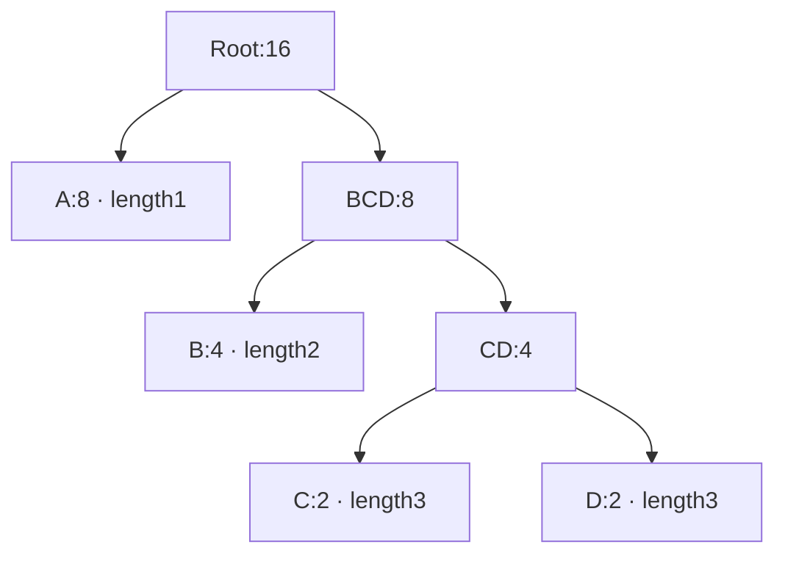

The [matching stage](/sample/match-search.html) has turned input into literals and length/distance records. A dynamic block now needs codes for those records. Its tree builder receives frequencies, not the original input bytes: one count for each literal or length code, and another alphabet for distance codes. END_BLOCK participates in the literal/length alphabet as well.

This chapter follows the actual queue and node representation before discussing code lengths. Keep a small abstract alphabet beside the implementation: `A:8`, `B:4`, `C:2`, `D:2`. It makes the operations visible without pretending to be a complete DEFLATE block alphabet.

## Frequencies and live leaves {#frequencies}

A Huffman merge repeatedly combines the two least frequent available subtrees. Frequent symbols tend to remain closer to the root, so their eventual codes are shorter. For the four-symbol example, lengths `1,2,3,3` cost `8×1 + 4×2 + 2×3 + 2×3 = 28` payload bits, compared with 32 bits for a fixed two-bit representation. A dynamic DEFLATE block must still pay to describe its lengths; payload savings alone do not settle the block choice.

The C builder does not allocate an object for every node. It uses arrays already embedded in `deflate_state`. A descriptor chooses the literal/length tree, distance tree or code-length tree, its alphabet size and maximum permitted length. The respective alphabets have 286, 30 and 19 symbols. The tree array also has room for internal nodes, which are numbered starting at `elems`.

`build_tree` scans the alphabet. A positive-frequency symbol is placed in the active heap and receives `depth = 0`. A zero-frequency symbol receives length zero. `max_code` records the largest symbol that the prepared tree needs to represent. Thus an unused symbol and an unread, arbitrary old array cell are different things: the scan explicitly establishes the unused length.

If fewer than two live leaves exist, a preparation loop adds artificial frequency-one leaves. This avoids a special zero-bit encoding case in later processing. The source also compensates its cost counters for these artificial counts. The prepared alphabet therefore differs from the original frequency list in a precise, limited way. A proof or cost calculation must account for that preparation rather than silently treating every prepared frequency as an observed input symbol.

## The priority queue and the coding tree {#queue}

There are two different tree shapes in the implementation. `heap[1]` names the least-priority node. Heap positions `2k` and `2k+1` are the queue children used to restore heap order. They are **not** the children of node `heap[k]` in the Huffman coding tree. Coding-tree ancestry is stored through the nodes' `Dad` fields after a merge.

The comparison first uses frequency. At equal frequencies it uses the `depth` array, preferring the smaller depth; the comparison includes equality. A prepared leaf has depth zero. A new internal node receives one plus the larger depth of its children. Here depth describes the height of the subtree already assembled, not the leaf's final distance from the future root. This tie rule helps avoid unnecessarily deep codes when weights are equal. It does not impose a symbol-number order on every remaining tie.

The populated queue is heapified from its last internal heap position down to 1. In `pqdownheap`, the displaced node is kept in a local variable. The smaller queue child moves up, opening the next slot, until that displaced node can be placed. This is a sift-down operation, not a complete re-sort after every insertion. Initial heapification is linear in the number of entries; subsequent merges use logarithmic-height queue repairs.

The first root is removed with `pqremove`, which replaces it by the last active entry and restores order. The second least node is now at the root. zlib can replace that root directly with the new parent and sift it down. Each merge reduces the active queue by one; there is no need for a separately allocated priority-queue object.

## A complete merge trace {#merges}

In the example, the first two selected leaves have weights 2 and 2. Their parent, called `CD` here, has weight 4 and stored depth 1. The active queue is now `B:4`, `CD:4`, `A:8`.

The next tie makes the meaning of depth concrete. `B` has depth 0, while `CD` has depth 1, so `B` is selected first. The next selected subtree is `CD`. Their parent has weight 8 and depth 2. Finally, the leaf `A:8` is preferred to that depth-two subtree of equal weight, and they are joined into the root.

| Merge | Selected weights and depths | New parent | Active subtrees afterwards |
| --- | --- | --- | --- |
| 1 | C `(2,0)`, D `(2,0)` | CD `(4,1)` | B, CD, A |
| 2 | B `(4,0)`, CD `(4,1)` | BCD `(8,2)` | A, BCD |
| 3 | A `(8,0)`, BCD `(8,2)` | Root `(16,3)` | Root |

The C/D tie can choose either orientation without changing their lengths. At this stage, left and right bit labels have not been assigned. Walking parent links gives A one edge to the root, B two, and C/D three. Later canonical assignment will choose code words from these lengths and symbol order.

For each actual merge, the source writes the sum into the next internal node, writes its subtree depth, and stores that node number as both children's parent. It then increments the internal-node cursor. These steps must occur while both selected node identities still refer to the same array entries.

## Reused storage and traversal order {#storage}

The `heap` array serves another purpose after nodes leave the active queue. Its high end retains selected nodes, while `heap_max` moves down by two per merge. The final root is stored before that retained region. Traversing the retained region forward then encounters a parent before its descendants. This is the order `gen_bitlen` needs: it can read the parent's assigned length and add one, without recursively traversing a separately allocated tree.

With `K` prepared leaves, the active heap has `K−t` entries after `t` merges, and `heap_max = 573−2t` before the final root store. Internal nodes start at the alphabet size. At most `K−1` are created. The proof needs both array capacity and separation between the growing retained tail and the shrinking active queue; an in-bounds tail write could still destroy a queue entry if those regions overlapped.

The node record itself also changes meaning across phases. Its `fc` union holds a frequency during construction and a code word after assignment. Its `dl` union holds a parent and later a code length. The implementation avoids extra arrays by overwriting values after their last use. Reading a final code word as if it were still the original frequency would invalidate both a cost argument and a structural argument. The correspondence has to name the phase in which a value is interpreted.

Machine widths are equally relevant. Frequencies and parent/length fields are 16-bit values; the auxiliary depth is an unsigned byte. Defined unsigned wrapping does not automatically preserve mathematical sums or heights. The execution and proof must establish the bounds required by the particular claim. These representation connections remain **to confirm** over all admitted caller histories; the [tree argument](/reference/docs/proof/trees.html#heap-and-node-bounds-f7) records them explicitly.

We now have a finite parent structure and a root-to-leaf depth for every prepared symbol. [Length limiting and code descriptions](/sample/huffman-lengths.html) explains the next transformation: enforcing format limits, assigning canonical words, and telling the decoder which lengths to use. [The matching proof route](/sample/match-proof.html) supplies the earlier connection from selected records to input bytes; [the Huffman proof route](/sample/huffman-proof.html) follows the arrays just constructed.
