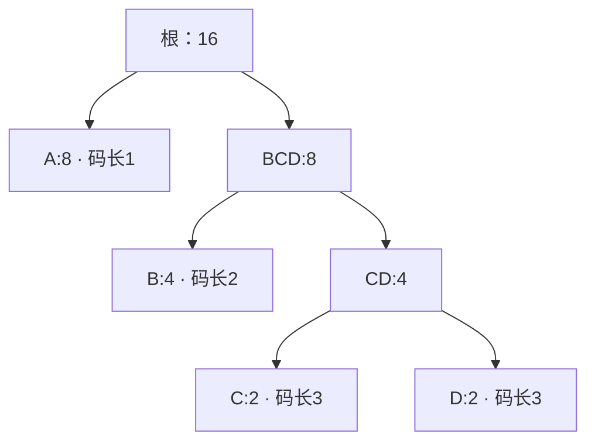

Huffman 构造把符号的出现次数变成一棵合并树：常见符号靠近根，码字通常就短。本章用四个符号手算这棵树，再把每次合并对应到 zlib 的数组读写。[下一章](/sample/huffman-lengths.html)才处理格式上限、最终码字和传给解码器的描述。

[匹配阶段](/sample/match-search.html)已经把输入转成字面量和长度／距离记录。现在的问题是：怎样让常见记录花更少的位，又让解码器能区分各个符号？这就是为动态编码块选择 Huffman 编码的用途。

## 频率与有效叶子 {#frequencies}

**输入**是一棵树所用字母表的频率表，不是原始输入字节。这里的字母表，是一套编码能够表示的符号编号集合。字面量／长度符号表示一个原文字节或一次匹配的长度，距离符号表示那次匹配要回退多远；两者各有一张频率表。字面量／长度表还包含 `END_BLOCK`，即通知解码器当前块已经结束的标记。**输出**最终是符号的码长和码字；本章先得到决定初步码长的父链接。零频率符号不用编码，准备时加入的人工叶子要另行记账。

先只用四个抽象符号：`A:8、B:4、C:2、D:2`。它们一共出现 16 次。A 最常见，应当尽量短；C、D 可以长一些。这个小字母表用来展示算法，不是一个完整的 DEFLATE 块。

Huffman 合并反复选择当前频率最小的两棵子树。常见符号倾向于停留在靠近根的位置，最终编码就较短。对这个四符号例子，码长 `1,2,3,3` 的载荷成本为 `8×1 + 4×2 + 2×3 + 2×3 = 28` 位，而每个符号固定两位需要 32 位。DEFLATE 的动态编码块仍要支付描述码长的成本，不能只看载荷节省了多少。

## 完整的合并过程 {#merges}

开始时，每个符号独自是一棵子树，权重就是出现次数，高度是零。每轮取出权重最小的两棵，把它们接到一个新父节点；父权重是两者之和，高度是较高孩子的高度加一。源码把这个“已经组好的子树高度”称为 `depth`，它还不是符号到最终根的距离。

例子中首先选中两个权重为 2 的叶子。把父节点记作 `CD`，它的权重为 4，保存的子树高度为 1。此时的有效队列包含 `B:4`、`CD:4`、`A:8`。

下一次平局让子树高度的用途变得具体：`B` 的子树高度为 0，`CD` 为 1，所以先选 `B`，再选 `CD`。它们的新父节点权重为 8，子树高度为 2。最后，权重同为 8 的叶子 `A` 优先于这个高度为二的子树，两者组成根。

| 合并 | 选中的权重与深度 | 新父节点 | 随后剩余的有效子树 |
| --- | --- | --- | --- |
| 1 | C `(2,0)`、D `(2,0)` | CD `(4,1)` | B、CD、A |
| 2 | B `(4,0)`、CD `(4,1)` | BCD `(8,2)` | A、BCD |
| 3 | A `(8,0)`、BCD `(8,2)` | 根 `(16,3)` | 根 |

C/D 的平局可以采取任一方向，不改变它们的码长。此时也还没有给左右边分配比特。沿父链接走，A 到根有一条边，B 有两条，C/D 有三条。随后，规范编码才根据这些码长与符号顺序确定码字。



合并到只剩根时，输入的 16 次出现都已包含在同一棵树内。沿父链接数边，便得到本阶段的输出 `A:1、B:2、C:3、D:3`。树的左右画法还不决定最终比特；两端只要共享码长和符号顺序，就能在下一阶段分配一致的规范码字。

## 优先队列与编码树 {#queue}

C 构造器没有为每个节点分别分配对象。它使用已经嵌在 `deflate_state` 中的数组。描述符选择字面量／长度树、距离树或码长树，以及相应的字母表大小和最大码长。三个字母表分别有 286、30 和 19 个符号。C 把选中的字母表大小记为 `elems`。原始符号占节点编号 0 到 `elems-1`；数组还给父节点留出空间，它们从编号 `elems` 开始。例如字面量／长度字母表有 286 个符号，节点 286 就是第一个可能的父节点，不是某个原文字节。

`build_tree` 先扫描字母表。正频率符号进入有效堆，并被设置为 `depth = 0`；零频率符号的长度被设置为零。`max_code` 记录准备后的树需要表示的最大符号编号。因此，“没有使用的符号”和“还留着任意旧内容的数组单元”并不相同：扫描明确建立了未使用符号的零码长。

如果有效叶子不足两片，准备循环会加入频率为一的人工叶子。这避免后续处理再为零位编码设置特殊分支。源码还会为这些人工计数补偿成本字段。因此，准备后的字母表与原始频率表之间存在一个精确、有限的差异。证明和成本计算都要把这一步记进去，不能默认所有准备后的频率都来自实际输入符号。

实现中同时存在两种不同的树形关系。`heap[1]` 保存优先级最小的节点编号。若一个队列槽位的编号为 k，则 `2k` 和 `2k+1` 是恢复堆顺序时使用的孩子槽位。这些数是数组槽位，而槽位里保存的值才是节点编号。它们**不是** Huffman 编码树中 `heap[k]` 这个节点的孩子。

可以用刚才的算例区分两种关系：优先队列可能把 A、B、CD 的编号放在相邻槽位，这只说明接下来能先取出谁；编码树中，C 与 D 的父节点才是 CD。队列可以在筛选时移动 CD 的编号，C、D 指向 CD 的父链接却不因此改变。后者保存在节点的 `Dad` 字段中。

比较器先看频率。频率相同时，再看 `depth` 数组，优先选择较小深度；源码的比较包含等号。准备好的叶子深度为零，新内部节点的深度是两个孩子较大高度加一。这里的 `depth` 表示已经组装出的子树高度，不是叶子最终距离未来根节点有多远。这种平局处理有助于避免相同权重下出现不必要的深码，但它没有为所有剩余平局规定按符号编号排序。

填入有效节点后，程序从最后一个内部堆位置向位置 1 逐步建堆。`pqdownheap` 把被移开的节点留在局部变量里，让较小的队列孩子上移，直到能放下原节点。这是向下筛选，不是每次插入都重新完整排序。初次建堆的工作量与有效节点数成线性关系；后面的合并只需要沿对数高度的队列路径修复。

`pqremove` 取出第一个根，用最后一个有效堆条目替换它，再恢复顺序。第二小的节点此时已经位于根。zlib 可以直接用新父节点替换这个根，再向下筛选。每合并一次，有效队列减少一个条目；整个过程中不需要另行分配优先队列对象。

### 在 C 中找到刚才的三轮合并 {#merge-code}

下面逐字节选固定源码 [`trees.c:681–684`](https://github.com/madler/zlib/blob/757f0527154291bcf6bfbd6396ecde6bedd2db95/trees.c#L681-L684)。`s` 指向压缩器状态，`tree` 是选中的节点数组；`n`、`m` 是取出的两个子树编号，`node` 是新父节点编号。节点字段 `Freq` 保存出现次数形成的权重，`Dad` 保存父节点编号；`s->depth` 保存以边数计的子树高度。强制转换中的 `uch`、`ush` 在这个构建中分别是无符号字节、无符号短整数：

```c
        tree[node].Freq = tree[n].Freq + tree[m].Freq;
        s->depth[node] = (uch)((s->depth[n] >= s->depth[m] ?
                                s->depth[n] : s->depth[m]) + 1);
        tree[n].Dad = tree[m].Dad = (ush)node;
```

第一行在第一轮计算 `2+2=4`，接下来两行计算高度 `max(0,0)+1=1`；最后一行让 C、D 的父链接都指向 CD。第二轮同样得到 BCD 的权重 8、高度 2，第三轮得到根的权重 16、高度 3。强制转换对应实际字段宽度，不能在证明中省略。随后 [`692–693 行`](https://github.com/madler/zlib/blob/757f0527154291bcf6bfbd6396ecde6bedd2db95/trees.c#L692-L693)把新父节点放回队列并向下筛选；节点编号的推进也发生在这里。

## 存储复用与遍历顺序 {#storage}

为什么实现不直接照图分配父子对象？三棵树都在每个块中反复构造。复用已有数组能避免为节点和队列逐个分配对象；保留取出顺序，则能在下一遍直接计算码长。代价是同一存储的含义会变化，证明必须逐阶段追踪。

节点离开有效队列后，`heap` 数组还有另一种用途：数组高端保留已经选出的节点，`heap_max` 每次合并向下移动两格。最后的根保存在这个保留区域之前。随后从前向后遍历保留区域，就会先遇到父节点，再遇到后代。这正是 `gen_bitlen` 需要的顺序：它能直接读取已经赋值的父码长再加一，无须递归遍历另一套动态分配的树。

可以逐轮数出两片区域各用了多少格。用 `K` 计准备后的叶子数，用 `t` 计已完成的合并次数；四符号例子中 `K=4`。每次合并从队列取两个根、放回一个父节点，因此有效条目数减少一。那两个取出的编号则各占一个保留槽位：

| 完成的合并次数 t | 有效队列条目 `K−t` | 已保留的取出编号数 `2t` |
| --- | --- | --- |
| 0 | 4 | 0 |
| 1 | 3 | 2 |
| 2 | 2 | 4 |
| 3 | 1 | 6 |

共享数组按最大字母表预留 `HEAP_SIZE = 2×286+1 = 573` 格，多出的一格支持队列从下标 1 开始。保留区域从高端向下增长，它的起点游标 `heap_max` 每轮减二，所以最后保存根之前有 `heap_max = 573−2t`。内部节点编号从字母表大小开始，至多创建 `K−1` 个。

证明要同时检查两件事：每个位置都在数组容量内；保留区域也没有追上仍在使用的有效队列。只检查第一件事，仍可能允许一次界内写入覆盖活跃队列条目。

[`deflate.h:72–81`](https://github.com/madler/zlib/blob/757f0527154291bcf6bfbd6396ecde6bedd2db95/deflate.h#L72-L81)给出了节点的两个联合字段。节点记录本身也随阶段改变含义。联合字段 `fc` 在构造时保存频率，分配编码后保存码字；`dl` 先保存父节点，后来保存码长。实现通过在最后一次使用后覆写旧值，省掉了额外数组。如果把最终码字仍然当作原始频率读取，成本论证和结构论证都会失效。表示关系必须指出当前处于哪个阶段。

机器宽度同样重要。频率与父节点／码长字段是 16 位值，辅助字段 `depth` 使用无符号字节保存子树高度。无符号回绕有定义，并不自动保证数学意义上的求和或高度保持正确。实际执行与证明需要建立当前结论所依赖的界。覆盖全部允许调用历史的表示保持证明尚未完成，需要把字段宽度、阶段变化和实际写入连接起来；[树构造论证](/reference/docs/proof/trees.html#heap-and-node-bounds-f7)明确记录了相应义务。

现在，我们已经得到有限的父节点结构，以及准备后的各个符号到根的深度。[码长限制与编码描述](/sample/huffman-lengths.html)继续解释下一次转换：满足格式上限、分配规范码字，并把应使用的码长告诉解码器。[匹配证明路线](/sample/match-proof.html)连接更早的符号选择与输入字节；[Huffman 证明路线](/sample/huffman-proof.html)则继续跟踪刚才构造的数组。
