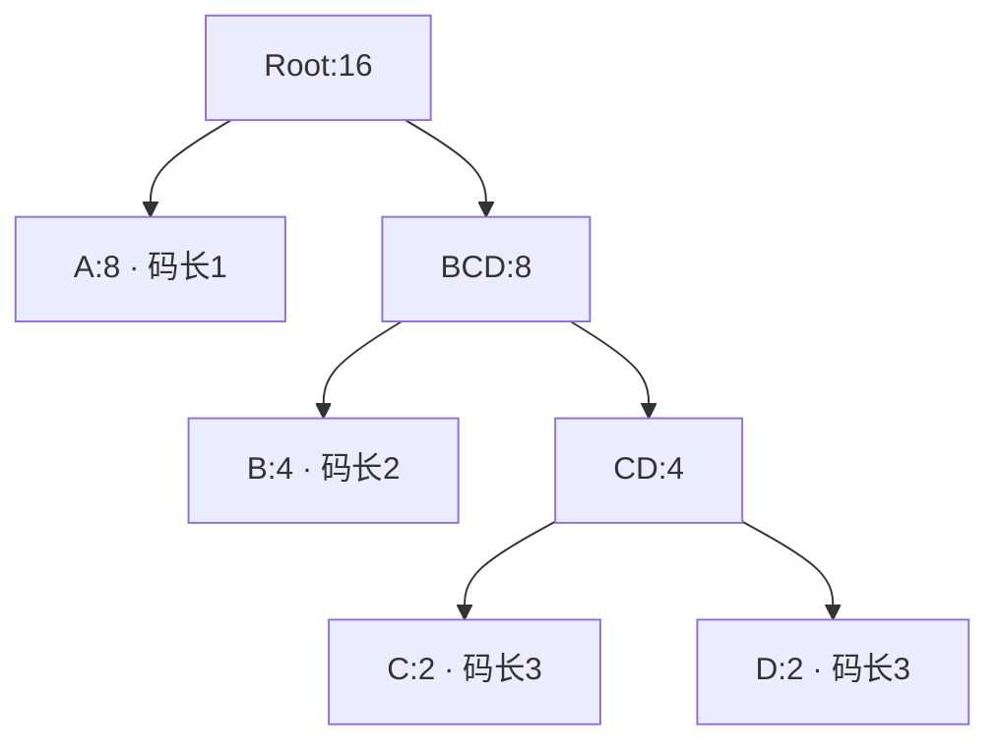

[匹配阶段](/sample/match-search.html)已经把输入转成字面量和长度／距离记录。dynamic 块接下来需要为这些记录构造编码。树构造器接收的是频率，而不是原始输入字节：字面量／长度字母表中的各个计数，以及另一个距离字母表中的计数。END_BLOCK 也属于字面量／长度字母表。

这一章先跟踪实际队列和节点的表示，再讨论码长。我们在实现旁边放一个小字母表：`A:8`、`B:4`、`C:2`、`D:2`。它让每一步容易观察，但不是一个完整的 DEFLATE 块字母表。

## 频率与有效叶子 {#frequencies}

Huffman 合并反复选择当前频率最小的两棵子树。常见符号倾向于停留在靠近根的位置，最终编码就较短。对这个四符号例子，码长 `1,2,3,3` 的载荷成本为 `8×1 + 4×2 + 2×3 + 2×3 = 28` 位，而每个符号固定两位需要 32 位。dynamic DEFLATE 块仍要支付描述码长的成本，不能只看载荷节省了多少。

C 构造器没有为每个节点分别分配对象。它使用已经嵌在 `deflate_state` 中的数组。描述符选择字面量／长度树、距离树或码长树，以及相应的字母表大小和最大码长。三个字母表分别有 286、30 和 19 个符号。树数组还容纳内部节点，其编号从 `elems` 开始。

`build_tree` 先扫描字母表。正频率符号进入有效堆，并被设置为 `depth = 0`；零频率符号的长度被设置为零。`max_code` 记录准备后的树需要表示的最大符号编号。因此，“没有使用的符号”和“还留着任意旧内容的数组单元”并不相同：扫描明确建立了未使用符号的零码长。

如果有效叶子不足两片，准备循环会加入频率为一的人工叶子。这避免后续处理再为零位编码设置特殊分支。源码还会为这些人工计数补偿成本字段。因此，准备后的字母表与原始频率表之间存在一个精确、有限的差异。证明和成本计算都要把这一步记进去，不能默认所有准备后的频率都来自实际输入符号。

## 优先队列与编码树 {#queue}

实现中同时存在两种不同的树形关系。`heap[1]` 保存优先级最小的节点编号。堆位置 `2k` 和 `2k+1` 是恢复堆顺序时使用的队列孩子，**不是** Huffman 编码树中 `heap[k]` 这个节点的孩子。编码树的祖先关系，要等合并后写入各节点的 `Dad` 字段。

比较器先看频率。频率相同时，再看 `depth` 数组，优先选择较小深度；源码的比较包含等号。准备好的叶子深度为零，新内部节点的深度是两个孩子较大深度加一。这里的 depth 表示已经组装出的子树高度，不是叶子最终距离未来根节点有多远。这种平局处理有助于避免相同权重下出现不必要的深码，但它没有为所有剩余平局规定按符号编号排序。

填入有效节点后，程序从最后一个内部堆位置向位置 1 逐步建堆。`pqdownheap` 把被移开的节点留在局部变量里，让较小的队列孩子上移，直到能放下原节点。这是向下筛选，不是每次插入都重新完整排序。初次建堆的工作量与有效节点数成线性关系；后面的合并只需要沿对数高度的队列路径修复。

`pqremove` 取出第一个根，用最后一个有效堆条目替换它，再恢复顺序。第二小的节点此时已经位于根。zlib 可以直接用新父节点替换这个根，再向下筛选。每合并一次，有效队列减少一个条目；整个过程中不需要另行分配优先队列对象。

## 完整的合并过程 {#merges}

例子中首先选中两个权重为 2 的叶子。把父节点记作 `CD`，它的权重为 4，保存的 depth 为 1。此时的有效队列包含 `B:4`、`CD:4`、`A:8`。

下一次平局让 depth 的用途变得具体：`B` 的 depth 为 0，`CD` 为 1，所以先选 `B`，再选 `CD`。它们的新父节点权重为 8，depth 为 2。最后，权重同为 8 的叶子 `A` 优先于这个高度为二的子树，两者组成根。

| 合并 | 选中的权重与深度 | 新父节点 | 随后剩余的有效子树 |
| --- | --- | --- | --- |
| 1 | C `(2,0)`、D `(2,0)` | CD `(4,1)` | B、CD、A |
| 2 | B `(4,0)`、CD `(4,1)` | BCD `(8,2)` | A、BCD |
| 3 | A `(8,0)`、BCD `(8,2)` | Root `(16,3)` | Root |

C/D 的平局可以采取任一方向，不改变它们的码长。此时也还没有给左右边分配比特。沿父链接走，A 到根有一条边，B 有两条，C/D 有三条。随后，规范编码才根据这些码长与符号顺序确定码字。

实际每次合并时，源码把频率之和写到下一个内部节点，写入子树深度，并把这个节点编号保存为两个孩子的父节点，最后推进内部节点游标。完成这些步骤之前，刚才选中的两个编号必须仍然指向同样的数组条目。

## 存储复用与遍历顺序 {#storage}

节点离开有效队列后，`heap` 数组还有另一种用途：数组高端保留已经选出的节点，`heap_max` 每次合并向下移动两格。最后的根保存在这个保留区域之前。随后从前向后遍历保留区域，就会先遇到父节点，再遇到后代。这正是 `gen_bitlen` 需要的顺序：它能直接读取已经赋值的父码长再加一，无须递归遍历另一套动态分配的树。

设准备后共有 `K` 片叶子。合并 `t` 次后，有效堆有 `K−t` 个条目；最后保存根之前，`heap_max = 573−2t`。内部节点编号从字母表大小开始，至多创建 `K−1` 个。证明既要说明数组容量够用，也要说明增长的保留尾部与缩短的有效队列彼此分离；即使尾部写入没有越过数组边界，也可能覆盖仍在使用的队列条目。

节点记录本身也随阶段改变含义。联合字段 `fc` 在构造时保存频率，分配编码后保存码字；`dl` 先保存父节点，后来保存码长。实现通过在最后一次使用后覆写旧值，省掉了额外数组。如果把最终码字仍然当作原始频率读取，成本论证和结构论证都会失效。表示关系必须指出当前处于哪个阶段。

机器宽度同样重要。频率与父节点／码长字段是 16 位值，辅助 depth 是无符号字节。无符号回绕有定义，并不自动保证数学意义上的求和或高度保持正确。实际执行与证明需要建立当前结论所依赖的界。这些表示连接在所有允许的调用历史上仍需证明确认（**to confirm**）；[树构造论证](/reference/docs/proof/trees.html#heap-and-node-bounds-f7)明确记录了相应义务。

现在，我们已经得到有限的父节点结构，以及准备后的各个符号到根的深度。[码长限制与编码描述](/sample/huffman-lengths.html)继续解释下一次转换：满足格式上限、分配规范码字，并把应使用的码长告诉解码器。[匹配证明路线](/sample/match-proof.html)连接更早的符号选择与输入字节；[Huffman 证明路线](/sample/huffman-proof.html)则继续跟踪刚才构造的数组。
