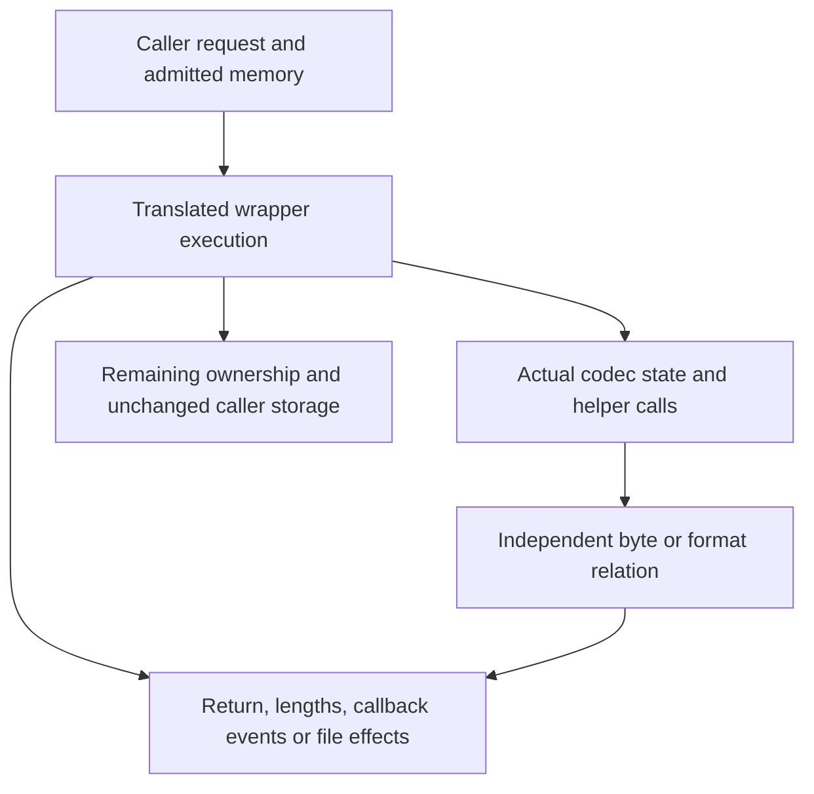

The preceding chapters give three interfaces three different shapes. A [buffer utility](/sample/buffers.html) creates a temporary stream and returns lengths. A [callback decoder](/sample/callbacks.html) exposes a sequence of input and output events. A [gzip handle](/sample/gzip.html) changes both memory and a file world. Their proofs must preserve those differences while connecting each interface to the same underlying byte meaning.

Begin with the visible task: which source bytes were consumed, which decoded or encoded bytes became observable, which state remains usable, and which resources still exist? The return code is one observation among these. In particular, failure can follow partial output, and successful data processing need not end a resource lifetime.

## Contracts across layers {#layers}

A useful argument connects three relations. The public contract relates the caller's request to observations. An implementation invariant explains how actual fields represent unfinished work. A format relation gives compressed bytes their independent meaning. Each layer needs a connection to the next one on the heap actually returned by the preceding operation.



For a convenience compressor, successful output must be a complete zlib encoding of the source. For a callback decoder, concatenated accepted output events must agree with raw DEFLATE decoding. For a gzip reader, the next returned bytes must agree with member concatenation or the transparent-input case. These conclusions have different observation channels; a theorem about `next_out` alone cannot be reused as a theorem about output callbacks.

Callee results also have to be available at the correct layer. An implementation proof cannot simply assume that zlib's `inflate`, `deflate`, table builder or allocator satisfies whatever contract makes its wrapper easy. It needs a theorem about that translated callee, then establishes that theorem's premises from the current state. Contracts for application-provided callbacks are different: they describe code supplied as an external parameter, so their explicitly stated behavior can be a caller premise.

## Temporary-state composition {#buffers}

For buffer utilities, the outer proof follows check order, successful initialization, the internal loop, cleanup and final scalar writes. The invariant keeps the original input and destination capacities alongside the current pointers and remaining wide lengths. Each loaded `uInt` chunk is a real slice of those original objects. Consumption moves the slice boundary; it cannot create a larger readable or writable region.

Automatic local storage matters here. The C local stream does not consume a `malloc` failure attempt. If its representation consumed an allocator-oracle entry, every later failure index would shift and the translation would describe a different program. Local storage must be created and released with automatic lifetime, while real codec allocations follow the caller's failure oracle and ownership accounting.

Error paths then separate naturally. Argument rejection can precede initialization and length writes. Initialization failure creates no end obligation for a live codec. After successful initialization, later returns must run cleanup while retaining whatever output and consumption the source already made observable. The plain wrappers' early scalar reads require their own pointer premises; the nullable checks inside `_z` do not reach backward to protect them. See the [full buffer argument](/reference/docs/proof/buffers.html) for representation and alias limits.

Output bounds need a separate link. The source declaration [`compressBound_z`](/reference/source/ZlibF/Proof/public-compress-bound.html#L46) has type `Goal.compressBound_z`. Its arithmetic argument translates wrapped 64-bit addition and the saturation test into the mathematical formula. That is a precise numeric result. The complete convenience-compression goal additionally requires that actual output fits an adequate destination, has the right meaning, frames other memory and releases internal state. A formula proof supplies one ingredient, not that whole composition.

## Callback framing and finite input {#callbacks}

The callback decoder must keep valid history and table state while running application code on the same modeled heap. Input validity extends across output events. An output callback cannot modify the active input chunk or the history window. The invariant therefore records ownership and preservation, not just callback return values.

The public callback protocol admits effects on callback-owned objects under its frame conditions. The older internal [`CbContract`](/reference/source/ZlibF/Proof/infback.c.callbacks.html#L57) is narrower: its callbacks write selected byte blocks and allocate or free nothing. That restriction makes its frame lemmas convenient, but it cannot silently stand for the entire public callback domain. The [public target](/reference/functions/inflateBack.html#formal-target) and [scope discussion](/reference/docs/proof/callbacks.html) must be read alongside a local result.

Termination introduces a different premise. Let `mu` bound the input still deliverable by the input callback. Returning `n` new bytes must reduce that reserve by at least `n`. The internal model combines three quantities:

```text
available input budget = held bits + 8 × current-chunk bytes + 8 × mu
```

Refilling moves budget from future input to the current chunk. Reading and consuming encoded fields uses that budget. Other internal transitions still need their mode-specific progress argument; this expression is not a claim that every C statement strictly decreases. [`InFinite` and `phi`](/reference/source/ZlibF/Proof/infback.c.macros.html#L26) make the finite-input premise and this accounting explicit. Safely returning callbacks alone do not rule out an infinite supply of nonfinal blocks.

The source contains appropriately smaller examples. [`back_init_public`](/reference/source/ZlibF/Proof/public-infback-init.html#L135) addresses the initialization goal, with allocation failure, window attachment and state ownership. [`back_end_public`](/reference/source/ZlibF/Proof/public-infback-end.html#L20) addresses release without freeing the caller's window. [`inflateBack_eof`](/reference/source/ZlibF/Proof/infback.c.back.html#L133) describes the particular case where initial input is NULL and the first input request returns zero: buffer error, no output callback and the specified unread-input fields. These statements help locate the proof architecture without promoting an empty-input branch to a complete decoder result.

## A file world beside the heap {#files}

Gzip wrappers add external effects. Their computations carry a file-system state `Fs` alongside the object heap. A read can change descriptor position and caller bytes; a write can change file contents; close can remove both a descriptor and owned heap objects. A meaningful frame condition must say what remains unchanged in both worlds.

The implemented [`gzfs` model](/reference/docs/design/external-io.html) represents a smaller regular-file world. Reads reach EOF or represented errors without an independent arbitrary short-read/failure oracle. Writes model file-size-limit behavior. It does not represent every pipe, socket, signal, concurrent file change or descriptor-sharing behavior, and its nonblocking flags do not model the entire corresponding protocol. A theorem quantified over `Fs` cannot thereby quantify over all POSIX executions.

This boundary affects specific proof paths. A partial successful read followed by a real I/O error can expose pointer-update ordering that the smaller model cannot generate. An operating-system write that repeatedly returns zero for a positive request needs a progress assumption to exclude a nonprogressing loop. Formatted output has its own supported conversions and argument representation; a model of those conversions is not a proof of the full C variadic ABI.

Some local public results are easy to interpret once these mechanisms are known. [`gzbuffer_public`](/reference/source/ZlibF/Proof/public-gzbuffer.html#L49) covers the buffer-setting goal, including refusal and minimum size; it does not promise future allocation success. [`gzoffset64_public_goal`](/reference/source/ZlibF/Proof/public-gz-offset.html#L199) connects the descriptor offset and buffered compressed input under the stated valid-state and file-system premises. It does not establish arbitrary compressed seeking or all read histories. The linked statements give the exact quantifiers and premises.

## Evidence and wider coverage {#evidence}

The remaining work is to compose these relations across actual caller histories: initialize, process, replace buffers or invoke callbacks, handle errors, and release resources. Initialization must establish usable invariants. Transitions must preserve them on actual returned heaps. End must account for the resources that really remain, including after failure. A top-level claim must also have an admitted initialized witness, rather than rely on an impossible invariant.

Source readings still **to confirm** include the correspondence of local storage, pointer lifetimes, callbacks and external operations. Differential tests can expose disagreements between selected real executions and the translation, but they do not enlarge the external model or prove all histories. The [progress record](/reference/docs/progress.html) owns current acceptance and remaining work. The examples here explain how to read the available claims; they do not add a second proof-status table.
