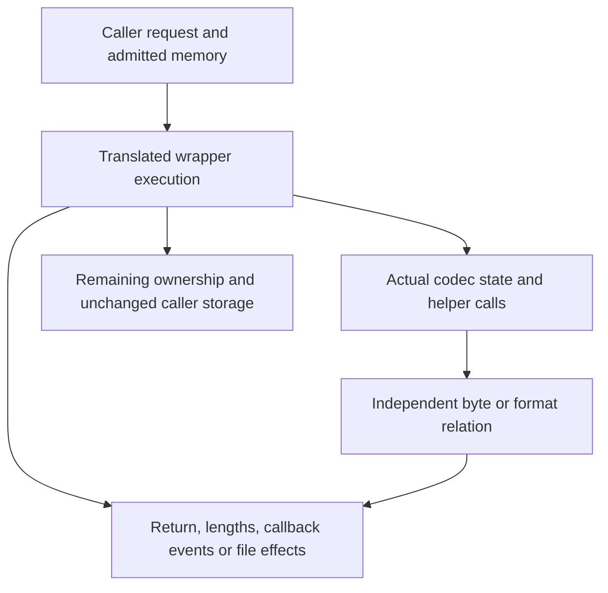

You have now seen three ways to recover bytes: decode a complete buffer, accept callback deliveries, or read through a gzip handle. To judge a proof, first ask what the application can observe. Eight correct output bytes do not by themselves show correct input consumption, safe cleanup, or a usable state after an error. This chapter turns the concrete interface runs into obligations for the translated C.

## State the result of a real task {#example}

Use the same inputs as the preceding chapters. These are proof targets, not claims that a complete interface theorem has been accepted:

| Task and interface choice | Supplied input | Observable successful result | What must also be accounted for |
| --- | --- | --- | --- |
| Recover a complete record with [uncompress2_z](/sample/buffers.html) | A zlib encoding of `ABABABAB`, then `END`; output capacity 8 | `Z_OK`, output `ABABABAB`, produced length 8, consumed length ending before `END` | Temporary codec released; caller buffers remain caller-owned |
| Let [inflateBack](/sample/callbacks.html) request chunks | Raw `73 74 82 40 00`, supplied as 2/1/2 bytes | `Z_STREAM_END`; accepted output callbacks concatenate to `ABABABAB` | Input and window preserved across callbacks; End frees only internal state |
| Read a [gzip file](/sample/gzip.html) | Two members encoding `ABC` and `DEFG` | Three-byte reads deliver `ABC`, `DEF`, `G`, then end | Descriptor position, buffered input, live error state and eventual close |

For the buffer task, `sourceLen` and `destLen` point to caller-owned byte counts: available input and output capacity on entry, consumed input and produced output on return. Near the return below, `len` counts all unused source bytes and `left` all unused destination bytes. Subtraction converts the original capacities into actual progress. The variable `err` is the internal decoder's result; the utility then maps it to its own result.

For example, the buffer decoder's source does not merely return a code. Its final steps include actual length writes, cleanup and result mapping. These selected lines are verbatim from [uncompr.c:74–81](https://github.com/madler/zlib/blob/757f0527154291bcf6bfbd6396ecde6bedd2db95/uncompr.c#L69-L81):

```c
    *sourceLen -= len;
    *destLen -= left;

    inflateEnd(&stream);
    return err == Z_STREAM_END ? Z_OK :
           err == Z_NEED_DICT ? Z_DATA_ERROR  :
           err == Z_BUF_ERROR && len == 0 ? Z_DATA_ERROR :
           err;
```

In the record example, unused input is the three-byte `END`; the first write therefore records the exact stream boundary. On failure these writes may still report real consumption and output. A proof must establish that the writes are permitted, derive the callee's cleanup result, and preserve those partial observations. It cannot replace the execution with an ideal decoder that returns either eight bytes or nothing.

## Contracts across layers {#layers}

The independent format relation explains why the five raw bytes decode to `ABABABAB`. The implementation invariant explains how the actual fields and heap represent unfinished work, so the next callback or API call can continue safely. The public contract connects both answers to returned bytes, lengths and errors. Each connection must use the heap actually returned by the preceding operation.



For a convenience compressor, successful output must be a complete zlib encoding of the source. For a callback decoder, concatenated accepted output events must agree with raw DEFLATE decoding. For a gzip reader, the next returned bytes must agree with member concatenation or the transparent-input case. These conclusions have different observation channels; a theorem about `next_out` alone cannot be reused as a theorem about output callbacks.

Callee results also have to be available at the correct layer. An implementation proof cannot simply assume that zlib's `inflate`, `deflate`, table builder or allocator satisfies whatever contract makes its wrapper easy. It needs a theorem about that translated callee, then establishes that theorem's premises from the current state. Contracts for application-provided callbacks are different: they describe code supplied as an external parameter, so their explicitly stated behavior can be a caller premise.

## Temporary-state composition {#buffers}

For the complete-record task, start with eight source bytes, compression capacity 21 and separate scalar cells. The outer proof follows check order, successful initialization, the internal loop, cleanup and final scalar writes. In decoding, the two writes shown above happen before End; compression has its own order. Follow each actual entry rather than imposing one common schedule.

For example, retaining the original `packed_len + 3` makes it possible to relate the unread suffix `END` to the consumed length. The invariant keeps those original capacities alongside current pointers and remaining wide lengths. The internal stream's availability fields use `uInt`, an unsigned integer type that is 32 bits in the selected build. The wider source length may therefore require several chunks. Each loaded `uInt` chunk is a real slice of those original objects. Consumption moves the slice boundary; it cannot create a larger readable or writable region.

Local variables and actual dynamic allocation must remain distinct. The C local `stream` acquires automatic storage when the function begins; it does not call `malloc`. The model’s allocation oracle records which dynamic allocation attempts succeed or fail. If it says that attempt two fails, its first entry must correspond to the codec’s actual first request. Consuming an extra entry to represent the local stream would move the failure to another request and simulate a different C path. The argument therefore tracks automatic lifetime separately from the order and cleanup of real allocations.

Error paths then separate naturally. Argument rejection can precede initialization and length writes. Initialization failure creates no end obligation for a live codec. After successful initialization, later returns must run cleanup while retaining whatever output and consumption the source already made observable. The plain wrappers' early scalar reads require their own pointer premises; the nullable checks inside `_z` do not reach backward to protect them. See the [full buffer argument](/reference/docs/proof/buffers.html) for representation and alias limits.

The program's capacity 21 also needs justification. An output-bound argument connects that number to sufficient storage for the actual compressor. The source declaration [`compressBound_z`](/reference/source/ZlibF/Proof/public-compress-bound.html#L46) has type `Goal.compressBound_z`. Its arithmetic argument translates wrapped 64-bit addition and the saturation test into the mathematical formula. That is a precise numeric result. The complete convenience-compression goal additionally requires that actual output fits an adequate destination, has the right meaning, frames other memory and releases internal state. A formula proof supplies one ingredient, not that whole composition.

## Callback framing and finite input {#callbacks}

In the 2/1/2-byte callback run, `feed` changes its descriptor and `collect` writes its result array. Meanwhile, the decoder must keep valid history and table state on that same modeled heap. Input validity extends across output events. An output callback cannot modify the active input chunk or the history window. The invariant therefore records ownership and preservation, not just callback return values.

The public callback protocol admits effects on callback-owned objects under its frame conditions. The older internal [`CbContract`](/reference/source/ZlibF/Proof/infback.c.callbacks.html#L57) is narrower: its callbacks write selected byte blocks and allocate or free nothing. That restriction makes its frame lemmas convenient, but it cannot silently stand for the entire public callback domain. The [public target](/reference/functions/inflateBack.html#formal-target) and [scope discussion](/reference/docs/proof/callbacks.html) must be read alongside a local result.

Termination introduces a different premise. Let `mu` be a nonnegative bound, measured in bytes, on input the callback can still deliver. Let `n` count the bytes in its next supplied chunk. Returning those `n` bytes must reduce the future reserve by at least `n`. Multiplying a byte count by 8 converts it to bits, so all terms of the following sum use the same unit. The internal model combines three quantities:

```text
available input budget = held bits + 8 × current-chunk bytes + 8 × mu
```

The five-byte example makes this accounting concrete. Every column below counts bits. Consuming three bits means removing a three-bit field, rather than merely loading it into the register.

| Point in the run | Held bits | Current-chunk bits | Future-input bits | Total budget |
| --- | --- | --- | --- | --- |
| Before requesting input | 0 | 0 | `8 × 5 = 40` | 40 |
| First callback supplies two bytes | 0 | `8 × 2 = 16` | `8 × 3 = 24` | 40 |
| Load one of those bytes into the bit register | 8 | 8 | 24 | 40 |
| Consume a three-bit field | 5 | 8 | 24 | 37 |

Refill moves budget from future input to the current chunk; a byte load moves it into the bit register. Consuming an encoded field spends the corresponding bits. Other internal transitions still need their mode-specific progress argument; this expression is not a claim that every C statement strictly decreases. [`InFinite` and `phi`](/reference/source/ZlibF/Proof/infback.c.macros.html#L26) make the finite-input premise and this accounting explicit. Safely returning callbacks alone do not rule out an infinite supply of nonfinal blocks.

The source contains appropriately smaller examples. [`back_init_public`](/reference/source/ZlibF/Proof/public-infback-init.html#L135) addresses the initialization goal, with allocation failure, window attachment and state ownership. [`back_end_public`](/reference/source/ZlibF/Proof/public-infback-end.html#L20) addresses release without freeing the caller's window. [`inflateBack_eof`](/reference/source/ZlibF/Proof/infback.c.back.html#L133) describes the particular case where initial input is NULL and the first input request returns zero: buffer error, no output callback and the specified unread-input fields. These statements help locate the proof architecture without promoting an empty-input branch to a complete decoder result.

## A file world beside the heap {#files}

In the gzip example, returning `ABC` changes caller memory and logical position. It may also have read much more compressed input from the descriptor. To express both effects, gzip computations carry file-system state `Fs` alongside the object heap. A read can change descriptor position and caller bytes; a write can change file contents; close can remove both a descriptor and owned heap objects. A meaningful frame condition must say what remains unchanged in both worlds.

The implemented [`gzfs` model](/reference/docs/design/external-io.html) represents a smaller regular-file world. Reads reach EOF or represented errors without an independent arbitrary short-read/failure oracle. Writes model file-size-limit behavior. It does not represent every pipe, socket, signal, concurrent file change or descriptor-sharing behavior, and its nonblocking flags do not model the entire corresponding protocol. A theorem quantified over `Fs` cannot thereby quantify over all POSIX executions.

This boundary affects specific proof paths. A partial successful read followed by a real I/O error can expose pointer-update ordering that the smaller model cannot generate. An operating-system write that repeatedly returns zero for a positive request needs a progress assumption to exclude a nonprogressing loop. Formatted output has its own supported conversions and argument representation; a model of those conversions is not a proof of the full C variadic ABI.

Some local public results are easy to interpret once these mechanisms are known. [`gzbuffer_public`](/reference/source/ZlibF/Proof/public-gzbuffer.html#L49) covers the buffer-setting goal, including refusal and minimum size; it does not promise future allocation success. [`gzoffset64_public_goal`](/reference/source/ZlibF/Proof/public-gz-offset.html#L199) connects the descriptor offset and buffered compressed input under the stated valid-state and file-system premises. It does not establish arbitrary compressed seeking or all read histories. The linked statements give the exact quantifiers and premises.

## Evidence and wider coverage {#evidence}

The examples end with three different resource stories: a utility already released its codec; `inflateBack` still needs End; a gzip reader still needs close. A complete argument must compose these relations across actual caller histories: initialize, process, replace buffers or invoke callbacks, handle errors, and release resources. Initialization must establish usable invariants. Transitions must preserve them on actual returned heaps. End must account for the resources that really remain, including after failure. A top-level claim must also have an admitted initialized witness, rather than rely on an impossible invariant.

The complete interface-composition proof is unfinished. Remaining connections include local storage versus real dynamic allocation, pointer validity across callbacks, and correspondence between the file model and actual external operations. Differential tests can expose disagreements between selected real executions and the translation, but they do not enlarge the external model or prove all histories. The [progress record](/reference/docs/progress.html) owns current acceptance and remaining work. The examples here explain how to read the available claims; they do not add a second proof-status table.
