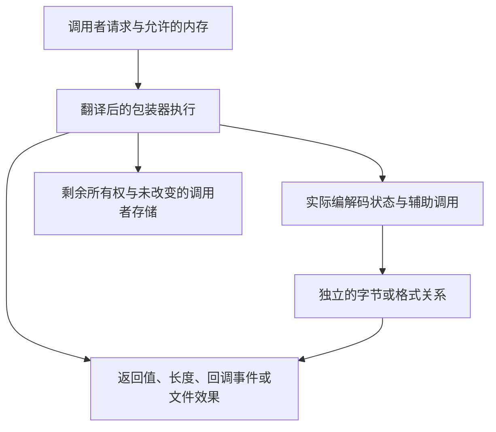

前面已经用三种办法还原字节：解码完整缓冲区、通过回调接收输出、通过 gzip 句柄读取文件。判断一份证明时，先看应用程序究竟能观察什么。输出八个正确字节，本身不足以说明输入消费正确、资源安全清理，或错误后的状态仍然可用。本章把前面的具体执行转成对翻译后 C 的证明义务。

## 写清一个真实任务的结果 {#example}

继续使用前几章的输入。下面列出的是证明目标，不是在宣称完整接口定理已经接受：

| 任务与选择的接口 | 提供的输入 | 成功时能观察的结果 | 还需要交代什么 |
| --- | --- | --- | --- |
| 用 [uncompress2_z](/sample/buffers.html) 还原完整记录 | `ABABABAB` 的 zlib 编码，后接 `END`；输出容量为 8 | `Z_OK`、输出 `ABABABAB`、产生量 8、消费量停在 `END` 前 | 临时编解码器已释放；调用者仍拥有缓冲区 |
| 让 [inflateBack](/sample/callbacks.html) 主动请求片段 | raw `73 74 82 40 00`，按 2/1/2 字节提供 | `Z_STREAM_END`；接收成功的输出回调拼成 `ABABABAB` | 跨回调保持输入和窗口；End 只释放内部状态 |
| 读取 [gzip 文件](/sample/gzip.html) | 分别编码 `ABC` 与 `DEFG` 的两个成员 | 每次请求三字节，依次交付 `ABC`、`DEF`、`G`，然后结束 | 描述符位置、输入缓冲、活错误状态和最终关闭 |

例如，缓冲解码器的源码不只返回一个码。最后还会真正写回长度、清理并转换结果。以下逐字选自 [uncompr.c:74–81](https://github.com/madler/zlib/blob/757f0527154291bcf6bfbd6396ecde6bedd2db95/uncompr.c#L69-L81)：

```c
    *sourceLen -= len;
    *destLen -= left;

    inflateEnd(&stream);
    return err == Z_STREAM_END ? Z_OK :
           err == Z_NEED_DICT ? Z_DATA_ERROR  :
           err == Z_BUF_ERROR && len == 0 ? Z_DATA_ERROR :
           err;
```

记录例子中，未用输入是三字节 `END`，第一项写回因此记录了准确的流边界。失败时，这些写回仍可能报告真实消费量与输出。证明要建立写入合法性，导出被调函数的清理结果，并保留这些部分观察，不能把真实执行替换成一个只会返回“八字节或完全没有输出”的理想解码器。

## 分层的契约 {#layers}

独立格式关系说明五个 raw 字节为什么解码为 `ABABABAB`。实现不变量说明实际字段和堆怎样表示未完成工作，使下一次回调或 API 调用能够安全继续。公开契约再把这两个答案连接到返回字节、长度与错误。每一项连接都必须使用前一操作实际返回的堆。



便利压缩器成功时，输出必须是源输入的完整 zlib 编码。回调解码器接收成功的输出事件拼接起来，必须符合 raw DEFLATE 的解码。gzip reader 接下来返回的字节，则必须符合成员拼接或透明输入的情形。它们的观察渠道不同，关于 `next_out` 的定理不能直接当作关于输出回调的定理。

被调函数的结果也必须出现在正确的层次。实现证明不能直接假设 zlib 的 `inflate`、`deflate`、表构造器或分配器满足一个便于证明包装器的契约。它需要关于翻译后被调函数的定理，再从当前状态建立这个定理的前提。应用程序提供的回调则不同：它们作为外部参数传入，因此显式规定的行为可以成为调用者前提。

## 临时状态的组合 {#buffers}

完整记录任务从八个源字节、21 字节压缩容量和分离的标量单元开始。外层证明沿着检查顺序、成功初始化、内部循环、清理与最终标量写入展开。解码时，上面的两个写回发生在 End 前；压缩又有自己的顺序。应逐个入口跟随真实执行，不能强加统一顺序。

例如，保留原来的 `packed_len + 3`，才能把未读后缀 `END` 连接到消费量。不变量同时保存这些原始容量、当前指针及较宽的剩余长度。每次装入 `uInt` 的片段都是原始对象的真实切片。消费只会移动切片边界，不会产生更大的可读或可写范围。

这里，自动存储的区别很重要。C 局部流不会消耗一次 `malloc` 失败尝试。如果它在模型中的表示消耗了分配预言机的一项，后续每一次失败的索引都会移动，翻译描述的就成了另一个程序。局部存储需要按照自动生命周期创建和释放，真正的编解码分配则遵循调用者的失败预言机与所有权记账。

错误路径随后可以自然分开。参数拒绝可能先于初始化和长度写入；初始化失败不产生一个活编解码器的结束义务；成功初始化后，后续返回必须清理，同时保留源码已经使其可见的输出与消费量。普通包装器较早的标量读取有自己的指针前提，内部 `_z` 的可空检查无法向前保护那些读取。[完整缓冲区论证](/reference/docs/proof/buffers.html)说明了表示与别名限制。

程序选择的容量 21 也需要理由。输出上界论证要把这个数值连接到真实压缩器所需的存储。源码中的 [`compressBound_z`](/reference/source/ZlibF/Proof/public-compress-bound.html#L46) 声明具有 `Goal.compressBound_z` 类型，其算术论证把回绕的 64 位加法与饱和检查连接到数学公式。这是一个精确的数值结果。完整便利压缩目标还要求实际输出放进足够的目标区、具有正确含义、保持其他内存，并释放内部状态。公式证明提供其中一个组成部分，不等于整个组合。

## 回调框架与有限输入 {#callbacks}

在 2/1/2 字节回调执行中，`feed` 改自己的描述符，`collect` 写自己的结果数组。与此同时，解码器还要在同一个模型堆上保持有效历史和表状态。输入有效期还跨越输出事件。输出回调不能修改活动输入块和历史窗口，因此不变量记录的是所有权与保持性，而不只是回调返回值。

公开回调协议允许回调在框架条件下影响自己的对象。较早的内部 [`CbContract`](/reference/source/ZlibF/Proof/infback.c.callbacks.html#L57) 更窄：回调只写选定的字节块，不分配也不释放。这项限制方便建立框架引理，却不能悄悄代表全部公开回调定义域。阅读局部结果时，要同时查看[公开目标](/reference/functions/inflateBack.html#formal-target)和[范围讨论](/reference/docs/proof/callbacks.html)。

终止性引入另一种前提。令 `mu` 约束输入回调还能提供的输入数量；返回 `n` 个新字节后，储备至少减少 `n`。内部模型把三个量合在一起：

```text
可用输入预算 = 已缓冲位数 + 8 × 当前块字节数 + 8 × mu
```

本例五字节输入在尚无缓冲位与当前字节时，预算为 40 位。第一次回调把 `mu` 中的两个字节搬到当前块，总和不变。补充输入把预算从未来输入搬到当前块，读取和消费编码字段则使用这份预算。其他内部转移仍需要针对模式的进展论证；这个表达式并不是说每条 C 语句都严格递减。[`InFinite` 与 `phi`](/reference/source/ZlibF/Proof/infback.c.macros.html#L26)明确写出有限输入前提和这项记账。每次回调安全返回，仍不足以排除不断提供非最终块的无限输入。

源码中有范围更小、容易解释的例子。[`back_init_public`](/reference/source/ZlibF/Proof/public-infback-init.html#L135)处理初始化目标，包括分配失败、附加窗口和状态所有权。[`back_end_public`](/reference/source/ZlibF/Proof/public-infback-end.html#L20)处理释放，而且不释放调用者窗口。[`inflateBack_eof`](/reference/source/ZlibF/Proof/infback.c.back.html#L133)描述初始输入为 NULL、第一次输入请求返回零的特定情形：返回缓冲错误，不调用输出回调，并写出规定的未读输入字段。这些命题有助于定位证明架构，却不能把空输入分支提升为完整解码器结论。

## 堆之外的文件世界 {#files}

gzip 例子返回 `ABC` 时，调用者内存和逻辑位置都改变了，也可能已经从描述符获取了更多压缩输入。为了同时表达这些效果，gzip 计算携带文件系统状态 `Fs` 和对象堆。读取可以改变描述符位置与调用者字节，写入可以改变文件内容，关闭则可能同时移除描述符与自有堆对象。因此，有意义的框架条件必须说明两个世界中哪些部分保持不变。

当前实现的 [`gzfs` 模型](/reference/docs/design/external-io.html)表示一个较小的普通文件世界。读取达到 EOF 或模型中的错误，却没有独立的任意短读与失败预言机；写入表示文件大小限制的行为。它不表示每一种管道、套接字、信号、并发文件改变或描述符共享，非阻塞标志也不表示相应的全部协议。对 `Fs` 量化的定理，不能因此变成对所有 POSIX 执行量化。

这项边界会影响具体路径。部分读取成功后再发生真实 I/O 错误，可能暴露较小模型无法生成的指针更新顺序问题。操作系统对正长度写入反复返回零时，需要进展假设才能排除无进展循环。格式化输出也有自己的受支持转换和参数表示；对这些转换的模型，不等于对完整 C 可变参数 ABI 的证明。

理解机制后，一些局部公开结果就容易解释了。[`gzbuffer_public`](/reference/source/ZlibF/Proof/public-gzbuffer.html#L49)覆盖缓冲设置目标，包括拒绝与最小大小，不保证未来分配成功。[`gzoffset64_public_goal`](/reference/source/ZlibF/Proof/public-gz-offset.html#L199)在明确的有效状态与文件系统前提下，连接描述符偏移和已缓冲压缩输入；它不建立任意压缩定位或全部读取历史。精确量化范围和前提都在链接的命题中。

## 证据与更广的覆盖 {#evidence}

几个例子的资源结尾不同：工具函数已经释放编解码器，`inflateBack` 仍需要 End，gzip reader 仍需要 close。完整论证要沿着实际调用历史组合这些关系：初始化、处理、更换缓冲区或运行回调、处理错误，以及释放资源。初始化必须建立可用的不变量；转移必须在真实返回堆上保持它们；结束必须对实际上仍然存在的资源记账，包括失败之后。顶层结论还需要一个允许的已初始化见证，不能依赖无法满足的不变量。

局部存储、指针生命周期、回调和外部操作的对应关系仍有需要确认的源码解读（**to confirm**）。差分测试可以暴露选定真实执行与翻译的差异，却不能扩大外部模型，也不能证明全部历史。[进度记录](/reference/docs/progress.html)统一保存当前接受范围和剩余工作。这里的例子解释怎样阅读已有命题，不另外建立一张证明状态表。
