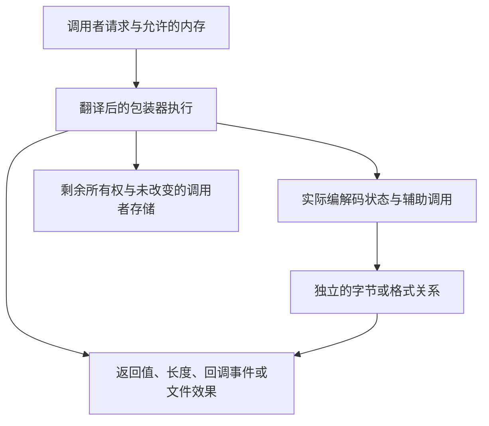

前面几章让三个接口呈现出不同形状：[整块缓冲区工具](/sample/buffers.html)创建临时流并返回长度，[回调解码器](/sample/callbacks.html)暴露输入与输出事件序列，[gzip 句柄](/sample/gzip.html)同时改变内存和文件世界。证明需要保留这些区别，同时把每个接口连接到共同的底层字节含义。

从可见任务出发：消费了哪些源字节，哪些解码或编码字节已成为观察结果，什么状态仍可使用，还有哪些资源存活？返回码只是这些观察之一。尤其是，失败可能发生在部分输出之后，而成功处理数据也不必结束资源的生命周期。

## 分层的契约 {#layers}

一条有用的论证连接三种关系。公开契约把调用者请求连接到观察结果；实现不变量说明实际字段怎样表示未完成工作；格式关系则独立地定义压缩字节的含义。每一层都要在前一操作实际返回的堆上，建立通向下一层的连接。



便利压缩器成功时，输出必须是源输入的完整 zlib 编码。回调解码器接收成功的输出事件拼接起来，必须符合 raw DEFLATE 的解码。gzip reader 接下来返回的字节，则必须符合成员拼接或透明输入的情形。它们的观察渠道不同，关于 `next_out` 的定理不能直接当作关于输出回调的定理。

被调函数的结果也必须出现在正确的层次。实现证明不能直接假设 zlib 的 `inflate`、`deflate`、表构造器或分配器满足一个便于证明包装器的契约。它需要关于翻译后被调函数的定理，再从当前状态建立这个定理的前提。应用程序提供的回调则不同：它们作为外部参数传入，因此显式规定的行为可以成为调用者前提。

## 临时状态的组合 {#buffers}

缓冲区工具的外层证明沿着参数检查、成功初始化、内部循环、清理和最后的标量写入展开。不变量既保存原始输入与目标容量，也记录当前指针及较宽的剩余长度。每次装入 `uInt` 的片段都是原始对象的真实切片。消费只会移动切片边界，不会产生更大的可读或可写范围。

这里，自动存储的区别很重要。C 局部流不会消耗一次 `malloc` 失败尝试。如果它在模型中的表示消耗了分配预言机的一项，后续每一次失败的索引都会移动，翻译描述的就成了另一个程序。局部存储需要按照自动生命周期创建和释放，真正的编解码分配则遵循调用者的失败预言机与所有权记账。

错误路径随后可以自然分开。参数拒绝可能先于初始化和长度写入；初始化失败不产生一个活编解码器的结束义务；成功初始化后，后续返回必须清理，同时保留源码已经使其可见的输出与消费量。普通包装器较早的标量读取有自己的指针前提，内部 `_z` 的可空检查无法向前保护那些读取。[完整缓冲区论证](/reference/docs/proof/buffers.html)说明了表示与别名限制。

输出上界还需要另外一条连接。源码中的 [`compressBound_z`](/reference/source/ZlibF/Proof/public-compress-bound.html#L46) 声明具有 `Goal.compressBound_z` 类型，其算术论证把回绕的 64 位加法与饱和检查连接到数学公式。这是一个精确的数值结果。完整便利压缩目标还要求实际输出放进足够的目标区、具有正确含义、保持其他内存，并释放内部状态。公式证明提供其中一个组成部分，不等于整个组合。

## 回调框架与有限输入 {#callbacks}

回调解码器在同一个模型堆上执行应用程序代码时，仍然要保持有效历史和表状态。输入有效期还跨越输出事件。输出回调不能修改活动输入块和历史窗口，因此不变量记录的是所有权与保持性，而不只是回调返回值。

公开回调协议允许回调在框架条件下影响自己的对象。较早的内部 [`CbContract`](/reference/source/ZlibF/Proof/infback.c.callbacks.html#L57) 更窄：回调只写选定的字节块，不分配也不释放。这项限制方便建立框架引理，却不能悄悄代表全部公开回调定义域。阅读局部结果时，要同时查看[公开目标](/reference/functions/inflateBack.html#formal-target)和[范围讨论](/reference/docs/proof/callbacks.html)。

终止性引入另一种前提。令 `mu` 约束输入回调还能提供的输入数量；返回 `n` 个新字节后，储备至少减少 `n`。内部模型把三个量合在一起：

```text
可用输入预算 = 已缓冲位数 + 8 × 当前块字节数 + 8 × mu
```

补充输入把预算从未来输入搬到当前块，读取和消费编码字段则使用这份预算。其他内部转移仍需要针对模式的进展论证；这个表达式并不是说每条 C 语句都严格递减。[`InFinite` 与 `phi`](/reference/source/ZlibF/Proof/infback.c.macros.html#L26)明确写出有限输入前提和这项记账。每次回调安全返回，仍不足以排除不断提供非最终块的无限输入。

源码中有范围更小、容易解释的例子。[`back_init_public`](/reference/source/ZlibF/Proof/public-infback-init.html#L135)处理初始化目标，包括分配失败、附加窗口和状态所有权。[`back_end_public`](/reference/source/ZlibF/Proof/public-infback-end.html#L20)处理释放，而且不释放调用者窗口。[`inflateBack_eof`](/reference/source/ZlibF/Proof/infback.c.back.html#L133)描述初始输入为 NULL、第一次输入请求返回零的特定情形：返回缓冲错误，不调用输出回调，并写出规定的未读输入字段。这些命题有助于定位证明架构，却不能把空输入分支提升为完整解码器结论。

## 堆之外的文件世界 {#files}

gzip 包装器增加外部效果。其计算同时携带文件系统状态 `Fs` 和对象堆。读取可以改变描述符位置与调用者字节，写入可以改变文件内容，关闭则可能同时移除描述符与自有堆对象。因此，有意义的框架条件必须说明两个世界中哪些部分保持不变。

当前实现的 [`gzfs` 模型](/reference/docs/design/external-io.html)表示一个较小的普通文件世界。读取达到 EOF 或模型中的错误，却没有独立的任意短读与失败预言机；写入表示文件大小限制的行为。它不表示每一种管道、套接字、信号、并发文件改变或描述符共享，非阻塞标志也不表示相应的全部协议。对 `Fs` 量化的定理，不能因此变成对所有 POSIX 执行量化。

这项边界会影响具体路径。部分读取成功后再发生真实 I/O 错误，可能暴露较小模型无法生成的指针更新顺序问题。操作系统对正长度写入反复返回零时，需要进展假设才能排除无进展循环。格式化输出也有自己的受支持转换和参数表示；对这些转换的模型，不等于对完整 C 可变参数 ABI 的证明。

理解机制后，一些局部公开结果就容易解释了。[`gzbuffer_public`](/reference/source/ZlibF/Proof/public-gzbuffer.html#L49)覆盖缓冲设置目标，包括拒绝与最小大小，不保证未来分配成功。[`gzoffset64_public_goal`](/reference/source/ZlibF/Proof/public-gz-offset.html#L199)在明确的有效状态与文件系统前提下，连接描述符偏移和已缓冲压缩输入；它不建立任意压缩定位或全部读取历史。精确量化范围和前提都在链接的命题中。

## 证据与更广的覆盖 {#evidence}

其余组合工作沿着实际调用历史展开：初始化、处理、更换缓冲区或运行回调、处理错误，以及释放资源。初始化必须建立可用的不变量；转移必须在真实返回堆上保持它们；结束必须对实际上仍然存在的资源记账，包括失败之后。顶层结论还需要一个允许的已初始化见证，不能依赖无法满足的不变量。

局部存储、指针生命周期、回调和外部操作的对应关系仍有需要确认的源码解读（**to confirm**）。差分测试可以暴露选定真实执行与翻译的差异，却不能扩大外部模型，也不能证明全部历史。[进度记录](/reference/docs/progress.html)统一保存当前接受范围和剩余工作。这里的例子解释怎样阅读已有命题，不另外建立一张证明状态表。
