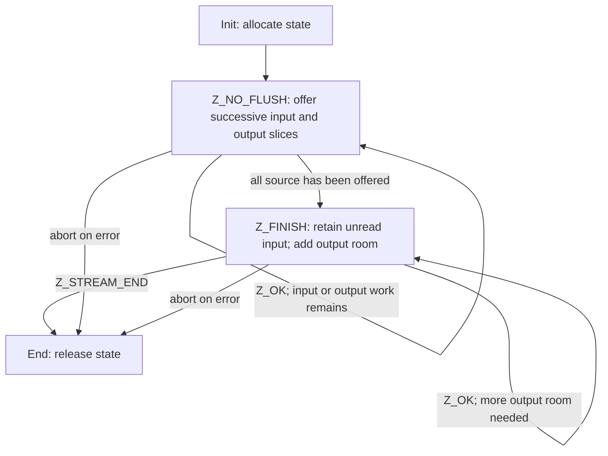
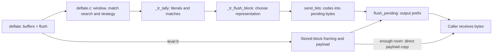

Suppose you want to compress `ABABABAB` while handing the result to a destination five bytes at a time. Choose the stream API when the application must control those buffer boundaries. Input is an original byte range plus a flush request; output is a written prefix plus a return code. The same compressor survives each buffer replacement. If the complete input and destination capacity are already available, the [buffer utilities](/sample/buffers.html) can run this protocol for you.

## One complete compression call sequence {#example}

The `z_stream` record separates the task from its temporary buffers. `next_in` points to the next readable original byte and `avail_in` counts how many remain. `next_out` points to the next writable output byte and `avail_out` counts room there. Counts are in bytes. The record also points to private compressor state, which must survive between calls even when the five-byte `chunk` array is reused.

This complete teaching program writes a zlib-wrapped encoding to standard output. The eight source bytes have no string terminator. All input is available immediately, so the program starts directly with `Z_FINISH`. Five output bytes are only a batch size; they do not limit the compressed stream to five bytes. The encoding's exact bytes and length are left to the compressor.

```c
#include <stdio.h>
#include <zlib.h>

int main(void) {
    unsigned char source[] = {'A','B','A','B','A','B','A','B'};
    unsigned char chunk[5];
    z_stream stream = {0};
    if (deflateInit(&stream, Z_DEFAULT_COMPRESSION) != Z_OK) return 1;
    stream.next_in = source;
    stream.avail_in = sizeof source;
    int ret, ok = 1;
    do {
        stream.next_out = chunk;
        stream.avail_out = sizeof chunk;
        ret = deflate(&stream, Z_FINISH);
        if (ret != Z_OK && ret != Z_STREAM_END) {
            ok = 0;
            break;
        }
        unsigned made = sizeof chunk - stream.avail_out;
        if (fwrite(chunk, 1, made, stdout) != made) {
            ok = 0;
            break;
        }
    } while (ret != Z_STREAM_END);
    int ended = deflateEnd(&stream);
    return !(ok && ended == Z_OK);
}
```

Each iteration hands over a new five-byte writable slice, writes only the returned prefix, and keeps the same `stream`. `Z_STREAM_END` ends the data task; `deflateEnd` then ends the allocation lifetime. The error exits also reach `deflateEnd`. This ordering matters even when the output sink fails after receiving a prefix.

## A compressor lifetime {#lifetime}

`deflateInit` is a macro that passes the version and structure size to `deflateInit_`. For another wrapper, window, memory level or strategy, use [deflateInit2_](/reference/functions/deflateInit2_.html). Successful initialization returns `Z_OK`, consumes no input and produces no compressed bytes. The ordinary schedule for gradually arriving input is:



Our program enters at the finishing step after init. Once finishing starts, keep any unread input, add no new input, and continue with `Z_FINISH`. Filling `chunk` does not mean the final block or trailer has been delivered. `Z_STREAM_END` reports that completion, but allocated state still exists until End or an appropriate reset for reuse.

The [deflate contract](/reference/functions/deflate.html) gives exact refusals. Zero output room returns `Z_BUF_ERROR`; `next_out` must still be non-NULL. Retrying the same exhausted buffer makes no progress. A non-finish flush after finishing starts returns `Z_STREAM_ERROR`. If the application aborts, [deflateEnd](/reference/functions/deflateEnd.html) discards unfinished work and releases storage. It can return `Z_DATA_ERROR` for abandoned busy-state data **after releasing that storage**; it does not finish the output for you.

## Input and output accounting {#accounting}

The program calculates `made = 5 - stream.avail_out`. In the general case, record the availability values before the call:

```text
accepted = old_avail_in  - new_avail_in
received = old_avail_out - new_avail_out
```

`next_in` advances by `accepted`; `next_out` advances by `received`. The total counters increase by those quantities at their unsigned C widths. Process the written output prefix before reusing its storage. Preserve the input suffix until consumed. Replacing either buffer does not require a reset.

Input acceptance and output delivery are different boundaries. `avail_in == 0` says that this input slice was accepted, not that its compressed block was delivered. Accepted bytes can remain as lookahead, then symbols awaiting a block decision, then held bits or pending complete bytes. A later call can deliver those old bytes before accepting more input. A `Z_OK` result alone therefore cannot report completion.

The private state names the delivery queue explicitly. `pending_out` points at its next undelivered compressed byte, and `pending` counts the bytes still waiting. The local `len` is the byte count selected for this copy, bounded by both waiting bytes and caller output room. `total_out` is the cumulative delivered-byte count. The six updates below keep those views of the same delivery consistent.

The following actual [flush_pending body, deflate.c:978–983](https://github.com/madler/zlib/blob/757f0527154291bcf6bfbd6396ecde6bedd2db95/deflate.c#L969-L986) shows the delivery boundary:

```c
    zmemcpy(strm->next_out, s->pending_out, len);
    strm->next_out  += len;
    s->pending_out  += len;
    strm->total_out += len;
    strm->avail_out -= len;
    s->pending      -= len;
```

Earlier lines choose at most the available output room. If five pending bytes are copied into an empty `chunk`, `avail_out` falls from 5 to 0, `next_out` advances by 5 and `made` becomes 5. The pending cursor advances by the same amount. That is why swapping `chunk` must preserve the internal stream: unread pending bytes still belong to the next call.

## The output pipeline {#pipeline}

A literal is one original byte; a match is a length/distance reference to earlier bytes. The compressor first collects those symbols, chooses how to describe a block, and assigns variable-length bit codes. The bit accumulator `bi_buf` holds bits that do not yet make a complete delivered byte. Pending storage holds complete compressed bytes waiting for caller room. These are successive representations of progress, rather than interchangeable counters.

Where do those pending bytes come from? Use this compact call map to locate the work. Internal functions are called by zlib, not separately by the application.



For `ABABABAB`, literals A and B followed by a length-6, distance-2 match are one valid description. The default encoder is free to choose another. [Block choice](/sample/blocks.html) explains fixed, dynamic and stored representations. [Bit output](/sample/bits.html) follows fields through `bi_buf` into complete bytes. [Shared storage](/sample/storage.html) explains why pending output and unread symbol records in one allocation must not overtake each other.

Settings select strategies, so this ordinary matching route does not describe every path. At level 0, sufficient room lets stored payload move directly to caller output, avoiding pending storage; buffered work uses the other edge. These are source readings **to confirm** through execution proofs.

Delivery, a format flush and End have distinct purposes. `flush_pending` copies already available bytes. `Z_SYNC_FLUSH` requests an aligned marker once fully delivered. `Z_FULL_FLUSH` also resets match history at the completed boundary. If a requested flush fills output, provide room and continue the same flush. Neither replaces `Z_FINISH` or End. The [state operations chapter](/sample/state-operations.html) develops those boundary choices.

## Contracts and the rest of the API {#contracts}

For this route, consult [initialization](/reference/functions/deflateInit2_.html), [processing](/reference/functions/deflate.html), [pending-output queries](/reference/functions/deflatePending.html), [reset](/reference/functions/deflateReset.html) and [end](/reference/functions/deflateEnd.html) in the [compression index](/reference/api.html?group=deflate-stream). The contracts retain shared-storage and call-order premises that a diagram cannot express.

The [full API index](/reference/api.html) also covers decompression streams, callback decoding, whole-buffer utilities and library information, checksums, and gzip files. Choose a family by the state and I/O protocol your task needs. The [proof chapter](/sample/proof.html) follows accepted input through symbols, bits and delivered output; conserving only the final byte count would not establish their meaning, valid intermediate states or resource cleanup.
