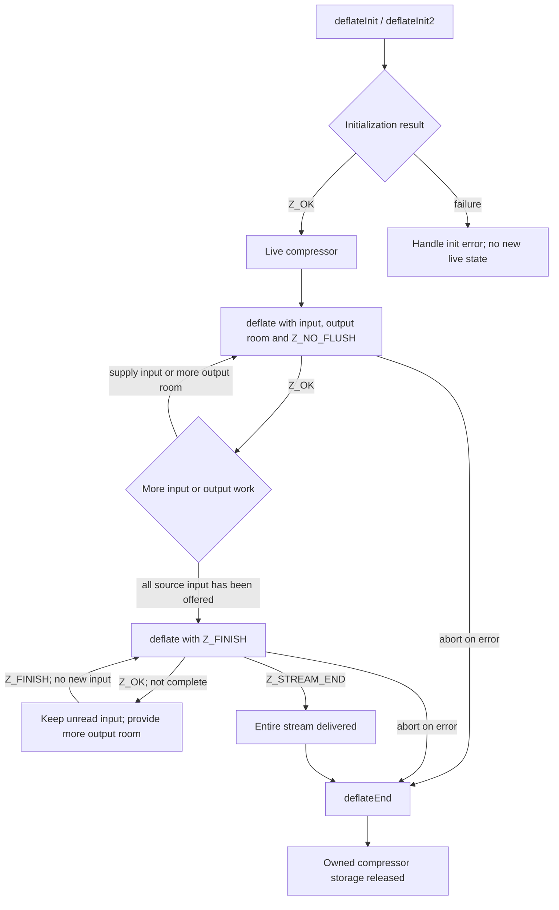
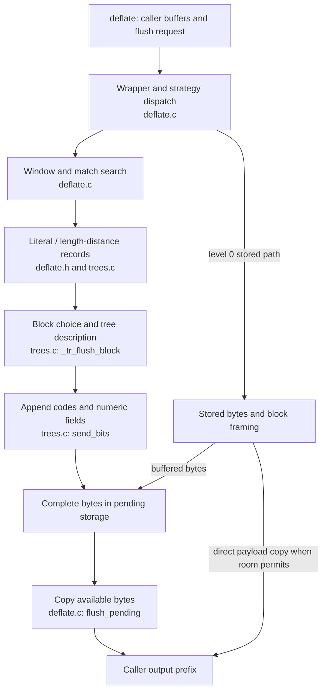

A call to `deflate` sits between two different kinds of progress. The application lends input and output buffers. Inside the compressor, accepted input becomes history, symbols, codes and pending bytes. These stages do not have to advance together. Following one compressor lifetime gives the API names a place in that process.

The [block-selection chapter](/sample/blocks.html) follows symbols toward a compressed block. The diagram below follows the application that asks for that work and receives its output.

## A compressor lifetime {#lifetime}

Initialization creates compressor state. `deflateInit` is a macro that supplies the version and stream-structure size to `deflateInit_`; `deflateInit2_` additionally selects the wrapper, window, memory level and strategy. Successful initialization returns `Z_OK`. It consumes no input and produces no compressed bytes.



The finishing loop deserves its own state in the picture. When finishing starts, the caller must keep any unconsumed input available, offer no new input, and continue with `Z_FINISH`. A full output buffer does not mean that the final block or wrapper trailer has been delivered. `Z_STREAM_END` reports that completion; the compressor's allocated state still exists until `deflateEnd`, or can be reused through an appropriate reset.

The diagram shows the ordinary successful schedule and an abort route. Exact refusals belong to the [deflate contract](/reference/functions/deflate.html). In particular, a call with zero output room returns `Z_BUF_ERROR`; retrying without changing the exhausted buffer cannot create progress. `next_out` must be non-NULL even for that checked case. A non-finish flush after finishing starts returns `Z_STREAM_ERROR`.

## Input and output accounting {#accounting}

Before each call, the application records the available input and output sizes. After the call, the differences tell it what happened:

```text
accepted = old_avail_in  - new_avail_in
received = old_avail_out - new_avail_out
```

`next_in` advances by `accepted`, and `next_out` by `received`. The total counters increase by the same quantities at their unsigned C widths. The application processes only the output prefix that was actually written. When that buffer fills, it supplies a new writable region; it does not reset the compressor to change buffers.

“Accepted” is an input boundary, not a claim that the corresponding block has reached the application. The compressor can have accepted lookahead that has not yet become symbols. Symbols can await a block decision. Encoded bits can remain in the bit buffer, and complete bytes can remain pending. Conversely, a later call can deliver old pending output before accepting further input. This is why neither `avail_in == 0` nor a successful `Z_OK` return means “compression is finished.”

For a concrete application loop, preserve the unread input range, refill output when needed, inspect every return value, and consume each returned output prefix before reusing its storage. If the application aborts after successful initialization, release the live compressor. `deflateEnd` discards unfinished work; it does not complete or deliver it. Its `Z_DATA_ERROR` result can report abandoned busy-state data **after releasing the owned storage**. See the [end contract](/reference/functions/deflateEnd.html).

## The output pipeline {#pipeline}

Now connect that lifetime to the implementation. This diagram follows the ordinary matching path. A box names work, and the smaller source labels locate its implementation.



This implementation route is a source reading **to confirm** through the corresponding execution proofs. The caller controls the request and available space. It does not call each internal stage separately. Compression settings select different strategies, and special paths can bypass the ordinary symbol-and-tree route. The stored path is shown separately for that reason. At level 0, sufficient input and output space can let the implementation copy stored payload directly to caller output, avoiding an extra trip through pending storage. Smaller or remaining work can use the buffered path.

Read [block choice](/sample/blocks.html) to understand why a symbol sequence may receive fixed or dynamic codes, or be replaced by a stored representation. Continue with [bit output](/sample/bits.html) to see how fields enter `bi_buf` and become complete bytes. Then read [shared storage](/sample/storage.html): pending bytes and unread symbol records can occupy different regions of one allocation, so their progress must remain coordinated. That memory arrangement makes sense only after both sides of the diagram are understood.

`flush_pending` delivers already available bytes to caller storage. A format flush is a request to complete a particular boundary in the compressed stream. `deflateEnd` releases the compressor. These operations have different jobs. For example, `Z_SYNC_FLUSH` completes an aligned marker once fully delivered; `Z_FULL_FLUSH` also resets match history at the completed boundary. Neither is a replacement for finishing the stream or releasing its state. If output fills during a requested flush, provide more room and continue that same flush.

## Contracts and the rest of the API {#contracts}

The [compression API index](/reference/api.html?group=deflate-stream) contains the complete entry contracts. For this route, start with [initialization](/reference/functions/deflateInit2_.html), [processing](/reference/functions/deflate.html), [pending-output queries](/reference/functions/deflatePending.html), [reset](/reference/functions/deflateReset.html) and [end](/reference/functions/deflateEnd.html). Shared storage and call-order conditions remain part of those contracts; a control-flow arrow does not replace them.

The complete manual has six families: compression streams, decompression streams, callback decoding, whole-buffer utilities and library information, checksums, and gzip files. Each family has its own entry conditions. The [full API index](/reference/api.html) keeps all entries accessible without forcing unrelated functions into this compression diagram.

Once the implementation route is clear, [the proof chapter](/sample/proof.html) follows the same accepted input, symbol sequence, encoded bits and delivered output. It explains which relations must hold across these stages, and why conserving only a final byte count would leave important obligations unanswered.
