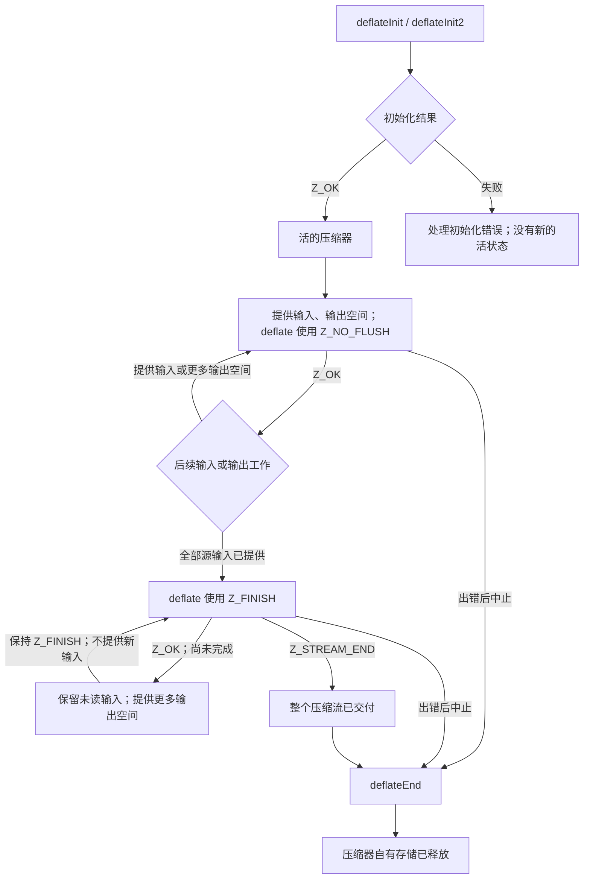
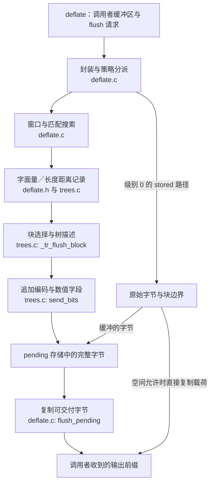

`deflate` 的一次调用连接着两种进度。应用程序提供输入与输出缓冲区；压缩器内部则把已经接收的输入逐步变成历史、符号、编码和待交付字节。这些阶段不必同时前进。先沿着一个压缩器的完整生命周期走一遍，各个 API 才能落到具体的工作上。

[块选择一章](/sample/blocks.html)沿着符号走向压缩块。这一页沿着应用程序的调用，说明它怎样请求这些工作，又怎样接收结果。

## 压缩器的生命周期 {#lifetime}

初始化创建压缩状态。`deflateInit` 是一个宏，把版本和流结构大小传给 `deflateInit_`；`deflateInit2_` 还允许选择封装、窗口、内存级别和策略。成功初始化返回 `Z_OK`，此时没有消费输入，也没有产生压缩字节。



完成阶段需要在图中单独占据一个状态。开始完成后，调用者保留尚未消费的输入，不再加入新输入，并继续使用 `Z_FINISH`。输出缓冲区写满，并不表示最终块或封装尾部已经交付。`Z_STREAM_END` 才报告这种完成；压缩器的分配状态仍然存在，直到 `deflateEnd` 释放，或者通过合适的 reset 重新使用。

图中展示普通成功调用顺序，以及中止时的清理路径。精确的拒绝行为见 [deflate 契约](/reference/functions/deflate.html)。其中，输出空间为零的调用返回 `Z_BUF_ERROR`；原样重试耗尽的缓冲区不会凭空取得进展。即使在这种被检查的情形下，`next_out` 也必须非 NULL。开始完成后，改用非 `Z_FINISH` 的 flush 会返回 `Z_STREAM_ERROR`。

## 输入与输出记账 {#accounting}

每次调用前，应用程序记住可用输入和输出空间。调用后，用差值确定这次发生了什么：

```text
已接收输入 = 调用前 avail_in  - 调用后 avail_in
已收到输出 = 调用前 avail_out - 调用后 avail_out
```

`next_in` 按已接收输入前移，`next_out` 按已收到输出前移。总计数按相应数量增加，并遵循 C 无符号整数的位宽。应用程序只处理实际写入的输出前缀。缓冲区填满后，换一个可写区域继续；更换缓冲区不需要重置压缩器。

“接收”标记的是输入边界，并不保证对应的压缩块已到达应用程序。压缩器可以保留已经接收、尚未转成符号的 lookahead；符号可以等待块选择；编码位可以留在位缓冲里；完整字节也可以留在 pending 区。后续调用还可能先交付旧的 pending 输出，再接收更多输入。因此，`avail_in == 0` 和成功返回 `Z_OK` 都不能解释成“压缩已经完成”。

实际调用循环要保留未读输入范围，按需补充输出空间，检查每次返回值，并在重用输出存储前处理本次产生的前缀。成功初始化后，如果应用程序中止任务，就要释放仍然存活的压缩器。`deflateEnd` 丢弃未完成工作，不替调用者完成或交付它。它返回 `Z_DATA_ERROR` 时，可能是在**已经释放自有存储之后**报告放弃了忙碌状态的数据。精确行为见 [end 契约](/reference/functions/deflateEnd.html)。

## 输出的实现路径 {#pipeline}

现在把这一生命周期连接到实现。下面沿着普通匹配路径画出数据的流向。方框表示工作，较小的源码标记说明工作由哪里完成。



这条实现路径属于需要执行证明确认的源码解读（**to confirm**）。调用者控制请求和可用空间，并不分别调用每一个内部阶段。压缩设置会选择不同策略，特殊路径也可能跳过普通的符号和树处理。图中因此单独画出了 stored 路径。级别 0 在输入和输出空间足够时，可以把 stored 载荷直接复制到调用者输出，省掉经过 pending 存储的一次中转；较小或剩余的工作可以使用缓冲路径。

先读[块选择](/sample/blocks.html)，理解同一符号序列为什么可以使用固定或动态编码，以及什么时候能改用 stored 表示。接着读[位输出](/sample/bits.html)，观察字段怎样进入 `bi_buf`，又怎样变成完整字节。最后读[共享存储](/sample/storage.html)：pending 字节和未读符号记录可以处在同一块分配的不同区域里，因而它们的进度必须互相配合。先理解图中两端的工作，再看这种内存安排，才容易理解它为什么需要额外的条件。

`flush_pending` 把已有字节交付到调用者存储。格式 flush 要求压缩流完成某种边界。`deflateEnd` 则释放压缩器。三者承担不同工作。例如，`Z_SYNC_FLUSH` 在完全交付后形成对齐的标记；`Z_FULL_FLUSH` 还会在完成的边界重置匹配历史。它们都不能替代流的完成和资源释放。请求的 flush 写满输出时，应补充空间并继续同一种 flush。

## 契约与其余接口 {#contracts}

[压缩 API 索引](/reference/api.html?group=deflate-stream)保留完整入口契约。沿着本页的路线，可以依次查阅[初始化](/reference/functions/deflateInit2_.html)、[处理](/reference/functions/deflate.html)、[待交付输出查询](/reference/functions/deflatePending.html)、[重置](/reference/functions/deflateReset.html)和[结束](/reference/functions/deflateEnd.html)。共同的存储与调用顺序条件同样适用；一条流程箭头不能代替函数契约。

完整手册分为六类：压缩流、解压流、回调解码、整块缓冲区工具与库信息、校验和，以及 gzip 文件。不同类别有各自的入口条件。[全部 API 索引](/reference/api.html)让每个入口都能单独查阅，不必把无关函数塞进这张压缩流程图。

实现路线清楚之后，[证明一章](/sample/proof.html)会继续追踪同一份已接收输入、符号序列、编码位和已交付输出。它说明这些阶段之间需要维持什么关系，以及为什么只保住最终字节数仍然留下了重要的证明义务。
