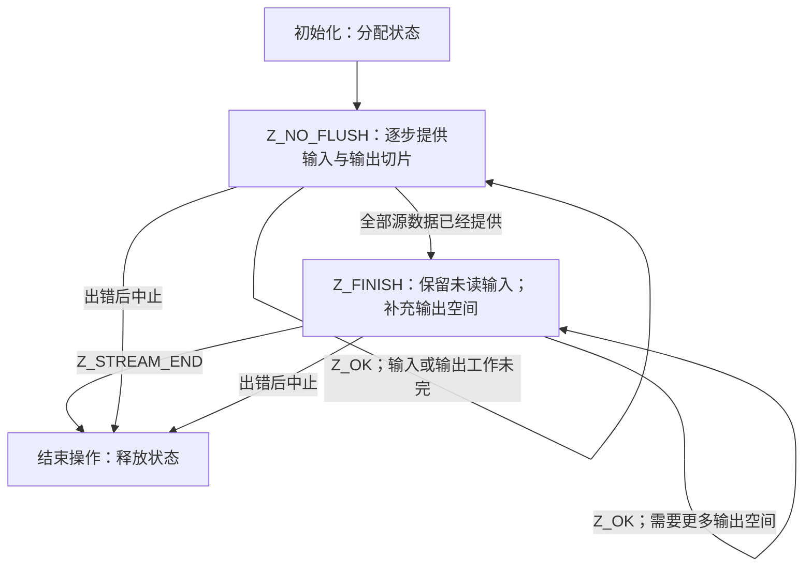
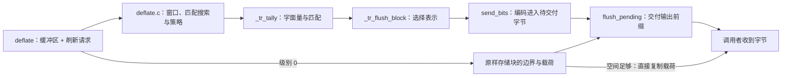

假设你要压缩 `ABABABAB`，而输出目标每次只接收五个字节。应用程序需要控制这些缓冲边界时，可以选择流式 API。输入是一段原始字节和刷新请求；输出是一段已写前缀与返回码。更换缓冲区时，同一个压缩器继续存活。如果完整输入和目标容量都已经具备，[缓冲区工具](/sample/buffers.html)可以代为执行这套协议。

## 一套完整的压缩调用 {#example}

`z_stream` 记录把持续的任务与临时缓冲区分开。`next_in` 指向下一个可读原文字节，`avail_in` 记录还剩多少；`next_out` 指向下一个可写输出位置，`avail_out` 记录那里还有多少空间，计数单位都是字节。记录还指向压缩器内部状态；五字节 `chunk` 数组反复使用时，内部状态必须继续保留。

下面这个完整教学程序把 zlib 封装的编码写到标准输出。八个源字节没有字符串结束符。由于输入一次全部提供，程序直接使用 `Z_FINISH`。五字节只是输出批次大小，不是整个压缩流的大小限制。具体编码字节和长度由压缩器选择。

```c
#include <stdio.h>
#include <zlib.h>

int main(void) {
    unsigned char source[] = {'A','B','A','B','A','B','A','B'};
    unsigned char chunk[5];
    z_stream stream = {0};
    if (deflateInit(&stream, Z_DEFAULT_COMPRESSION) != Z_OK) return 1;
    stream.next_in = source;
    stream.avail_in = sizeof source;
    int ret, ok = 1;
    do {
        stream.next_out = chunk;
        stream.avail_out = sizeof chunk;
        ret = deflate(&stream, Z_FINISH);
        if (ret != Z_OK && ret != Z_STREAM_END) {
            ok = 0;
            break;
        }
        unsigned made = sizeof chunk - stream.avail_out;
        if (fwrite(chunk, 1, made, stdout) != made) {
            ok = 0;
            break;
        }
    } while (ret != Z_STREAM_END);
    int ended = deflateEnd(&stream);
    return !(ok && ended == Z_OK);
}
```

每轮提供五字节可写切片，只写出返回的前缀，并保留同一个 `stream`。`Z_STREAM_END` 结束数据任务，之后 `deflateEnd` 才结束分配的生命周期。错误出口也会到达 `deflateEnd`。即使输出目标在收到部分内容后失败，这个清理顺序仍然适用。

## 压缩器的生命周期 {#lifetime}

`deflateInit` 是宏，把版本和结构大小传给 `deflateInit_`。需要其他封装、窗口、内存级别或策略时，使用 [deflateInit2_](/reference/functions/deflateInit2_.html)。初始化成功返回 `Z_OK`，没有消费输入，也没有产生压缩字节。输入逐步到达时，普通调用顺序如下：



本例初始化后直接进入完成阶段。开始完成后，要保留未读输入，不加入新输入，并继续使用 `Z_FINISH`。`chunk` 填满，不代表最终块或尾部已经交付。`Z_STREAM_END` 才报告完成；分配状态却仍然存在，直到结束操作，或者通过合适的重置重新使用。

[deflate 契约](/reference/functions/deflate.html)给出精确的拒绝行为。输出空间为零时返回 `Z_BUF_ERROR`，`next_out` 仍须非 NULL。原样重试耗尽的缓冲区不会取得进展。开始完成后改用其他刷新请求，会返回 `Z_STREAM_ERROR`。中止时，[deflateEnd](/reference/functions/deflateEnd.html)丢弃未完成工作并释放存储；它可能在**已经释放存储之后**返回 `Z_DATA_ERROR`，报告放弃了忙碌状态的数据，不会代为完成输出。

## 输入与输出记账 {#accounting}

程序计算 `made = 5 - stream.avail_out`。一般情形先记住调用前的可用量：

```text
已接收输入 = 调用前 avail_in  - 调用后 avail_in
已收到输出 = 调用前 avail_out - 调用后 avail_out
```

`next_in` 按已接收量前移，`next_out` 按已收到量前移。总计数按相应数量增加，遵循 C 无符号整数的位宽。重用输出存储前，先处理已经写入的前缀。输入后缀则要保留到消费完成。更换任何一个缓冲区都不需要重置。

接收输入与交付输出是两个边界。`avail_in == 0` 只说明当前切片已经接收，不说明对应压缩块已经交付。接收的字节可以先作为预读数据保留，再变成等待块选择的符号，随后成为缓冲位或完整的待交付字节。后一次调用可能先交付旧字节，再接收新输入。因此，单独一个 `Z_OK` 不能报告完成。

内部状态把交付队列明确记录下来：`pending_out` 指向下一个未交付的压缩字节，`pending` 统计仍在等待的字节数。局部变量 `len` 是本次复制量，单位为字节，受待交付数量和调用者输出空间共同限制；`total_out` 是累计交付字节数。下面六项更新让这些字段始终描述同一次交付。

下面真实的 [flush_pending 主体，deflate.c:978–983](https://github.com/madler/zlib/blob/757f0527154291bcf6bfbd6396ecde6bedd2db95/deflate.c#L969-L986)显示了交付边界：

```c
    zmemcpy(strm->next_out, s->pending_out, len);
    strm->next_out  += len;
    s->pending_out  += len;
    strm->total_out += len;
    strm->avail_out -= len;
    s->pending      -= len;
```

前面的语句把数量限制在可用输出空间内。若五个待交付字节复制进空的 `chunk`，`avail_out` 从 5 降到 0，`next_out` 前移 5，`made` 得到 5。待交付游标也前移相同数量。因此，更换 `chunk` 必须保留内部流：尚未交付字节还属于后一次调用。

## 输出的实现路径 {#pipeline}

字面量表示一个原文字节，匹配则用长度／距离引用较早字节。压缩器先收集这些符号，再选择怎样描述一个块，并把符号编码成长度不一的比特。位累积器 `bi_buf` 暂存尚未形成完整交付字节的位；待交付存储保存已经形成、但还在等待调用者空间的压缩字节。这些是处理进展的不同表示，不能用同一个计数代替。

这些待交付字节从哪里来？下面的简明调用地图用来定位工作。内部函数由 zlib 调用，应用程序不需要分别调用它们。



对 `ABABABAB`，字面量 A、B 后面跟长度 6、距离 2 的匹配，是一种有效描述。默认编码器也可以选择别的表示。[块选择](/sample/blocks.html)解释固定编码、动态编码和原样存储三种表示。[位输出](/sample/bits.html)追踪字段怎样经过 `bi_buf` 成为完整字节。[共享存储](/sample/storage.html)则解释：同一分配中的待交付输出与未读符号记录为什么不能互相追越。

配置会选择不同策略，因此普通匹配路线不覆盖所有路径。级别 0 在空间充足时，允许原样存储载荷直接进入调用者输出，省去待交付中转；需要缓冲的工作走另一条边。这些策略路径的完整执行证明未完成；还需要把普通符号输出与级别 0 的直接复制分别接到公开调用的记账和内存条件上。

交付、格式刷新和结束操作有不同目的。`flush_pending` 复制已经可用的字节。`Z_SYNC_FLUSH` 请求在完全交付后形成对齐标记；`Z_FULL_FLUSH` 还在完成的边界重置匹配历史。一次刷新请求填满输出时，应提供空间并继续同一种刷新方式。它们都不能替代 `Z_FINISH` 或结束操作。[状态操作一章](/sample/state-operations.html)进一步解释这些边界选择。

## 契约与其余接口 {#contracts}

沿此路线，可在[压缩索引](/reference/api.html?group=deflate-stream)中查阅[初始化](/reference/functions/deflateInit2_.html)、[处理](/reference/functions/deflate.html)、[待交付输出查询](/reference/functions/deflatePending.html)、[重置](/reference/functions/deflateReset.html)和[结束](/reference/functions/deflateEnd.html)。图中没有表达出的共享存储与调用顺序前提，仍由契约保留。

[全部 API 索引](/reference/api.html)还覆盖解压流、回调解码、整块缓冲区工具与库信息、校验和，以及 gzip 文件。按任务需要的状态和 I/O 协议选择类别。[证明一章](/sample/proof.html)继续从已接收输入追踪符号、位与已交付输出；只保住最终字节数，还不能建立这些内容的含义、中间状态有效性或资源清理。
