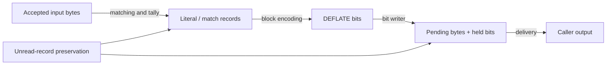

We want the algorithm to return a result that remains usable: its compressed bits decode to the accepted input, unread symbols and unrelated caller memory stay intact, and execution can resume when output space runs out. All three guarantees must hold together. Computing plausible compressed bytes does not yet answer the last two questions.

Use the same example to locate possible failures. Chosen symbols `A`, `B`, length 6/distance 2 should expand to `ABABABAB`; their final fixed encoding has 38 meaningful bits and becomes `73 74 82 40 00` after alignment. The proof must generalize this concrete transformation to every symbol sequence, heap state and call history admitted by its premises.

| Required guarantee | What to follow in the example | What could go wrong |
| --- | --- | --- |
| Preserve input meaning | Distance-2 copying recovers the remaining `ABABAB` byte by byte | A record’s length offset or distance is off by one |
| Encode exactly | Six fields form 38 adjacent bits | Crossing the register loses, repeats or pads bits |
| Preserve unread input | Read B’s complete record before reusing its space | Pending writes reach the match record too early |
| Deliver and resume exactly | Deliver five bytes as a two-byte prefix and a three-byte suffix | A returned cursor makes the next call repeat or skip bytes |

These are the required guarantees, not a claim that all are complete. The local theorems below each have explicit premises. Their connections to initialization, complete block output and public call sequences still need to be assessed within their own scopes. Follow the table’s order below: identify the record’s meaning, append its bits, preserve the next unread record, and finally deliver bytes already produced to the caller. [Project progress](/reference/docs/progress.html) is the maintained record of acceptance.



## Symbol meaning {#meaning}

Begin before the first output bit. A literal expands to its byte. A match reads from the already expanded history, one byte at a time. The distance stays fixed while that history grows. Therefore the example's match expands to six bytes even though its distance is only two.

The compressor needs a relation between this expansion and the input it has accepted. After tallying a literal, the symbol expansion gains that byte. After tallying a match, it gains the bytes justified by the preceding match search. The deferred decision in lazy matching needs the same account: accepting bytes into **lookahead**, the buffered input still waiting for a match decision, and committing a symbol are different events. Their cursors cannot be treated as interchangeable.

Next connect the logical symbol to its actual record. The three stored bytes must reconstruct the same distance and literal or length offset, and the frequency updates must count that symbol. The existing [`tr_tally_spec`](/reference/source/ZlibF/Proof/trees.c.tally.html#L327) describes the translated tally's actual writes under explicit room and symbol-domain premises. It does not, by itself, establish that a preceding search selected bytes equal to the input. That is the caller's part of the connection.

Once a record is read for emission, fixed or dynamic encoding must produce the format-prescribed code and extra bits for that same symbol. Stored blocks take a different branch: they copy the raw bytes. These branches can use different representations while satisfying one independent decoding relation. [`Deflate.Valid`](/reference/source/ZlibF/Spec/Format/Deflate.html#L160) defines that raw-format target through decoding, rather than defining success as “whatever the compressor happens to emit.”

## Exact bit output {#bitstream}

First revisit the B append. Before it, pending is empty and 11 register bits represent the header and A. Afterwards, 16 bits in pending bytes `73 74` precede three register bits. Both representations must equal the old 11 bits followed by B’s eight bits: the same 19-bit sequence. This equality explains why we need to describe both array and register.

The writer makes the bit representation concrete. Complete bytes may already sit in `pending_buf`, while the next bits remain in `bi_buf`. Here `pending` is the count of complete buffered bytes, `bi_buf` stores the next held bits, and `bi_valid` is their count in bits. Call the combined logical bit sequence `outBits`:

```text
outBits = byte_bits(pending_buf[0 .. pending))
          ++ low_bits(bi_buf, bi_valid)
```

This expression describes a local emission state whose pending region starts at the buffer base. `byte_bits` expands each byte low bit first; `++` means concatenation; `low_bits(x,n)` takes the low n bits of x, low bit first. After partial delivery, the undelivered region must be read from the actual `pending_out` cursor. The last section connects that cursor to the global relation.

Each byte contributes its low bit first. Stored Huffman words are already reversed for that writer. The statement for one `send_bits` call is then especially useful: the returned sequence equals the old sequence followed by exactly the requested field. A change in where those bits reside does not change their order.

`TreesInvAt` names concrete state conditions: the state and byte array exist in the current heap; pending and symbol pointers identify the prescribed positions in one writable allocation; tree descriptors identify their arrays; the valid count lies between 0 and 16; the register has no stray bits above that count; and the symbol cursor stays within its limit on a three-byte record boundary. It does not supply the caller’s proof that this append has room or preserves unread records. Those obligations must be established separately.

The actual [`send_bits_spec`](/reference/source/ZlibF/Proof/trees.c.bits.html#L411) separates the branch that retains bits from the branch that emits a 16-bit word and keeps the remainder. Its current statement requires `TreesInvAt`, a length from 0 through 15, a fitting value, and explicit bit room. It concludes an actual successful execution, the same invariant on the returned heap, exact bit append, and preservation of bytes outside the written interval.

This is how a local result becomes useful to the next call. [`EmitState.step`](/reference/source/ZlibF/Proof/trees.c.emit-state.html#L34) composes actual emissions: appending `u` and then `v` appends `u ++ v`. It carries the returned heap and unchanged fields along with the bit equation. The proof uses the helper's proved execution result and establishes its premises at the call site; it does not assume the helper behaves according to an unproved contract.

## Unread storage {#prefix}

Exact bits still do not guarantee a usable symbol stream. A writer could append the intended field and destroy a record that the next iteration needs to read.

We need to compare two byte offsets within the shared allocation. `B`, the layout scale named `lit_bufsize`, is the offset of the first record. Let `q` count complete records already read. Each occupies three bytes, so the next unread record starts at `R(q) = B + 3q`. Let `P(q)` be the next free output byte offset after their emission, measured from the same allocation base. The argument must keep every actual write away from the unread suffix. The project's convenient sufficient boundary is `P(q) < R(q)`, together with preservation during the intervening writes. An equality at a boundary is not, on its own, an actual overwrite; the concrete half-open write ranges decide overlap.

Recall the deliberately front-loaded teaching plan. With `B = 8`, reading the first record moves the unread start to 11. Starting with two pending bytes and then writing twelve more changes the next free position to 14. The write interval `[2,14)` intersects unread storage at `[11,14)`. A final size of 20 fits the 32-byte allocation, but it cannot restore those three bytes. This explains why the induction needs every prefix, not just the last one.

For a fixed block, the reasoning has a simple quantitative form. A literal costs at most nine bits; a match costs at most 31. Assume entry has no pending bytes and at most seven held bits. Combining the three-bit header with the writer's byte bound gives the conservative estimate

```text
P(q) ≤ (7 + 3 + 31q) / 8 + 1
```

for the corresponding emission prefixes. First unify units. The numerator counts bits: at most 7 held on entry, 3 for the header, and `31q` for q records. Division by 8 converts to bytes; the extra 1 reserves conservative staging and rounding room. This is a rational upper bound for an integer byte count.

Next compare how fast the frontiers move. Reading one record advances the read boundary by 3 bytes. Its worst-case output allowance is `31/8` bytes, exceeding that by `31/8 - 3 = 7/8` byte. Over q records, the excess can be `(7/8)q` bytes, with another `10/8 + 1 = 9/4` bytes reserved on entry. The initial gap B keeps the frontiers apart if `(7/8)q + 9/4 < B`.

Finally use the record limit `q ≤ B−1`. Substitution bounds the left side by `7B/8 + 11/8`, so `B > 11` suffices. The actual layout permits B no smaller than 128. This supplies ample separation. Connecting the calculation to execution still requires the stated entry conditions, including no pending bytes and at most seven held bits, and covers header emission before record zero, intermediate writes, END_BLOCK and final alignment at their respective points. [The full F9 discussion](/reference/docs/proof/trees.html#the-overlay-lemma-f9) keeps those obligations explicit.

## Dynamic prefix costs {#dynamic}

Dynamic blocks add a tree description before the first record. Their early symbols may also receive long codes. Choosing a dynamic block because its complete rounded cost beats the fixed block bounds the total; it does not constrain where the expensive symbols occur.

The needed budget therefore includes the description and each prefix of symbol costs. Kraft's inequality alone cannot provide it. Kraft describes a legal code space, while this budget needs a relationship between code lengths and the actual frequencies used to build the tree.

This step needs a further detailed reading of tree construction. The proof must follow queue selection, merging, depth tie-breaking, length limiting and reassignment. A mathematical frequency/depth bound is useful only once those premises have been obtained from the translated constructor. It must then survive the conversion to canonical words, extra bits and the actual writer's rounding. One historical route uses Fibonacci numbers, where each new number is the sum of the previous two. A merge likewise sums two child weights. Such growth estimates can bound tree depth under specific frequency conditions and then estimate prefix cost. The parameter scope matters: applying the estimate to C still requires the matching frequency, depth and machine-arithmetic facts. [Tree construction and repair](/reference/docs/proof/trees.html#length-repair-f8) develops the required accounting.

## Delivery and call boundaries {#composition}

For delivery, `len` is the smaller of the internally pending-byte count `s->pending` and the caller's writable-byte count `strm->avail_out`. The internal read cursor is `s->pending_out`; the caller's write cursor is `strm->next_out`, and `total_out` counts bytes delivered so far. Follow the delivery core of [`flush_pending`, deflate.c:978–983](https://github.com/madler/zlib/blob/757f0527154291bcf6bfbd6396ecde6bedd2db95/deflate.c#L969-L986):

```c
zmemcpy(strm->next_out, s->pending_out, len);
strm->next_out  += len;
s->pending_out  += len;
strm->total_out += len;
strm->avail_out -= len;
s->pending      -= len;
```

The first line copies `len` bytes from the undelivered prefix. Lines two and three advance the caller’s write cursor and the internal read cursor by the same amount. The fourth adds the delivery to total output. The fifth deducts caller space; the sixth deducts undelivered bytes. Earlier source lines choose `len` as the smaller available amount; a later branch resets the internal cursor when pending reaches zero.

For the five-byte example and a two-byte caller buffer, the first copy delivers `73 74`, pending falls from 5 to 3, and the internal cursor advances by 2. The next copy reads `82 40 00` from that cursor. The proof must retain this byte equality along with valid ranges and the separation required by the copy.

This copy moves an already encoded prefix; it should neither invent bytes nor discard the undelivered suffix. Limited output space can split that delivery across calls. Thus a call boundary needs both a byte account and the remaining encoder state.

A useful relation connects the accumulated caller output, the current pending region and held bits to the encoded prefix of the logical symbols. When output fills, that relation explains what has been delivered and what remains. On resumption, the proof starts from that returned state. A new block cannot simply assume the fresh-entry bound while bytes from the previous block are still pending.

Finally, block correctness must compose with wrapper headers and trailers, flush operations, initialization and cleanup. The public [`deflate` contract](/reference/functions/deflate.html) and [`deflate_sequence` target](/reference/targets.html#deflate_sequence) state broader obligations than the local writer results above. The [deflate argument](/reference/docs/proof/deflate.html) connects those layers; [project progress](/reference/docs/progress.html) records accepted scope and what remains. The route to follow is concrete throughout: preserve the records, append their exact bits, deliver those bytes, and retain enough state to continue the same task.
