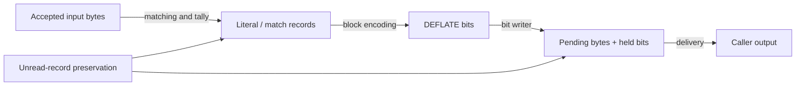

The previous chapters followed one block through three representations: a sequence of symbols, a sequence of bits, and bytes sharing an allocation with unread symbols. The proof follows those same objects. Its job is to connect each representation to the next without losing either the data's meaning or the right to access its storage.

Keep the running example in view: literals `A`, `B`, then a match of length 6 and distance 2. Their expansion is `ABABABAB`. Encoding this chosen sequence as a final fixed block takes 38 bits before padding. This gives us a small execution to follow; the argument must also cover the other symbol sequences and states admitted by its premises.



## Symbol meaning {#meaning}

Begin before the first output bit. A literal expands to its byte. A match reads from the already expanded history, one byte at a time. The distance stays fixed while that history grows. Therefore the example's match expands to six bytes even though its distance is only two.

The compressor needs a relation between this expansion and the input it has accepted. After tallying a literal, the symbol expansion gains that byte. After tallying a match, it gains the bytes justified by the preceding match search. The deferred decision in lazy matching needs the same account: accepting input into lookahead and committing a symbol are different events. Their cursors cannot be treated as interchangeable.

Next connect the logical symbol to its actual record. The three stored bytes must reconstruct the same distance and literal or length offset, and the frequency updates must count that symbol. The existing [`tr_tally_spec`](/reference/source/ZlibF/Proof/trees.c.tally.html#L327) describes the translated tally's actual writes under explicit room and symbol-domain premises. It does not, by itself, establish that a preceding search selected bytes equal to the input. That is the caller's part of the connection.

Once a record is read for emission, fixed or dynamic encoding must produce the format-prescribed code and extra bits for that same symbol. Stored blocks take a different branch: they copy the raw bytes. These branches can use different representations while satisfying one independent decoding relation. [`Deflate.Valid`](/reference/source/ZlibF/Spec/Format/Deflate.html#L160) defines that raw-format target through decoding, rather than defining success as “whatever the compressor happens to emit.”

## Exact bit output {#bitstream}

The writer makes the bit representation concrete. Complete bytes may already sit in `pending_buf`, while the next bits remain in `bi_buf`. We need one logical sequence covering both places:

```text
outBits = bits(pending_buf[0 .. pending))
          ++ low_bits(bi_buf, bi_valid)
```

Each byte contributes its low bit first. Stored Huffman words are already reversed for that writer. The statement for one `send_bits` call is then especially useful: the returned sequence equals the old sequence followed by exactly the requested field. A change in where those bits reside does not change their order.

The actual [`send_bits_spec`](/reference/source/ZlibF/Proof/trees.c.bits.html#L411) separates the branch that retains bits from the branch that emits a 16-bit word and keeps the remainder. Its current statement requires `TreesInvAt`, a length from 0 through 15, a fitting value, and explicit bit room. It concludes an actual successful execution, the same invariant on the returned heap, exact bit append, and preservation of bytes outside the written interval.

This is how a local result becomes useful to the next call. [`EmitState.step`](/reference/source/ZlibF/Proof/trees.c.emit-state.html#L34) composes actual emissions: appending `u` and then `v` appends `u ++ v`. It carries the returned heap and unchanged fields along with the bit equation. The proof uses the helper's proved execution result and establishes its premises at the call site; it does not assume the helper behaves according to an unproved contract.

## Unread storage {#prefix}

Exact bits still do not guarantee a usable symbol stream. A writer could append the intended field and destroy a record that the next iteration needs to read.

Let `B` be `lit_bufsize`, and let `q` count complete records already read. The next unread record starts at `R(q) = B + 3q`. Let `P(q)` be the next free output byte after their emission. The argument must keep every actual write away from the unread suffix. The project's convenient sufficient boundary is `P(q) < R(q)`, together with preservation during the intervening writes. An equality at a boundary is not, on its own, an actual overwrite; the concrete half-open write ranges decide overlap.

Recall the deliberately front-loaded teaching plan. With `B = 8`, reading the first record moves the unread start to 11. Starting with two pending bytes and then writing twelve more changes the next free position to 14. The write interval `[2,14)` intersects unread storage at `[11,14)`. A final size of 20 fits the 32-byte allocation, but it cannot restore those three bytes. This explains why the induction needs every prefix, not just the last one.

For a fixed block, the reasoning has a simple quantitative form. A literal costs at most nine bits; a match costs at most 31. Assume entry has no pending bytes and at most seven held bits. Combining the three-bit header with the writer's byte bound gives the conservative estimate

```text
P(q) ≤ (7 + 3 + 31q) / 8 + 1
```

for the corresponding emission prefixes. Comparing it with `B + 3q` yields a sufficient inequality `(7/8)q + 9/4 < B`. With `q ≤ B−1`, `B > 11` suffices; the shared layout's permitted minimum is 128. This is the calculation behind the slack, not a claim that every call already establishes the entry conditions. Header emission before record zero, the intermediate writes, END_BLOCK and final alignment each need their place in the argument. [The full F9 discussion](/reference/docs/proof/trees.html#the-overlay-lemma-f9) keeps those obligations explicit.

## Dynamic prefix costs {#dynamic}

Dynamic blocks add a tree description before the first record. Their early symbols may also receive long codes. Choosing a dynamic block because its complete rounded cost beats the fixed block bounds the total; it does not constrain where the expensive symbols occur.

The needed budget therefore includes the description and each prefix of symbol costs. Kraft's inequality alone cannot provide it. Kraft describes a legal code space, while this budget needs a relationship between code lengths and the actual frequencies used to build the tree.

This step needs a further detailed reading of tree construction. The proof must follow queue selection, merging, depth tie-breaking, length limiting and reassignment. A mathematical frequency/depth bound is useful only once those premises have been obtained from the translated constructor. It must then survive the conversion to canonical words, extra bits and the actual writer's rounding. Historical Fibonacci arguments offer a route, with their own parameter scopes; they are not a substitute for this implementation connection. [Tree construction and repair](/reference/docs/proof/trees.html#length-repair-f8) develops the required accounting.

## Delivery and call boundaries {#composition}

The last connection concerns `flush_pending`. Copying bytes to the caller moves an already encoded prefix; it should neither invent bytes nor discard the undelivered suffix. Limited output space can split that delivery across calls. Thus a call boundary needs both a byte account and the remaining encoder state.

A useful relation connects the accumulated caller output, the current pending region and held bits to the encoded prefix of the logical symbols. When output fills, that relation explains what has been delivered and what remains. On resumption, the proof starts from that returned state. A new block cannot simply assume the fresh-entry bound while bytes from the previous block are still pending.

Finally, block correctness must compose with wrapper headers and trailers, flush operations, initialization and cleanup. The public [`deflate` contract](/reference/functions/deflate.html) and [`deflate_sequence` target](/reference/targets.html#deflate_sequence) state broader obligations than the local writer results above. The [deflate argument](/reference/docs/proof/deflate.html) connects those layers; [project progress](/reference/docs/progress.html) records accepted scope and what remains. The route to follow is concrete throughout: preserve the records, append their exact bits, deliver those bytes, and retain enough state to continue the same task.
