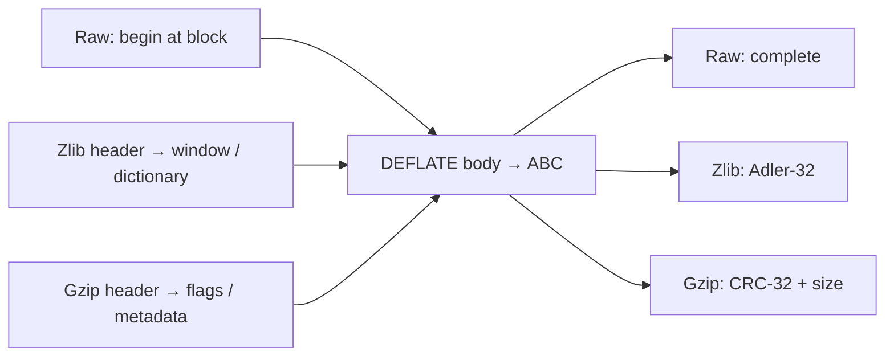

The previous chapter let an application recover `ABABABAB` in two small batches. That example used **raw DEFLATE**: compressed blocks with no format header or checksum trailer. A file or network protocol often needs more information: what format is this, what history can it use, and did the recovered bytes pass an integrity check?

A **wrapper** adds bytes before and after the DEFLATE body to carry that information. The application still receives only the recovered original bytes. Header fields and trailing checks are consumed as compressed input; they do not appear in its output buffer.

This chapter follows the smaller original text `ABC`, so that we can inspect every byte. First see the complete layouts, then see why an application can have all of `ABC` while still needing another `inflate` call. The checksum calculation and decoder settings follow afterward.

## Three byte layouts {#layout}

A stored block carries its payload bytes unchanged, preceded by a length and a check on that length. Choose one final stored block rather than relying on any compressor's match or tree choices. Its eight bytes are:

```text
01 | 03 00 | fc ff | 41 42 43
     LEN=3  NLEN     A  B  C
```

The first byte `01` is hexadecimal `0x01`. Reading its low bits first gives `1,0,0`: the first bit marks a final block, and the next two bits `00` select a stored block. The remaining positions align to the byte boundary. `LEN` is the payload byte count, here 3. `NLEN` is its 16-bit bitwise complement, here `0xfffc`; comparing both fields helps detect a malformed length. Both are 16-bit little-endian fields, so their low byte comes first. Only `41 42 43` become uncompressed output. The surrounding bytes tell the decoder how to interpret or validate that output.

| Layer | Chosen complete encoding (hexadecimal bytes) |
| --- | --- |
| Raw DEFLATE | `01 03 00 fc ff 41 42 43` |
| Zlib | `78 01` · body · `01 8d 00 c7` |
| Gzip | `1f 8b 08 00 00 00 00 00 00 03` · body · `48 03 83 a3 03 00 00 00` |

Here “body” is exactly the same eight bytes. The gzip example selects timestamp zero, no optional fields, and OS field 3. Other permitted metadata would change its header without changing `ABC` or the DEFLATE rules. The zlib header `78 01` does not force the compressor to use a stored block; we deliberately selected that body to make the boundary readable.



These are conceptual routes through shared decoding modes. A malformed header, block or trailer has its own error exit. Input can stop midway through any field, requiring the saved state described in the preceding chapter.

## Payload delivery and stream completion {#completion}

Now cut the zlib example immediately after `ABC`, before its four-byte trailer. The application already has all three output bytes, but the stream is incomplete. Providing the expected trailer permits validation; supplying `01 8d 00 c6` instead produces a checksum mismatch under normal validation. The decoder cannot retract output delivered on earlier calls. An incomplete trailer needs continuation, whereas a fully read bad trailer is an error.

For an ordinary zlib decoder, this gives three different situations:

| Input supplied so far | Original bytes available to the application | What remains |
| --- | --- | --- |
| Header and complete body | `ABC` | Read the four trailer bytes; do not declare success yet. |
| Those bytes followed by `01 8d 00 c7` | `ABC` | Validate the check, then return `Z_STREAM_END`. |
| Those bytes followed by `01 8d 00 c6` | `ABC` | Report `Z_DATA_ERROR` when the enabled check finds the mismatch. |

In the decoder, `CHECK` names the trailer-checking stage. `state->wrap` records whether a wrapper is in use and which checks are selected; zero denotes raw mode. `state->check` holds the accumulated payload checksum. The macro `NEEDBITS(n)` ensures that at least `n` bits are available to interpret, fetching input or pausing as necessary.

The C makes the distinction explicit. The pinned [`CHECK` case](https://github.com/madler/zlib/blob/757f0527154291bcf6bfbd6396ecde6bedd2db95/inflate.c#L1081-L1098) begins:

```c
case CHECK:
    if (state->wrap) {
        NEEDBITS(32);
```

For the zlib example, `NEEDBITS(32)` must obtain the four trailer bytes before the following comparison can run. A missing trailer leaves work to resume. The following C compares the interpreted trailer against `state->check` when validation is enabled and switches to `BAD` on mismatch. Raw mode skips this wrapper branch. The complete wrapper proof is unfinished. It must connect this pause, the trailer supplied on resumption, and the accumulated check used by the comparison to the same call history.

The [inflateValidate contract](/reference/functions/inflateValidate.html) explicitly allows disabling wrapper checksum and gzip length validation before decoding. With checking disabled, bad check values may be accepted and the output-checksum account is not maintained in the same way. That setting changes the promised validation property; it does not remove the wrapper's framing or turn its trailer into payload. Raw mode remains raw. A proof must retain the setting that was actually selected rather than silently assuming checks are enabled.

For concatenated gzip members, each member has a new header, body, CRC and size. Ordinary `inflate` stops at the first `Z_STREAM_END`. Keep the remaining input, reset the decoder appropriately, then start the next member. The higher-level [gzip file reader](/reference/functions/gzread.html) manages member concatenation; a single core call does not thereby inherit the file reader's behavior.

The format checks detect certain damage. They establish neither authenticity nor collision-free equality. The complete claim needs body decoding, valid history, correct byte boundaries and whichever integrity checks the chosen API configuration enables. [The stream proof](/sample/stream-proof.html) now connects those conditions to actual calls.

## Checksums over the right bytes {#checksums}

Adler-32 makes the zlib trailer easy to follow by hand. `s1` is a running sum of byte values; `s2` sums those successive running sums, making byte position affect the result. Begin with `s1 = 1`, `s2 = 0`; for each uncompressed byte, add it to `s1`, then add the new `s1` to `s2`, reducing modulo 65521:

| Prefix | `s1` | `s2` |
| --- | ---: | ---: |
| Empty | 1 | 0 |
| `A` (65) | 66 | 66 |
| `AB` (+66) | 132 | 198 |
| `ABC` (+67) | 199 | 397 |

The result is `397 × 65536 + 199 = 0x018d00c7`. Zlib writes those four bytes most significant first. Gzip instead uses CRC-32 of the uncompressed payload, here `0xa3830348`, and writes it least significant byte first, followed by output size modulo `2^32`. Thus our gzip trailer is `48 03 83 a3 | 03 00 00 00`.

Compression updates its payload checksum over accepted input. Decompression updates over the output it actually produced. Neither computes that payload checksum over the compressed body bytes. Splitting `ABC` into updates for `A` and `BC` must give the same result as updating once over `ABC`; which actual slices were processed is as important as the checksum arithmetic itself.

A gzip header can optionally include a check consisting of the low 16 bits of its header CRC-32. That is a separate byte history. Header names, comments and extra fields do not become payload. `inflateGetHeader` can register caller-owned destinations for them; their capacities and lifetimes must remain valid while later calls parse the header. The [header contract](/reference/functions/inflateGetHeader.html) also explains truncation, terminators and `done`, including `done = -1` when automatic detection selects zlib.

For the checksum calculation and why it continues when buffers change, open [checksums and chunk combination](/verification/checksums.html). It follows the same original data through zlib’s Adler-32, gzip’s CRC-32, and independently computed chunk summaries.

## Headers and initial history {#headers}

The zlib header has two one-byte fields. `CMF` stores the compression method and window-size declaration; `FLG` stores flags, a compression-level hint and header check bits. Its method must identify DEFLATE; at the format level, its window declaration bounds permitted distances. The combined header integer must be divisible by 31. `FDICT` is the flag bit saying that a four-byte dictionary identifier appears before the body. The compression-level hint does not prescribe a unique encoding.

Unpack the example header `78 01`. The low four bits of `0x78` are 8, selecting DEFLATE. The high four bits are 7; the format adds 8 to obtain window exponent 15. The combined integer is `0x7801 = 30721 = 31 × 991`, so it also passes the header divisibility check. None of these checks has read the `ABC` payload yet.

Window sizes use a power-of-two notation: an exponent of 15 means `2^15 = 32768` history bytes. The initialization argument `windowBits` combines that size request with the wrapper choice. Values such as 31 are encoded requests, not a request for a `2^31`-byte history window; the table below separates the two meanings.

Header acceptance and per-match source checking are separate implementation steps. A decoder configured for a smaller maximum window must reject a larger declaration. The C comparison of each distance with the header-derived byte-distance ceiling `dmax` is guarded by `INFLATE_STRICT`, which is not enabled in the initial default build. Current-call output can sometimes supply a distance beyond the retained window size. Keep the format promise distinct from the exact conditions that default C explicitly rejects; the [format reference](/reference/docs/spec/format/README.html) and [decoder argument](/reference/docs/proof/inflate.html) retain that distinction. A `windowBits` request of zero instead selects the size from the zlib header. Raw and gzip do not carry that zlib window declaration, so their initial configuration provides the required limit. The accepted default-build requests are deliberately not one continuous interval:

| `inflateInit2` request | Accepted layer and window choice |
| --- | --- |
| `-15` through `-8` | Raw DEFLATE; magnitude gives window bits. |
| `0`, or `8` through `15` | Zlib; header-selected size for zero, otherwise that maximum. |
| `16`, or `24` through `31` | Gzip only; default size for 16, otherwise subtract 16. |
| `32`, or `40` through `47` | Detect zlib or gzip; header/default choice for 32, otherwise subtract 32. |

For example, 15 is a zlib decoder and 31 a gzip decoder; 47 accepts either wrapper. This is the decoder table. Compression has a different [configured-init contract](/reference/functions/deflateInit2_.html), including its own accepted window settings. Do not copy one engine's parameter domain onto the other.

A zlib dictionary request returns `Z_NEED_DICT`, with the required Adler-32 identifier in `strm->adler`. `inflateSetDictionary` checks the supplied dictionary and installs its window-sized suffix as history. Those bytes can justify a match before output has supplied enough history. They are not themselves emitted as decoded bytes, and the identifier concerns the whole supplied dictionary, not merely the retained suffix.

An equal identifier alone does not establish dictionary equality: checksums can collide. Correct recovery requires the dictionary bytes expected by the compressor. Raw mode permits dictionary supply without that identifier handshake, under its own call-boundary rules. Gzip has no corresponding preset-dictionary path. These differences belong in the [dictionary contract](/reference/functions/inflateSetDictionary.html), not in an assumption that all wrappers start with empty history.

## Proof connections {#proof-boundary}

The byte layout alone does not show that the implementation reads the correct ranges. Its argument must connect the selected header rules, decoded body, retained history and exact checksum slices on the actual returned heaps. It must also keep the validation setting that the caller chose. [The stream proof](/sample/stream-proof.html#wrappers) joins those obligations to the two-call task.
