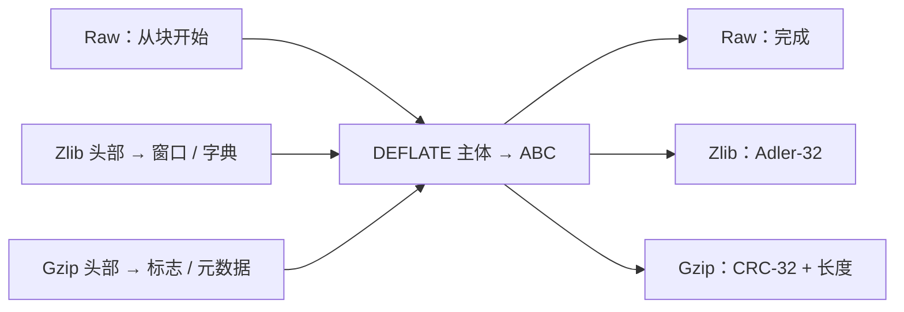

上一章让应用分两批解出 `ABABABAB`。那个例子使用 **raw DEFLATE**：只有压缩块，没有格式头部和校验尾部。文件或网络协议往往还需要知道：这是什么格式、允许使用什么历史、恢复出的字节是否通过完整性检查？

**封装**就是在 DEFLATE 主体前后增加字节，携带这些信息。应用收到的仍然只有恢复出的原文字节。头部字段和尾部检查值会作为压缩输入被读取，不会进入应用的输出缓冲区。

本章把原文缩小为 `ABC`，以便逐字节检查。先看完整布局，再看为什么应用已经拿到全部 `ABC`，却还需要继续调用 `inflate`。最后解释校验和怎样计算、解码器怎样选择封装。

## 三种字节布局 {#layout}

选择一个最终 stored 块，不依赖压缩器会作出哪种匹配或建树决策。它包含八个字节：

```text
01 | 03 00 | fc ff | 41 42 43
     LEN=3  NLEN     A  B  C
```

`01` 的低三位表示最终标志为 1、stored 类型为 0，其余位用于对齐字节边界。`LEN` 和它的补码是 16 位小端字段。只有 `41 42 43` 成为未压缩输出；其余字节规定怎样解释或验证输出。

| 层次 | 选定的完整编码，均为十六进制字节 |
| --- | --- |
| Raw DEFLATE | `01 03 00 fc ff 41 42 43` |
| Zlib | `78 01` · 主体 · `01 8d 00 c7` |
| Gzip | `1f 8b 08 00 00 00 00 00 00 03` · 主体 · `48 03 83 a3 03 00 00 00` |

这里的“主体”都是完全相同的八个字节。gzip 示例选择时间戳为零、没有可选字段、OS 字段为 3。其他允许的元数据会改变头部，但不改变 `ABC` 和 DEFLATE 规则。zlib 头部 `78 01` 也没有强制压缩器选择 stored 块；这里主动选用这种主体，是为了把边界展示清楚。



这是经过共用解码模式的概念路径。畸形头部、块和尾部各有错误出口。输入也可能停在任何字段中间，需要上一章介绍的保存状态。

## 原文已经到手，为什么还没完成 {#completion}

现在在 `ABC` 后面截断 zlib 示例，暂不供应四字节尾部。应用已经获得全部三个输出字节，但流尚未完成。提供正确尾部后才可完成验证；若换成 `01 8d 00 c6`，正常验证会检测到校验和不匹配。解码器无法撤回先前调用已经交付的输出。不完整的尾部需要继续输入，完整读入但不匹配的尾部则是错误。

对于普通的 zlib 解码器，这对应三种情况：

| 已经提供的输入 | 应用已拿到的原文字节 | 还需要做什么 |
| --- | --- | --- |
| 头部与完整主体 | `ABC` | 读取四字节尾部；此时还不能报告成功。 |
| 上述字节再加 `01 8d 00 c7` | `ABC` | 检查值通过后，返回 `Z_STREAM_END`。 |
| 上述字节再加 `01 8d 00 c6` | `ABC` | 已启用的验证发现不匹配，报告 `Z_DATA_ERROR`。 |

C 明确写出了这个区别。固定版本的 [`CHECK` 分支](https://github.com/madler/zlib/blob/757f0527154291bcf6bfbd6396ecde6bedd2db95/inflate.c#L1081-L1098)从这里开始：

```c
case CHECK:
    if (state->wrap) {
        NEEDBITS(32);
```

对这个 zlib 例子，`NEEDBITS(32)` 必须取得四个尾部字节，才能执行后面的比较。尾部尚未到达时，要留下工作等待下次继续。随后 C 在验证已启用时，把解释后的尾部与 `state->check` 比较，不匹配就进入 `BAD`。raw 模式跳过这个封装分支。这段代码解释了应用看到的边界；对所有允许历史都成立的保持性仍须证明确认：**to confirm**。

[inflateValidate 契约](/reference/functions/inflateValidate.html)明确允许在解码前关闭封装校验和及 gzip 长度验证。关闭后，错误检查值可能被接受，输出校验和也不再按相同方式维护。这项配置改变验证承诺，不会去掉封装的边界，也不会把尾部变成载荷。raw 模式仍是 raw。证明必须保留实际选择的配置，不能悄悄假定检查始终启用。

拼接 gzip 成员时，每个成员都有新头部、主体、CRC 和长度。普通 `inflate` 在第一个 `Z_STREAM_END` 停止。保留剩余输入，正确重置解码器，再开始下一个成员。上层 [gzip 文件读取器](/reference/functions/gzread.html)负责成员拼接；单次底层调用不会自动继承文件读取器的行为。

这些格式检查可以检测某些损坏，不建立真实性，也不是无碰撞的相等性证明。完整结论仍需主体解码、有效历史、正确字节边界，以及所选 API 配置启用的完整性检查。

## 校验和对应的字节 {#checksums}

zlib 使用的 Adler-32 可以手算。初始 `s1 = 1`、`s2 = 0`；每读一个未压缩字节，先把它加到 `s1`，再把新的 `s1` 加到 `s2`，两者都模 65521：

| 已处理前缀 | `s1` | `s2` |
| --- | ---: | ---: |
| 空 | 1 | 0 |
| `A`，数值 65 | 66 | 66 |
| `AB`，再加 66 | 132 | 198 |
| `ABC`，再加 67 | 199 | 397 |

结果为 `397 × 65536 + 199 = 0x018d00c7`，zlib 按最高有效字节在前写出四字节尾部。gzip 则计算未压缩数据的 CRC-32，此处为 `0xa3830348`，最低有效字节在前写出，然后写出模 `2^32` 的输出长度。因此示例 gzip 尾部为 `48 03 83 a3 | 03 00 00 00`。

压缩时，载荷校验和针对已经接受的输入；解压时，针对实际产生的输出。两者都不是对压缩主体字节计算载荷校验和。先更新 `A`，再更新 `BC`，必须与一次更新 `ABC` 一致。实际处理的是哪些字节切片，与算术本身同样重要。

gzip 头部还可以带一个可选检查值，即头部 CRC-32 的低 16 位。这是另一份字节历史。文件名、注释和 extra 字段不是载荷。`inflateGetHeader` 可登记调用者拥有的目的存储，让后续调用填入这些字段；解析期间必须保持对应容量和生命周期有效。[头部契约](/reference/functions/inflateGetHeader.html)还规定了截断、终止零和 `done`，包括自动识别到 zlib 时 `done = -1`。

## 头部与初始历史 {#headers}

zlib 头部由 `CMF` 和 `FLG` 组成。方法字段必须表示 DEFLATE；在格式层面，窗口声明限制允许的距离。合起来的头部整数必须能被 31 整除。`FDICT` 表示主体之前还有四字节字典标识符。压缩级别提示不指定唯一编码。

头部接受检查与每个匹配的来源检查是不同的实现步骤。解码器配置的最大窗口较小时，必须拒绝更大的头部声明。C 中把每个距离与头部导出的 `dmax` 比较的分支受 `INFLATE_STRICT` 控制，首个目标默认构建并未启用它。当前调用的输出有时可以支持超过保留窗口大小的距离。必须区分格式的约束与默认 C 明确拒绝的条件，详见[格式参考](/reference/docs/spec/format/README.html)和[解码器论证](/reference/docs/proof/inflate.html)。`windowBits` 为零则从 zlib 头部选择大小。raw 和 gzip 不携带这份 zlib 窗口声明，因此相应限制由初始配置提供。默认构建接受的请求并不是一段连续整数区间：

| `inflateInit2` 请求 | 允许的封装与窗口选择 |
| --- | --- |
| `-15` 到 `-8` | Raw DEFLATE，绝对值是窗口位数。 |
| `0` 或 `8` 到 `15` | Zlib，零表示由头部选择，否则是指定的最大位数。 |
| `16` 或 `24` 到 `31` | 仅 gzip，16 使用默认大小，否则减去 16。 |
| `32` 或 `40` 到 `47` | 自动识别 zlib 或 gzip，32 使用头部或默认大小，否则减去 32。 |

例如 15 是 zlib 解码器，31 是 gzip 解码器，47 可识别两种封装。这是解码器的参数表。压缩器有不同的[配置初始化契约](/reference/functions/deflateInit2_.html)，也有自己的窗口取值规则，不能把一个引擎的定义域直接套给另一个。

需要 zlib 字典时，解码返回 `Z_NEED_DICT`，并在 `strm->adler` 中给出所需 Adler-32 标识符。`inflateSetDictionary` 检查提供的字典，把窗口大小的后缀安装为历史。这些字节可以在尚无足够输出历史时支持回引用，但它们本身不作为解码结果输出。标识符检查针对完整的供应字典，不只是保留后缀。

相同标识符也不能证明字典相同，校验和可能碰撞。正确恢复需要与压缩器一致的字典字节。raw 模式允许在自己的调用边界规则下提供字典，没有相同的标识符握手。gzip 则没有对应的预设字典路径。这些区别属于[字典契约](/reference/functions/inflateSetDictionary.html)，不能用“所有封装都从空历史开始”代替。

## 证明要接起来的事实 {#proof-boundary}

字节布局本身不能证明实现读取了正确范围。论证还必须在真实返回堆上，连接所选头部规则、主体解码、保留历史和校验和实际处理的字节切片，并保留调用者实际选择的验证配置。[流式执行的证明](/sample/stream-proof.html#wrappers)把这些义务接回两次调用的任务。
