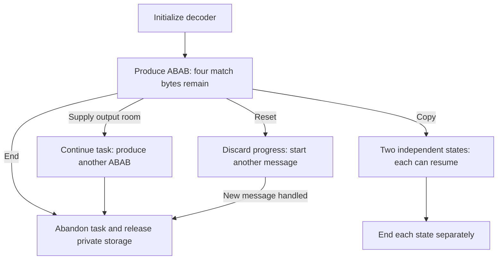

## Give the algorithm usable state {#connection}

[Streaming](/verification/streaming.html) can pause and resume because held bits, tables, an unfinished match and retained bytes survive a function return. That state needs storage. Initialization establishes it, calls keep using it, Reset or Copy changes the task's continuation, and End eventually releases it.

Use raw stream `73 74 82 40 00` again, this time with four output slots. After receiving `ABAB`, four match bytes remain. The application now has several genuinely different choices:

This four-byte checkpoint varies the five-byte streaming example so that the remaining result is also `ABAB`. Copy preserves the state needed to resume; it does not replay an already delivered prefix.

## Decide whether the task continues {#operations}

Rebuffering, Reset and Copy may all retain some memory, but their meanings differ. [State operations](/sample/state-operations.html) develops the checkpoint above. Ordinary Reset invalidates old matching bytes. Copy preserves progress but gives private windows and dynamic tables independent storage; otherwise ending the original stream could invalidate the copy's tables.

The chapter then connects these operations to external context. A preset dictionary supplies match sources not yet produced as output. Priming bits and registering gzip metadata meet an enclosing container. Each operation has its own timing and borrowed-storage requirements; their effects cannot be understood merely as “changing state.”

## Acquire the storage needed to continue {#allocation}

Compression needs a byte window, searchable indexes and pending output. An ordinary decoder can instead allocate just its state first and delay its window until output must survive a call. [Allocation and release](/sample/allocation.html) connects these uses to actual objects, then follows the failure paths.

In one concrete compressor example, request three of five fails: state and window succeed, predecessors fail, and later hash-head and pending-storage requests can still succeed. Cleanup must release all four successful objects. A decoder example starts with `ABAB` already delivered before the retained-window allocation fails with `Z_MEM_ERROR`. An error code guarantees neither “nothing was allocated” nor “no bytes were written.”

This is where optimization meets the interface. Lazy allocation can avoid a window allocation and copy; its contract must correspondingly describe which data has already been delivered and which resources remain releasable after a late failure.

## Preserve both progress and ownership {#guarantees}

[Ownership and lifetime](/sample/ownership-proof.html) develops the proof around those same objects. Initialization must establish a genuinely usable stream. Each legal call must preserve valid pointers and authorized write ranges. Failed attempts and End must account for every new, retained and released object. Copy must preserve both equal progress and independent storage: either one alone is insufficient.

The complete lifetime composition is unfinished; [progress](/reference/docs/progress.html) records its current scope. These storage relations do not replace algorithmic content. A valid window need not contain the right bytes, and a valid table pointer need not return the right symbol. Those layers join [decoding](/verification/decoding.html#guarantees) and [correctness across calls](/sample/stream-proof.html#continuation).

The [stream API](/reference/docs/spec/api/streams.html) leads to full parameter, return and storage contracts. For `.gz` files, [the gzip file interface](/sample/gzip.html) also manages file buffers and handles around these lower-level objects.
