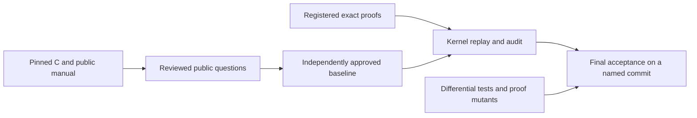

<!--
source: docs/checking/README.md
source-sha256: 15c9fd72685406c7136a45ec419377c5b8a709266893157f71ef732b0303affd
-->

# 检查一项验证主张

绿色构建表示模块能够编译。它不表示 zlib 已经得到验证。接受结果需要对固定的公开问题给出证明、忠实的 C 翻译，以及对运行时经过独立批准的说明。剩余工作见[概览](../overview.md)。

先阅读[公开目标](goals.md)，理解主张的内容。阅读[反作弊策略](../anti-cheating.md)，理解证明变化时如何保持问题固定。[可信基础](../trusted-base.md)说明语义限制。

## 四个阶段

在仓库根目录运行以下命令。每个阶段回答不同的问题。

| 阶段 | 命令 | 通过所建立的结论 | 不建立的结论 |
| --- | --- | --- | --- |
| 覆盖 | `python3 scripts/verification.py coverage` | 固定版本的公开头文件、入口清单、翻译名称、手册章节和导入闭包相互一致。 | 每个契约都已存在或正确。 |
| 开发 | `python3 scripts/verification.py check` | 项目构建成功，已编译声明在新内核中重放，声明审计通过，且锁匹配。 | 已经完成：仍然允许存在未完成目标。 |
| 规格就绪 | `python3 scripts/verification.py specs` | 开发检查通过，而且所有必需的公开命题都存在且是闭合的。 | 语义完整性、独立批准，或这些命题的证明。 |
| 最终证明接受 | `python3 scripts/verification.py final --baseline COMMIT` | 每个固定目标都有精确匹配的已登记证明；保留了已批准基线；严格检查在干净的具名提交上通过。 | 未经审查基线、C 编译器或操作系统的正确性。 |

清单要求 95 个默认构建入口契约、四个生命周期契约和四个初始化域契约。其他构建配置仍然属于项目目标。命题存在不等于证明。关于抽象 API 或字节格式的证明，不能完成关于实际翻译执行的契约。

## 这些检查建立什么

| 检查 | 证据和限制 |
| --- | --- |
| 内核重放和公理审计 | 检查证明项及其依赖。只允许 `propext`、`Classical.choice` 和 `Quot.sound`。正确的证明仍然可能回答一个不完整的问题。 |
| 精确目标匹配 | 已登记定理必须以固定目标作为其类型。额外前提、相似名称或抽象模型定理都不算。 |
| 源码和语义锁 | 检测受保护源码、定义和已登记定理类型的变化。它们保持含义，不判断该含义是否正确。 |
| 无占位符检查 | 拒绝未完成的 Lean 证明源码。开发检查通过不能免除最终无占位符要求。 |
| 差分测试 | 比较翻译执行与真实 C，包括错误和分配失败。它们是忠实性的有限证据，不是证明。消毒器运行扩充这类证据。 |
| 审计和差分自测 | 故意破坏输入，并要求检查机制检测到变化。首先必须有一个通过的正基线。 |
| 证明变异 | 改变翻译函数的行为，并要求该函数的证明拒绝它。公开入口还会针对变异重放原始精确证明。敏感性不证明覆盖了每一种错误。 |
| 独立审查 | 判断运行时、翻译、公开允许域、规格和锁更新。初始化必须建立不变量；不能假设任何未经证明的被调用函数契约。 |

最终接受运行干净构建、新内核重放、严格审计、无占位符检查、审计自测、普通和消毒器差分运行、差分自测，以及严格的证明变异列表。四项 CI 作业是 `build`、`no-sorry`、`audit` 和 `difftest`。只有具名提交上必需 CI 全绿时，才能报告结果已经证明。绝不能把未运行的检查报告为通过。

## 谁来固定问题

候选锁检测检出副本内的漂移。权威来自经过独立批准、不可变的基线。最终接受与该基线比较，包括审计代码和原始登记。最终工作流从 `main` 获取审计器和基线；开发引导路径不是最终接受。

运行时、翻译、允许域或规格变化需要单独审查，说明新旧含义、源码证据和生成的锁差异。锁必须重新生成，不能手工编辑。改变受保护路径的文档移动也需要经过审查的策略更新。必要审查和检查必须由仓库保护机制强制执行；单独的代码所有者文件不能强制它们。详细规则见[反作弊策略](../anti-cheating.md)。

## 指南与审查记录

| 页面 | 用途 |
| --- | --- |
| [公开目标](goals.md) | 调用者允许域、执行、结果、框架条件、所有权和生命周期义务。 |
| [证明变异](proof-mutants.md) | 如何运行和解释变异检查，包括严格接受。 |
| [公开契约审查](contract-review.md) | 命题层次、源码审查修正、反例和高级操作边界。 |
| [查询登记审查](query-registration-review.md) | 六项精确公开查询及其变异证据。 |
| [编译器辅助函数审查](compiler-helper-review.md) | 六个生成的递归执行辅助函数及其逻辑对应物。 |
| [运行时审查](runtime-review.md) | 历史发现 R1–R13 和翻译问题 U1–U5。 |
| [堆表审查](runtime-tables-review.md) | 关于数组支撑表和原位更新的历史发现 F1–F6。 |

审查记录保留证据和范围。它们不是独立的基线批准，也不能读作当前缺陷列表。当前工作看[概览](../overview.md)，公开行为看[API 手册](../api/README.md)，模型看[设计](../design/README.md)，实现论证看[证明指南](../proof/README.md)。

[局部证明登记检查](registration-review.md)描述接受证据及其范围。
