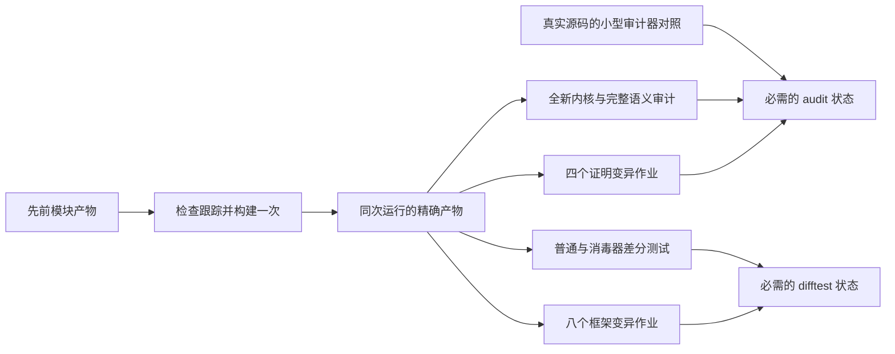

<!-- source-sha256: ddd00b72713836acdc798932308aa6e820a213b26c198e88588bfabb79c1eee9 -->
# CI 审计性能

已测到的最大延迟来自审计负例测试。每个样例都导入完整库。
旧审计器为每条声明分别收集公理，同一批依赖会被反复遍历。
已经无效的导入闭包也会先生成完整语义报告，然后才拒绝。

现在从所有被审计的定义和定理建立一个依赖图。
遍历类型和值，包括私有定义、公理类型和归纳类型的构造器。
禁止公理沿反向边传播，直到没有新依赖。先建立完整图再传播，
使循环依赖不会把尚未遍历完的节点误当作无禁止公理。
允许的公理和已审查的编译器例外不变。

发现禁止声明仍会令检查失败，但不再为已失败的闭包生成完整语义报告。
每个成功检查仍输出全部语义记录、登记定理类型和目标结果。
小型回归样例对每个审计根比较新收集器与 Lean 原收集器，
并覆盖私有依赖、公理类型和相互递归的归纳类型。

同一源码编译为 `zlibf-audit` 可执行程序。验证入口在调用方的审计器检出中
构建程序；加载候选版本的已编译声明时，不运行候选模块初始化器。
负例测试只在调用方快照中构建一次审计器，之后每次独立变异都使用
这个确切的程序。候选版本不能选择替代审计器。

一次全库测量覆盖 36,106 条声明和 406 个登记定理。
仅将原审计器编译为可执行程序，运行仍需 788 秒；
共享依赖遍历后为 62 秒。两者生成的 481,854,479 字节报告
都与此前解释执行得到的完整报告逐字相同。
这个时间只衡量声明审计，不包括独立内核重放、源码构建、
证明变异或整轮远端 CI。

所有负例均保留，每项仍有真实未修改基线、独立构建和拒绝要求。
日志给出各样例耗时，便于继续定位瓶颈。
独立内核重放和完整语义锁仍分别检查。

源码范围解析器也在调用方检出中只编译一次。每次仍重新解析实际源码和变异，
不对候选导入做语义展开或执行。程序在干净临时目录运行，只使用固定标准库搜索路径。
对照测试同时加入候选搜索路径和无法解析的源码导入，确认输出仍与解释器一致。
不缓存源码解析结果。

## 一次构建与独立检查

生产作业恢复先前的模块产物，再由 Lake 检查源码与依赖跟踪，构建完整库和差分驱动。
缓存命中不代表验证通过。键区分工具链、配置、原生编译器和操作系统版本；源码变化
可以复用未变模块。缓存缺失或被清除时重新编译。

同一次工作流只发布一个不可变产物归档。每个消费作业先核对精确提交、全部受版本
控制的 Lean 输入、工具链、平台与编译器，再提取。归档不能覆盖源码或包含链接。
消费作业使用 `lake --no-build build ZlibF`；产物缺失或过期会失败，不会悄悄再编译。
变异在私有副本运行，并保留正例。独立已批准审计器自行构建工具，候选原生程序不能
取代它。编译器不从候选作业可写的缓存恢复。

原有十三个审计器负例全部保留，并使用未改动的真实源码闭包。声明对照导入真实运行时。
运行时与翻译变更必须编译成功，再被原语义锁比较器拒绝；陈述变更使用实际登记定理。
每个样例先编译、通过审计并记录自己的正例语义基线。编译错误、超时、审计器崩溃、
未应用的变更或错误类型的锁失败都会令测试失败。完整库正例审计及已提交锁仍是单独的
必需检查；这些小样例不用于推导 zlib 正确性。

十三个对照的本地运行耗时 32.37 秒。这不是完整 Linux 工作流的时间。
过去完整库负例分片曾耗时 110 与 156 分钟；后者触发旧时限。

证明变异分片保留每个公开目标组、原始精确证明正例，以及全部引用列表中的所有行，
包括未映射公开登记的行。初始清单有 49 个目标、64 个精确公开变异和 146 个完整列表行。
四个独立证明作业无重叠分担；差分框架用八个作业执行原有完整行分片。必需状态拒绝跳过、取消或失败
的作业，矩阵不因一个作业失败而取消其他作业。

精确证明重放的 Lean 源码未改，只编译为原生程序一次。每次调用仍重建原始证明依赖
闭包并在全新内核检查。回归测试比较原生与解释器的退出码及完整标准输出，覆盖正例、
不影响结果的变异和真正影响结果的变异。

## 完整工作流实测

两轮 Linux 工作流均已全部十六个作业成功。它们使用四个证明变异作业和四个差分框架
变异作业。后一轮源码还新增了十三个证明模块。

| 测量 | 首次冷启动 | 随后的增量运行 |
| --- | --- | --- |
| 源码 | `20f9f41b` | `940e95e4` |
| 含排队的工作流总时间 | 52 分 42 秒 | 33 分 4 秒 |
| 初始排队及等待执行器 | 2 秒 | 2 分 59 秒 |
| 从首个作业开始的执行时间 | 52 分 40 秒 | 30 分 5 秒 |
| 库构建步骤 | 21 分 50 秒 | 41 秒 |
| 差分驱动构建步骤 | 18 秒 | 不足一秒 |

[冷启动运行](https://github.com/cla7aye15I4nd/zlib-f/actions/runs/42543153993)
和[增量运行](https://github.com/cla7aye15I4nd/zlib-f/actions/runs/42547590505)
均保留完整内核重放、语义锁、全部变异、普通 C 对照及 ASan/UBSan。这是完整工作流的
时间，没有把并行作业时间相加。首轮已经在主线保存可复用模块缓存；传输和源码验证
成功后，其余作业直接使用该构建，不再编译全库。

增量运行最慢的框架变异作业耗时 28 分 25 秒。最慢的证明变异作业为 16 分 47 秒，
核心审计为 15 分钟。因此下一次调优只将差分框架拆为八个作业，证明作业仍为四个。
原有 445 行全部保留：410 个必须不同，35 个必须一致。每个作业保留全部正例基线、
完整输入和原判定规则。实际 shell 回归验证八个非空分片不重不漏；八作业版本的
完整工作流尚未实测。

主线推送现在等待正在运行的检查结束，PR 的过期运行仍会取消。此前实测一轮冷编译
运行 28 分 42 秒后被取消，产物及缓存还没保存。这个取消问题已修复，没有因网站
变更而跳过检查。上述完整运行已实现低于一小时的目标；八作业调度含排队低于
三十分钟的目标仍需实测。
