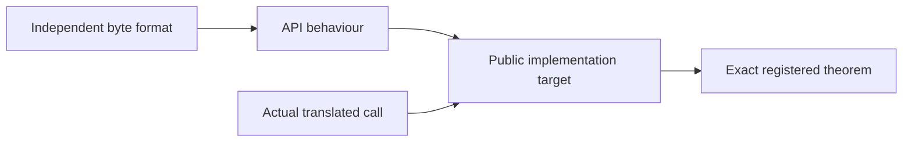

<!--
source: docs/checking/contract-review.md
source-sha256: 1b4dc5ffaf51441be74a3f3a58997cfeea5e93989f0c3f307b262a1ff9afc080
-->

# 公开契约审查记录

本记录解释 95 个默认构建入口契约和八个族目标背后的源码审查与反例。
它不是对语义基线的独立批准。下文关于已检查证明的陈述描述已记录的审查证据；
当前接受仍要求具名提交上的登记和 CI。
当前剩余工作仅列在 [overview](../overview.md)。

## 三层规格

| 层 | 含义 |
| --- | --- |
| `ZlibF/Spec/Format` | 合法的 DEFLATE、zlib 和 gzip 字节、解码及校验和。 |
| `ZlibF/Spec/Api` | 不依赖堆的 API 模型。某些旧模型仅覆盖文档规定的调用模式。 |
| `ZlibF/Spec/Public` | 固定的实现目标：实际执行、调用者定义域、结果、frame 和所有权。 |

`Calls.lean` 固定实际翻译后的入口。
公开目标不能把它换成空执行关系，也不能假设库中的被调用函数满足其规格。
仅有格式或抽象模型证明，不会验证一个公开函数。

## 陈述审查的范围

| 组 | 目标模块 | 已审查的义务 |
| --- | --- | --- |
| 校验和与查询 | `Checksums`, `Queries` | 空缓冲区约定、所有标量值、有符号合并长度、不可变堆和常量表。 |
| 初始化与重置 | `Initialisation`, `Lifecycle`, `Domains` | 版本/错误顺序、每个有符号参数、分配失败、精确清理，以及建立的非空定义域。 |
| 流操作 | `StreamQueries`, `Streams`, `Copy` | 干净拒绝、计数器、部分输出、字典窗口、位插入、界，以及独立复制的所有权。 |
| 缓冲区工具 | `Utilities` | 兼容包装函数、标量单元、尾随输入、内存失败时的部分输出、精确长度和临时清理。 |
| 回调 inflate | `Back` | 实际有限且返回的回调、自适应输入、共享分配的描述符、raw 输出和调用者拥有的窗口。 |
| Gz 句柄 | `GzState`, `GzOpen`, `GzControl`, `GzRead`, `GzWrite`, `GzClose` | 延迟分配、非活跃的悬空字段、恢复、位置、完整项计数、借用消息、已接受字节、定位补零和描述符清理。 |
| 生命周期 | `Sequences`, `GzTrace` | 每个被允许的下一次调用都返回、由初始化建立的不变量、精确分配变化、清理、普通格式阶段，以及完整写入输出。 |

具名已检查结果之外的源码解释，仍需由实现证明确认，即 **to confirm**。
[API 手册](../api/README.md) 解释各项操作。
历史执行笔记和证明状态文字，均不优先于登记表或必要 CI。

## 源码审查带来的修正

审查在目标陈述中识别出以下区别：

- `Uncompress2` 允许晚发生的内存失败之前已经产生输出。
  它与具体工具目标共享数据关系。缓冲区耗尽不意味着未使用的尾随字节能够把流延伸为有效流。
  初始化失败时长度单元可能保持不变；后续失败则保存计数。
- 流查询包含空指针和干净的无效状态拒绝。
  位预置遵循源码对零、负数和溢出的处理顺序。可选输出单元彼此独立地可选。
- 固定版本的 `gz_look` 首先检查四个头部字节。错误方法、标志或较短文件可以选择透明输入。
  后续成员直接进入 inflate。默认缓冲区为 8192 字节；`gzbuffer` 钳制到八，
  并拒绝倍增溢出。格式化拒绝返回流错误，与空结果或超大结果分开处理。
- 头文件不承诺 `gzsetparams` 拒绝每个无效标量。
  对有效参数，成功会更新内部压缩器以及外部字段。
- 回调描述符可以与窗口共享一次分配。它们保留窗口切片；其观察不变量只忽略该切片。
  整函数目标对这些不变量全称量化，因此选择宽松不变量不能完成目标。

这些都是对选定 C 源码的解释，仍为 **to confirm**，需要完整实现证明。
它们出现在已编译命题中，不代表这些命题本身是完整的。

## 旧陈述的反例

独立后续工作使用不可变提交 `a655458` 作为旧规格。
它没有改变公开调用者定义域、翻译后的函数或运行时操作。

| 输入或状态 | 旧陈述的错误 | 修正和已记录证据 |
| --- | --- | --- |
| Raw 字节 `73 04 42 00`，一个输出字节 | 实际首次调用在拉取一个不可能的距离后返回 `Z_OK` 和 `A`。整体预读有效性拒绝该结果。 | 要求存在具有有效补全的支持性比特前缀，并要求每个相容补全都以该输出为前缀。内核证明拒绝旧子句，并检查一个模型见证。成对的 C/翻译回归还包含随后的 `Z_DATA_ERROR`。 |
| 有效 gz 读取句柄、已分配消息、空只读表 | `dropWindow` 通过存储默认值改变了只读表的尺寸。实际 `freeB` 保持该表不变。 | 仅删除字节块。通用定理覆盖每个 `WindowAllocation`；完整的 `gzclearerr` 公开证明检查修正后的目标。 |
| 具有 `2^63` 个解码表槽位的模型状态 | 查询视图遗漏固定 C 数组布局，允许指针相减超出 `ptrdiff_t`。 | 要求实际 1444 项 `codes[ENOUGH]` 布局。一个内核反例保留旧问题；精确的公开 `inflateCodesUsed` 证明检查修正。 |

因果输出修正也适用于共享的 `Uncompress2`。
在畸形预读之后，仅有全称确定性可能空真。
两个修正后的子句都不假设其余预读内容有效。
未改变的解码器模型问题，仍需精化到实际解码器执行。
单独的旧式固定检测滞后子句存在反例；本记录不把该模型视作已批准的实现精化。

清理辅助函数由 `inflateReset`、`inflateReset2`、`gzrewind` 和 `gzclearerr` 共享。
它们分配的块可写，要求同样的字节删除操作。通用效果证明不证明每个调用者。
这是规格表示错误，不是上游缺陷。

查询布局来自 `inflate.h` 和 `inftrees.h` 中 852+592 的界。
已有 `Good` 不变量蕴含该布局。初始化与实际转换必须建立并保留该不变量；
序列目标要求它作为结论。没有增加公开标量限制。

在活状态前提下，deflate 目标还固定流错误分类的两个方向：
无效刷新、无效空缓冲区，或开始完成后进行非 finish 调用。
仅列举允许的错误码，会允许无依据的拒绝。
写入消息的拒绝与较早的无效刷新返回不同；仅后者承诺堆不变。

已记录的模型变异删除因果证据、恢复整体预读有效性，或移除输入前缀要求。
公开 `gzclearerr` 变异省略错误清除或保留 EOF 标志。
拒绝这些变异的检查，测试证明的敏感性。差分比较仍是有限执行证据。

## 高级操作的边界

序列安全性和清理包括所有允许的操作，包括 reset、copy 和恢复。
普通数据阶段把实际接受和产生的字节连接到独立格式，
并包含输出空间充分时的完成。轨迹构造器计算资格标记；证明不能自由选择或清除它们。

一个初始字典描述普通 RFC 流。中途替换 raw 解码器字典，会改变这个上下文。
标记记录该变化；仍要求其逐入口窗口效果和序列安全性。
位预置、头部捕获和恢复也保留具体操作目标。
这组目标尚不等于每种高级组合的完整操作精化。
该边界不免除其安全义务。

Gz 写入历史记录实际调用、已接受输入以及消费的定位零字节。
最后关闭必须产生能解码为这些数据的 gzip 成员，
或在透明模式下产生相同字节。已有文件前缀和尾部都被计入。
只有位置的契约不充分。

## 审查与批准

提出陈述修正，需要不可变的旧、新陈述，C/手册比较，以及对失败问题的解释。
必须区分证明技术问题、错误规格、翻译不匹配和上游缺陷。
内部不变量的反例不能成为缩窄公开前置条件的理由。
初始化和此前调用必须建立替代不变量。被调用函数的契约仍须是已证明的结果。

确认的规格错误应属于独立审查的修改，并附带回归证据和重新生成的锁文件。
就绪性检查覆盖存在性、编译、新鲜重放和锁一致性；它不能判定语义完整性。
提交成为权威基线之前，独立审查必须批准公开定义域、表示限制和运行时。
