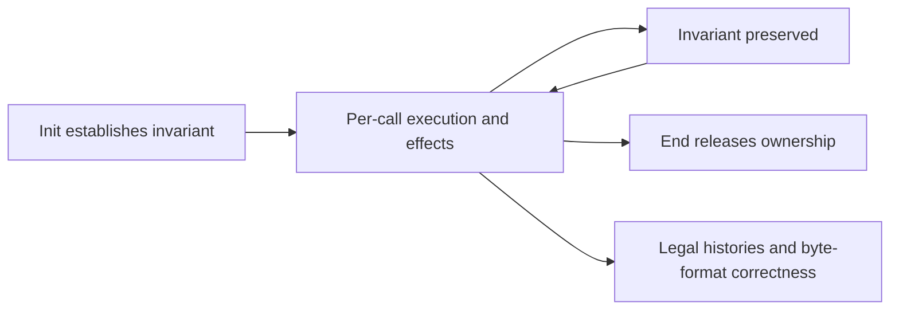

<!--
source: docs/checking/goals.md
source-sha256: b1404fe934f21fc03ca33bb9d57a95445073bbf39a5653f0df2fc2762c5454e3
-->

# 公开验证目标

主张是公开 API 的安全性和文档规定的行为。首个目标是采用默认分配器的默认 x86_64 Linux 静态构建。分配失败属于范围之内。项目也以由上游 CI 构建的每种配置为目标。

`tests/audit/public-api.json` 对照固定版本的 `zlib.h` 固定公开清单。每个入口给出一个翻译函数、一个手册章节及其必需的最终目标。共有 95 个默认构建入口和八项族级义务：四个生命周期契约和四个初始化域契约。仅 Windows 使用的 `gzopen_w` 单独标明。清单入口是一项要求，不是证明。

## 契约覆盖整次调用

| 部分 | 必需陈述 |
| --- | --- |
| 允许域 | 覆盖公开契约允许的每次调用。被拒绝的标量参数有规定的错误路径。在实现中建立内部辅助函数的边界，不将它们增加为调用者要求。 |
| 执行 | 实际翻译入口返回且不产生运行时故障，包括 fuel 耗尽。量化覆盖每个允许的初始堆和分配失败 oracle。空的执行关系不能满足契约。 |
| 结果 | 规定返回码、标量输出、输出字节和流变化，包括错误顺序、部分输出和计数器。错误码本身不蕴含缓冲区未被触碰。 |
| 框架条件 | 保持允许写入范围之外的调用者存储和不相关活对象。 |
| 所有权 | 初始化和复制建立所有权。失败的初始化和复制释放部分分配。结束和关闭恰好释放所拥有资源一次。普通错误保持文档规定的恢复或清理操作可用。 |

具体目标位于 `ZlibF/Spec/Public/`；`Domains.lean` 和 `Sequences.lean` 增加族级义务。`Calls.lean` 固定实际翻译执行。[契约审查](contract-review.md)解释它们与不依赖堆的 API 模型及[独立字节格式](../format/README.md)的分离。任何一种模型定理本身都不能证明具体公开契约。

[API 手册](../api/README.md)解释签名、参数、效果、调用顺序和所有权。一些简短手册描述受限用法。它们的文档前置条件不会从已登记目标中移除情况。[手册范围](../api/contracts.md)和[偏差说明](../deviations.md)明确这些限制。形式化目标变化需要单独审查。

## 生命周期与非空泛性

四个目标覆盖 inflate、deflate、回调 inflate 和 gz 历史。安全性和清理量化覆盖有限合法历史，包括允许情况下的 reset、字典变化、复制、恢复、结束和关闭。副本拥有独立存储，并保持可观察的后续行为。

普通数据阶段把接受和产生的字节与独立格式联系起来。完成的压缩产生有效数据。在兼容的封装、窗口和字典设置下，解压恢复其输入。校验值满足各自的数学定义。高级操作保留各入口的效果和无条件的调用序列安全性；普通数据阶段的精确边界见[契约审查](contract-review.md#the-advanced-operation-boundary)。不能把它误认为每种高级组合的完整精化。

四个初始化域目标要求初始化对于每种文档规定的参数组合，都在成功时建立表示不变量，并在失败时清理。这通过实际初始化使允许域非空。一个方便的见证不能代替对所有参数的全称覆盖。具体见证补充顶层结果。任何最终定理都不能假设未经证明的库内被调用函数契约。

## 调用者假设和语义限制

调用者提供 API 要求的活对象和可读或可写范围。同一个流上的调用依次进行。调用者不修改库拥有的状态。缓冲区重叠条件和标量指针表示限制需要对照公开契约审查。每一项更强限制都属于[偏差说明](../deviations.md)。允许的库调用中出现未定义行为是阻塞项，不是新的调用者限制。

回调和系统调用属于外部。文档规定的内存契约是对它们的假设。终止性还假设它们会返回，并在无限流原本可能永远继续的情况下假设回调输入有限。这不是关于任意调用者代码或操作系统的定理。

主张排除编译器和操作系统正确性、性能、常数时间行为，以及抵御解压炸弹的资源界。畸形压缩数据仍在范围内。受信任的语义限制见[可信基础](../trusted-base.md)。

## 接受

[检查指南](README.md)区分覆盖、开发检查、规格就绪和最终证明接受。每个最终目标都需要精确匹配的已登记定理、允许的公理依赖、由初始化建立的不变量、框架条件和所有权证明，以及函数证明变异。独立审查必须批准问题和基线。全部四项 CI 作业都必须在具名提交上通过。有限差分测试支持忠实性；它们不是证明。当前证明进展和阻塞项只出现在[概览](../overview.md)中。
