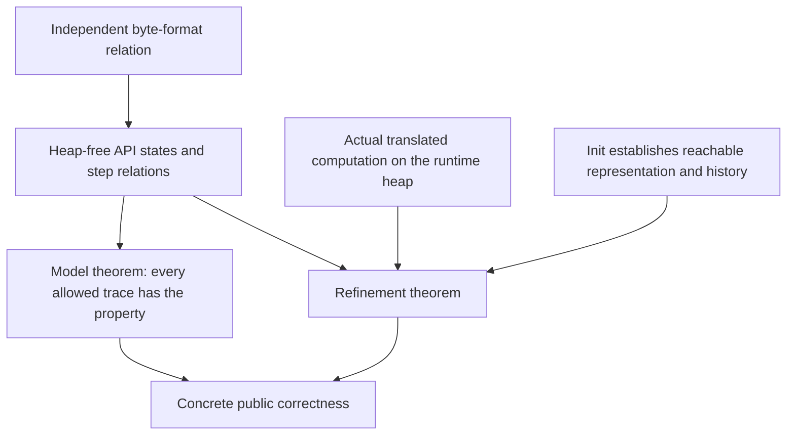

<!--
source: docs/design/api-model.md
source-sha256: 6d89e6c4083e9d3335724208b3a6cd24014526aa2721edc819f43f153cdcbf59
-->

# API 模型与具体边界

本仓库有两类不同的 API 陈述。`ZlibF/Spec/Api/` 中不依赖堆的关系描述字节历史和允许的结果。
`ZlibF/Spec/Public/` 中的具体公开目标指定翻译后的调用及其运行时效果。
关于无堆关系的定理，不等于关于 C 入口的定理。单个调用见
[公开 API 手册](../api/README.md)，接受要求见[目标指南](../checking/goals.md)。

本页解释模型的结构和限制。它不提供缺失的精化证明，也不替代公开目标。
[Overview](../overview.md) 记录当前状态。

## 正确性声明需要的三条连接

模型关系只允许其各个子句写明的行为。证明这些子句的一个推论可能有用，
即使该推论与某个子句非常接近。实现层面实质性的义务是证明实际执行满足每个相关子句。
初始化必须建立具体表示与历史之间的关系。调用者必须使用翻译后的初始化和辅助函数定理来证明
辅助函数的前置条件，不能假设被调用函数的契约成立。

公开目标还包含安全性、frame、所有权、生命周期和精确标量效果，字节历史模型无法表达这些性质。
模型或聚焦手册描述的较窄用法，不会缩小这些目标。参见[表示限制](../deviations.md)。

## 定义位于何处

下列路径相对于 `ZlibF/Spec/Api/`。

| 模块 | 作用 |
| --- | --- |
| `Basic.lean` | 返回码、刷新值、参数检查、封装选择和格式可延续性 |
| `Header.lean` | Gzip 头部请求、输出记录和头部字节 |
| `Inflate.lean` | Inflate 状态、步关系、字典、恢复和回调解码 |
| `Deflate.lean` | Deflate 状态、步关系、刷新历史、字典和界 |
| `Compress.lean` | 单次调用的压缩/解压关系和数值界 |
| `Gz.lean` | 基于抽象文件内容的文件句柄状态机 |
| `Run.lean` | 操作数据类型、族分派和轨迹 |
| `Iface.lean` | 旧式精化目标使用的抽象 `HeapApi` 接口 |
| `Concrete.lean` | 直接运行时执行、成功运行的正确性和选定的压缩器目标 |
| `Goals.lean` | 关于模型和精化的具名命题 |
| `Examples.lean` | 小型模型见证和可计算检查 |

## 状态、调用与历史

`InflState` 记录自重置以来已消费的输入和已交付的输出（`seen`、`out`）。
`DeflState` 记录已接受的输入和已产生的输出（`input`、`produced`）。
一个步骤是诸如 `InflStep st call result st'` 的关系，而不是实现函数。
公开接口允许每次调用取得不同程度的进展，也允许压缩器选择不同的块。
该关系约束这些选择，但不选择某种算法。

轨迹会重新提供未消费的输入，并改变可用输出空间和刷新值。
因此，在所表示的操作族范围内，`InflTrace` 和 `DeflTrace` 支持跨任意分块边界的陈述。
模型的总数使用自然数；LP64 下具体的 `uLong` 总数需要按模 `2^64` 与它们建立关系。

调用记录用 `badBuf` 表示空输出缓冲区，或输入长度非零时的空输入缓冲区。
其中没有实际空指针或重叠内存。这些形状和别名属于具体边界。

数据方面的声明依赖状态的精确性标志。位预置、恢复和关闭校验和验证，
可能使普通的字节格式解释失效。`InflState.Exact` 同时要求精确性和验证。
较弱的数据解释不会免除具体安全性、终止性或精确逐调用效果的要求。

核心历史模型省略 `msg` 和 `data_type`。它把 `adler` 建模为已交付 inflate 输出或
已接受 deflate 输入所对应的校验和。`deflateUsed`、`inflateCodesUsed`、
`zlibCompileFlags` 和校验和合并入口等数值查询，在这里没有完整契约；
它们有单独的具体目标。

## Inflate：输出需要因果证据

`Layer.Decodes wrap wbits dict stream output` 选择独立的 raw、zlib、gzip 或自动封装关系。
对 raw 数据，它使用字典的有效后缀。对 zlib，它还检查头部窗口与配置窗口的关系，
其中零表示采用头部的窗口。

| 关系 | 含义 |
| --- | --- |
| `Layer.Viable` | 字节前缀存在一个完整有效的延续，并允许短头部情况 |
| `Layer.Consistent` | 已消费字节的某个补全具有所提出的输出前缀 |
| `Layer.Determined` | 每个与已消费字节历史相容的完整流，都以该输出为前缀 |
| `Layer.OutputEvidence` | 存在一个支持性比特前缀，它具有有效补全；对每个允许的字典，每个相容补全都以该输出为前缀 |
| `Layer.Detectable` | 按所配置的检测滞后，一个较早字节前缀已不可延续为有效流 |

只有存在性的一致性，允许从有利的未读延续中猜测输出。全称确定性排除了这种情况。
当拉取的预读内容已经包含尚未检查的错误时，支持性比特证据还可以避免空真。
`InflState.Consistent` 使用 `Layer.OutputEvidence`；`InflState.Determined`
单独量化每个允许的字典。二者都出现在普通运行关系和晚发生的内存错误关系中。

未知的预设字典不是空字典。在带封装的流请求字典之前，合法延续仍可能提供该字典。
对于精确、完整窗口的流，数据错误必须对状态仍允许的每个字典都有依据。
一旦字典被提供，该字典就固定下来。

`FullWindow` 标记能够支持格式允许的每个有效距离的配置。
通常的往返目标使用 15 位 inflate 窗口。较小的配置窗口可能拒绝一个本来有效的流，
并且结果依赖调用分块：一个距离可以到达本次调用的输出字节，
而较小的已保存窗口中已不再有这些字节。完整窗口条件限定抽象的拒绝/完成声明，
不是公开安全性的限制。

旧式 `detectLag = 8` 不描述实际 inflate。一个动态表前缀可能在第 230 字节已经不可能有效，
但某次调用消费 281 字节后仍返回 `Z_OK`。
因此，关于 `Goal.inflate_rejects_invalid` 的定理会建立模型性质，而不是该实现的时序声明。
该差异记录在 [overview](../overview.md)；不能通过改变公开输入定义域来隐藏它。

`InflRunOk` 描述游标进展、总数、返回码、停止、格式子句、校验和以及请求的头部字段。
`InflRunMem` 描述调用退出时历史窗口分配失败的情况。
这种失败可以发生在输入读取和非空输出写入之后，而 `total_in`、`total_out` 和 `adler`
仍保留旧值。它进入内存错误阶段。模型的活性声明允许以此结果代替正常完成。
此行为不同于尚未写出输出的早期分配失败。

负 `inflatePrime` 值贡献其低位：模型取模 `2^bits` 的非负余数。
`InflMark` 只描述新状态的情况。`InflSyncPoint` 和输入后的位预置只有部分抽象描述。
`InflGetDict` 描述窗口固定的运行中流。
`InflBack` 把两个回调表示为调用次数的纯函数；该关系不建模任意回调的堆效果。

## Deflate：字节有效性与调用历史

`DeflState.Valid` 把已完成的输出与全部已接受输入和选定封装关联起来。
`DeflState.FlushedAt` 描述完成 sync/full flush 时的输出。
`DeflRun` 还记录待处理字节、缓冲位、校验和更新和返回码条件。

历史 `started` 标志在重置前单调保持，包括被拒绝的调用。
如果拒绝时抹去它，就会允许在封装头部已经写出后改变字典。
模型中的 `done` 标志为真，当且仅当它之前已经为真，或调用返回 `Z_STREAM_END`。
缓冲区错误不结束流。当调用返回 `Z_OK` 且还有输出空间时，模型记录一次已完成的 full flush，
并保留相应的输入/输出分割，用于 raw 重新同步性质。

`DeflState.bound` 给出 `deflateBound` 的数值公式。输出充分性是单独子句，
由模型的 `clean` 标志和精确转换规则保护。
参数改变、位预置、调优、字典改变和刷新，都需要各自的效果记账；
仅有数值公式不能证明输出界。
`compressBound` 是经过饱和处理的默认公式，而抽象 `deflateBound` 公式没有溢出钳制。

字典模型不描述每一种操作用法。Raw `InflSetDict` 仅限于输入前情况，
尽管 C 允许随后修改窗口。`DeflSetDict` 描述文档规定的压缩前顺序，
并拒绝某些 C 在流结束后仍接受的调用。这些限制记录在 [deviations](../deviations.md)。
只有一个初始字典的字节格式阶段，无法表示之后任意的字典替换。

## 单次调用工具：字节与标量单元不同

`Compress2` 是仅描述数据的关系。`CompressCall` 和 `CompressResult` 加入指针形状、
容量和单独存储的长度；`Compress2Z` 保留 `_z` 入口的检查顺序：

1. 拒绝长度非零的空源指针、空长度单元，或容量为正的空目标指针。
   若长度单元存在，其值保持不变。
2. 在初始化前清零已存储长度。无效级别在分配器可能失败之前被拒绝。
3. 容量为零的空目标指针通过这些检查。初始化可能返回内存错误；
   否则内部压缩器拒绝该空目标指针。
4. 对可接受的形状，数据关系给出已写字节和已存储长度。

兼容包装函数在这些检查之前读取长度单元。空单元会故障，不是 `_z` 式的干净参数拒绝。
这些适配器不表示标量单元与输入/输出的别名。
带计数的解压适配器也保持标量单元分离。
`Uncompress2` 同时记录已写输出和已消费输入，并区分输入截断和输出空间不足。
早期与晚发生的分配失败必须保留其不同的标量效果。

`Concrete.execute` 在 `C.Heap` 上运行实际翻译后的计算，保留每个返回的堆并暴露故障。
它不是可替换的关系。`Concrete.Correct` 要求每个允许的初始堆都具有实际成功运行，
并且随后满足给定后置条件。前置条件仍必须可达；函数级不变量由初始化建立，
顶层声明还需要一个具体的允许见证。

`Concrete.lean` 明确区分了两个有用的目标：

| 目标 | 范围 |
| --- | --- |
| `Goal.compress_bound_value` | 两个翻译后界函数对每个 `UInt64` 输入的数值相等性；不声明输出充分性 |
| `Goal.compress2_z_first_alloc_failure` | 首次默认分配失败：内存错误、存储的长度为零、字节块不变且没有额外活块 |

后者把局部流当作自动存储，因此不消费分配器失败索引。
它不描述成功压缩或后续分配失败。

## Gzip 文件：抽象文件不等于操作系统

`GzHandle` 保存文件内容、解码数据、位置、回推字节、写入历史和错误标志。
`GzDecoded` 描述解码内容和终止状态。模型允许外部 I/O 失败；
设置 `failed` 后，其数据承诺停止成立。
具体目标仍必须描述所有权、错误效果和安全清理。

模型表示的源码行为包括四字节 gzip 检测、透明读取、拼接成员、尾随垃圾、
延迟错误交付和截断文件的缓冲区错误。`G` 模式关闭透明读取。
`gzprintf` 接受已格式化字节；它不验证任意 C 可变参数格式化器。

位置关系保留了一个重要区别。压缩读取句柄到达 EOF 后，向前定位可以返回未来位置，
而 `gztell` 在待处理跳过实际执行之前仍停在旧末尾。
透明模式定位重新定位描述符，可以丢弃回推字节，并可以移动到文件末尾之外。
`GzHandle.CopyMode` 区分这种情况。`GzOffset` 只把结果约束为非负数或 -1，
不是精确的描述符位置契约。这些例子说明，抽象 gz 关系不能替代具体的逐函数目标。
此外，`GzDecoded` 的错误后缀子句使用旧的存在性 `Layer.Consistent`，
而不是 `InflState` 使用的因果输出证据关系。
不能把它当作 gzip 读取的完整操作规格。

## 抽象接口必须具有什么含义

`Iface.lean` 中的 `HeapApi` 固定旧式精化目标的类型。
它的字段不是运行时堆的实现。选择空运行关系或不可能成立的匹配关系，不会验证任何东西。

| 字段族 | 具体实例化中要求的解释 |
| --- | --- |
| `Heap`, `Strm`, `GzFile` | 实际运行时堆和所表示的流/句柄引用 |
| `inflMatches`, `deflMatches`, `gzMatches` | 活的具体表示加上模型历史；无关字段保持自由 |
| `*Args` | 操作的实际缓冲区、标量值、尺寸、可写性和必要分离 |
| `*Run`, init/end/copy/back and utility operations | 每种实际执行结果，包括故障、外部失败和分配失败 |
| `*NoState`, `*Disjoint` | 初始化或复制所需的具体无状态条件和分离 |

对 inflate，匹配必须把模式、位缓冲、环形历史、校验和以及回绕总数连接到模型状态。
对 deflate，还必须连接待处理输出、缓冲位和最后一次刷新。
复制匹配必须描述独立拥有的存储中相等的逻辑历史。
回调解码需要明确的回调效果和终止假设。

抽象精化目标要求，每个允许操作之后都无故障且满足匹配关系。
只有实际初始化建立匹配、实际操作保留匹配之后，才能得到序列组合。
无泄漏还需要具体所有权和 frame 陈述；抽象接口不提供它们。
生成的 [schema](../runtime-schema.md) 描述表示字段，不是匹配关系成立的证明。

## 怎样阅读模型目标名称

| `Goals.lean` 中的族 | 性质 |
| --- | --- |
| `format_deterministic`, `format_prefix_free` | 完整格式流具有唯一解码，且不存在完整的真延伸 |
| `inflate_decodes`, `inflate_completes`, `inflate_rejects_invalid` | 模型的精确性/窗口/检测子句下的输出前缀、完成和拒绝 |
| `deflate_valid`, `deflate_completes`, `deflate_full_flush_resync` | 有效的已完成输出、在假定界内完成，以及 raw 重新同步 |
| `roundtrip`, `roundtrip_completes`, `dict_roundtrip`, `header_roundtrip` | 通过独立格式关系进行组合 |
| `deflate_bound_adequate`, `compress_bound_adequate`, `compress_roundtrip` | 相应模型子句关于工具/界的推论 |
| `gz_roundtrip`, `gz_seek_read` | 抽象文件往返和指定的位置情况 |
| `*_refines` | 在具体 `HeapApi` 实例化下，实际执行必须是允许的模型步骤 |

`Examples.lean` 提供小型见证和算术检查。这样的见证建立某个所表示的例子是可能的；
它不建立全称正确性或具体精化。
[检查指南](../checking/README.md) 区分定义、见证、已登记定理和已接受结果。

[设计指南](README.md) · [文档首页](../README.md)
