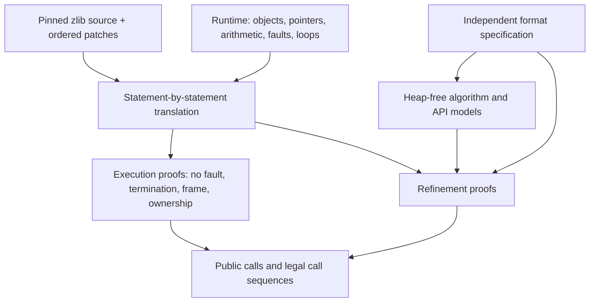
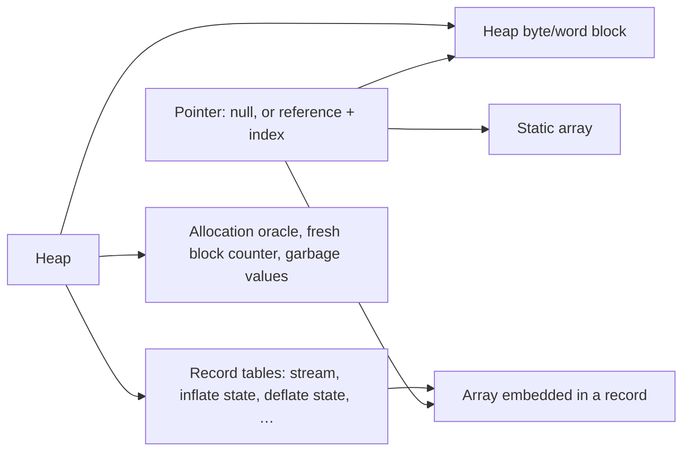

<!--
source: docs/design/architecture.md
source-sha256: 8307c763f1beaaad717eeb2e78fc948f31ddf6129a30bcadab4c6f863115a9de
-->

# 从 C 到经过检查的定理

定理讨论的是一个 Lean 计算。将它应用到 zlib，需要两条经过审查的连接：运行时必须表示相关的 C 操作，
翻译必须符合选定的 C 源码。内核在这些选择确定之后检查证明。它不会检查这两条到 C 的连接。
[信任基础](../trusted-base.md)记录了这个边界。

## 各个层次

| 层次 | 职责 | 根据 |
| --- | --- | --- |
| 选定的 C | 固定被验证的程序 | 固定版本的 `zlib/` 子模块，加上按名称顺序应用的 `patches/*.patch` |
| 运行时 | 为翻译后的操作提供可执行语义 | 独立审查与语义回归测试 |
| 翻译 | 保留 C 语句及其顺序 | 源码审查与差分测试；测试是证据，不是证明 |
| 模型与规格 | 不预先承诺具体实现，说明程序必须做什么 | 审查定义、定义域，以及它们与公开手册和数据格式的关系 |
| 证明 | 将计算连接到这些陈述 | Lean 内核检查与[接受检查](../checking/README.md) |

安全性和功能正确性使用同一组具体状态。不依赖堆的数学内容属于 `ZlibF/Math/`；
不应仅因为某个内存证明使用它，就为它引入堆依赖。
中间算法模型在分离数学推理和内存推理时很有用，但仍需要一个精化证明，将它连接到翻译后的函数。

## 选定源码与模块布局

首个目标是默认 x86_64 Linux 静态构建，采用 LP64 位宽与默认分配器。
分配失败在范围内。其他构建配置和自定义分配器实现属于独立范围，记录在[表示限制](../deviations.md)中。
绝不编辑源码子模块。补丁仅允许用于已经确认的上游缺陷，遵守仓库 `AGENTS.md` 和 `patches/README.md` 中的规则。

| 位置 | 职责 |
| --- | --- |
| `ZlibF/Runtime/` | 堆、指针、故障、循环和建模的库操作 |
| `ZlibF/Zlib/X.c.lean` | `zlib/X.c` 的翻译，以及该文件的规格和证明 |
| `ZlibF/Zlib/X.h.lean` | `zlib/X.h` 的翻译 |
| `ZlibF/Spec/` | 不依赖堆的格式/API 关系，以及具体公开目标 |
| `ZlibF/Math/` | 证明共享的不依赖堆的事实 |
| `tests/` | 差分证据、回归与接受检查 |

大型 C 文件模块可以有辅助子模块。函数名仍使用 C 名称。
函数文档字符串以它的 C 签名开头。[翻译规则](translation.md)详细描述了对应关系。

## 为什么使用对象堆

C 结构体用 Lean 记录表示。堆分别为记录、字节数组、字数组和其他元素种类维护独立的表。
指针由一个对象或嵌入式/静态数组的名称，加上元素索引组成。它不包含机器地址。

这样可以直接进行字段更新和 frame 推理。记录字段是一个投影；修改它就是更新记录。
更新字节不能改变另一张表中的记录。复制整个记录也会复制其中嵌入的数组。
生成的[运行时模式](../runtime-schema.md)给出了完整字段、指针构造器和类型选择。

这种表示有意避免使用 ABI 字节偏移。因此，它不能提供任意结构体的字节视图，
也不能表示标量单元与缓冲区之间所有可能的别名关系。
记录类型不强制数组字段的长度。需要时，由 `WellFormed`、
`Heap.RecordsWellFormed` 和 `Statics.WellFormed` 提供这些事实。
证明必须携带这些事实，或者从表示不变量中导出它们。

## 执行与故障

运行时给出返回值与最终堆，或一个故障。`Fault.ub` 表示模型覆盖的未定义操作。
`Fault.outOfFuel` 表示循环界限耗尽；终止证明要排除它。
[安全性定义](../safety.md)给出了完整义务。

| 操作 | 表示的行为 |
| --- | --- |
| 指针运算 | 保持在一个活数组内，包括其尾后一位位置；解引用尾后一位会产生故障 |
| 加载和存储 | 检查存活性与边界；存储还检查只读状态 |
| 指针差/顺序比较 | 要求同一个活数组和有效偏移；差值必须能用 `ptrdiff_t` 表示 |
| 指针相等比较 | 结构相等；不同引用构造器比较为不相等 |
| 无符号算术 | 按 C 位宽回绕 |
| 有符号算术与移位 | 翻译检查溢出和无效移位计数 |
| 复制/填充 | 检查区间和可写性；`memcpy` 还检查不重叠 |
| 分配 | 使用失败预言机；成功时使用新的块标识 |
| 释放 | 接受 NULL；否则要求指向活的可写块的起点 |
| 循环 | 使用有限界限；耗尽是故障，绝不是普通退出 |

语言操作位于 `Space.lean`、`Monad.lean` 和 `Ptr.lean`。
建模的 C 库操作位于 `Libc.lean` 和生成的 `LibcTables.lean`。
生成的模式和记录访问操作位于 `Schema.lean` 和 `Tables.lean`。

## 证明必须尊重的语义差异

这些是设计限制，不是对 C 的额外断言。权威细节见[信任基础](../trusted-base.md)
和[表示限制](../deviations.md)。

| 差异 | 对证明的影响 |
| --- | --- |
| 新整数单元具有任意值 | 对所有垃圾值函数量化；不能假定为零 |
| 每个新单元在一次运行中保持一个值 | 不能依赖 C 中对未初始化内容的重复读取彼此一致 |
| 新指针字段为 NULL | 建立字段先写后读的事实；仅与 NULL 比较不能建立它 |
| `NULL + 0` 成功；通用 `NULL - NULL` 产生故障 | 单独审查翻译中特有的例外 |
| 相等比较没有相邻对象地址的情形 | 不能用来自不同对象的指针相等关系来论证 C 分支 |
| 没有一般地址、对齐或类型标签 | 显式审查转换和地址敏感路径；结构体没有一般字节视图 |
| CRC 观察地址低位 | 堆字节块采用对齐的起点；静态和嵌入式字节数组具有任意且稳定的起点余数。一般 ABI 布局以及字转换的严格别名问题仍在模型之外 |
| 只读状态覆盖字节块与静态对象 | 不能假定任意记录或字块可以被标为只读 |
| 块标识永不复用 | 分配代码携带 `Fresh`；初始堆也必须具有互异的对象标识 |
| 库复制操作按元素计数 | 正确转换 C 字节计数；整个记录的 `memcpy` 使用检查重叠的记录复制 |

自动存储必须保持 C 中的生命周期，不能消费默认分配器的失败索引。
地址逃逸到调用中的局部变量仍需要表示其存储，并进行清理。
任何证明都不能通过静默限制公开定义域来修补表示缺口。

## 设计决定

这些标识使早期设计讨论保持可追踪。它们描述选定的方法；其可靠性义务仍记录在信任基础和证明指南中。

| ID | 决定 | 义务 |
| --- | --- | --- |
| D1 | 使用带类型化记录表的对象堆 | 论证所表示的操作，并覆盖相关的 C 别名情形。 |
| D2 | 使用局部证明自动化 | 生成的证明项必须通过内核检查；不能用假定正确的验证条件生成器代替证明。 |
| D3 | 手工逐语句翻译 C | 审查对应关系，并保留差分测试作为证据。 |
| D4 | 建模压缩器中重叠的 pending/符号存储 | 对每个允许的内存级别证明生命周期与不覆盖条件。 |
| D5 | 新整数单元取任意值，新指针取 NULL | 对整数垃圾值量化，并证明指针先写后读的历史。 |
| D6 | 避免为记录采用 ABI 字节布局 | 记录字节视图和标量/缓冲区别名需要独立的表示工作。 |

## 组合调用，而不假定调用结果

辅助函数定理证明的是实际翻译后辅助函数的性质。
调用者建立该辅助函数的前置条件，然后使用定理。
辅助函数契约绝不是代替执行的假设。[内部义务](internal-contracts.md)列出了调用者必须建立的条件。

每类状态记录使用一个表示不变量，携带正确性所需的边界、所有权和历史。
初始化建立它；之后的调用保持它；结束函数释放拥有的存储。
这也建立了该不变量可达的事实。
随后，完整序列证明组合这些函数定理，包括拒绝和分配失败情形。
方法见[证明指南](../proof/README.md)，接受结果的条件见[检查指南](../checking/README.md)。

[设计指南](README.md) · [文档首页](../README.md)
