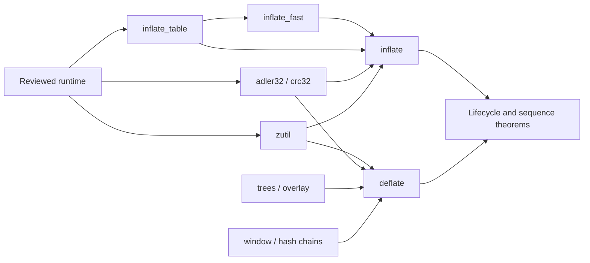

<!--
source: docs/proof/README.md
source-sha256: 105ebba8b9b20cb0d2461746b94d06ab2b2413cce7fa4d8c9156ac17d52ad7ce
-->

# 证明指南

本指南解释把翻译后的 C 与 zlib 契约连接起来的论证。
它区分数学引理、内存推理和跨调用组合。
这些页面是证明计划和说明。
文字论证不是内核检查过的定理，
关于模型的定理也还不是关于翻译后函数的定理。

当前检查点和唯一的剩余工作列表见 [概览](../overview.md)。
所声称的性质见 [安全要求](../safety.md)，
接受一项结果所需的证据见 [检查](../checking/README.md)。
下文的历史证明名称帮助定位早先论证，
它们不认证当前源码、运行时或调用者定义域。

## 选择阅读路径

整体方法从 [证明一个函数](method.md) 开始。
它解释契约、不变量、框架、所有权，以及证明卡住时的诊断。
然后根据函数需要，阅读 [API 契约](../api/README.md)、
[格式规格](../format/README.md) 和 [设计指南](../design/README.md)。

解压方面，先读校验和与分配器页面，再读表构造、快速解码器和主解码器。
主解码器必须建立快速路径的入口条件。
表构造必须建立两个解码器使用的谓词。

压缩方面，先读校验和与分配器页面，
再读 `deflate.c` 中的窗口和哈希链论证。
树构造、位发射和共享输出/符号缓冲区见 `trees.c`。
重叠存储界是内存安全性的一部分。

| 源码 | 指南 | 主要论证 |
| --- | --- | --- |
| `adler32.c` | [Adler-32](adler32.md) | 模求和、有界批次和精确的起始值范围 |
| `crc32.c` | [CRC-32](crc32.md) | 交织读取、地址语义和多项式精化 |
| `zutil.c` | [工具函数与分配](zutil.md) | 分配尺寸、失败、所有权和常量查询 |
| `inftrees.c` | [解码表](inftrees.md) | Canonical code、表容量、覆盖和条目含义 |
| `inffast.c` | [快速解码](inffast.md) | 输入/输出余量、复制、回退和源比特 |
| `inflate.c` | [流式解码](inflate.md) | 模式、历史、字典和跨调用组合 |
| `deflate.c` | [流式压缩](deflate.md) | 窗口界、已初始化的链、策略和生命周期 |
| `trees.c` | [树与块发射](trees.md) | 堆构造、长度修复、编码和重叠存储前缀 |

下方的依赖箭头表示目标使用来源的定理。
它们展示证明顺序，不把任何结点标记为已完成。

## 阅读组件页面

每个页面标明源码和契约术语，
然后解释该函数所需的不变量与引理。
所述的界以旁边写出的前提为条件。
公开定理必须从初始化、先前调用和文档规定的调用者要求取得这些前提。
它不能假设被调函数契约，也不能丢弃合法的 API 情况。

仍待证明的源码解读标记为 **to confirm**。
标识符 `U1`–`U12`、`F1`–`F9` 和 `I-*`
把论证与安全文档、方法和内部契约联系起来。
它们描述的是义务，不是接受状态。

区间 `[a, b)` 包含 `a`，不包含 `b`。
数组指针可以形成 one-past 位置，但不能读取该位置。
无符号运算像 C 中一样回绕。
需要普通算术的证明，必须建立回绕不改变相关数值这一事实。

本指南首先针对默认 x86_64 Linux 构建。
从该构建的字宽、表或分配器分支推出的界，必须在其他配置下重新审查。
[信任边界](../trusted-base.md) 和 [偏离说明](../deviations.md)
仍是每项所声称结果的一部分。
