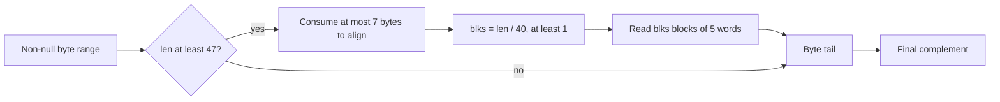

<!--
source: docs/proof/crc32.md
source-sha256: 1fed426d90bf0fbb5cf9d2db5136e735ef5b0718fc8bffd0733531516a59b232
-->

# CRC-32：字节区间、交织与多项式含义

源码：`zlib/crc32.c`；翻译：`ZlibF/Zlib/crc32.c.lean`。
首个目标是默认 x86_64 Linux 分支，使用 `W = 8`、`N = 5`、小端字，
且不使用硬件 CRC 指令。
`F-crc-incremental` 在 [格式指南](../format/README.md) 中规定；
公开辅助函数的定义域见 [API 指南](../api/README.md)。

局部执行证明覆盖每种已表示的字节数组视图及其全部原点余数。
一般 ABI 布局和 C 别名仍是单独的义务。
[概览](../overview.md) 记录当前结果和剩余工作。

## 读取预算

空缓冲区返回 0。否则，函数对传入的 CRC 取反并应用掩码，
可选地处理交织字块，然后处理剩余字节，并返回取反后的结果。

阈值为 `N*W + W - 1 = 47`。
即使先消耗七个对齐字节，仍至少剩下 40 个字节。
因此，在 `while (--blks)` 之前有 `blks ≥ 1`。
循环处理 `blks₀ - 1` 个块，单独的最终块代码处理最后一个块。
若从零开始，计数器将回绕，并破坏读取界。

每个块读取五个 8 字节字，然后前进五个字。
由于 `40 * blks₀ ≤ len_after_alignment`，所有字读取都位于原始区间内。
剩余长度小于 40。在所选分支中，最终尾部在 `len ≥ 8` 时使用展开的字节循环，
随后使用逐字节循环；它不是额外的字读取循环。
每次循环体消耗的字节数，恰好等于从 `len` 中减去的计数。

对每次字节查表，`x & 0xff < 256`。
交织行索引为 `k < W = 8`，每行有 256 个条目。
表值不影响这些索引界。
提取字节的移位使用 `8k ≤ 56`，小于 64 位字宽。
证明还必须在源码应用掩码或转换的位置，保持 CRC 的 32 位解释。
循环度量是剩余字节/块计数或固定行计数器；
它们必须足以论证运行时的 fuel 界。

## 对齐与表示中的地址

源码的对齐测试使用 `buf` 的地址，而不是数组索引。
翻译后的字读取按所选端序把八个字节分组。
忠实的衔接需要建立表示中的对象地址、内部偏移、对齐和有效字节区间之间的关系。
还需要所选 C 分支的访问及别名解释；
仅靠字节分组不能证明这一衔接。

分配得到的字节块保持原点对齐约定。
静态和嵌入字节数组在堆中具有任意且稳定的原点余数。
地址证明把低三个位与具体基址加偏移联系起来，
并表明每种这样的非块布局都可以表示。
公开 CRC 目标不增加对齐前提。

[正向回归](../../tests/verification/regressions/crc-static-address.lean)
保留了原反例中有效的 47 字节静态表输入。
两个 CRC 入口现在都返回独立的校验和，并保持整个堆不变。
一般字节视图证明覆盖所有已表示的数组、种子和可读长度。
剩余的 ABI 和别名限制见 [可信基础](../trusted-base.md) 和 [偏离说明](../deviations.md)。

## 多项式精化

CRC 正确性需要的不只是安全查表。
将 32 位 CRC 解释为 GF(2) 上的多项式，并使用 C 所采用的反射 CRC 多项式。
需要建立字节表递推和交织表递推，
包括初始/最终取反以及字的端序。

一条可复用的路线是先从多项式除法证明表的第一行，
再证明后续各行如何推进递推。
具体条目求值可以在内核中检查所需的基础数据。
这样就不必把表内容当成未经证明的常量。

交织不变量把每个运行中的 CRC 与它对应的字子序列，
以及分隔这些字的 x 的幂联系起来。
随后，GF(2) 上的线性性使按实际顺序执行的最终 `crc_word` 合并有据可依。
尾部将字节递推与合并后的前缀组合。
输入拆分正确性来自多项式连接律。

更早的工作使用了较长的逐条目证明，并给结果命名为
`crc32_z_correct` 和 `multmodp_eq_gf2`。
这些是代数论证的历史参考，不是当前翻译后执行的接受证据。

## 辅助函数契约

| 函数 | 证明边界 |
| --- | --- |
| `crc32` | 保留所选包装函数分支，并把长度参数转换到 `crc32_z` 的定义域。 |
| `crc_word`, `crc_word_big`, `byte_swap` | 固定宽度循环，以及所选构建下精确的端序/多项式含义。 |
| `multmodp(a, b)` | 扫描掩码从位 31 开始。终止要求所表示的 32 位操作数 `a` 中存在置位；源码注释排除了零。使用其乘法定理之前，要从每个调用者的定义域证明这一点。 |
| `x2nmodp(n, k)` | `n` 非负，其右移会终止；`k & 31` 位于具有 32 个条目的表内。证明所表示的 x 的幂满足乘法前提。 |
| `crc32_combine_gen64`, `crc32_combine_gen` | 保留负长度返回 0 的行为，并为允许的长度证明 x 的幂公式。 |
| `crc32_combine_op` | 保留 `op == 0` 时的返回。对于允许的生成算子，满足乘法前提并证明连接效果。 |
| `crc32_combine64`, `crc32_combine` | 组合生成器和算子定理，包括负长度行为及参数转换。 |
| `get_crc_table` | 返回精确的只读静态表指针和目标规定的条目；不分配，也不改变堆。 |

这些函数都需要精确的框架命题。
只读的校验和调用保持调用者存储不变。
静态数据不会变成流拥有的资源。
其他构建分支、动态表初始化和硬件路径，
需要在相同公开契约下给出各自针对源码的论证。
