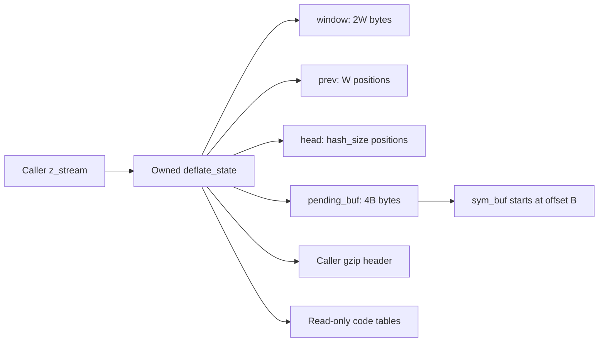
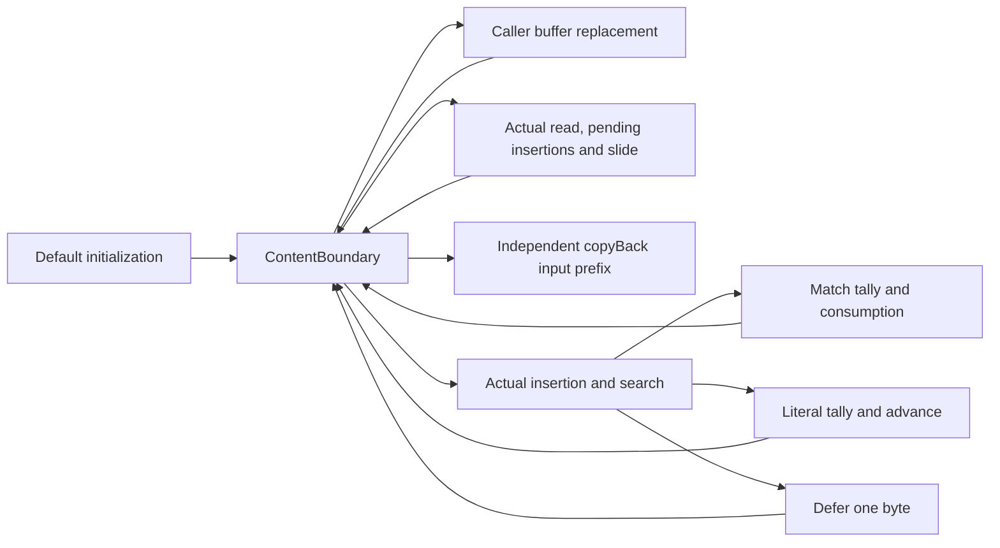
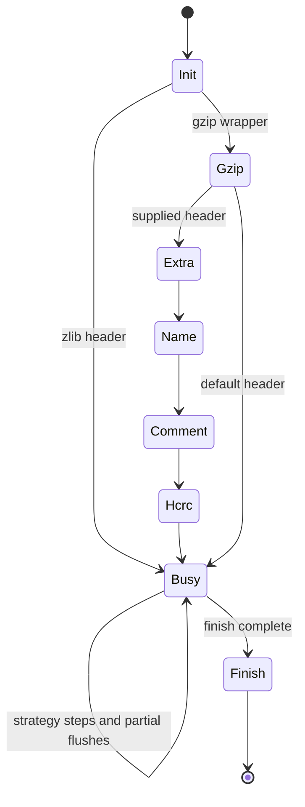
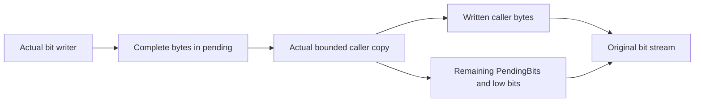
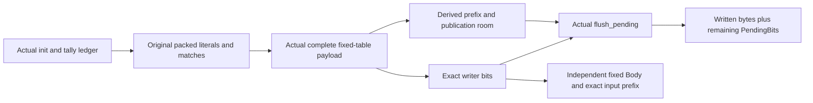
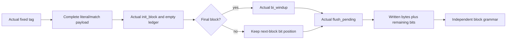
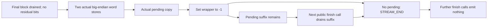
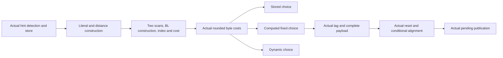

<!--
source: docs/proof/deflate.md
source-sha256: f0c4034feaedf11893faf7c024e80c289403e0308f36de44fbbbdfc50f06767b
-->

# 流式压缩：窗口、链与生命周期

源码：`zlib/deflate.c`；翻译：`ZlibF/Zlib/deflate.c.lean`。
[API 指南](../api/README.md) 给出公开行为。内部契约使用
[内部契约](../design/internal-contracts.md) 中的
`I-fw-*`、`I-sh-*`、`I-hc-inv`、`I-lm-*` 和 `I-fp-*`。
树的构造和共享缓冲区界 F9 在 [树](trees.md) 中说明。

本页给出证明结构及其内部前提。关于 `DGood` 或搜索不变量的条件结果，
需要先通过初始化和保持性建立衔接，才能推出公开接口的正确性。
当前已接受的范围和剩余工作仅记录在 [概览](../overview.md) 中。

## 存储与尺寸等式



流拥有五个块：状态、窗口、`prev`、`head` 和 pending 存储。
调用者拥有流、它的输入/输出视图以及任何 gzip 头部缓冲区。
嵌入的树、堆和深度数组属于状态块。

经过验证的默认构建参数给出以下等式：

| 字段 | 值 |
| --- | --- |
| `w_bits` | 归一化后的窗口参数，其中 8 改为 9 |
| `W = w_size` | `1 << w_bits`，所以 `512 ≤ W ≤ 32768` |
| `window_size` | `2W` |
| `hash_bits`, `hash_size` | `memLevel + 7`、`1 << hash_bits` |
| `B = lit_bufsize` | `1 << (memLevel + 6)`，范围为 128 到 32768 |
| `pending_buf_size` | `4B` |
| `sym_buf`, `sym_end` | `pending_buf + B`、`3(B - 1)` |

这些等式描述默认的共享符号分支；采用不同符号布局等配置时，
需要各自的精化论证。分配尺寸的乘积必须适合分配器的 32 位无符号乘法。
这里最大的缓冲区乘积为 131072 字节。状态尺寸和 ABI 假设是另外的问题。

归一化到 `W ≥ 512` 是关键前提：
`MIN_LOOKAHEAD = 262`、`MAX_MATCH = 258`、`MAX_DIST = W - 262 ≥ 250`。
没有它，256 字节的窗口会使距离减法回绕。

## 符号与有符号块位置

符号账本把每个已存储的三字节符号与同一状态中的叶子频率联系起来。
距离为零表示字面量；距离为正时，存储的是相对于三的长度偏移。
一个符号最多表示 258 个输入字节。符号数最多为 `B - 1`，
因此表示的字节数最多为 `258 * (B - 1)`。
每个字面量/长度叶子的频率最多为符号数加一；
每个距离叶子的频率最多为符号数。多出的一来自实际初始化器建立的结束标记。
这些界使 UInt16 递增有据可依，而不必假设它不会回绕。
实际字面量/长度叶子频率之和恰好等于符号数加一。
距离叶子频率之和最多等于符号数。证明在每个符号所选的叶子中计数一次，
而不是用每个叶子的上界乘以字母表大小。
因此，在源码要求的任何虚拟叶子加入之前，初始树的权重预算最多为 B，
而距离树满足严格界。

块的平衡等式为

```text
strstart - block_start = represented_bytes(symbols) + credit
```

在正常的慢速策略边界处，credit 为零，或因一个延迟字节而为一。
在中间切分点处，它可以为负：记录一个匹配会先减去它的全部长度，
然后源码才前进经过这个匹配。记录字面量减一，遍历一个字节则加一。
滑动会从两个位置中同时减去窗口尺寸，从而保持平衡。
容量界控制负的 block_start，并使经过检查的有符号减法有据可依。
默认内存级别 8 时，B 为 16384；一般的共享缓冲区界允许 B 达到 32768。

初始化衔接必须保留实际的叶子值，而不只是 DGood 中的数组长度。
记录符号的衔接必须在返回的堆上，同时保留实际打包字节及其对应的自然数直方图。
只描述长度的契约无法提供其中任何一项事实。

## D：窗口界与 `fill_window`

形状不变量 **D** 为

```
strstart + lookahead ≤ window_size = 2W
```

初始化时两个计数器均为零。读取输入使 lookahead 增加，
增量不超过窗口可用空间。消耗字节使 `strstart` 前进，
并使 lookahead 减少相同的数量。证明必须在每个使用 D 的入口和策略循环位置建立 D。

`I-fw-pre` 还提供 `lookahead < MIN_LOOKAHEAD`、有效的尺寸/掩码、
`insert ≤ strstart`、有界的高水位、搜索设置以及哈希链不变量。
有了当前的 D，默认分支计算
`more = window_size - lookahead - strstart` 时，相关无符号减法和转换不会造成数值损失。

若 `strstart ≥ W + MAX_DIST = 2W - 262`，则 `more ≤ 262 - lookahead < W`。
滑动把 `W - more` 个字节从 `[W, 2W-more)` 复制到 `[0, W-more)`。
两个区间都位于窗口内且互不相交。代码调整 `match_start`、
`strstart`、有符号的 `block_start`、`insert`、哈希位置和空闲空间。

每项调整都需要自己的类型论证。`strstart ≥ W` 能论证它的减法，
却不能表明 `match_start ≥ W`：无符号的陈旧匹配位置可能回绕，
证明必须说明之后何时可以使用这个值。
有符号的 `block_start -= (long)W` 必须在实际不变量下保持在范围内。
应精确建模源码表达式及其转换。

滑动证明保留一个与源码相等的连续前缀：窗口复制、匹配位置和当前位置、
有符号块位置、插入计数的钳制，然后是两个哈希重新缩放循环。
新的机器 strstart 是旧位置减 W。逻辑输入原点增加 W，
因此即使旧的 match_start 回绕，保留下来的匹配见证仍能继续使用模距离。
私有 pending 字节及其频率账本保持不变。

经过这个前缀后，真实外层循环体在返回的堆上与不滑动的循环体一致。
第一次循环体求值的相等性，给出余下 do-while 计算的相等性，
条件和剩余 fuel 都相同。不滑动执行提供实际的读取、校验和、
重新预置哈希和填充结果。没有输入时，循环体仍然先滑动再退出；
随后一般的高水位证明提供所需填充，不假设新窗口已经填充。

滑动之后，`more += W` 再次度量数据之后的空间。
若仍有输入，`read_buf` 最多把这么多字节复制到
`window + strstart + lookahead`。
插入循环只对可用的三字节字符串求哈希，用掩码把 `ins_h` 限制在 `hash_size`，
并写入相应的 `prev`/`head` 单元。
需要建立待处理的 `insert` 位置与当前窗口内容之间的关系。

高水位初始化的写入不超过 `window_size`：
它或者在新数据之后扩展 `min(window_size-curr, WIN_INIT)`，
或者从旧高水位开始，按期望扩展量与剩余容量中的较小者扩展。
使用各分支的减法之前，要先给出它们的界。
这些写入还支持后续读取的初始化历史。

`I-fw-post-room` 给出 `strstart ≤ window_size - MIN_LOOKAHEAD`。
滑动测试在无输入退出之前执行，因此空间论证也必须覆盖输入结束后的调用。
**to confirm**：每个搜索调用者都能从 D 下足够的 lookahead 或一次 `fill_window`
调用取得这个界，包括策略变化和恢复调用的情形。
对一个循环的源码解读不能为所有策略证明这一点。

只要源码的 lookahead 测试要求补充，非滑动补充就具有真实的空闲空间。
读取从旧的有效终点开始。在当前 strstart 重新预置滚动哈希，
而不是在分配偏移零处重新预置。
源码条件停止外层循环以后，在新的有效终点之后扩展高水位填充。
在逻辑历史中保留调用者输入前缀，并把新接收的字节附加到那里。


## H1/H2：有意义的哈希链读取

源码不初始化 `prev`，而是按需填充。
对于其余槽位的任意内容，安全性都必须成立。
当插入操作记录了一个位置的三字节哈希时，称该位置已被 **插入**；
它的身份随窗口滑动调整，并因清空哈希而失效。位置零为 `NIL`。
把 `T = strstart - W` 解释为数学位置域中的值，使用：

- **H1：** 每个头要么为零，要么是当前所表示数据范围内一个有意义的已插入位置。
- **H2：** 对每个保留下来的已插入位置 `q > T`，`prev[q & wmask]`
  包含它经过滑动调整后记录的前驱：要么为零，
  要么是具有相关哈希的、更小的已插入位置。

这些条款表达 `I-hc-inv`。其精确的时间和范围表述，
必须覆盖 `fill_window`、字典以及策略宏中的插入。
仅仅属于一个已分配的 `prev` 数组，不能证明这类事实。

`CLEAR_HASH` 写入最后一个头，并将之前的头清零。
于是头映射为空，不必初始化每个 `prev` 槽位。
插入操作先写入前驱槽位，再把自己的位置发布到头中。
证明必须跟踪插入顺序，并表明覆盖一个窗口之前的位置所对应的槽位，
不会破坏保留下来的链接。

`slide_hash` 访问每个头和每个 `prev` 槽位。
它按 `m ≥ W ? m-W : 0` 变换每个 16 位值 m。
即使 m 是垃圾值，这也是安全的。对于有意义的链接，
需要证明该变换与新窗口位置一致，并保持掩码槽位，
因为减 W 保持模 W 的余数。被丢弃的位置变为 `NIL`；
任意的未使用槽位仍在 H2 的定义域之外。
`do … while (--n)` 循环以正尺寸开始，并具有固定的界。

字典插入和复制必须保持这些关系。复制整个 `prev` 也会复制垃圾值，
这在运行时规则中是允许的。任何论证都不能推断每个被复制的槽位已经初始化。

## `longest_match`：F5 和 F6

`I-lm-pre` 提供位于 `strstart` 之前的非零匹配头、
最多为 `MAX_DIST` 的距离、H1/H2、空间界、有效的前一个长度，
以及正的有效搜索预算。因此，第一个头位于保留的 H2 范围内。

令 `limit = max(strstart-MAX_DIST, 0)`。
当距离恰好为 `MAX_DIST` 时，第一次循环体可能有 `cur_match = limit`：
这是一个 `do` 循环。继续执行的循环体要求下一个前驱严格大于 limit。
不能把这个继续条件作为第一次循环体的额外前提。

对实际到达的每次前驱读取，H2 表明该槽位已为那个位置初始化，
并包含零或一个更小的有意义位置。循环测试拒绝零和超出范围的前驱。
这就是 **F5**：垃圾值可能被重新缩放，但不会用作链地址。

有界窗口论证是 **F6**。`scan` 从 `window + strstart` 开始，
`match` 从一个更早的有效位置开始。
前一个匹配的哨兵使用至多为 258 的长度。
默认比较循环从偏移 2 开始，以八个字节为一组前进到偏移 258，
因为 `258 - 2 = 8 × 32`。空间前提给出
`strstart + 258 < window_size`，因此每次这样的比较都在范围内。
其他非对齐比较分支需要针对其实际宽度和对齐的证明。

这些比较可能查看真实 lookahead 之外的任意字节。
对于模型中的整数字节，这种读取是允许的，但返回的匹配会被钳制到 lookahead。
功能正确性必须表明所选匹配在真实数据上相等；
仅凭无故障论证，不能证明结果与垃圾值无关。

对于终止性，有意义的前驱位置严格递减。
配置的链预算也限制遍历。**to confirm**：
每当适用该分支时，预算经 `>>= 2` 缩减后仍保持为正，
包括 `deflateTune` 允许的值。
若零预算在递减时回绕，无符号回绕本身有定义；
但它仍会使“预算严格递减到零”这一证明假设失效。
只能使用精确契约能够支持的界。

实际插入结果在不同时间提供两项不同事实。
插入前，返回的非零头位于旧插入前沿之前，而这个前沿不晚于 `strstart`。
插入后，头指向 `strstart`，其前驱单元指向返回的那个头。
用前一项事实论证候选顺序，用后几项事实论证链的来源。
位置零处插入后的 NIL 头，不能约束任意旧的 prev 内容。
堆衔接从 DGood 推出匹配器存储条件，
并从 D 加上足够的 lookahead 推出比较空间。
它不假设匹配器的契约。

慢速策略在插入已消耗匹配的位置之前，先减少 lookahead。
因此，它的插入循环需要三个有效字节，而不是匹配器入口的 262 字节条件。
对于 3 到 258 的前一个长度，源码中的这次更新会留下至少五个 lookahead 字节。
减二之后的正 prev_length 计数器最多为 256。
用这个实际堆计数器作为 do-while 的秩。
每次插入推进已预置的滚动哈希时，保持 strstart 与该计数器之和不变。
源码最后的递增恢复原来的 strstart-plus-lookahead 终点。

当 match_length 小于三时，一个待处理字面量还要求 strstart 为正。
应把这项事实与有条件的匹配见证分开保留。
初始化时没有待处理字面量；源码的每次决策都保持
“存在待处理字面量意味着此前已消耗一个字节”这一蕴含。

结果返回 `min(best_len, lookahead)`，并在改进时更新 `match_start`。
需要为调用者证明其字节相等性和距离事实，
包括保留陈旧匹配状态的情况。

## 策略循环与符号产生

SlowBoundary 把实际拥有的数组与逻辑输入、当前哈希链前沿和延迟匹配历史联系起来。
它还携带符号账本和块平衡。延迟字节 credit 由实际 match_available 标志定义。
初始化建立这个边界，此时没有符号，输入视图为空。

PendingBoundary 加入更早的前沿 strstart-insert。
它描述等待第三个字节的字符串。它记录 insert<=strstart，
并要求 lookahead>=3 时 insert=0。初始化建立两个前沿。
调用者替换缓冲区会保持拥有的数组和两项链事实。
实际预置循环同时推进局部位置并减少堆中的插入计数器。
它停止时，待处理字符串恰好为 min(old insert, 2-lookahead) 个。
滑动将 insert 钳制到新的 strstart；新的下界前沿是旧前沿减一个窗口，
使用截断的自然数减法。完整补充保持相同的逻辑输入前缀、符号账本和块平衡。
公开接口对空输入指针的拒绝在这次内部调用之前已被处理。



不刷新的循环体最多附加一个真实符号。
选中的匹配从一个延迟字节开始，记录完整的前一个匹配长度，
然后前进经过余下的长度减一。其 credit 回到零。
字面量花掉一个 credit，再通过前进一个字节恢复它。
延迟操作不产生符号，并把 credit 从零改为一。
精确的记录框架保留源码写入之外的所有字段。
特别是缓冲区几何关系、block_start、high_water 和封装配置，
都可供下一步证明使用。
补充的框架另外保留滑动、读取、预置和填充写入之外的所有字段。
这在实际补充后的堆上提供策略的符号空间条件。
源码的 Z_NO_FLUSH 守卫会在补充后的 lookahead 较短时，于搜索之前返回 need_more。
否则，完整的搜索/循环体执行从该堆开始。
组合后的迭代核算已接收的字节，并保持绝对输入终点，
包括窗口原点的移动。

ContentBoundary 在绝对块基址处加入一条符号轨迹。
每个字面量都与其累计位置处的输入字节一致。
每个匹配都与正距离前驱逐字节一致，包括该匹配内部的重叠。
该轨迹通过独立格式中的 copyBack 展开为完整输入前缀。
它的终点是 origin+strstart 减去为零或一的延迟字节 credit。
每个实际发射值都保留对应的源码分支证据：
字面量具有一个进入时的延迟字节，保留的匹配长度至少为三。
这些事实把该值放在轨迹终点处。
补充只在旧的已接收终点之后扩展逻辑输入，
因此即使窗口滑动，也会保持之前所有符号的含义。
初始化在调用者替换缓冲区之前建立空轨迹。

字节存储框架保持五个私有对象键之外的原始数组和嵌入深度数组，
以及只读标志和静态字节表。流记录可以推进调用者的游标。
私有所有权键在补充和慢速记录更新中保持不变。
因此，CallerRange 能把未读输入后缀和未改变的输出区间转移到返回的堆。
即使调用者的两个区间共用一个分配，区间分离性仍保持。
真实补充通过读取、延迟插入循环、填充和可选滑动建立此框架。
随后，同一个返回堆同时携带 ContentBoundary、核算和 StreamBuffers。
实际搜索和编码决策也保留这个字节存储框架。
哈希插入改变字表和一个私有状态记录。
匹配消耗通过完整的插入循环保持它。
记录符号只写入私有 pending 字节数组和私有状态。
组合这些效果，就能在每次完整的 Z_NO_FLUSH 迭代之后保持调用者缓冲区。
SlowIterationFrame 精确记录补充与慢速编码所写字段的并集；
未改动的字段包括封装、符号容量和存储几何关系。
源码的返回值要么是先前值，要么是 need_more。

完整的块前循环使用显式内部预算
`3 * (origin + fillEnd + avail_in - base + 1) < sym_end`。
每个符号至少表示一个字节，因此内容账本为每次实际迭代推出记录符号的空间。
已接收终点与调用者未读输入之和保持不变。
这也把预算传递到补充和滑动之后。不假设记录空间契约。

源码返回之后，循环秩为零。否则，它为
`lookahead + avail_in + 1`。
补充在这两项之间转移字节；编码步骤推进绝对已消耗位置。
因此秩严格递减。窗口几何关系和调用者的 UInt32 计数，
推出小于运行时 2^64 fuel 的界。
循环不变量在每个返回堆上组合输入核算、内容前缀一致性、符号列表扩展、
调用者缓冲区有效性以及两个精确框架。

保留的源码停止原因区分“没有输入且 lookahead 较短”和“输出计数耗尽”。
策略在这条路径上不产生输出，因此正的初始输出计数迫使它接收所有输入。
结果通过独立格式中的 copyBack 展开每个已发射符号，并保留延迟字节 credit。
实际默认初始化保持调用者绑定，并推出 sym_end = 49149。
随后，一个 300 字节的具体调用者以非空符号轨迹到达完整内部循环。
这是从初始化到策略的见证，不是公开分派。


| 函数 | 所需不变量与功能步骤 |
| --- | --- |
| `deflate_stored` | 给出直接输入/输出复制、pending 头部重写和窗口保留的界；跟踪 `block_start`、有符号/无符号转换，以及支持后续策略变化的哈希滑动核算。 |
| `deflate_fast` | 插入有意义的位置，证明所选匹配，记录有效符号，并在刷新/返回时保持 D/H1/H2。 |
| `deflate_slow` | 还要把延迟字面量、`prev_length` 和延迟匹配决策与已消耗输入联系起来。 |
| `deflate_rle` | 建立 `strstart-1` 处前一字节读取的条件，以及直到偏移 258 的比较空间；只发射有效的距离一匹配。 |
| `deflate_huff` | 把已消耗字节作为字面量发射，并保持相同的块/刷新不变量。 |

一个符号消耗三个字节，并使 `sym_next` 增加三。
在 `sym_end = 3(B-1)` 处刷新，将每次记录写入限制在符号区内。
对于匹配，存储的长度偏移最多为 255，距离减一最多为 32767，
因此 `_length_code` 和具有 512 个条目的 `_dist_code` 查找均在范围内。
在这个前提下，分支 `256 + (dist >> 7)` 最多为 511。

当 `compress_block` 读取符号时，这些界必须再次成立。
如果 pending 输出覆盖了它，重建的距离可能是任意 16 位值，
表索引则可能达到 767。因此，F9 既保护后续读取，也保护输出写入。
总压缩尺寸界不能建立 F9 的前缀条件。
见 [树](trees.md#the-overlay-lemma-f9)，其中也包括较小的 `memLevel` 情况。

`block_start` 在滑动之后可能变为负数。
此时，块刷新宏传入一个空的原始缓冲区指针，
所以要求处处满足 `0 ≤ block_start` 的不变量是错误的。
**to confirm**：有符号区间和各分支的非负条件，
可以在不隐藏这种情况的前提下，建立每次实际窗口复制及 stored 长度减法的条件。

## `deflate`：头部、数据与尾部



对于第一次默认级别六的 Z_NO_FLUSH 调用，精确的源码切分点
把入口检查、zlib 头部和数据分派连接起来。
算术写出 0x78,0x9c。只有一个输出字节时，会走头部的提前返回路径。
完整头部会更新两个输出游标和发生回绕的总量，并重置 pending 游标。
它的元数据更新保持已初始化的窗口、哈希前沿、叶子频率和空符号账本。
保持尺寸的写入会保留调用者区间安全性，即使两个区间位于同一对象内也是如此。
这个尺寸关系不对它们的内容作出断言。


块前组合在同一个返回堆上保留绝对已接收终点和独立的符号展开。
随后，私有字节框架在调用者输出中保留两个封装字节。
一个 300 字节的具体调用者执行初始化和公开函数，调用后具有非空符号轨迹。
支撑性的首次调用定理明确给出其原始输出、三字节容量和块前预算范围。
当前覆盖范围及剩余精化义务见概览。

实际源码在这些分组内部存在条件跳过和部分返回。
不变量 D7 把 `EXTRA`、`NAME`、`COMMENT` 和 `HCRC` 与有效的 `gzhead` 存储联系起来。
早先的不变量允许空头部指针与 `EXTRA` 同时出现；
该反例表明缺少可达性条件，而不是合法序列定理。

每个头部 `put_byte` 都需要 pending 空间。
extra/name/comment 循环在容量处刷新，
并在输出耗尽时保留精确的进度计数器。
减法 `(extra_len & 0xffff) - gzindex` 需要相应的进度界。
尾部写入需要同样的空间证明。
`flush_pending` 使用 `pending_out + pending ≤ pending_buf + pending_buf_size`，
并最多复制 `avail_out` 个字节，然后更新精确的游标和计数。

对齐的原始输出 flush_pending 证明执行实际的位刷新被调函数，
它保持少于八个的缓冲位不变。
无符号长度选择的自然数值是 min(pending, avail_out)，
包括 pending 不能放入 UInt32 的分支。
选择为零时，在指针访问之前返回。
选择为正时，精确返回堆具有已复制的前缀、两个已推进的指针，
以及发生回绕的输出总量更新。
pending 游标恰在减法为零时重置为 pending_buf。
内部前提要求原始输出对象与 pending 对象不同；
这不是对公开调用者缓冲区定义域的新限制。

完整发布证明先执行实际的 bi_flush 被调函数。
它使 pending 增加 bi_valid/8，并保留 bi_valid%8 个位。
同一个返回堆为 pending 复制提供 DGood。
复制 min(pending, avail_out) 个字节使用不会回绕的计数减法，
推进两个游标，并且仅当没有剩余字节时重置 pending_out。
返回的公开 PendingBits 关系从实际推进后的游标开始。
在它的位之前加上写给调用者的字节，得到写入器原来的位。
证明保留对象身份、分配计数器和完整的旧对象框架，
以及调用者区间尺寸和只读标志。



发布阶段具有 pending_out = pending_buf。
一次容量合适的实际 send_bits 调用保持该游标，
并在同一个堆上建立新的位计数和内容。
默认初始化之后发送一次或两次八个位，
就提供了 bi_flush 字节分支和字分支的具体执行。
每次实际复制的分配变化都为零。
部分复制之后，恢复后的低位定理从 DGood 取得实际游标和分配。
它在该游标处拆分字节，而不是在 pending_buf 处拆分。
合法的调用者缓冲区替换保留完整的公开 PendingBits 序列。
两次调用的组合包括两次实际刷新，以及任意有效的原始输出容量；
两个观测到的输出列表后接最终 pending 位，等于原来的序列。
**to confirm**：为每种块选择建立发布阶段和空间条件，
并在所有公开路径中保持这个阶段。概览跟踪当前范围。

公开的 pending 输出分支现已把两次实际 last_flush 写入
与已证明的 flush_pending 执行组合起来。
当正的输出容量不大于 pending 字节数时，它返回 Z_OK，
记录重试标记 -1，并保持输入不变。
剩余位关系使用返回时推进后的游标。
覆盖所有允许的 flush 标志；FINISH_STATE 入口要求 Z_FINISH，与 C 完全一致。
这组合的是真实入口，而不是假设被调函数契约。
互补的空闲路径排空正的 pending 字节，并留下输出空间。
在 BUSY_STATE 中，当 Z_NO_FLUSH 下没有输入也没有 lookahead 时，
实际头部和数据继续路径返回 Z_OK，
并具有基址 pending 游标、剩余调用者输出容量和正常的 flush 标记。

完整的固定表载荷按原始顺序消耗打包的逻辑符号。
合法字面量最多耗费九个位；合法匹配最多耗费 31 个位，
包括长度和距离的额外位。
若已消耗 i 个符号，它们的输出最多耗费 31*i 个位，
而下一个符号从字节 lit_bufsize+3*i 开始。
实际符号数界和最小缓冲区尺寸推出不越过未读符号的条件与总空间条件。
这里，引擎前提中没有输出空间契约。
对于默认 memLevel 8，载荷与 END_BLOCK 在 65536 字节中最多留下 63486 个 pending 字节。
这还推出完整位发布所需的空间。
实际引擎账本提供计数、打包字节和合法符号值。
发射与 flush_pending 在同一个堆上组合，
保留 DGood、调用者区间、分配/框架事实以及精确位序列。
存储的固定码字也与独立的 canonical code 一致。
长度/距离额外位给出独立的字段值。
完整载荷接受 Symbols 中的每个尾随后缀，包括 END_BLOCK。
实际逻辑轨迹借助独立的 copyBack 处理重叠匹配，
从而把其输出确认为输入前缀。
这个语法结果与实际载荷发射和发布在同一个堆上组合。



所选固定分支现在包括实际经过检查的标签算术。
入口处最多七个位变成载荷入口处最多十个位。
compress_block 之后，真实的 init_block 循环恢复空符号账本，
同时保留 pending 输出和所有位缓冲区字段。
只有之后，源码才在 last 非零时执行 bi_windup。
非最终块保留精确的下一块继续状态。
最终块附加对齐位、清空位缓冲区，并在默认内存下最多使用 63488 个 pending 字节。
完整源码相等性保留另外两个分支和所有准备工作。



对于从字节边界开始并完整发布的最终块，
实际字节对逻辑输入满足独立的 Deflate.Valid。
语法恰好跳过该字节末尾的剩余部分。
这个推论使用一个足够大的 63488 字节调用者视图；
执行和部分发布则允许任意原始调用者容量。
更早的准备和选择仍与这个经过检查的源码分支组合分开。
返回的 BlockOutputFrame 列出每个发生变化的状态记录字段。
窗口、哈希、匹配历史、位置和配置保留原来的值。
重置后的计数器和空叶子频率在发布后的堆上建立。
更早的支撑性命题保持精确的类型，并由更强结果推出。

公开正确性还要把发射的封装字段、块位、校验和及尾部长度
与已消耗输入和所选刷新计划联系起来。
是否已经开始压缩的单调历史在拒绝路径之间很重要：
失败调用不能使后续调用看起来像一个全新的流。

## API 生命周期与错误情况

| 函数 | 证明边界 |
| --- | --- |
| `deflateInit_`, `deflateInit2_` | 验证参数和版本/尺寸；分配状态和四个缓冲区；成功时建立每项字段/所有权条款，失败时释放每次成功的分配。默认分配器不会把存储清零。 |
| `deflateReset`, `deflateResetKeep`, `lm_init` | 区分完整历史/哈希重置与保留状态的行为，并建立适当的阶段不变量。 |
| `deflateEnd` | 对每个允许的状态，将所有拥有的缓冲区和状态恰好释放一次；返回文档规定的状态并清空状态指针。 |
| `deflateSetDictionary`, `deflateGetDictionary` | 读取/复制允许的字典视图，更新封装校验和/历史及有意义的插入，并返回精确的字典后缀。 |
| `deflatePrime` | 使用源码精确的移位，保持非负/负计数行为以及 pending/位缓冲区容量条件。 |
| `deflateParams` | 在改变策略、级别和哈希状态之前，组合任何 `deflate(Z_BLOCK)` 调用及其部分执行/失败效果。 |
| `deflateCopy` | 分配独立块，清理每个失败前缀，只复制源码规定的区间，并重新定位 pending/符号/描述符指针。 |
| `deflateBound`, `deflateBound_z` | 证明机器算术，并另外在契约的配置/头部条件下证明输出充足性。数值公式定理不等于充足性。 |
| `deflateTune`, `deflatePending`, `deflateSetHeader`, `deflateUsed` | 精确的参数/查询/拒绝效果，允许的输出单元写入，以及后续数据调用所需的保持性。 |

复制的窗口内容范围是 `high_water`；其 `prev` 复制包括尚未写入的整数单元。
分配失败可能发生在更早的分配已经成功之后。
证明必须为每种情况保留源码的清理行为，以及目标/源框架。
被调函数契约是已证明的执行结果，绝不是打包进顶层定理的假设。

生命周期定理组合初始化、调用、重置/字典/头部/预置/复制操作以及 End。
随后，往返定理把实际发射的流与独立的 DEFLATE 语义连接起来，
覆盖其定义域内每种允许的拆分、策略、级别和配置。
像 `memLevel ≥ 4` 这样的历史限制，必须在带有该限制的定理中保持显式；
不能把它们当作完整的 `zlib.h` 定义域。

## 完成默认 zlib 封装

源码的结束尾部有两个阶段。它先写出四个校验和字节，
再尽量复制调用者能够接收的 pending 输出。
即使复制是部分完成的，封装标志也会变为负数。
后续调用必须先排空这个 pending 后缀，才能通过负封装分支返回。
这个顺序避免重复的尾部。



内部尾部发布器接受任意原始输出容量。
公开结束入口要求正容量、FINISH_STATE、空的输入和 lookahead、
基址 pending 游标、零个 pending 字节以及零个残留位。
这些是策略完成所提供的阶段事实。
它的 last_flush 范围为 -2..5，与初始化及已接受的标志写入一致。
公开的 pending 排空定理保留推进后的游标，
并要求容量严格大于排队中的后缀。
容量耗尽使用既有的公开 pending 定理。
所有情况都保留完整的已发射位账本。

## 压缩器堆上的树构造

树构造器的精确记录修改范围允许改变选中的树和描述符最大值、
堆和深度工作数组、位长计数以及成本。
所有替换数组都保留原来的长度。
引擎保持性从该修改范围和构造器实际经过检查的树表示推出。
它保留流所有权、调用者缓冲区区间、分配计数和 pending 输出位序列。

嵌入深度字节视图需要自己的尺寸论证。
构造期间其内容会改变，因此精确的字节视图相等性是错误的。
调用者尺寸关系记录其保持的长度。
实际相邻的字面量构造和距离构造组合这些事实，
然后在同一次执行中建立 BL 构造器的输入表示。
不假设任何被调用的规格。

## 完整准备与计算得到的固定选择

实际的正级别前缀先检查公开的 data_type 提示。
UNKNOWN 会对字面量频率执行两次有界的只读扫描。
其安全执行结果保持堆不变，并返回 BINARY 或 TEXT。
有条件的流写入只改变该提示。
随后，字面量、距离和 BL 构造在同一个堆上运行，
包括两次哨兵扫描、BL 搜索和无符号头部成本写入。



固定选择定理返回实际的准备状态，然后显式给出其分支条件：
静态编码舍入后的成本不大于动态编码舍入后的成本，
并且此前的 stored 测试为假。
它在这些计算所得条件下执行整个源码函数，而不是强制使用固定策略。
准备过程保留代码数组、描述符/工作数组、堆控制和成本之外的每个状态字段。
既有固定输出框架提供后续计数器重置和 pending/位变化。
两者共同保留更强引擎不变量所需的窗口、链、匹配历史和配置。
完整原始流推论包括实际树准备、实际选择、真实载荷、重置、填充和复制。
