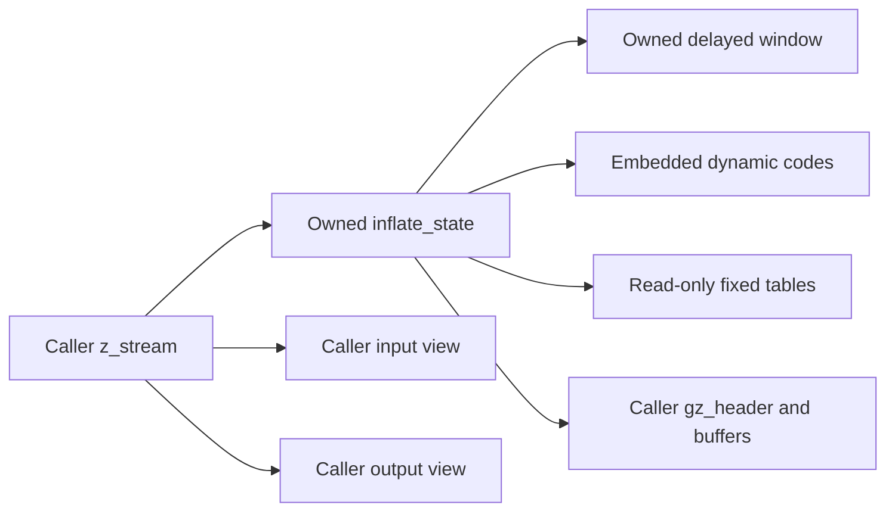
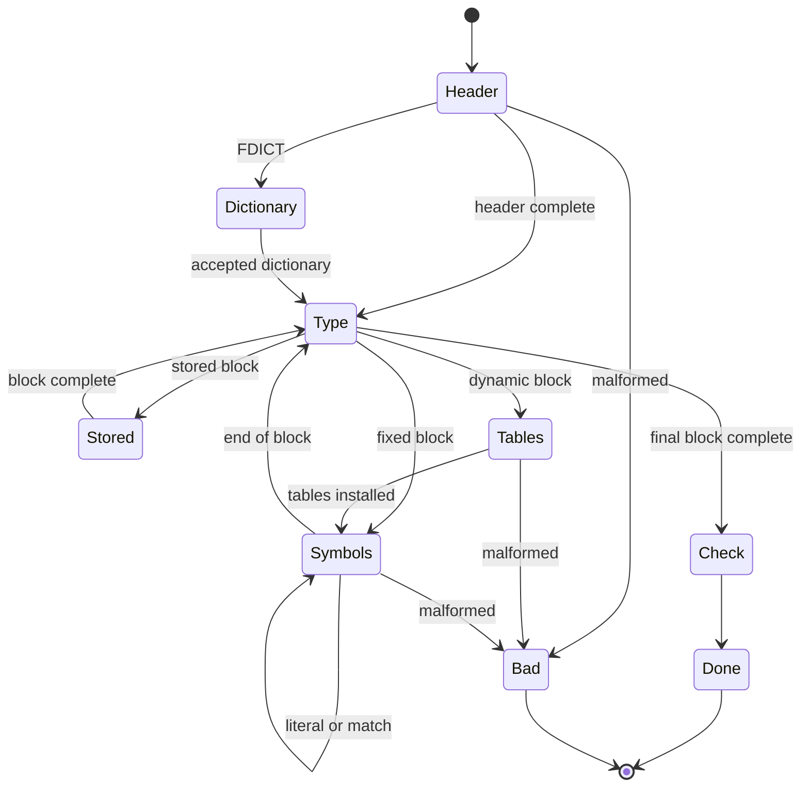

<!--
source: docs/proof/inflate.md
source-sha256: e3dc69b9938660f162d59f6afaaeeaf723d7e5c07a40a99a859a77d2c50f146d
-->

# 流式解码：模式、历史与调用组合

源码：`zlib/inflate.c`；翻译：`ZlibF/Zlib/inflate.c.lean`。
公开行为由 [API 指南](../api/README.md) 描述，解码后的流由
[格式指南](../format/README.md) 描述，窗口更新由
[内部契约](../design/internal-contracts.md) 中的 `I-uw-*` 描述。

证明使用 [解码表](inftrees.md)、[快速解码](inffast.md)、
[Adler-32](adler32.md)、[CRC-32](crc32.md) 和 [分配](zutil.md)。
本页描述这些部分需要支持的组合方式，并不把整个解码器标记为已证明。
[概览](../overview.md) 记录当前进度。

## 内存与所有权

流拥有已分配的状态，以及任何已分配的窗口。`lens[320]`、
`work[288]` 和 `codes[1444]` 嵌在状态中。`lencode` 和 `distcode`
选择静态固定表或 `codes` 中的区域；`next` 跟踪表的构造。
`head` 指向调用者拥有的头部存储。不变量必须记录这些不同情况、
已初始化的范围，以及获准使用的字节视图。

初始化要在指针字段被读取前建立它们的值。运行时把新指针置为 null 的约定
不能证明这个时序事实；见 [安全要求](../safety.md#uninitialised-memory)。
错误模式也属于不变量的覆盖范围，使拒绝或数据错误之后的清理仍然安全。

## 窗口不变量 W 与 F4

用 **W** 表示环形缓冲区的形状：

1. `wsize = 0` 或 `wsize = 2^wbits`。
2. `window` 为 null，或指向已分配的 `2^wbits` 字节块；
   `wsize > 0` 蕴含存储非 null。
3. `whave ≤ wsize`；若 `wsize > 0`，则 `wnext < wsize`；否则 `wnext = 0`。
4. 若 `whave < wsize`，则 `wnext = whave`。

初始化得到空窗口。各个 reset 变体必须分别检查：重置计数器、保留现有存储
和改变窗口大小是不同的操作。只有改变大小并释放存储的路径，才可以移除
对应的所有权主张。

为了证明正确性，还要给 W 加上环中内容的关系：有效的 `whave` 个字节
按环形顺序对应逻辑历史的相应后缀。预设字典字节提供历史，但不成为输出。
仅有形状 W 不能证明回引用返回正确的字节。

### `updatewindow(strm, end, copy)`

`I-uw-pre` 提供可读的源区间 `[end-copy, end)`，以及每次 `memcpy`
所需的不重叠事实。源可以是最近输出，也可以是获准使用的字典范围。
公开调用者必须提供这些事实；不能悄悄排除 API 允许的视图。

若需要分配而分配失败，函数返回 1，并且不获得窗口块。
要证明它对字段和框架条件的精确影响；不能从失败码推断整个堆保持不变。
若分配成功后 `wsize` 为零，则把它设为 `2^wbits`，并初始化
`wnext = whave = 0`。

对于 `copy ≥ wsize`，只保留 `[end-wsize, end)`，写满整个窗口，
并设置 `wnext = 0`、`whave = wsize`。

对于 `copy < wsize`，令 `dist = min(wsize-wnext, copy)`。第一次复制从源前缀
写入 `[wnext, wnext+dist)`。若还有剩余字节，则 `dist = wsize-wnext`；
第二次复制写入 `[0, copy-dist)`，环随之变满。
设置 `wnext = copy-dist`、`whave = wsize`。

若没有剩余字节，则把 `wnext` 增加 dist，并在 `wsize` 处回绕。
若原来的环尚未满，W.4 给出 `whave = wnext`，因此同样的加法把 `whave`
增加到不超过 `wsize`，并在环仍未满时恢复 W.4。若原来已满，则仍然保持满。
这给出形状保持的论证。内容论证通过相同的分支跟踪最新后缀。
还要包括零复制调用，以及针对其实际源视图的精确指针形成过程。

## 各模式的证明

每个实际模式都在一个共同不变量下具有相应的执行情形。
分组视图展示数据流；它不能代替源码中的各个模式或退出路径。

| 源码分组 | 所需的执行事实 |
| --- | --- |
| 入口检查 | 无效的流或参数返回规定的错误，并且恰好产生获准的影响。只有契约明确规定时，才能笼统地声称堆保持不变。 |
| `PULLBYTE` | `have == 0` 时在读取前退出；否则，读取和游标递增消耗一个有效字节。 |
| `NEEDBITS`、`BITS`、`DROPBITS` | 对每个实际请求的位数给出界，并在减法前建立位数足够的事实。仅在移位计数有效时移入字节；默认的 64 位 `hold` 保留已取入的位。 |
| `HEAD` 到 `HCRC` | 验证封装字段；仅在调用者提供的容量内写入 `extra`、`name`、`comment`。在无符号减法前界定 `length` 和进度计数器。 |
| `DICTID`、`DICT` | 保持需要字典的状态和校验和影响；拒绝字典不能凭空产生解码输出。 |
| `STORED`、`COPY` | `copy ≤ min(length, have, left)` 界定两个视图。为 `memcpy` 提供有 API 依据的不重叠条件。 |
| `TABLE` | 默认检查给出 `nlen ≤ 286`、`ndist ≤ 30`，因此 `nlen+ndist ≤ 316 < 320`。 |
| `LENLENS` | `have < ncode ≤ 19` 界定 `order[have]`；零填充补齐供码长表使用的 19 项码长输入。 |
| `CODELENS` | 编码 16 要求存在前一个码长；重复次数检查防止写入超过 `nlen+ndist`。 |
| 安装表 | 证明 `inflate_table` 的执行、表项含义和总预留量 `852+592 = 1444`；安装由此得到的表谓词。 |
| `LEN` 到 `DISTEXT` | 根表和子表读取使用已初始化的表项，并且恰好消耗支撑该结果的编码位和额外位。选中快速路径分支时，证明它的入口前提。 |
| `MATCH`、`LIT` | 界定输出写入，并论证历史或窗口来源的有效性，包括顺序输出中的重叠。 |
| `CHECK`、`LENGTH` | 按定义的宽度，用正确的封装校验和或长度与实际产生的字节比较。 |
| `inf_leave` | 精确写回游标、计数器和位；在需要时更新历史，并保持规定的返回行为。 |

对补充位缓冲的论证，若请求的 `n ≤ 32`，取入字节只发生在 `bits < n` 时；
因此字节的移位计数至多为 31，取入后的位数至多为 39。
其他掩码和丢弃操作需要各自针对源码的界。不能把每次 `BITS` 使用的位数都
当作某个固定的小常数：动态表宽度和链接表项的界来自表谓词。

外层循环需要区分模式的度量。有些转移既不消耗输入，也不产生输出。
要界定取得进展或返回的节点之间的内部转移次数，再把这个界与有限的
输入、输出和复制度量结合起来。仅证明每个模式终止，不能建立完整的 fuel 界。

## 跨调用的因果性与历史

功能正确性必须独立于实现状态确定输出。一个解码后的符号需要一段支撑它的
源位前缀。解码器可能推测性地读取超出该前缀的内容，并可能在离开快速路径前
退回完整的预读字节。要把产生的符号与支撑它的位联系起来；不要要求其含义
与全部推测性预读内容一致。

早先的全部预读内容一致性条件是错误的。修正后的支撑位前缀关系处理了这一区别。
同样，数据错误检测固定滞后八个字节的说法也存在反例。未经证明就增大这个常数，
不能建立因果性的错误定理。这些是规格或模型方面的教训，不是已确认的上游
内存错误。当前反例和接受记录见 [概览](../overview.md)。

跨调用要保持累计的位前缀、输出前缀、逻辑历史、封装和校验和状态，
以及任何字典要求。量化必须覆盖所有允许的输入拆分、输出空间拆分和 flush 值。
后续失败可能发生在实际输出之后：延迟的窗口分配可能在解压已写出字节后返回
`Z_MEM_ERROR`。错误契约必须保留这些影响，而不能要求输出为空。

预设字典引入一个已知的校验和要求，并且可能提供一段在调用者提交字典前
内容尚未知晓的历史。要把这段未知历史与输出字节区分开。
raw 模式中的字典替换、头部操作、位预装和恢复都需要各自精确的 API 影响；
普通数据处理阶段的精化不会自动覆盖每一种这样的序列。
负值位预装也需要通用的位级连接论证，不能只靠有限的执行矩阵或模型见证。

## 生命周期与辅助函数

| 函数 | 证明必须组合的内容 |
| --- | --- |
| `inflateInit_`、`inflateInit2_` | 版本、大小和参数的拒绝路径，状态分配，初始化写入，成功不变量，以及精确的失败清理。 |
| `inflateReset`、`inflateResetKeep`、`inflateReset2` | 各自不同的计数器、历史和头部影响，允许的窗口大小变化，以及相应的所有权转移。 |
| `inflateEnd` | 把窗口和状态各释放一次，清空流的状态，并恢复调用者先前的活块集合。 |
| `inflatePrime` | 负计数重置和非负位插入；移位、低位解释，以及超出位数限制时的拒绝。 |
| `inflateSetDictionary`、`inflateGetDictionary` | 文档规定的字典模式、校验和判定，以及按时间顺序执行的环形复制；历史与产生的输出不同。 |
| `inflateCopy` | 独立的状态和窗口分配及失败清理；复制内容，重新定位动态 `lencode`、`distcode`、`next`，保持静态指针，并证明未来行为等价。 |
| `inflateSync`、`syncsearch` | 有界扫描、恢复状态变化，以及被丢弃输入与重新开始的解码阶段之间的关系。 |
| `inflateGetHeader` | 保存获准使用的调用者存储，并在头部处理完成前保持其生命周期和容量要求。 |
| `inflateMark`、`inflateSyncPoint`、`inflateCodesUsed` | 每个允许模式中的精确数值或查询行为，包括拒绝情形。 |
| `inflateValidate`、`inflateUndermine` | 精确的状态更新、受支持或不受支持的行为，以及不变量保持。 |

对指向动态表和静态表的指针进行大小关系比较，需要在指针模型下审查源码。
历史材料中提到 `inflateCopy` 的 `ub.patch`，不构成采用补丁的授权：
只有 `patches/README.md` 定义选定的补丁集合。

最终的序列定理使用初始化结果，以及各个函数已经证明的保持性、框架条件
和所有权影响。它必须把内部历史和表谓词连接到独立的格式关系。
抽象的 `inflate_decodes` 模型定理或局部快速调用定理，都不能单独提供
这种实现精化。
