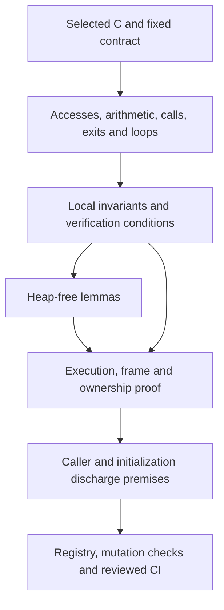
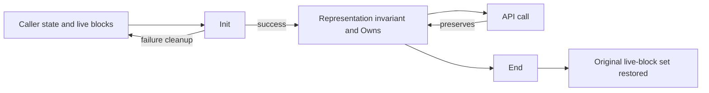

<!--
source: docs/proof/method.md
source-sha256: 9b5a1fb2598757a6c6458f2e8ba0ed3decd162bb7512fa7d3535a75974b80baf
-->

# 证明一个函数

函数证明把逐语句翻译与固定的契约连接起来。它必须建立安全性、终止性、框架条件和精确的所有权效果。功能正确性则把同一次执行及其状态与格式或 API 模型联系起来。[安全要求](../safety.md)定义这些主张；[概览](../overview.md)记录它们当前的接受状态。

## 先固定问题，再开始证明

从选定的 C 源码开始，包括 `patches/README.md` 中列出的补丁。阅读[API 指南](../api/README.md)中的公开要求和[设计指南](../design/README.md)中的内部条件。确定函数必须满足的精确命题。记录调用者的全部要求、错误情况、可写对象和分配效果。

公开前置条件必须覆盖 `zlib.h` 允许的情况。内部定理可以要求表的边界或特定模式的不变量，但调用者必须证明这些要求。任何超出 `zlib.h` 的公开域限制都必须写进定理的文档字符串和[偏差说明](../deviations.md)。

按 C 的顺序执行。保留每个分支、读取、写入和算术转换。无符号算术回绕。有符号运算和无效指针操作必须产生模型规定的故障。不要为了让证明更容易而合并语句，或把源码表达式换成看似等价的表达式。读取发生的时机很重要：在另一处写入之前读取一个字段，可能不同于缓存它更早的值。

## 构建论证

对于每次访问，证明对象仍然存活、指针具有正确形式，并且偏移位于访问范围内。对于指针运算，还要包含尾后一位规则。对于每次移位或有符号运算，建立其取值范围。对于每个循环，给出度量并证明执行符合实际 fuel 上限。数学上的有限循环本身并不证明翻译后的执行不会产生 `Fault.outOfFuel`。

对每个被调用函数使用已经证明的执行定理。从当前状态建立它的前置条件，再使用它的结果、框架条件和所有权效果。禁止使用“被调用函数满足其规格”这样的假设。

不需要堆的算术和组合引理放在 `ZlibF/Math/` 中。内存证明再将它们实例化到实际读取和写入的单元上。例如，只有堆上的精化证明建立 `inflate_table` 确实安装了那些表项后，纯数学的表定理才能用于解码器。

## 诊断卡住的证明

可能有四种原因。调查时不要预先认定程序或规格是正确的。

| 原因 | 要寻找的证据 | 处理方式 |
| --- | --- | --- |
| 证明技术 | 命题与翻译相符，但缺少结构性引理或不变量，导致论证无法推进 | 在尽可能底层证明所需引理。从初始化开始建立并维持任何更强的不变量。 |
| 规格错误 | 某个合法执行与声明的结果或错误行为矛盾 | 解释反例，并停止证明该命题。修正规格需要另行审查的规格变更。 |
| 翻译错误 | 翻译与选定的 C 不同，包括求值顺序或转换 | 通过经过审查的流程修正翻译，并增加差分回归测试。 |
| 真实的 zlib 错误 | 选定的 C 本身在合法输入上失败 | 构造输入，在消毒器下运行 C，并记录复现和范围。 |

缩小调用者的允许域不能解决其中任何一种原因。确认的上游错误可以支持一个与已提交上游修复一致的最小补丁。模型限制不等于上游错误。

## 一个表示不变量

`InflateOK` 和 `DeflateOK` 是预期流不变量的名称。源码中可能包含中间谓词，或 `DGood` 等旧名称；它们与流不变量的关系需要明确的定理。基于此类谓词的条件性结果不是调用序列安全性。

| 不变量 | 证明必须建立的条款 |
| --- | --- |
| `InflateOK` | 所拥有的状态块和窗口块存活且互不相同；模式和位数有效；窗口索引满足 W；表指针选择正确的静态或动态对象；表项及已初始化范围支持每次实际到达的读取。 |
| `DeflateOK` | 状态、窗口、`prev`、`head` 和 pending 存储存活且互不相同；尺寸等式成立；D 约束窗口；H1/H2 描述有意义的哈希链；pending/符号区域满足重叠存储界；树和状态支持实际到达的操作。 |

条款 D7 将 gzip 发射状态 `EXTRA`、`NAME`、`COMMENT` 和 `HCRC` 与非空的 `gzhead` 关联起来。较早的不变量允许空头部下的 `EXTRA`，因此一次条件性的 `deflate(Z_BLOCK)` 执行产生了故障。这是不变量的反例。调用序列证明必须建立合法调用无法到达这种组合。

不变量也携带正确性需要的数据关系。只有边界不能确定解码出的字节。应在同一状态上增加历史或格式关系，并证明它在每一步如何变化。不要为正确性另建一套与流状态脱节的描述。

## 初始化、框架条件和所有权

初始化成功时必须建立表示不变量。它也必须解释每一种分配失败。默认分配不保证存储已经清零：要展示初始化了之后会被读取的每个字段的写入。对于新指针字段，运行时提供 null，却不会检测未初始化读取。这弱于 C。证明必须另外建立每次此类读取之前都有写入；参见[安全要求第 3 节](../safety.md#uninitialised-memory)和[可信基础](../trusted-base.md)。

未初始化整数的读取涵盖任意值。`slide_hash` 可以遍历全部 `prev`，包括尚未写入的槽位，但链遍历只能到达为有意义位置初始化的槽位。模型在一次运行中固定每个垃圾单元的值。如果论证依赖重复垃圾读取保持一致，就需要对照更一般的 C 行为进行审查。

框架条件确定函数可以修改的精确内存：它的流、流拥有的状态，以及该次调用获得授权的调用者范围。调用者输入、不相关块和静态只读表按契约要求保持不变。错误情况有各自精确的效果。有些情况拒绝执行且不写入；另一些情况会更新状态或产生输出后才返回错误。不要从负返回码推导堆保持不变。

`Owns` 跟踪流所拥有的活分配块。分配增加一个新块；释放恰好移除它一次。复制创建独立拥有的块，并重新定位内部指针。结束操作移除所拥有的块。失败的初始化或复制必须释放该次尝试获得的每个块，并保留此前的所有权。无泄漏是由这些包含失败路径的转换在整个生命周期上推出的，而不是只由成功路径推出。

## 非空泛性和组合

初始化定理表明表示不变量能够成立。它必须覆盖允许的参数域和失败行为；不能因为条件性保持容易证明，就接受一个不一致的不变量。顶层主张还需要具体见证。已有模型见证不会自动实例化翻译后的堆 API。

通过对合法调用序列归纳来组合 API 调用。初始化提供第一个不变量。每次调用提供下一个不变量、框架条件和所有权转换。只要公开 API 允许，reset、字典、预置位、恢复、复制和部分缓冲区就都属于这项归纳。功能关系也必须能跨任意输入和输出切分组合。

## 多个证明共用的结构事实

这些标识与组件页面共用。每项事实都需要适用于实际执行的前提，而不是假设一个被调用函数的契约。

| ID | 必需事实 | 使用者 |
| --- | --- | --- |
| F1 | canonical 表的写入保持在预留表内，成功构造的表覆盖所有读取索引 | `inflate_table`、`inflate`、`inflate_fast` |
| F2 | 计数偏移把编码符号排序到不同且已初始化的 `work` 槽位 | `inflate_table` |
| F3 | 实际到达的窗口复制会对照可用历史检查距离 | `inflate`、`inflate_fast` |
| F4 | 在部分填充的环形缓冲区中，`whave < wsize` 蕴含 `wnext = whave` | `updatewindow`、解码器复制 |
| F5 | 哈希遍历到达已插入的位置和已初始化的 `prev` 链接 | `longest_match` |
| F6 | 在调用者的可用空间界下，直至偏移 258 的匹配比较都在窗口内 | `longest_match`、`deflate_rle` |
| F7 | 活跃堆、存储节点和树索引保持在各自数组内 | `build_tree`、`pqdownheap` |
| F8 | 溢出修复能在长度上限以下找到非空类别，并能递减最后一类 | `gen_bitlen` |
| F9 | pending 输出从不覆盖未读符号，并且装得进共享缓冲区 | 块写入函数及后续静态表查找 |

F1 使用 Kraft 和 canonical code 论证。F8 使用严格二叉树和截断后的 Kraft 和。F9 要求实际构造的树满足前缀成本界；比较块的总尺寸是不够的。[表](inftrees.md)和[树](trees.md)的页面给出这些论证及其范围。

## 接受结果

为了让证明可审查，记录源码函数、固定目标、显式允许域、所用的不变量条款、访问足迹、所有权变化、被调用函数的定理、循环度量和数学引理。运行时无法检测遗漏写入时，还要包含指针初始化论证。

变异检查必须修改翻译后的函数，并在该函数的证明内部失败。仅有别处的源码相等性引理失败是不够的。选择能检验该函数实际义务的变异，例如删除检查、改变返回值、写错字段或造成索引差一。

定理必须匹配已登记目标并通过公理审计。完整接受流程还会检查源码/规格锁、变异证据、差分测试，以及同一具名提交上的全部四项 CI 作业。差分测试是忠实性的证据，不是证明。参见[检查](../checking/README.md)和[反作弊要求](../anti-cheating.md)。

较早工作度量过证明规模，并探索过通过生成验证条件来缩短证明。这些估计是方法的动机，不为当前证明的难度或规模建立任何界。无论证明短小还是构建成功，都不能代替接受条件。
