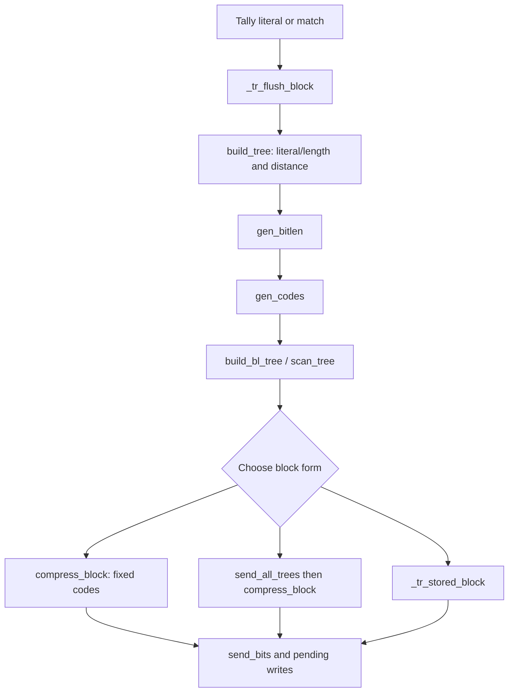

<!--
source: docs/proof/trees.md
source-sha256: 760f17c48d4042651a64e9b77e22a0709fb253817e565e7d5cb050f28a4f9260
-->

# 树与块发射：边界、编码和共享存储

源码：`zlib/trees.c`，符号布局位于 `zlib/deflate.h`。翻译：`ZlibF/Zlib/trees.c.lean`。内部契约使用[内部契约](../design/internal-contracts.md)中的 `I-bt-*`、`I-gb-*`、`I-gc-*`、`I-cb-*`、`I-tf-*`、`I-fp-*` 和 `I-pb-room`。数学编码规则是[格式指南](../format/README.md)中的 `F-code-*`、`F-length-table` 和 `F-distance-table`。

证明必须把实际的树构造、canonical 码字和发射出的比特连接起来。仅有数组安全性不能说明输出是一个 DEFLATE 块。下文的历史结果指出了一些有用的论证，并明确其范围。[概览](../overview.md)记录当前结果和剩余工作。

## 数据流



每条边都要求执行定理和已建立的表示事实。尤其是，块发射必须保护 pending 缓冲区中未读的符号，之后才能在表索引证明中使用它们的值。

## 堆和节点边界：F7

令 `elems` 对字面量/长度树、距离树或位长树分别为 286、30 或 19。`HEAP_SIZE = 573`。`heap`、`depth` 和 `dyn_ltree` 数组各有 573 个条目；`dyn_dtree` 有 61 个，`bl_tree` 有 39 个。

扫描会重置堆计数器、选取非零频率叶子，并初始化所需长度/深度。对于零个或一个活叶子的情况，补足循环最多创建两个不同的活叶子。要从不受限制的旧数组内容出发证明这一点，包括其精确的描述符最大值和无符号成本调整。结果是堆位置 `1..N` 中存在 `2 ≤ N ≤ elems` 个已填入条目。

对于 `pqdownheap(k)`，只有 `j ≤ heap_len` 时才读取左孩子 `j = 2k`；只有 `j < heap_len` 时才读取右孩子 `j+1`。下降会把 k 移到孩子，因此有限堆深度约束了循环和移位。其执行定理必须保留堆的节点置换，并恢复构造器需要的顺序。索引有界并不建立根节点最小。

建堆循环按内部节点的逆序应用该定理。之后的合并循环以 `heap_len = N`、`heap_max = HEAP_SIZE` 和 `node = elems` 开始。完成 t 次合并后，

```
heap_len = N - t
heap_max = HEAP_SIZE - 2t
```

只有 `t ≤ N-2` 时才存在下一次合并。它的两次存储节点写入使用索引 `HEAP_SIZE-2t-1` 和 `HEAP_SIZE-2t-2`。它们为正，并位于活跃堆之上：

```
HEAP_SIZE - 2t - 2 > N - t
```

原因是 `N ≤ 286` 且 `t ≤ N-2`。新节点编号至多为 `elems+N-2 ≤ 2*elems-2`，即 570、58 或 36。它落在选定的树数组内。最后的根写入使用 `HEAP_SIZE-2N+1 ≥ 2`。这些是 **F7** 中主要的数组边界。

完整的合并证明还必须建立孩子互异、父链接、频率和、节点归属和存储顺序。源码层的平局判定在特定时刻读取深度。翻译后的合并表达式必须保留对选中深度的再次读取；缓存更早的深度得到的是另一个程序。每次实际到达的深度读取的初始化历史都属于证明。

深度是无符号字节。深度递增可能按 C 允许的方式回绕。这一点本身不损害内存安全，但不能用来支持使用未回绕深度进行排序或推导重叠存储界的数学主张。此类主张必须建立足够的取值范围，或明确计入回绕。频率和成本字段同样需要其实际位宽和总权重界，包括人工叶子及重置/修复的效果。

## 长度修复：F8

`gen_bitlen` 接收已经构造的严格二叉树、父链接和有序的存储节点区域。令 `L = max_length`，对数据编码为 15，对位长树为 7，并令 n 为叶子数。在 `heap[heap_max..HEAP_SIZE)` 中，根先于其后代：孩子离开优先队列后才构造父节点，而父节点随后被存储在更小的索引处。

第一遍为每个非根节点赋值 `Len = min(Len(parent)+1, L)`。因此 `Len = min(true depth, L)`。`overflow` 统计真实深度超过 L 的每个节点，包括内部节点；它不只是深叶子的数量。该遍历在 `bl_count` 中统计叶子长度，并更新源码精确的成本字段。

### 截断后的 Kraft 恒等式

对于严格二叉树，真实叶子的 Kraft 和为 1。令截断后 `K = Σ_leaves 2^-Len`。真实深度为 L 的每个内部节点 v 都有一棵严格二叉子树，其中包含 `ℓ_v` 个叶子，以及严格位于它下方的 `2ℓ_v-2` 个节点。截断这棵子树会把它的 Kraft 权重从 `2^-L` 提高到 `ℓ_v*2^-L`。深度 L 以下的每个节点恰好属于一棵这样的子树。因此

```
K - 1 = 2^-L Σ_v (ℓ_v - 1)
overflow = Σ_v (2ℓ_v - 2)
K = 1 + (overflow/2) 2^-L
```

特别地，overflow 是偶数。这个恒等式依赖实际的严格二叉树和遍历计数；任意有界叶子长度并不蕴含它。

一次修复找到最高的非空类别 `b < L`，然后执行

```
bl_count[b]--
bl_count[b+1] += 2
bl_count[L]--
overflow -= 2
```

拆分一个叶子会保留 Kraft 权重并增加一个叶子。删除一个长度为 L 的叶子会移除 `2^-L` 和一个叶子。因此修复保持 n 和上面的恒等式，同时将 overflow 减少二。

### 为什么修复不会越出数组

**F8(i)：** 当 overflow 为正时，存在某个非空类别 `1 ≤ b < L`。否则全部 n 个叶子长度均为 L，由带有正 overflow 的恒等式会得到 `n > 2^L`。但描述符给出 `n ≤ 286 < 2^15`，或对位长树给出 `n ≤ 19 < 2^7`。因此向下扫描类别会在到达零或负索引之前停止。

**F8(ii)：** 每次修复入口处，最后一类至少有两个叶子。最初它的数量至少等于深叶子数：

```
a₀ ≥ Σ_v ℓ_v = overflow₀/2 + R ≥ overflow₀/2 + 1
```

其中 R 是 overflow 为正时深度为 L 的内部子树的正数量。每次修复使 a 至多减少一，并使 overflow/2 恰好减少一。因此在继续修复的入口处有 `a ≥ overflow/2 + 1 ≥ 2`。递减不会回绕。中间计数的增加受 n+1 约束，因此也适合其字段。

Overflow 沿非负偶数值递减，因此修复以 K = 1 终止。第二遍为每种长度恰好分配 `bl_count[b]` 个叶子，扫描 `heap[--h]` 并跳过内部节点。`2n-2` 个非根存储节点中有 n 个叶子，因此扫描始终不低于 `heap_max+1`。除这些边界外，还要证明分配顺序和成本修正与源码一致。

结果 `I-gb-len` 给出 `1..L` 中的活叶子长度、计数，以及一个完整前缀码。父节点/树/堆的前提必须来自 `build_tree` 的执行；它们不能是假设的被调用函数契约。

## canonical 码字和树描述

`gen_codes` 先根据 `bl_count` 计算 canonical 起始码字，再为每个正长度符号写入反转的码字，并推进该长度的下一个码字。`I-gc-*` 必须建立精确的反转 canonical 分配、长度保持，以及选定编码单元之外的框架条件。安全性需要显式的数组和长度界；正确性还需要 canonical 编码与计数之间的关系。起始编码算术中的无符号回绕必须与实际翻译操作一致。

每次这样的 `bi_reverse` 调用都具有正计数，至多为 15。它的循环恰好反转相应数量的比特。零长度情况在调用前跳过。实际执行证明必须解释两个循环及其 fuel。

| 函数 | 所需边界和含义 |
| --- | --- |
| `scan_tree` | 位于 `max_code+1` 的哨兵写入落在树内。真实长度为 `0..15`；哨兵 `0xffff` 只用于比较，不用它索引 `bl_tree`。重复符号 16、17 和 18 落在位长树内。 |
| `send_tree` | 它的重复分解与扫描计数一致，并用生成的位长编码重现原来的码长序列。 |
| `build_bl_tree` | 从 18 向 3 扫描时，`bl_order[max_blindex]` 有界；把树成本连接到实际描述。 |
| `send_all_trees` | `blcodes ≤ 19` 和其他计数界为描述符及顺序表访问提供依据；发射出的计数与长度符合格式语法。 |
| `_tr_tally` 和 tally 宏 | 每个存储的字面量/匹配都有规定的长度/距离域和相应频率更新；符号写入落在共享区域内。 |
| 初始化和重置辅助函数 | 在使用者读取之前，建立描述符指针、END_BLOCK 频率、位缓冲状态，以及零值/计数事实。 |

## 比特、pending 字节和 `compress_block`

`I-pb-room` 要求为 `put_byte`/`put_short` 留出一个/两个字节的空间。`send_bits` 要求 `1 ≤ length ≤ 16`、能容纳的值和有效的位缓冲状态。它自身不做容量检查。它或者在 16 位缓冲区内追加，或者写入一个 short 并保留余下部分。每次移位和转换都需要精确到分支的取值范围。

用 **P** 表示计数界。如果从一个基准 pending 位置开始已发送 S 个比特，初始位数为 v，那么 short 写入部分满足

```
pending ≤ base + 2 floor((S + v) / 16)
```

在恰好 16 位的边界处不一定取等号：源码可以把已满的位缓冲保留到下一次写入。当 `v ≤ 7` 时，方便使用的上界为 `pending ≤ base + S/8 + 1`。字节对齐、树头部和最终刷新都需要各自的额外字节计数。

`compress_block` 在发射符号的编码前读取三个符号字节。对于匹配，`lc ≤ 255` 约束 `_length_code[lc]`；它的编码至多为 28，用于索引长度基值/额外位表，以及最高到符号 285 的字面量/长度树。距离减一至多为 32767，因此 `d_code(x) = x < 256 ? _dist_code[x] : _dist_code[256 + (x >> 7)]` 的索引至多为 511。选定的距离编码至多为 29。

这些前提要求符号仍然是统计时的值。覆盖未读距离可能产生任意 16 位值，以及最高达到 767 的索引。因此重叠存储引理既支持 pending 写入安全，也支持静态表读取安全。

## 重叠存储引理 F9

参考论证使用实际 Huffman 构造的性质，包括长度上限修复。仅有满足 Kraft 条件的长度和更小的动态块总成本，并不蕴含前缀安全。参考材料包含对这一较弱蕴含的反例。其纯数学 Fibonacci 和秩修复论证已适配到 `Math/Huffman*.lean`；实际最小值选择与数学合并权重之间的连接位于 `Proof/trees.c.build.fib-step.lean`。


纯数学前缀预算是 `Math/DeflateOverlay.lean` 中的 `Overlay.large_overlay_prefix`。它由有界入口位数、头部成本和加权超额推出；这些数据都要从实际块导出。其默认内存实例是一个里程碑，不是对公开内存级别允许域的更改。当前证据和剩余连接只记录在[概览](../overview.md#default-memory-overlay-route)中。

令 `B = lit_bufsize`。Pending 存储有 `4B` 字节。符号从偏移 B 开始，每个消耗三个字节，数量至多为 `K ≤ B-1`。符号 k 在 `[B+3k, B+3k+3)` 处读取。

**F9 / I-cb-pending：** 发射符号 k 后，

```
pending < B + 3(k+1)
```

而且发射期间的任何写入都不能触及未读后缀。结束码和最终刷新后，要求 `pending ≤ 4B`。符号前的树/头部写入也必须保护符号 0。证明需要这些时间性事实，而不只是最终 pending 计数。

### 入口计数 H0

预期的 **H0** 是在 `_tr_flush_block` 入口处 `pending = 0` 且 `bi_valid ≤ 7`。**to confirm**：对每个调用者、封装头部路径和恢复的部分输出调用导出它。源码会刷新 pending 的位/字节，并可能在输出空间耗尽时返回。新块不能绕过残留的 pending 字节。任何具有不同入口界的路径都需要实际的更强计数前提，不能直接断言 H0。

### 固定块和存储块

对于固定编码，字面量最多花费九位，匹配最多花费 `8 + 5 + 5 + 13 = 31`。固定块增加三位头部和七位结束码。在 H0 和 P 下，发射 q 个符号后（`1 ≤ q ≤ K`），一个方便的界是

```
pending ≤ (7 + 3 + 31q)/8 + 1
```

只要 `(7/8)q + 9/4 < B`，它就小于 `B+3q`。由于 `q ≤ B-1`，`B > 11` 就足够；允许的最小值是 B = 128。精确整数舍入只会改善这个宽松的界。把结束码和最终对齐也计入，才能证明最终的 `4B` 容量。初始余量也保护符号 0 不受三位头部影响。

块选择计算经过舍入的动态和固定字节成本。只有动态成本经舍入后严格小于固定成本，才选择动态输出；存储块要求 `stored_len+4 ≤` 选定成本，并且有可用的原始缓冲区。对于存储块，这个比较和固定成本界共同约束头部加上复制数据。之后不再读取符号，所以一旦选择存储形式，就允许覆盖符号区域。要为实际分支证明字节舍入和入口位数计数。

### 动态块需要前缀界

动态块在符号之前发射树描述：14 个计数位、每个已声明位长编码的三个比特，以及经过重复编码的长度序列。后续数据码长可以达到 15。比较整个动态块与整个固定块，约束的是总量。它不约束每个前缀：较长的早期符号可以出现在较短的后期符号之前。

所需不等式的形式为

```
tree_bits + Σ_(i < q) dynamic_symbol_bits(i)
    < 8(B + 3q) - rounding_and_entry_slack
```

它要对每个发射前缀成立，此外还要有符号 0 之前的树和最终刷新的界。仅有满足 Kraft 条件的码长不能建立这个不等式；它必须使用从块频率实际构造出的树。

较早的工作探索了沿真实 Huffman 路径的 Fibonacci 增长。一个深的低频叶子迫使周围子树具有足够的总权重；形式化的深度/频率定理便可以约束前缀发射成本。记载在较早 `theorems_trees_fib.txt` 中的 `build_tree_fib_stmt_holds` 是历史构造器结果。`dynFits_dynOf_of_fib` 覆盖 `memLevel` 4 和 5，`dynFits_of_push` 在该较早开发中覆盖 6 到 9。复用要求为此翻译导出它们精确的频率、平局判定、深度和成本前提。它们不建立当前整个压缩器的定理。

对于 `memLevel` 1、2 和 3，B 仅为 128、256 和 512。固定编码余量约为 16 到 64 字节，动态描述可能消耗相近的空间。历史搜索没有发现真实块违规，并记录了最接近的情况仍剩余 47 字节。该搜索是证据，不是证明。历史上的 `lowmem_lp_bound` 路线使用线性规划对偶证书；已检查的证书本身并未完成从真实块频率和前缀出发的必要连接。

限制为 `memLevel ≥ 4` 的定理必须声明这一前提，并出现在[偏差说明](../deviations.md)中。它不能支持涵盖 `zlib.h` 允许的每种配置的安全主张。所有重叠存储情况当前的权威处理统一在[概览](../overview.md)中。

## 组件定理必须组合什么

整体结果使用实际的描述符初始化、堆选择与合并、长度修复、canonical 分配、描述发射和块成本选择。它在同一次执行上建立 F7/F8/F9，并为允许的树、符号和 pending 区域之外的全部内存给出框架条件。即使完整的源码相等性引理仍然通过检查，变异也必须使该函数的执行证明失败。对重置/扫描/建堆前缀的证明，不是对未改变的后续合并和发射代码的证明。
