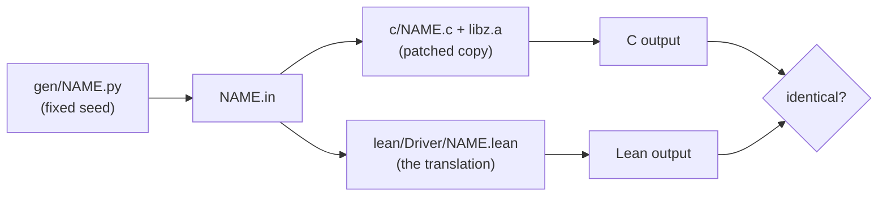

# Differential tests: the Lean translation against the real C

The translation in `ZlibF/Zlib/*.c.lean` is trusted, not proved (`docs/trusted-base.md`). This
directory is the evidence that it matches the C. For each C function, the same inputs go to

* the **real zlib**: the pinned `zlib/` submodule plus `patches/*.patch` in name order, applied to a
  **copy** (the submodule is never touched), built as `libz.a` with `./configure --static`;
* the **Lean translation**, called through the runtime (`C.run`, `C.allocBytes` from `ZlibF.Runtime.Alloc`).

The two outputs are compared byte for byte. This is a test, not a proof: it shows that the two agree on
the inputs tried, nothing more. The drivers import the translation module itself, never a copy, and
sit outside the audit.



## Run

```bash
git submodule update --init zlib            # at the pinned commit
ZLIB_SRC=$PWD/zlib bash tests/run.sh        # builds the patched copy once, then tests
bash tests/selftest.sh                      # mutation check of the harness (reuses tests/build/zlib)
SAN=1 ZLIB_SRC=$PWD/zlib bash tests/run.sh  # the C side under ASan + UBSan
```

`run.sh` needs `cc`, `patch`, `python3`, `tar` and `lake`. Variables: `ZLIB_SRC` (a zlib checkout),
`ZLIB_BUILD` (reuse a copy made by `build-zlib.sh`), `ONLY=name` (one list entry), `SAN=1`. It exits 0 if
all outputs are identical, 1 on the first difference (it prints the input line and both results), 2 on
a setup error. Everything it makes is in `tests/build/` and `tests/.lake/`.

The zlib patches are applied by `build-zlib.sh`, so the C under test is the verified source. A zlib
checkout of another commit gives a meaningless test; the pin is in the `zlib` submodule.

## File formats

One test case per line, fields separated by one space. Blank lines are skipped.

| Field | Written as |
| --- | --- |
| function | its C name (`adler32_z`, ...) |
| unsigned integer | decimal |
| signed integer | decimal, optional `-` |
| buffer | `null:LEN` (a NULL pointer, passed with length LEN) or `hex:DIGITS` (a non-NULL pointer to those bytes; empty digits give a valid pointer to zero bytes) |

The output has one line per input line: the decimal result. The Lean side prints `FAULT ...` if the
translation raises `Fault.ub` or `Fault.outOfFuel`. The C side cannot fault, so a fault is always a
difference (a case the C accepts, and the translation calls undefined). Malformed input prints
`BADINPUT` on both sides and fails the run. Inputs that are undefined behaviour in C (a length larger
than the buffer) must not be generated: both sides would be right to differ.

Types follow the default build, LP64: `uLong`, `z_size_t` are 64 bits, `uInt` 32, `z_off_t` and
`z_off64_t` signed 64.

## Add a C file (for example `crc32.c`)

Five edits. Take `adler32` as the model.

1. `tests/c/crc32.c`: a `main` that reads lines from stdin, dispatches on the first field, calls the
   real function and prints the result. Reuse the parsing helpers of `c/adler32.c` (copy them).
   Allocate buffers with `malloc` of the exact size so that sanitizers see overreads.
2. `tests/lean/Driver/Crc32.lean`: `import ZlibF.Zlib.«crc32.c»` and `DiffTest.Common`, a
   `handle : String → List String → Except String String` that parses the fields (`parseU64`,
   `parseI64`, `parseBuf`) and calls the translation (`withBuf`, `showResult`, `C.run`), and
   `def main : IO UInt32 := mainLoop handle`. When the function has a more complex state (structs,
   several buffers), build the heap with `C.alloc` and print what the C driver prints (for example the
   output buffer in hex), in the same order.
3. `tests/gen/crc32.py`: print the inputs, deterministic (fixed seed, no clock). Include: every
   length up to 40; lengths around every constant in the C (loop unrolling steps, block sizes, table
   sizes: `N-1`, `N`, `N+1`); all-zero, all-`0xff`, ramp and random contents; NULL buffers; non-canonical
   argument values (high bits set, values at and above a modulus); signed arguments at 0, -1, `INT_MIN`,
   `INT_MAX`; and the exact boundary values of every comparison in the code, so that `>=` and `>` give
   different results.
4. `tests/lakefile.toml`: a stanza
   ```toml
   [[lean_exe]]
   name = "difftest_crc32"
   root = "Driver.Crc32"
   srcDir = "lean"
   ```
5. `tests/list.txt`: one line, `crc32`.

Then add `tests/mutations/crc32.tsv` (below) and run `run.sh` and `selftest.sh`. The names must agree:
`c/NAME.c`, `gen/NAME.py`, `difftest_NAME`, `list.txt`, `mutations/NAME.tsv`.

## The mutation check (`selftest.sh`)

Before the slow runs, a preflight checks every selected mutation against the same translation
prefix the runner will keep. Missing targets, unchanged replacements and empty selections fail.
Each suite restores its last mutation before the next suite checks its positive baseline.
`selftest-parallel.sh` runs two disjoint ordinal shards in separate copies. Each keeps its
own positive baselines and build cache; the wrapper fails if either shard fails.

A harness that cannot see a wrong translation is worthless. `selftest.sh` copies the workspace to a
temporary directory, keeps in `ZlibF/Zlib/X.c.lean` only the translation (the text up to the first
line `end Zlib.<Name>`: proofs would not check after a mutation), checks that the harness passes on
this unmutated copy, and then, for each line of `mutations/NAME.tsv`, applies one textual mutation,
rebuilds the Lean driver and runs `run.sh`. Columns, separated by tabs:

`name`, `expect` (`detect` or `same`), `file`, `occurrence` (which match of `old`, 1-based), `old`, `new`.

* `detect`: the mutation changes behaviour; `run.sh` must report a difference.
* `same`: an equivalent mutant (for example a larger `NMAX` that is still a multiple of 16: with a
  64-bit `unsigned long` nothing overflows, so the result cannot change). `run.sh` must pass. These
  lines document why a constant is not tested more tightly; if one is ever reported as a difference,
  the pair of translation and C changed meaning and someone must look.

For a new C file, write at least one mutation per constant, per comparison (`>=` to `>`), per branch
condition and per unrolled step. If a `detect` mutation is not detected, fix `gen/NAME.py` (never the
mutation) until it is. If one cannot be detected because it is equivalent, say so with `same`.

## Results on the adler32 inputs

See the last lines of `run.sh` and `selftest.sh` output. The mutation `combine-sum1-first-ge-to-gt` was
first marked `detect`; the check showed it is equivalent (the second, identical comparison that follows
it removes the difference), and it is now `same`. No input of `gen/adler32.py` had to be added to
catch the others: the boundary cases for `len == 1`, the 16 and 5552 byte steps, and the sums of the
halves in `adler32_combine` were written first and all `detect` mutations were caught by them.

## What this does not cover

* Only the default configuration (LP64 Linux, `NO_DIVIDE` undefined). Other configurations are not
  built.
* Inputs are bounded: lengths up to 20000 bytes. Adler NULL queries use only `null:0`;
  CRC NULL queries also exercise larger lengths. Rare
  paths with larger sizes are not reached.
* Heap behaviour beyond the functions' outputs (for example freed blocks) is only compared when the
  driver prints it.
* The C and Lean sides agree on inputs that are in the domain of the C function. Undefined-behaviour
  inputs are not generated (`SAN=1` checks the C side on the inputs that are).

## `inflate` and `infback`: whole-API drivers

`inflate.c` and `infback.c` are tested through their API, not function by function. `tests/c/inflate.c` and
`tests/lean/Driver/Inflate.lean` make the same calls in the same order: `inflateInit2`, optional `inflateValidate`,
`inflatePrime`, `inflateGetHeader`, `inflateSetDictionary`, then a loop of `inflate` calls on input chunks of a given
size and output buffers of a given size (a fresh malloc'ed buffer of the exact size each time, so that a sanitizer sees an
overread), `inflateSetDictionary` at `Z_NEED_DICT`, optional `inflateCopy` after the second call, optional `inflateSync`
after a data error, and at the end `inflateMark`, `inflateSyncPoint`, `inflateCodesUsed`, `inflateGetDictionary`,
`inflateEnd`. The line holds every return code, counter, the message, the gzip header fields, a trace of the first 24 calls
(return code, unused input, bytes produced) and all the output. The format of a case is in the header of `tests/c/inflate.c`.
`infback` is the same with call-backs: `in` hands out the input in pieces, `out` records what it receives and can fail.

* `inflateCopy` of a stream stopped inside a fixed block is undefined behaviour in the C source (it compares `lencode`
  with `codes`, which are different objects) and a `Fault.ub` in the translation. The C driver reads the state (it includes
  `inflate.h`) and prints the line `FAULT ub comparison of pointers into different objects` in that case, so the Lean
  fault is checked to occur exactly there. The source with `ub.patch` would not need this.
* The Lean driver rebuilds the heap tables between two `inflate` calls (`flatten`): the heap is a chain of closures and a
  long run would make every lookup slow. It changes no value.
* Inputs: zlib, raw and gzip streams made with Python's `zlib` (so the exact bytes depend on the zlib of the machine that
  generates them; both sides read the same file), gzip headers built by hand, hand-made invalid dynamic headers, streams
  corrupted at many places, truncated, with trailing bytes, garbage, every flush value (`Z_BLOCK` and `Z_TREES` stop at
  block boundaries), window sizes smaller and larger than the stream's, dictionaries (right, wrong, missing, longer than the
  window), `Z_SYNC_FLUSH` streams for `inflateSync`.

## Benchmark of the runtime

`bench_store` (`lean/Driver/Bench.lean`) is not a differential test. `bench_store N SIZE` makes `N` stores into a
`SIZE`-byte block and prints the number of changed bytes; `bench_store checksums SIZE` runs `adler32_z` and `crc32_z`
over `SIZE` bytes. Memory and time are read with `/usr/bin/time -f "%e s %M KB"`; the numbers are in
`docs/trusted-base.md`, item 2.

## Platform

The differential tests are run on Linux. The 64-bit entry points of zlib (`adler32_combine64`, `crc32_combine64`, `gzopen64` ...) are declared in `zlib.h` only when the C library defines `_LFS64_LARGEFILE`, which glibc does and some other systems do not; the C drivers define `_LARGEFILE64_SOURCE` but cannot add the declaration where the library does not provide it. A compile error for one of those functions on a non-Linux system is this, not a difference between C and Lean.
